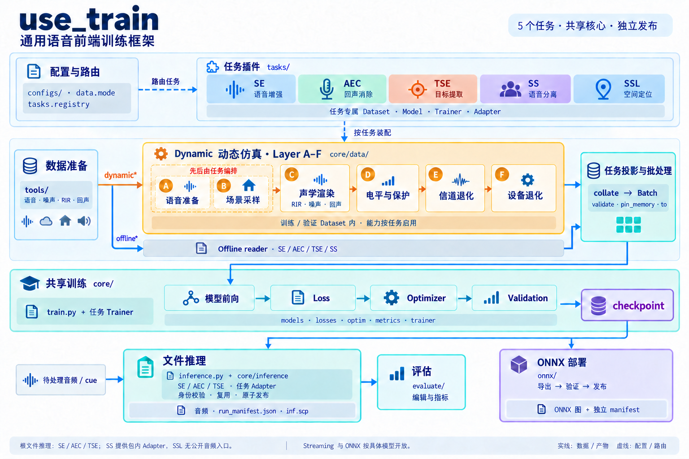

<h1 align="center">🎙️ use_train</h1>

<p align="center">
  <strong>Shared training, evaluation and inference for five speech-processing tasks</strong>
  <br />
  <em>Speech Enhancement · Acoustic Echo Cancellation · Target Speaker Extraction · Speech Separation · Spatial Sound Localization</em>
</p>

<p align="center">
  <a href="#quick-start"></a>
  <a href="LICENSE"></a>
</p>

<p align="center">
  
  
  
</p>

<p align="center">
  English · <a href="README_CN.md">中文</a>
</p>

<p align="center">
  <a href="#overview">Overview</a> ·
  <a href="#tasks-and-models">Tasks &amp; Models</a> ·
  <a href="#quick-start">Quick Start</a> ·
  <a href="#architecture">Architecture</a> ·
  <a href="#documentation">Documentation</a> ·
  <a href="#contributing">Contributing</a> ·
  <a href="#license">License</a> ·
  <a href="#acknowledgements">Acknowledgements</a>
</p>

---

<a id="overview"></a>
## Project Overview

**use_train** supports speech enhancement (SE), acoustic echo cancellation (AEC), target speaker extraction (TSE), speech separation (SS), and spatial sound localization (SSL). Tasks share the training backbone and reusable data, model, loss, and artifact components. Inference and deployment support depend on the task and model.

- **Shared training:** YAML configuration, model/loss registries, and a common training and validation lifecycle.
- **Dynamic simulation:** Layer A–F constructs training and validation samples with task-specific acoustics and degradation; offline modes read prepared data.
- **Task-specific supervision:** speaker and multimodal cues for TSE, source separation with PIT, and spatial targets for SSL.
- **Training controls:** DDP, AMP, EMA, gradient accumulation, checkpoint recovery, and TensorBoard/WandB logging.
- **Evaluation and deployment:** task evaluation pipelines, file inference, and streaming/ONNX paths for supported models.

<a id="tasks-and-models"></a>
## Tasks and Models

All tasks train through `train.py -C <config.yaml>`. The required `data.mode` selects the task and data pipeline; each task link below contains its data setup, recipes, complete model list, and usage.

| Task | `data.mode` | Representative models | Inference / evaluation |
|---|---|---|---|
| [SE · Speech enhancement](tasks/se/README.md) | `dynamic` / `offline` | GTCRN, CoFi-Lite, BSRNN, SpatialNet_SE, PASE family | `inference.py`; `evaluate/eval_pipeline_se.py` |
| [AEC · Echo cancellation](tasks/aec/README.md) | `dynamic_aec` / `offline_aec` | DeepVQE, CAGCRN, DBGNet, LocalVQE | `inference.py`; `evaluate/eval_pipeline_aec.py` |
| [TSE · Target speaker extraction](tasks/tse/README.md) | `dynamic_tse` / `offline_tse` | TSE_BSRNN_SPK, TSE_Modular | `inference.py --tse-manifest`; `evaluate/eval_pipeline_tse.py` |
| [SS · Speech separation](tasks/ss/README.md) | `dynamic_ss` / `offline_ss` | TDANet, TIGER, SpatialNet, OnlineSpatialNet | Package-level `SSExtractor` / `SSInferenceAdapter` |
| [SSL · Sound localization](tasks/ssl/README.md) | `dynamic_ssl` | FixedArrayIPDNet, FNSSL, IPDNetFixed / IPDNetVariable / IPDNet2 | Scene training and evaluation; no root audio-file inference entry |

Root file inference supports SE/AEC/TSE. Streaming and ONNX availability is model-specific; see the [deployment support matrix](onnx/README.md).

<a id="quick-start"></a>
## Quick Start

This example uses the [GTCRN offline recipe](configs/se/voicebank_demand/gtcrn_causal_offline.yaml) with VoiceBank-DEMAND. Run commands from the repository root. Prepare the dataset separately; the example assumes an NVIDIA GPU and `ffmpeg` on `PATH`.

### Install

```bash
conda create -n use_train python=3.10
conda activate use_train
pip install torch==2.4.0 torchvision==0.19.0 torchaudio==2.4.0 \
    --index-url https://download.pytorch.org/whl/cu121
pip install -r requirements.txt
```

### Prepare Data

Extract VoiceBank-DEMAND under `data/se/voicebank_demand/` following the [data guide](configs/se/voicebank_demand/README.md), then build the four SCP files referenced by `data.train` and `data.validation`:

```bash
python tools/prepare_data_tools/scp/prepare_scp.py \
    data/se/voicebank_demand/clean_trainset_wav -o data/se/voicebank_demand/voicebank_clean_train
python tools/prepare_data_tools/scp/prepare_scp.py \
    data/se/voicebank_demand/noisy_trainset_wav -o data/se/voicebank_demand/voicebank_noisy_train
python tools/prepare_data_tools/scp/prepare_scp.py \
    data/se/voicebank_demand/clean_testset_wav/clean_testset_wav -o data/se/voicebank_demand/voicebank_clean_val
python tools/prepare_data_tools/scp/prepare_scp.py \
    data/se/voicebank_demand/noisy_testset_wav/noisy_testset_wav -o data/se/voicebank_demand/voicebank_noisy_val
```

### Train

```bash
CUDA_VISIBLE_DEVICES=0 python train.py \
    -C configs/se/voicebank_demand/gtcrn_causal_offline.yaml
```

This recipe writes training outputs under `exp/se/gtcrn_causal_offline/`. See the [SE training guide](tasks/se/README.md#-训练) for multi-GPU commands and the [checkpoint guide](docs/guides/training/Checkpoint_Format.md) for resume and model-only initialization.

### Run Inference and Evaluation

After training, let the SE pipeline discover the saved configuration and checkpoint:

```bash
python evaluate/eval_pipeline_se.py \
    --exp_dir exp/se/gtcrn_causal_offline \
    --datasets voicebank \
    --voicebank_clean_scp data/se/voicebank_demand/voicebank_clean_val.scp \
    --voicebank_noisy_scp data/se/voicebank_demand/voicebank_noisy_val.scp \
    --step all
```

`--step all` runs inference and reference-based evaluation, producing enhanced audio, inference manifests, and metric reports. Use `--step inference` or `--step evaluate` to run one stage. Separate file inference, optional MOS metrics, and other task commands are covered in the [task guides](#tasks-and-models) and [evaluation guide](evaluate/README.md).

<a id="architecture"></a>
## Architecture and Simulation

`data.mode` routes each configuration through `tasks.registry`. Task packages own their datasets, models, trainers, and adapters; `core/` provides shared implementations and lifecycle management.



**Layer A–F:** A prepares speech; B samples scenarios and sources; C renders acoustics; D controls levels and guards; E adds channel degradation; F adds device degradation. A/B ordering is task-specific.

Dynamic simulation builds training and validation samples inside the Dataset. Offline readers load prepared data. Model inference and ONNX publication use the trained model and their own input/output contracts.

[Editable architecture and support boundaries](docs/diagrams/readme_architecture.md) · [A–F simulation guide](docs/guides/simulation/Simulation_Flow_Logic.md) · [Model architectures](docs/architecture/README.md)

<details>
<summary>Directory structure</summary>

```text
use_train/
├── train.py                 # 训练入口
├── inference.py             # 文件推理入口
├── core/                    # 共享训练、数据、仿真、Loss 与推理生命周期
├── tasks/                   # se / aec / tse / ss / ssl 任务实现
├── configs/                 # 任务与模型配置
├── tools/                   # 数据准备、筛选与运维工具
├── evaluate/                # 评估流水线与指标
├── onnx/                    # 模型导出、验证与发布
├── docs/                    # 架构、使用指南、论文与图表
└── tests/                   # 测试与资源 marker
```

</details>

<a id="documentation"></a>
## Documentation

Use the [documentation index](docs/README.md) for the full collection, or choose a topic below. Model-specific setup stays in the [task guides](#tasks-and-models).

| Topic | Reference |
|---|---|
| Data preparation and filtering | [SCP and dataset tools](tools/prepare_data_tools/README.md) · [Noise Filter Pipeline](tools/noise_filter_pipeline/README.md)（strict JSONL schema v6 / noise source parser v10） |
| Training and recovery | [Training guide](docs/guides/training/README.md) · [Checkpoint format and loading](docs/guides/training/Checkpoint_Format.md) |
| File inference and evaluation | [Inference guide](docs/guides/inference/README.md) · [Evaluation pipelines](evaluate/README.md) |
| Configuration and loss | [Configuration conventions](configs/README.md) · [Loss configuration](docs/guides/loss/Loss_Configuration_Guide.md) |
| Runtime environment variables | [Environment reference](docs/guides/reference/Runtime_Environment_Variables.md) |
| Streaming and ONNX | [Export, verification, and publication](onnx/README.md) |
| Optional dependencies and model assets | [Third-party setup](third_party_scripts/README.md) |
| Research references | [Paper index](docs/paper/README.md) |

<a id="contributing"></a>
## Development and Contributing

- Follow [AGENTS.md](AGENTS.md) for architecture, coding, and repository conventions.
- Update the affected documentation and tests when changing behavior.
- Choose checks by resource requirements; default pytest selection is `unit`. See the [testing guide](tests/README.md).
- Keep commits focused and use English Conventional Commit messages.

<a id="license"></a>
## License

[MIT](LICENSE). Dependencies and third-party models retain their own licenses.

<a id="acknowledgements"></a>
## Acknowledgements

- [SEtrain](https://github.com/Xiaobin-Rong/SEtrain): training structure, losses, and FastEnhancer.
- [URGENT2026](https://github.com/urgent-challenge/urgent2026_challenge_track1): dynamic mixing, channel degradation, and the BSRNN baseline.
- [ESPnet](https://github.com/espnet/espnet): Conformer, TFGridNet, and related module references.

Model sources and citations are maintained with [SE](tasks/se/README.md#-bibtex-引用), [AEC](tasks/aec/README.md#-bibtex-引用), [TSE](tasks/tse/README.md), [SS](tasks/ss/README.md), and [SSL](tasks/ssl/README.md). Evaluation and filtering credits are in the [third-party source index](third_party_scripts/README.md#project-sources). Follow the licenses and citation requirements of the components you use.

---

<p align="center">
  <sub>README last reviewed: 2026-10-08 | Author: xincheng.zhu</sub>
</p>
