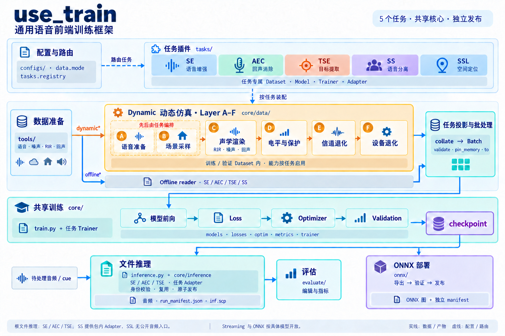

<h1 align="center">use_train</h1>

<p align="center">
  <strong>面向五个语音处理任务的共享训练、评估与推理框架</strong>
  <br />
  <em>语音增强 · 声学回声消除 · 目标说话人提取 · 语音分离 · 空间声学定位</em>
</p>

<p align="center">
  <a href="#quick-start"></a>
  <a href="LICENSE"></a>
</p>

<p align="center">
  
  
  
</p>

<p align="center">
  中文 · <a href="README.md">English</a>
</p>

<p align="center">
  <a href="#overview">项目概览</a> ·
  <a href="#tasks-and-models">任务与模型</a> ·
  <a href="#quick-start">快速开始</a> ·
  <a href="#architecture">架构与仿真</a> ·
  <a href="#documentation">文档导航</a> ·
  <a href="#contributing">开发与贡献</a> ·
  <a href="#license">License</a> ·
  <a href="#acknowledgements">致谢</a>
</p>

---

<a id="overview"></a>
## 项目概览

**use_train** 支持语音增强（SE）、声学回声消除（AEC）、目标说话人提取（TSE）、语音分离（SS）和空间声源定位（SSL）。五任务共用训练骨架，复用数据、模型、Loss 和产物管理组件；推理与部署能力按任务和具体模型开放。

- **共享训练**：YAML 配置、模型与 Loss registry，以及统一的训练和验证生命周期。
- **动态仿真**：Layer A–F 构造训练 / 验证样本，按任务启用声学与退化能力；Offline 模式读取已准备的数据。
- **任务监督**：TSE 的说话人及多模态 cue、SS 的 PIT 源分离监督、SSL 的空间目标。
- **训练控制**：DDP、AMP、EMA、梯度累积、checkpoint 恢复和 TensorBoard/WandB 日志。
- **评估与部署**：任务评估流水线、文件推理，以及支持模型的 Streaming / ONNX 路径。

<a id="tasks-and-models"></a>
## 任务与模型

所有任务统一使用 `train.py -C <config.yaml>`。配置必须显式声明 `data.mode`，用于选择任务与数据管线；下表的任务链接包含数据准备、配置示例、完整模型清单与操作说明。

| 任务 | `data.mode` | 代表模型 | 推理 / 评估入口 |
|---|---|---|---|
| [SE · 语音增强](tasks/se/README.md) | `dynamic` / `offline` | GTCRN、BSRNN、SpatialNet_SE、PASE 系列 | `inference.py`；`evaluate/eval_pipeline_se.py` |
| [AEC · 回声消除](tasks/aec/README.md) | `dynamic_aec` / `offline_aec` | DeepVQE、CAGCRN、DBGNet、LocalVQE | `inference.py`；`evaluate/eval_pipeline_aec.py` |
| [TSE · 目标说话人提取](tasks/tse/README.md) | `dynamic_tse` / `offline_tse` | TSE_BSRNN_SPK、TSE_Modular | `inference.py --tse-manifest`；`evaluate/eval_pipeline_tse.py` |
| [SS · 语音分离](tasks/ss/README.md) | `dynamic_ss` / `offline_ss` | TDANet、TIGER、SpatialNet、OnlineSpatialNet | 包内 `SSExtractor` / `SSInferenceAdapter` |
| [SSL · 空间声源定位](tasks/ssl/README.md) | `dynamic_ssl` | FixedArrayIPDNet、FNSSL、IPDNetFixed / IPDNetVariable / IPDNet2 | 场景训练与评估；无根音频文件推理入口 |

根文件推理开放 SE/AEC/TSE。Streaming 与 ONNX 按具体模型开放，见[部署支持矩阵](onnx/README.md)。

<a id="quick-start"></a>
## 快速开始

以 VoiceBank-DEMAND 和 [GTCRN 离线配置](configs/se/voicebank_demand/gtcrn_causal_offline.yaml) 为例，所有命令在仓库根目录执行。数据集需单独准备；本例使用 NVIDIA GPU，并要求 `PATH` 中可以找到 `ffmpeg`。

### 安装

```bash
conda create -n use_train python=3.10
conda activate use_train
pip install torch==2.4.0 torchvision==0.19.0 torchaudio==2.4.0 \
    --index-url https://download.pytorch.org/whl/cu121
pip install -r requirements.txt
```

### 准备数据

按[数据指南](configs/se/voicebank_demand/README_CN.md)将 VoiceBank-DEMAND 解压到 `data/se/voicebank_demand/`，然后生成 `data.train` 与 `data.validation` 引用的四份 SCP：

```bash
python tools/prepare_data_tools/scp/prepare_scp.py \
    data/se/voicebank_demand/clean_trainset_wav -o data/se/voicebank_demand/voicebank_clean_train
python tools/prepare_data_tools/scp/prepare_scp.py \
    data/se/voicebank_demand/noisy_trainset_wav -o data/se/voicebank_demand/voicebank_noisy_train
python tools/prepare_data_tools/scp/prepare_scp.py \
    data/se/voicebank_demand/clean_testset_wav/clean_testset_wav -o data/se/voicebank_demand/voicebank_clean_val
python tools/prepare_data_tools/scp/prepare_scp.py \
    data/se/voicebank_demand/noisy_testset_wav/noisy_testset_wav -o data/se/voicebank_demand/voicebank_noisy_val
```

### 训练

```bash
CUDA_VISIBLE_DEVICES=0 python train.py \
    -C configs/se/voicebank_demand/gtcrn_causal_offline.yaml
```

本配置的训练产物写入 `exp/se/gtcrn_causal_offline/`。多卡命令见 [SE 训练指南](tasks/se/README.md#-训练)，恢复训练与 model-only 初始化见 [checkpoint 指南](docs/guides/training/Checkpoint_Format.md)。

### 推理与评估

训练完成后，由 SE 流水线自动查找保存的配置与 checkpoint：

```bash
python evaluate/eval_pipeline_se.py \
    --exp_dir exp/se/gtcrn_causal_offline \
    --datasets voicebank \
    --voicebank_clean_scp data/se/voicebank_demand/voicebank_clean_val.scp \
    --voicebank_noisy_scp data/se/voicebank_demand/voicebank_noisy_val.scp \
    --step all
```

`--step all` 执行推理和有参考指标评估，产出增强音频、推理清单和指标报告。单独运行一个阶段可使用 `--step inference` 或 `--step evaluate`。独立文件推理、可选 MOS 指标与其他任务命令见[任务指南](#tasks-and-models)和[评估指南](evaluate/README.md)。

<a id="architecture"></a>
## 架构与仿真

配置通过 `data.mode` 和 `tasks.registry` 路由。任务包负责 Dataset、模型、Trainer 与 Adapter，`core/` 提供共享实现和生命周期管理。



**Layer A–F：** A 准备语音，B 采样场景与声源，C 渲染声学环境，D 调整电平与保护，E 模拟信道退化，F 模拟设备退化；A/B 的先后由任务编排。

动态仿真在 Dataset 内构造训练 / 验证样本，Offline reader 读取已准备的数据。模型推理和 ONNX 发布使用训练后的模型及各自的输入输出合同。

[可编辑结构与支持边界](docs/diagrams/readme_architecture.md) · [A–F 仿真指南](docs/guides/simulation/Simulation_Flow_Logic.md) · [模型架构](docs/architecture/README.md)

<details>
<summary>目录结构</summary>

```text
use_train/
├── train.py                 # 训练入口
├── inference.py             # 文件推理入口
├── core/                    # 共享训练、数据、仿真、Loss 与推理生命周期
├── tasks/                   # se / aec / tse / ss / ssl 任务实现
├── configs/                 # 任务与模型配置
├── tools/                   # 数据准备、筛选与运维工具
├── evaluate/                # 评估流水线与指标
├── onnx/                    # 模型导出、验证与发布
├── docs/                    # 架构、使用指南、论文与图表
└── tests/                   # 测试与资源 marker
```

</details>

<a id="documentation"></a>
## 文档导航

完整内容见[文档中心](docs/README.md)，也可按目的选择下列入口；模型专属的数据准备与命令维护在[任务指南](#tasks-and-models)。

| 主题 | 文档入口 |
|---|---|
| 数据准备与筛选 | [SCP 与数据集工具](tools/prepare_data_tools/README_CN.md) · [Noise Filter Pipeline](tools/noise_filter_pipeline/README.md)（strict JSONL schema v6 / noise source parser v10） |
| 训练与恢复 | [训练指南](docs/guides/training/README.md) · [Checkpoint 格式与加载](docs/guides/training/Checkpoint_Format.md) |
| 文件推理与评估 | [推理指南](docs/guides/inference/README.md) · [评估流水线](evaluate/README.md) |
| 配置与 Loss | [配置约定](configs/README.md) · [Loss 配置](docs/guides/loss/Loss_Configuration_Guide.md) |
| 运行时环境变量 | [环境变量参考](docs/guides/reference/Runtime_Environment_Variables.md) |
| Streaming 与 ONNX | [导出、验证与发布](onnx/README.md) |
| 可选依赖与模型资产 | [第三方资源准备](third_party_scripts/README.md) |
| 研究资料 | [论文索引](docs/paper/README.md) |

<a id="contributing"></a>
## 开发与贡献

- 架构、编码与仓库约定见 [AGENTS.md](AGENTS.md)。
- 修改行为时同步更新受影响的文档与测试。
- 按资源要求选择检查范围，pytest 默认选择 `unit`；命令与 marker 见[测试指南](tests/README.md)。
- 保持提交范围聚焦，提交信息使用英文 Conventional Commit。

<a id="license"></a>
## License

[MIT](LICENSE)。依赖与第三方模型各自保留其许可证。

<a id="acknowledgements"></a>
## 致谢

- [SEtrain](https://github.com/Xiaobin-Rong/SEtrain)：训练结构、Loss 与 FastEnhancer。
- [URGENT2026](https://github.com/urgent-challenge/urgent2026_challenge_track1)：动态混合、信道退化与 BSRNN baseline。
- [ESPnet](https://github.com/espnet/espnet)：Conformer、TFGridNet 等模块参考。

模型来源与论文引用分别维护在 [SE](tasks/se/README.md#-bibtex-引用)、[AEC](tasks/aec/README.md#-bibtex-引用)、[TSE](tasks/tse/README.md)、[SS](tasks/ss/README.md) 和 [SSL](tasks/ssl/README.md) 文档；评估与筛选组件见[第三方项目来源](third_party_scripts/README.md#project-sources)。使用相关组件时，请遵循对应项目的 License 与引用要求。

---

<p align="center">
  <sub>README 最后校对: 2026-10-08 | 作者: xincheng.zhu</sub>
</p>
