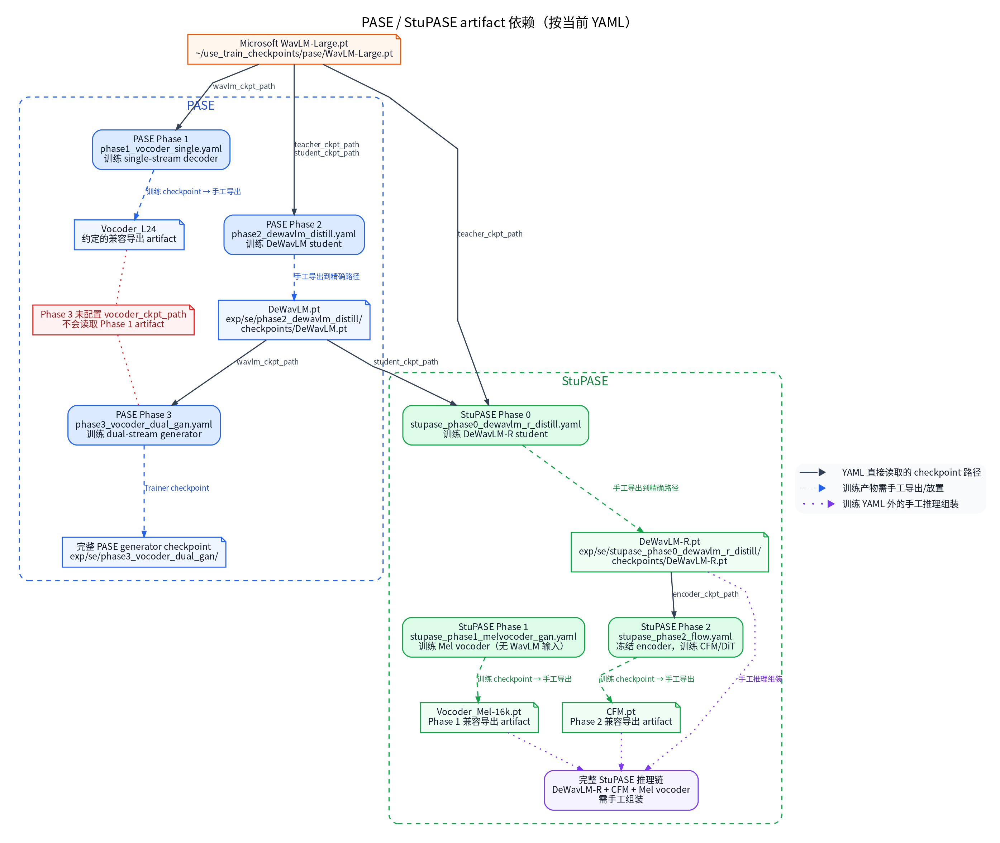

# PASE / StuPASE 训练配置 (`configs/se/urgent2026/pase`)

本目录提供基于 WavLM 音素先验的 PASE（AAAI 2026）与 StuPASE（Interspeech 2026）生成式语音增强训练配置。

**怎么读这份文档**：这两套模型都不是"一个 YAML 训完"，而是把完整链路拆成若干阶段，每个阶段单独训练一个组件，产物再交给下一阶段使用。因此先看下面的「6 阶段训练流水线」确定自己要跑哪一阶段，再按「数据与预训练权重准备」备齐该阶段的输入，最后用「训练命令」启动。阶段之间**不会**自动发现上一阶段的 checkpoint，衔接方式见「输出产物与下一阶段的衔接」。

## 目录

- [术语速查](#术语速查)
- [模型简介](#模型简介)
- [6 阶段训练流水线](#6-阶段训练流水线)
- [数据与预训练权重准备](#数据与预训练权重准备)
- [训练命令](#训练命令)
- [输出产物与下一阶段的衔接](#输出产物与下一阶段的衔接)
- [重要实现说明](#重要实现说明)
- [参考文档](#参考文档)

## 术语速查

| 术语 | 一句话解释 |
|---|---|
| 蒸馏（distillation） | 让小的 student 网络去模仿大 teacher 网络的中间特征，而不是直接学标签 |
| DeWavLM / DeWavLM-R | 本项目从 WavLM 蒸馏得到的编码器；`-R` 是在其基础上进一步蒸馏的版本 |
| Vocos / 声码器 | 把声学特征还原成波形的模块 |
| CFM（conditional flow matching） | 一类生成式建模目标，用条件 ODE/流把噪声变换成目标 |
| DiT | 使用 Transformer 骨干的 diffusion/flow 模型 |
| discriminator + GAN | 与生成器对抗训练的判别器，只用于训练，不进入推理产物 |
| artifact | 阶段产物文件（如 `DeWavLM.pt`），也是下一阶段的输入 |
| warm-start | 用已有权重初始化新训练；本目录要求显式给出 `*_ckpt_path`，没有自动发现 |
| `*_ckpt_path` | 各阶段 YAML 中声明前置产物绝对路径的配置键 |

## 模型简介

| 模型 | 论文 | 核心结构 | 官方资源 |
|------|------|----------|----------|
| **PASE** | AAAI 2026, arXiv:2511.13300 | DeWavLM 蒸馏 → 双流（音素+声学）Vocos 声码器，GAN 训练 | [arXiv](https://arxiv.org/abs/2511.13300) |
| **StuPASE** | Interspeech 2026, arXiv:2603.09234 | DeWavLM-R 蒸馏 → DiT 条件流匹配（CFM）→ Mel 声码器，GAN 训练 | [arXiv](https://arxiv.org/abs/2603.09234), [Demo](https://xiaobin-rong.github.io/stupase_demo/) |

> 注意：这里的 PASE 是 Xiaobin-Rong et al. 2026 年提出的生成式语音增强模型，不是 2019 年 SincNet+QRNN 版的 Problem-Agnostic Speech Encoder。
>
> UniPASE（Cisco, 2025：PLC 版 DeWavLM-Omni + VocosAdapter + TFGridNet PostNet 宽带扩展）的 4 阶段训练配置在子目录 [`unipase/`](unipase/README.md)。GAP-URGENet 复用 UniPASE 生成支路，并训练 Predictor 与双路融合 PostNet，配置入口见 [`gap_urgenet/`](gap_urgenet/README.md)。

### 子目录配置索引

| 家族 | 训练配置 | 推理配置 | 详细说明 |
|------|----------|----------|----------|
| StuPASE | `stupase_phase0_dewavlm_r_distill.yaml`、`stupase_phase1_melvocoder_gan.yaml`、`stupase_phase2_flow.yaml` | `stupase_infer.yaml`、`stupase_repro_infer.yaml` | 本文件 |
| UniPASE | `unipase_phase1_dewavlm_omni.yaml`、`unipase_phase2_vocoder_gan.yaml`、`unipase_phase3_adapter_gan.yaml`、`unipase_phase4_postnet_gan.yaml` | `unipase_infer.yaml`、`unipase_48k_infer.yaml` | [`unipase/README.md`](unipase/README.md) |
| GAP-URGENet | `gap_urgenet_phase1_predictor.yaml`、`gap_urgenet_phase2_postnet_gan.yaml`、`gap_urgenet_phase2_postnet_finetune.yaml` | `gap_urgenet_infer.yaml` | [`gap_urgenet/README.md`](gap_urgenet/README.md) |

表内文件名均相对于对应子目录；完整仓库路径分别以 `configs/se/urgent2026/pase/unipase/` 与 `configs/se/urgent2026/pase/gap_urgenet/` 开头。

PASE 本身没有子目录；官方发布权重的推理配置为 [`pase_infer.yaml`](pase_infer.yaml)，直接使用 `DeWavLM.pt` + `Vocoder_Dual.pt` artifact（`meta.allow_no_stft: true`，免传训练 checkpoint）。
自训练产物的推理配置为 [`pase_repro_infer.yaml`](pase_repro_infer.yaml)（`base_config` 继承，仅替换为
`exp/se/phase2_dewavlm_distill/checkpoints/DeWavLM.pt` 与 `exp/se/phase3_vocoder_dual_gan/checkpoints/Vocoder_Dual.pt`）。

### 配置说明

- **模型边界**：PASE 完整链为 `DeWavLM -> dual-stream Vocos`；StuPASE 完整链为
  `DeWavLM-R -> CFM/DiT -> Mel vocoder`。蒸馏与 flow 配置只训练链路组件，不是完整音频模型。
- **参数量**：Microsoft `WavLM-Large.pt` 已就位（`~/use_train_checkpoints/pase/`），按
  checkpoint 实测 **315.45M/副本**（Phase-2 训练期 teacher+student 双副本共 630.91M，推理 artifact
  只含 student）；PASE 完整推理链参考 `382.14M`（encoder 315.45M + decoder 66.69M）；
  StuPASE 项目参考约 `565M`、官方 checkpoint README 参考约 `561M`，两种口径未在本机复核。
- **复杂度输入口径**：`B=1`、16 kHz、shape `[1, 16000]` 的 float waveform，幅度
  `[-1, 1]`；训练切片长度以各配置的 `max_duration_seconds` 为准。
- **MACs/FLOPs**：encoder、decoder/CFM/vocoder 与训练期 discriminator 均为
  **not measured**。论文完整链 `PASE 21.42 GMAC/s`、`StuPASE ~104 GMAC/s` 仅作
  reference，不能拆分为本配置实测。THOP 覆盖不完整时必须标为 **partial/unverified**。
- **评估边界**：`PASEGANTrainer` 的 waveform 阶段可产出供离线评估的音频，但 Trainer
  不计算 DNSMOS/UTMOS；`DualInputLossTrainer` 的 feature/scalar-loss 阶段不输出增强音频，
  不能计算或解释音频 MOS/PESQ/STOI。完整链评估需加载全部 artifact 后独立执行。
- **artifact 边界**：蒸馏阶段冻结 teacher、训练 student；GAN 阶段冻结指定 encoder、训练
  decoder/vocoder，discriminator 仅参与训练。PASE 完整链需要 `DeWavLM + dual-stream vocoder`；
  StuPASE 完整链需要 `DeWavLM-R + CFM + Mel vocoder`。

---

## 6 阶段训练流水线

| 阶段 | 配置文件 | 模型 | Trainer | 输入/条件 | 输出权重 |
|------|----------|------|---------|-----------|----------|
| **PASE Phase-1** | [`phase1_vocoder_single.yaml`](phase1_vocoder_single.yaml) | `PASE`（单流）+ `PASEDiscriminator` | `PASEGANTrainer` | 干净音频（`prob_target_only: 1.0`） | `Vocoder_L24`（decoder） |
| **PASE Phase-2** | [`phase2_dewavlm_distill.yaml`](phase2_dewavlm_distill.yaml) | `DeWavLMDistillModel` | `DualInputLossTrainer` | 带噪音频 vs 干净音频的同层 WavLM 特征 | `DeWavLM.pt` |
| **PASE Phase-3** | [`phase3_vocoder_dual_gan.yaml`](phase3_vocoder_dual_gan.yaml) | `PASE`（双流）+ `PASEDiscriminator` | `PASEGANTrainer` | 带噪/干净配对（reverb + noise） | 完整 PASE 模型 |
| **StuPASE Phase-0** | [`stupase_phase0_dewavlm_r_distill.yaml`](stupase_phase0_dewavlm_r_distill.yaml) | `DeWavLMDistillModel` | `DualInputLossTrainer` | 带噪 vs 干净，热启动自 Phase-2 的 `DeWavLM.pt` | `DeWavLM-R.pt` |
| **StuPASE Phase-1** | [`stupase_phase1_melvocoder_gan.yaml`](stupase_phase1_melvocoder_gan.yaml) | `StuPASEMelVocoderGenerator` + `PASEDiscriminator` | `PASEGANTrainer` | 干净音频，无条件 Mel 声码器自编码 | `Vocoder_Mel-16k.pt` |
| **StuPASE Phase-2** | [`stupase_phase2_flow.yaml`](stupase_phase2_flow.yaml) | `StuPASEFlowTrainModel` | `DualInputLossTrainer` | 冻结 `DeWavLM-R` 提供音素条件，训练 CFM/DiT | `CFM.pt` |

**依赖与 warm-start 边界**：



图的可维护事实源为 [`pase_family_stage_dependencies.dot`](../../../../docs/guides/se/assets/pase_family/pase_family_stage_dependencies.dot)，边按当前六份 YAML 的 `*_ckpt_path` 绘制；虚线表示训练 checkpoint 仍需手工导出或放到精确路径，点线表示训练 YAML 外的手工推理组装。

> Trainer 不会自动发现上一阶段的 latest/best checkpoint。PASE Phase-3 的
> `wavlm_ckpt_path` 精确读取 Phase-2 约定的 `DeWavLM.pt`，但未配置
> `vocoder_ckpt_path`，因此不会读取 Phase-1 decoder。StuPASE Phase-0 精确读取 PASE
> Phase-2 的 `DeWavLM.pt`，StuPASE Phase-2 精确读取 Phase-0 的 `DeWavLM-R.pt`；
> StuPASE Phase-1 的 Mel vocoder 不进入 Phase-2 训练 forward，只在完整推理链中手工组合。

**PASE 三阶段官方口径（2026-10 对齐）**：三份配置统一 `meta.use_amp: false`（官方训练脚本
fp32、无 autocast），`meta.seed` 取官方训练脚本值（Phase-1 `43`、Phase-2 `34`、Phase-3 `43`），
`optimizer.*.args.lr` 写官方 `optimizer.lr` 初始值（Phase-1/3 `1e-4`、Phase-2 `1e-3`），
validation 逐 epoch 执行（`trainer.validation_epoch_interval: 1`、
`data.dataloader.val_batch_size: 1`，并显式覆盖 `simulation_cfg.speech.random_start: false`）。
`scheduler.*.args.max_lr` 保持 Phase-1/3 `2e-4`、Phase-2 `1e-4` 的峰值口径；`optimizer.lr`
只是第一步初始值，两者不是同一个字段。这些口径**不改变已完成的 §12.6 复现结果**：§12.6
的指标是旧配置（bf16、seed 42、初始 lr `2e-4`/`1e-4`）的产物，新配置按官方口径编写，
供未来重跑；不得把既有六项指标当作新配置产出的结果。

## 验证音频（trainer.val_audio）

PASE Phase-1/Phase-2/Phase-3 与 StuPASE Phase-0/Phase-1/Phase-2 的训练配置在
`trainer.val_audio` 下启用官方验证音频：仅 rank 0、仅在 validation 循环内、按官方
1-based epoch/step 条件写 `<trainer.exp_path>/samples/{step}_*.wav`。实现位于
`tasks/se/trainer/val_audio.py`，阶段前向由模型 `val_audio_outputs()` 提供；
`enabled: false` 时整段零开销。Phase-0/Phase-2 与 StuPASE Phase-0 使用官方
`Vocoder_L24`（PASE 发布 artifact，1024 维 WavLM 特征输入），不是 Mel 声码器；
PASE Phase-1 保存 `true/esti`，Phase-3 保存 `noisy/clean/enh`；StuPASE
Phase-1 保存 `true/esti`（16 kHz）。

## 数据与预训练权重准备

### 1. WavLM 依赖

| 阶段 | 依赖类型 | 实际 checkpoint |
|------|----------|-----------------|
| PASE Phase-1 | 直接 | Microsoft `WavLM-Large.pt` |
| PASE Phase-2 | 直接 | teacher/student 均为 Microsoft `WavLM-Large.pt` |
| PASE Phase-3 | 直接依赖上游 artifact，间接依赖 WavLM-Large | PASE Phase-2 `DeWavLM.pt` |
| StuPASE Phase-0 | teacher 直接依赖 WavLM-Large；student 直接依赖上游 artifact | Microsoft `WavLM-Large.pt` + PASE Phase-2 `DeWavLM.pt` |
| StuPASE Phase-1 | 无 | 不构造 WavLM/DeWavLM |
| StuPASE Phase-2 | 直接依赖上游 artifact，间接依赖 WavLM-Large | StuPASE Phase-0 `DeWavLM-R.pt` |

直接使用 Microsoft checkpoint 的阶段从 `~/use_train_checkpoints/pase/WavLM-Large.pt`
加载。`download_pase_pretrained.py` 不下载该文件；从 Microsoft WavLM release 取得后可执行：

```bash
mkdir -p ~/use_train_checkpoints/pase
cp /path/to/WavLM-Large.pt ~/use_train_checkpoints/pase/WavLM-Large.pt
```

### 2. SCP 数据

PASE Phase-1/2/3 已切到按 official 配方构建的 PASE 专用清单（`data/se/pase/manifests/`，
四列 `uid fs length_samples path`）：

- clean：`pase_clean_train.scp`（431,918 条：DNS5 read_speech 过滤 + LibriTTS train-clean-100/360
  + VCTK）与 `pase_clean_val.scp`（18,933 条：DNS5 前 90 speaker + LibriTTS dev + VCTK 10 speaker）；
- noise：`dns5_noise_{train,val}.scp`（DNS5 noise）；
- wind：`data/shared/noise/filter/v2/{train,val}_wind_noise_sources.scp`；
- RIR：`dns5_rir_{train,val}.scp`（仅 SLR26/28，对齐 official PASE）。

StuPASE 三份配置仍使用共享清单：`urgent26_clean_{train,val}.scp`
（`data/shared/urgent26_track1_se_dataset/urgent26_track1_universal_se/`）、
`data/shared/noise/filter/v2/{train,val}_noise_sources.scp`、同目录 wind 清单与
`data/shared/rirs/gpurir_static/gpurir/fs16000/{train,val}_rirs.scp`。

这些路径按仓库根目录解析。PASE/StuPASE 配置的风噪概率为 `0.0`，UniPASE Stage 1/3/4 与
GAP 两阶段按官方 `simulation_train.yaml:24` 设为 `0.05`；未采样风噪时 Dataset 初始化仍会
解析 `windnoise_scp`，因此对应 manifest 必须存在。PASE Phase-1 使用
`scene.prob_target_only: 1.0`、`acoustic.rir.reverberation_prob: 0.0`（official
`dataloader_clean.py` 纯 clean，不采样 RIR）；StuPASE Phase-1
仍使用 `prob_target_only: 1.0`、`reverberation_prob: 0.5`。PASE Phase-2/3 使用
`reverberation_prob: 0.5`，Phase-2 teacher 与 Phase-3 target 都是 early-RIR；训练随机起点裁剪 4 s，
短句右侧补零（`repeat_to_max_duration: false`）。初始化仍会解析共享 manifest。
`tasks/se/data/dynamic_dataset.py` 明确允许 target-only 概率和等于 `1.0`，此时显式
target-noise 路径权重为 0，并跳过 C-1/C-2 噪声混合。

### 3. 官方预训练权重（可选，用于推理或热启动）

下载脚本支持 `--model {pase,stupase,unipase,all}` 与 `--output_dir`。未显式传入
`--output_dir` 时，PASE 默认下载到 `checkpoints/pase/`，StuPASE 默认下载到
`tasks/se/models/pase_family/stupase/open_model_checkpoint/`，UniPASE 默认下载到
`tasks/se/models/pase_family/unipase/open_model_checkpoint/`；`--model all` 会按这三个默认目录分别保存。
显式传入 `--output_dir` 时，所选模型的文件统一保存到该目录。PASE 的默认目录与训练 YAML
中的上游 artifact 路径不同；StuPASE/UniPASE 的默认目录已与推理配置一致：

```bash
python tools/model_tools/download_pase_pretrained.py --model pase
python tools/model_tools/download_pase_pretrained.py --model stupase
python tools/model_tools/download_pase_pretrained.py --model unipase
```

下载的权重包括：

- PASE：`DeWavLM.pt`、`Vocoder_Dual.pt`
- StuPASE：`DeWavLM-R.pt`、`CFM.pt`、`Vocoder_Mel-16k.pt`
- UniPASE：`DeWavLM-Omni.pt`、`Adapter.pt`、`Vocoder_DWO-L1.pt`、`Vocoder_WavLM-L24.pt`、`PostNet.pt`

若用官方 encoder 权重直接运行依赖上游自训 artifact 的 YAML，需放到 YAML 的精确期望位置：

```bash
mkdir -p exp/se/phase2_dewavlm_distill/checkpoints
mkdir -p exp/se/stupase_phase0_dewavlm_r_distill/checkpoints
cp checkpoints/pase/DeWavLM.pt \
    exp/se/phase2_dewavlm_distill/checkpoints/DeWavLM.pt
cp tasks/se/models/pase_family/stupase/open_model_checkpoint/DeWavLM-R.pt \
    exp/se/stupase_phase0_dewavlm_r_distill/checkpoints/DeWavLM-R.pt
```

其中 `Vocoder_Dual.pt`、`CFM.pt` 与 `Vocoder_Mel-16k.pt` 不被这六份训练 YAML 直接读取，
用于手动组装推理链或显式配置热启动。官方发布的 `.pt` 可直接作为转换输入；需要统一包装格式时可执行：

```bash
python tools/model_tools/convert_checkpoint.py \
    --source pase_official \
    --model_type PASEVocoder \
    --input checkpoints/pase/Vocoder_Dual.pt \
    --output checkpoints/pase/vocoder_dual_use_train.pth
```

不要假设官方提供 `official.tar`。只有实际拿到可信的 legacy training-state archive 时，才将其
真实路径传给转换脚本；转换器会从 `model`、`generator` 或 `state_dict` 槽位提取权重。

> 判别器 key 需要特殊映射：`discrimiantor.0.* → mpd.*`、`discrimiantor.1.* → mbd.*`（源码拼写错误），转换脚本已内置该映射。

---

## 训练命令

每个阶段都是独立的 `python train.py -C /path/to/config.yaml`，按上表的依赖顺序执行即可；训练日志与 checkpoint 写入该阶段 YAML 的 `trainer.exp_path`（默认 `exp/se/<配置文件名去 .yaml>`）：

```bash
# PASE
python train.py -C configs/se/urgent2026/pase/phase1_vocoder_single.yaml
python train.py -C configs/se/urgent2026/pase/phase2_dewavlm_distill.yaml
python train.py -C configs/se/urgent2026/pase/phase3_vocoder_dual_gan.yaml

# StuPASE
python train.py -C configs/se/urgent2026/pase/stupase_phase0_dewavlm_r_distill.yaml
python train.py -C configs/se/urgent2026/pase/stupase_phase1_melvocoder_gan.yaml
python train.py -C configs/se/urgent2026/pase/stupase_phase2_flow.yaml
```

启动前至少要确认两件事：该阶段 `*_ckpt_path` 指向的前置 artifact 与 `DeWavLM`/`WavLM-Large.pt` 已就位（见上一节），并且 `data.train` 中的 SCP 清单真实存在——缺失清单或权重会在 entry 配置校验/构造阶段直接报错。

多卡训练与仓库其它配置一致：

```bash
python -m torch.distributed.run --nproc_per_node=2 train.py -C configs/se/urgent2026/pase/phase3_vocoder_dual_gan.yaml
```

**调度口径速查（12 阶段）**：`epochs` / `num_per_epoch` / batch size / `warmup_steps` /
`decay_until_step` 全部为官方 cfg 字面量，严格复现时保持原值、凑齐下表文档卡数启动；
`epochs` 不要为凑卡数做换算——换卡数等于改官方配方（world_size 把每 epoch steps 缩放而
绝对 step 调度不动：卡多截断 cosine 退火，卡多不了多少但卡少会把大量步数压到下界 lr）。
非严格跑法可以自行换卡数，但需在实验记录中注明偏差。

| 阶段 | 配置 | 文档卡数 | steps/epoch | T 总 steps | W warmup | D decay_until | T/D |
|------|------|---------|-------------|-----------|----------|---------------|-----|
| PASE P1 | `phase1_vocoder_single.yaml` | 4 | 500 | 200k | 10k | 200k | 1.00 |
| PASE P2 | `phase2_dewavlm_distill.yaml` | 4 | 500 | 100k | 10k | 100k | 1.00 |
| PASE P3 | `phase3_vocoder_dual_gan.yaml` | 4 | 500 | 200k | 10k | 200k | 1.00 |
| StuPASE P0 | `stupase_phase0_dewavlm_r_distill.yaml` | 2 | 500 | 50k | 5k | 55k | 0.91 |
| StuPASE P1 | `stupase_phase1_melvocoder_gan.yaml` | 3 | 500 | 200k | 20k | 220k | 0.91 |
| StuPASE P2 | `stupase_phase2_flow.yaml` | 6 | 500 | 100k | 10k | 110k | 0.91 |
| UniPASE S1 | `unipase/unipase_phase1_dewavlm_omni.yaml` | 4 | 500 | 100k | 10k | 110k | 0.91 |
| UniPASE S2 | `unipase/unipase_phase2_vocoder_gan.yaml` | 4 | 500 | 200k | 20k | 220k | 0.91 |
| UniPASE S3 | `unipase/unipase_phase3_adapter_gan.yaml` | 4 | 500 | 100k | 10k | 110k | 0.91 |
| UniPASE S4 | `unipase/unipase_phase4_postnet_gan.yaml` | 4 | 500 | 100k | 5k | 55k | 1.82 |
| GAP Ph1 | `gap_urgenet/gap_urgenet_phase1_predictor.yaml` | 8 | 500 | 100k | 10k | 110k | 0.91 |
| GAP Ph2 | `gap_urgenet/gap_urgenet_phase2_postnet_gan.yaml` | 8 | 500 | 60k | 5k | 60k | 1.00 |

表注：

- `T/D = 0.91` 的阶段（`D = 1.1×T`）是官方 cfg 的 `decay_until_step` 字面量：训练结束 lr
  停在距下界约 2.45% 峰值处，官方原样，不是配置错误。
- S4 的 `D=55000` 已核对官方 `cfg_train_postnet.yaml` 原文（`warmup_steps: 5000,
  decay_until_step: 55000, epochs: 200`）：官方即 55k 步退火完、后 45k 步在下界 lr 细调。
- steps/epoch=500 的前提是文档卡数且 cap 能被 `卡数×batch` 整除（上表全部满足）。启动日志中
  scheduler 的 planned-total 与 D 的比对是被动兜底：比例不是上表数值，说明 world_size
  或数据没对上，应停下核对而不是继续跑。
- 数据侧两条前置断言（在准备过滤后 scp 时保证，属数据产出属性，无需运行时校验）：
  1. 过滤后 scp 行数 ≥ `num_per_epoch`（最大为 S3 的 128,000 条）；
  2. `data.sample_rate` 必须显式写出——它映射为 dataset `target_sr`，sampler 因此按单一
     SR 分组；漏写且 scp 混 SR 时才可能出现分组 floor 损耗。scp 源文件混采样率本身无碍，
     会被 `speech_min_sample_rate` 过滤并统一重采样。

StuPASE/UniPASE/GAP-URGENet 的完整推理与产物导出：

```bash
# StuPASE：官方权重 / 自训练产物；CFM 为 8-step ODE，长音频不要用 --chunk_seconds
PYTHONPATH=. python inference.py -C configs/se/urgent2026/pase/stupase_infer.yaml \
    --input_dir /path/to/noisy --output_dir /path/to/output
PYTHONPATH=. python inference.py -C configs/se/urgent2026/pase/stupase_repro_infer.yaml \
    --input_dir /path/to/noisy --output_dir /path/to/output

# UniPASE：16k / 48k（48k 配置显式加载 PostNet）
PYTHONPATH=. python inference.py -C configs/se/urgent2026/pase/unipase/unipase_infer.yaml ...
PYTHONPATH=. python inference.py -C configs/se/urgent2026/pase/unipase/unipase_48k_infer.yaml ...

# GAP-URGENet：五模块 48k 融合链
PYTHONPATH=. python inference.py -C configs/se/urgent2026/pase/gap_urgenet/gap_urgenet_infer.yaml ...

# 训练 wrapper → 独立 artifact（--verify 严格回载）
python tools/model_tools/export_pase_artifacts.py --stage dewavlm_r ... --verify
python tools/model_tools/export_pase_artifacts.py --stage stupase_vocoder ... --verify
python tools/model_tools/export_pase_artifacts.py --stage cfm ... --verify
python tools/model_tools/export_pase_artifacts.py --stage gap_predictor ... --verify
python tools/model_tools/export_pase_artifacts.py --stage gap_postnet ... --verify
```

---

## 输出产物与下一阶段的衔接

| 阶段 | 默认 exp_path | checkpoint 名 | 下一阶段如何使用 |
|------|---------------|---------------|------------------|
| Phase-1 | `exp/se/phase1_vocoder_single` | 训练 checkpoint；兼容导出目标为 `Vocoder_L24` | 用于 Vocoder-L24 基线和 DeWavLM 评估；Phase-3 的 dual-stream vocoder 从零训练，不读取该 decoder |
| Phase-2 | `exp/se/phase2_dewavlm_distill` | 训练 checkpoint；兼容导出目标为 `DeWavLM.pt` | Phase-3 写死期望路径；须先显式导出到该精确位置，不会自动选择 latest/best |
| Phase-3 | `exp/se/phase3_vocoder_dual_gan` | 完整 PASE generator checkpoint | 推理或评估使用 |
| StuP0 | `exp/se/stupase_phase0_dewavlm_r_distill` | 训练 checkpoint；兼容导出目标为 `DeWavLM-R.pt` | StuPASE Phase-2 写死期望路径；须先显式导出到该精确位置 |
| StuP1 | `exp/se/stupase_phase1_melvocoder_gan` | 训练 checkpoint；兼容导出目标为 `Vocoder_Mel-16k.pt` | 不进入 Phase-2 训练 forward；完整推理时才手动加载 |
| StuP2 | `exp/se/stupase_phase2_flow` | 训练 checkpoint；兼容导出目标为 `CFM.pt` | 与 `DeWavLM-R.pt` + `Vocoder_Mel-16k.pt` 手动组合为完整 StuPASE |

---

## 重要实现说明

1. **波形原生推理**：PASE 与 StuPASE 的框架入口不走框架 STFT/iSTFT，配置以
   `meta.allow_no_stft: true` 声明；模型内部仍按架构执行 mel、ISTFT 等处理。
2. **AMP 精度（fp32）**：PASE、StuPASE、UniPASE 与 GAP 的 12 份训练配置均为
   `meta.use_amp: false`，对齐官方训练脚本的 fp32、无 autocast；`meta.amp_dtype: bfloat16`
   仅保留作参考（GAP Phase 2 续训配置继承同一设置）。若手动开启 AMP 必须保持
   `bfloat16`，避免 `ISTFTHead` 的复数 FFT 进入 PyTorch 实验性 `ComplexHalf` 路径。
3. **数据增强策略**：为对齐 official PASE/StuPASE，PASE/StuPASE 配置关闭 Layer E channel
   degradation、high-pass、wind 与 Layer F post-mix degradation。`rir_normalize: false`
   是刻意选择：RIR convolution 保留 official raw RIR gain，不使用仓库默认的 shared-full-peak
   RIR normalization。PASE Phase-1 使用 `prob_reverberation: 0.0`（纯 clean）；StuPASE Phase-1
   target-only 阶段仍使用 `prob_reverberation: 0.5`。UniPASE Stage 1/3/4 与 GAP 两阶段
   按官方 `simulation_train.yaml` 保留 Layer E 与 5% wind noise（`prob_wind_noise_sidechain: 0.05`）。
   PASE Phase-2/3、StuPASE 三阶段、UniPASE 四阶段与 GAP 两阶段的训练 split 均使用
   `speech.random_start: true` 和
   `repeat_to_max_duration: false`，对齐各自 official `train_dataset` 的随机起点裁剪与零填充。
4. **Layer D post-mix amplitude conditioning（normalize → guard）**：公共 D-normalize 由
   `peak_normalization_mode` 控制，合法枚举为 `off`、`joint`；未显式设置
   `peak_normalization_scale_range` 时采用 schema 默认值 `[0.5, 0.95]`（线性幅度），随后执行
   D-guard。PASE 使用公共 `joint`；StuPASE/PASE 的 noisy/clean 或 target-only 独立归一化
   写在 `simulation_cfg.pase_preprocess.peak_normalization_mode`，不进入公共 SimulationConfigs。
   UniPASE Stage 1/3/4 与 GAP 两阶段把公共 D-normalize 设为 `off`，改用 `pase_preprocess`
   的 `separate` + `apply_after_channel: true`，在 Layer E 信道退化之后归一化。
5. **epoch 语义**：`data.train.num_per_epoch` 是每个 epoch 的无放回抽样上限；若上限大于等于
   Dataset 大小则全量遍历，不会有放回补齐。实际 optimizer steps 取决于
   `min(num_per_epoch, Dataset 大小)`、batch、DDP 与 `drop_last`。
6. **运行依赖**：
   - `torchdiffeq==0.2.5`（StuPASE ODE 采样）
   - `x-transformers==2.17.10`（StuPASE DiT 的 RoPE；当前环境实际版本，StuPASE smoke 已通过）
   - `huggingface_hub`（官方权重下载）

## 参考文档

- 架构与训练细节：[`docs/guides/se/pase_family_learning_guide.md`](../../../../docs/guides/se/pase_family_learning_guide.md) §8
- **复现总结**（use_train 框架内完整重训 Phase-2/Phase-3，六项指标对照、已知近似）：[`docs/guides/se/pase_family_learning_guide.md`](../../../../docs/guides/se/pase_family_learning_guide.md) §12.6
- 家族机制分析：[`docs/architecture/analysis/Rong_Model_Family_Analysis.md`](../../../../docs/architecture/analysis/Rong_Model_Family_Analysis.md)
- UniPASE 与家族总览：[`docs/guides/se/pase_family_learning_guide.md`](../../../../docs/guides/se/pase_family_learning_guide.md)
- 损失函数：`core/losses/pase_family.py` 中的 `PaseMultiScaleMelLoss`
- Trainer 实现：`tasks/se/trainer/pase_gan_trainer.py`、`tasks/se/trainer/dual_input_loss_trainer.py`
- 模型实现：`tasks/se/models/pase_family/`
