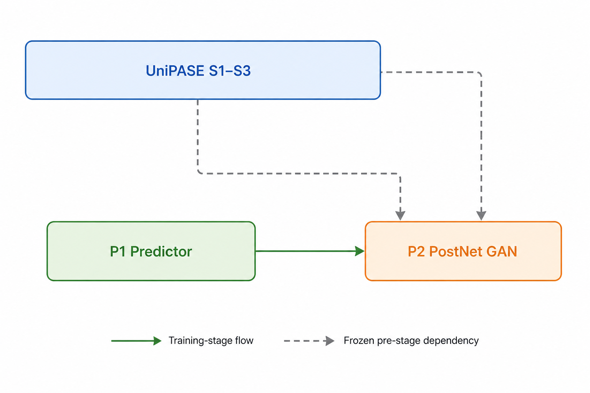

# GAP-URGENet 训练配置 (`configs/se/urgent2026/pase/gap_urgenet`)

<p align="center">
  <strong>GAP-URGENet (Cisco, 2025)：16 kHz 双支路增强 + 固定 48 kHz PostNet 融合</strong>
</p>

官方仓库：[Xiaobin-Rong/gap-urgenet](https://github.com/Xiaobin-Rong/gap-urgenet)。
整体结构：`生成支路 DeWavLM-Omni (WavLM + PLC) -> VocosAdapter -> VocosVocoder (16 kHz 波形)`
与 `预测支路 Predictor (单通道 TFGridNetV3, 16 kHz)` 双路上采样到 48 kHz，
由 `PostNet (双通道 TFGridNetV3 + BandSplit)` 融合输出。

GAP-URGENet 的生成支路三模块（DeWavLM-Omni / VocosAdapter / VocosVocoder）与
UniPASE 完全同源，直接复用 `tasks/se/models/pase_family/unipase/` 的实现与产物；
本目录只训练 GAP 特有的两个模块。

**怎么读这份文档**：完整模型不做端到端训练，而是分两个阶段训练 GAP 自己的两个模块——Phase 1 训 Predictor，Phase 2 冻结前级后训 PostNet。因此先看「2 阶段训练流水线」确定阶段，再按「权重衔接」准备该阶段需要的权重（Phase 1 不引用任何前级 artifact；Phase 2 默认引用官方四件前级权重），最后用「训练命令」启动。配置默认直接指向官方发布权重，所以从 Phase 2 起跑是最省事的路径；全流程自训必须先导出兼容 artifact 并手工替换 `*_ckpt_path`。

| 术语 | 一句话解释 |
|---|---|
| 生成支路 / 预测支路 | 两路并行估计同一段增强语音，最后融合；生成支路是大模型生成式方案，预测支路是轻量判别式方案 |
| PLC（packet loss concealment，丢包补偿） | 生成支路内建的丢包补偿前端；本目录两份配置都在 Layer E 开启 `packet_loss` 退化，让该路径真正被训练到 |
| PostNet | 融合两支路并做宽带扩展的网络；本目录的 `PostNet` 是双通道 48 kHz 版本，不是 UniPASE 的全时域残差变体 |
| TFGridNet / BandSplit | 时频网格骨干网络 / 子带切分前端，两者都取自 UniPASE 实现 |
| MPD + MBD | 多周期 + 多频带判别器，只在 Phase 2 训练期参与，不进入推理 |
| artifact | 阶段产物或官方发布权重文件（如 `Predictor.pt`、`PostNet.pt`） |
| `*_ckpt_path` | YAML 中声明前级权重路径的配置键；本目录不会自动发现 exp 目录里的最新产物 |

### 配置顶部审计摘要

- **Model**：Phase 1 单独训练 `Predictor`；Phase 2 冻结 UniPASE 生成支路与 Predictor，
  训练双通道 48 kHz `PostNet`。完整 inference chain 是生成/预测双支路融合，不等于任一阶段组件。
- **Params**：Predictor `22,087,196`、PostNet `4,777,751`（保留现有实测值）；
  当前缺少五件官方 artifact，完整链为 **not measured（missing checkpoint）**。论文完整链
  `567.76 M` 仅作 reference，训练期 discriminator 不计入推理参数。
- **1 秒复杂度输入/范围**：Phase 1 为 `B=1`、16 kHz、`[1, 16000]`；Phase 2 为
  `B=1`、48 kHz、`[1, 48000]`；均为 float waveform，标称幅度 `[-1, 1]`。完整推理
  内部双支路固定为 16 kHz，融合固定为 48 kHz，最后才重采样到请求输出率。
- **THOP / FLOPs 边界**：THOP 状态为 **partial/unverified**；当前未对生成支路、
  Predictor、PostNet 或训练期 MPD+MBD 做可复核的独立 profile，统一记为
  **not measured（checkpoint 缺失）**。论文完整链 `472.84 GMAC/s` 仅作 reference，
  不能拆作 Predictor/PostNet 的本地 FLOPs。
- **Trainer MOS 边界**：Phase 1 `SETrainer` 和 Phase 2 `PASEGANTrainer` 都不在线计算
  DNSMOS/UTMOS；waveform 输出只允许在 artifact 严格加载后离线评估。Predictor 单件 MOS
  不能代表完整 GAP-URGENet，Phase 2 才覆盖完整链输出。
- **组件与 artifact 边界**：Phase 1 仅 Predictor 可训练、无 discriminator，产出
  `Predictor.pt`；Phase 2 冻结 DeWavLM-Omni/Adapter/Vocoder/Predictor，只训练 PostNet，
  MPD+MBD 仅训练期参与，产出 `PostNet.pt`。完整推理还必须同时提供前三件生成 artifact。

---

## 2 阶段训练流水线

| 阶段 | 配置文件 | 模型 (generator) | 判别器 | Trainer | 输出权重 |
|------|----------|------------------|--------|---------|----------|
| **Phase 1** | [`gap_urgenet_phase1_predictor.yaml`](gap_urgenet_phase1_predictor.yaml) | `GAPURGENetPredictor` | — | `SETrainer` | `Predictor.pt` |
| **Phase 2** | [`gap_urgenet_phase2_postnet_gan.yaml`](gap_urgenet_phase2_postnet_gan.yaml) | `GAPURGENetPostNetGenerator` | `PASEDiscriminator` (MPD+MBD) | `PASEGANTrainer` | `PostNet.pt` |
| **Phase 2 续训** | [`gap_urgenet_phase2_postnet_finetune.yaml`](gap_urgenet_phase2_postnet_finetune.yaml) | 同 Phase 2（`base_config` 继承） | 同 Phase 2 | `PASEGANTrainer`（resume） | `PostNet.pt`（续训段） |

**依赖与 warm-start 边界**：



> 图示表示 UniPASE Stage 1–3 生成支路 artifact 与 GAP Phase 1 Predictor 共同汇入
> Phase 2，并不表示 Trainer 自动扫描上游 checkpoint。Phase 2 YAML 默认加载固定的官方
> 四件前级路径，不会自动改用 Phase 1 或 UniPASE exp 目录中的最新产物。全流程自训必须先导出
> 兼容 artifact，再手动替换四个 `*_ckpt_path`；配置本身不提供自动 warm-start 发现机制。

各阶段要点（与官方 `configs/cfg_train_{predictor,postnet}.yaml` 对齐）：

- **Phase 1**：`GAPURGENetPredictor` 是 `predictor.tfgridnet.TFGridNet` 的直接子类
  （state_dict key 与官方逐字一致，训练产物可直接导出为官方格式 `Predictor.pt`），
  仅把 forward 适配为 SETrainer 接口 `forward(noisy_wav, lengths=None, *, fs=None)`
  （官方签名 `(x, sr=16000)` 与 SETrainer 位置传参 `model(noisy, lengths)` 冲突，
  必须包这一层）。loss = `GAPHybridLoss`（压缩复数谱 RI×30 + 压缩幅度×70 +
  符号 SDR 变体×1，移植官方 `utils/loss_factory.py:33-89`，已与官方数值比对
  diff=0.0）。
- **Phase 2**：`GAPURGENetPostNetGenerator` 冻结 encoder/adapter/vocoder/predictor
  四链（no_grad，对齐官方 `models/gap_urgenet.py:49-74`），双支路上采样到 48 kHz，
  stack 为 `(B, 2, L)` 后送入可训练 PostNet（`n_imics=2`，无残差、无软门控——与
  UniPASE PostNet 的全时域残差/软门控变体不同）。直接复用 `PASEGANTrainer`
  （waveform 域 MPD+MBD GAN），loss = `15×mel + 1×adv + 1×feat`
  （官方 `coeff: {recons: 15, adv: 1, feat: 1}`）。PostNet 的
  `normalization_mode: legacy_centered` 执行 `(x-mean)/std`，与官方
  `models/postnet/tfgrid_cws.py:127-134` 一致；`paper_variance` 只除 std，不对齐官方。

**Phase 2 续训入口（官方 10 epoch 段，本框架绝对 epoch=60）**：
[`gap_urgenet_phase2_postnet_finetune.yaml`](gap_urgenet_phase2_postnet_finetune.yaml)
继承 `gap_urgenet_phase2_postnet_gan.yaml`，只覆盖 `trainer` 段（`epochs: 60`、
逐 epoch validation、逐 epoch 保存、独立 `exp_path`），对应官方 `cfg_train_postnet.yaml`
的 50+10 resume 续训段：

```bash
python train.py -C configs/se/urgent2026/pase/gap_urgenet/gap_urgenet_phase2_postnet_finetune.yaml \
    --resume-from exp/se/gap_urgenet_phase2_postnet_gan/checkpoints/latest_model.tar
```

两份 Phase 2 配置的区别：`gap_urgenet_phase2_postnet_gan.yaml` 的 120 epoch 是从零训练、
跑满 `warmup_steps=5000` 与 `decay_until_step=60000` 的口径；续训配置写 `epochs: 60`，
因为本框架 `trainer.epochs` 是绝对结束 epoch（`range(start_epoch, epochs + 1)`），
从第 50 epoch 的 checkpoint 续训时 60 等价于官方的相对 10 epoch。scheduler 状态
（含 `decay_until_step=60000`）由 checkpoint 恢复，不重新 warmup。
文件中的字面 `10` 仅用于记录官方续训段口径。

推理配置 [`gap_urgenet_infer.yaml`](gap_urgenet_infer.yaml)：`GAP_URGENet` 五模块
级联 + 官方发布权重，`meta.inference_only: true`；`data.mode: dynamic` 仅用于 SE
任务路由，不包含训练或验证数据配置。

---

## 超参数对照（官方 → 本配置）

| 项 | Phase 1 (Predictor) | Phase 2 (PostNet GAN) |
|----|---------------------|------------------------|
| 采样率 / clip 时长 | 16 kHz / 4 s | 48 kHz / 4 s |
| batch size | 1 | 1 |
| validation batch size | 1 | 1 |
| epochs | 200 | 120（从零）/ 60（续训，等价官方 50+10） |
| AdamW max_lr（scheduler 峰值） | 1e-4 | 4e-6 |
| optimizer.lr（初始值） | 1e-3 | 1e-6 |
| warmup / decay_until | 10k / 110k | 5k / 60k |
| 损失 | RI×30 + mag×70 + sdr×1 | mel×15 + adv×1 + feat×1 |
| num_per_epoch (train/val) | 4000 / 1000 | 4000 / 800 |
| meta.seed | 0 | 43 |
| 精度 | fp32 | fp32 |

两阶段的 validation 均按官方 `validation_dataset` / `validation_dataloader` 设置：
`validation_epoch_interval: 1` 逐 epoch 验证、`data.dataloader.val_batch_size: 1`，并显式覆盖
`simulation_cfg.speech.random_start: false`（train 为 `true`）。

Phase 2 的 `epochs` 由官方字面值 10 调整为 120。官方 `trainer.epochs=10` 是 resume
续训段的口径（只对应 5k steps，刚好停在 warmup 结束点）；从零训练要跑满
`warmup_steps=5000` 与 `decay_until_step=60000` 的 scheduler，8 卡、per-GPU
`batch_size=1` 时每 epoch 为 `4000 / (1×8) = 500` optimizer steps，`500 × 120 = 60000`
才是等价口径。官方字面 `epochs: 10` 单独落在
[`gap_urgenet_phase2_postnet_finetune.yaml`](gap_urgenet_phase2_postnet_finetune.yaml)，
必须配合 `--resume-from` 使用，不用于从零训练（见上方「Phase 2 续训入口」）。

除 Phase 2 的 `epochs`（按本机 8 卡 step 口径调整，见上）外，其余逐项对齐官方
`configs/cfg_train_{predictor,postnet}.yaml`
（`clip_grad_norm=3.0`、`min_lr=1e-6` 两阶段一致）。`betas=(0.8, 0.99)` 与
`weight_decay=0.01` 不在官方 YAML 里，而是官方训练脚本中 AdamW 的硬编码值
（`train/train_predictor.py:72`、`train/train_postnet.py:99-100`），本配置
与之保持一致。官方训练脚本为 **fp32**（无 autocast），两份配置统一
`meta.use_amp: false`，`meta.amp_dtype: bfloat16` 仅保留作参考。

`optimizer.lr` 是官方 `optimizer.lr` 的第一步初始值（Phase 1 `1e-3`、Phase 2 `1e-6`），
训练开始后由 `scheduler.*.args.max_lr` 接管峰值调度；表中 `AdamW max_lr` 行仍取
`max_lr`，两者不要混写。

source 语音过滤按官方 `loaders/dataloader.py:71` 的 `fs >= default_fs` 执行：Phase 1
的 train 与 validation split 都写 `speech_min_sample_rate: 16000`，Phase 2 写 `48000`。

**Scheduler**：框架 `core/optim/scheduler.py` 已有 `LinearWarmupCosineAnnealing`
（0 -> max_lr 线性 warmup -> cosine 衰减到 min_lr -> 保持），与官方
`LinearWarmupCosineAnnealingLR` 语义一致，直接使用，无差异。

### 动态仿真运行时边界

- `data.mode: dynamic` 选择 SE 动态混音任务；Dataset 仿真统一到 Layer A–F，推理配置只保留
  该任务路由，不包含 `train`、`validation`、`trainer` 或 `loss`。
- AEC 的 `AECDeploymentFrontend` 仅属于 AEC 模型输入/部署链路，在 Trainer/Inference 的
  STFT 前运行，不属于 Dataset 仿真。
- Phase 2 使用 16 kHz RIR 清单，但 runtime 通过 `_read_cached_2d` 按 48 kHz
  加载并重采样后再卷积；`rir_normalize: false` 保留重采样后 RIR 的原始增益。
- post-mix 固定顺序为 `pre-finite -> D-normalize -> D-guard -> E -> F -> task-post-EF ->
  final-guard -> post-finite`；SE 的 `task-post-EF` 为 no-op，不存在额外的 `G` 阶段。
- Layer D 是 post-mix amplitude conditioning（normalize → guard）；公共
  `peak_normalization_mode` 设为 `off`，noisy/clean 各自 peak 归一化由
  `se.pase_preprocess` 的 `separate` 承担，`apply_after_channel: true` 让它在 Layer E
  信道退化之后执行，对齐官方 `loaders/dataloader.py:335-336`“先增广、后分别归一化”
  的顺序；目标峰值沿用 schema 默认区间 `[0.5, 0.95]`，随后执行 D-guard。
- `prob_wind_noise_sidechain: 0.05` 对齐官方 `simulation_train.yaml:24` 的 5% wind noise；
  `bandwidth_limitation.target_sr: 8000` 对齐官方硬编码的 8 kHz 有效带宽。
- Layer E 仅作用于 `noisy`，runtime 枚举为 `bandwidth_limitation`、`clipping`、
  `codec`、`packet_loss`；`num_augmentations` 是一次选取项数的完整概率分布。
  `noisy_post_mix_degradations_enabled: false` 只关闭 Layer F，不关闭 Layer D 或 E。

---

## 与官方的有意偏差

1. **采样率口径**：官方 `train_dataset.selected_fs` 只用于 source 过滤
   （`loaders/dataloader.py:71` 的 `fs >= default_fs`），仿真固定使用 `default_fs`
   （Phase 1 为 16 kHz，Phase 2 为 48 kHz）。本目录已用 split 级
   `speech_min_sample_rate`（Phase 1 `16000`、Phase 2 `48000`，train 与 validation
   同口径）复现该过滤，不再有“未过滤低采样率 source”的偏差。框架本身支持原生多采样率
   训练：省略 `data.sample_rate` 后按 SR 分桶批处理，模型/loss 接收 batch 实际 `fs`；
   `GAPHybridLoss` 已声明 `REQUIRES_SAMPLE_RATE`，可由 Trainer 注入 batch
   `sample_rate`。官方 released recipe 未启用多采样率，复现时不要自行打开。
2. **训练裁剪对齐**：两份训练配置的 train split 显式设置 `speech.random_start: true`
   与 `repeat_to_max_duration: false`，对齐官方 `cfg_train_*.yaml` 的随机起点裁剪和零填充；
   validation 显式覆盖 `simulation_cfg.speech.random_start: false`（官方 val 为 False）。
3. **增广链实现差异**：官方用 URGENT3Dataset 的退化链（packet loss / codec /
   bandwidth limitation / clipping，见官方 `simulation_train.yaml`），本配置用
   框架 dynamic 管道的 Layer E 信道退化（`prob_channel_enabled: true` + 同名四类
   增广，`bandwidth_limitation.target_sr: 8000` 固定 8 kHz 带宽上限），退化类型与
   带宽上限对齐，但具体参数分布/实现细节与官方不完全一致。
4. **epoch 语义与 Phase 2 步数**：本框架已把 `data.train.num_per_epoch` 接到 sampler；
   每个 epoch 从全量 SCP 索引中最多无放回抽取该数量，若上限大于等于数据集大小则退化为
   全量遍历，不会有放回补齐。Phase 1 保留官方字面 `epochs=200`；Phase 2 的官方
   `epochs=10` 是 resume 续训段的相对口径；从零训练在 8 卡、per-GPU `batch_size=1`
   下每 epoch 为 500 steps，故把 `epochs` 调为 120（共 60k steps）以覆盖官方
   `warmup_steps=5000` / `decay_until_step=60000`。续训配置用绝对 `epochs=60`
   表达官方 50+10。实际 steps 仍取决于
   `min(num_per_epoch, 数据集大小)`、batch 数量、DDP 与 `drop_last`。
5. **Trainer 复用**：Phase 2 未新增 trainer，直接复用
   `tasks/se/trainer/pase_gan_trainer.py` 的 `PASEGANTrainer`——其 `_forward_generator`
   以 `generator(noisy, lengths)` 调用，与 `GAPURGENetPostNetGenerator.forward`
   签名匹配，mel/adv/feat 三路损失接线完全一致。

---

## 验证音频（trainer.val_audio）

Phase 1 与 Phase 2 配置在 `trainer.val_audio` 下启用官方验证音频：仅 rank 0、仅在
validation 循环内、按官方 1-based `epoch` 的 `epoch < 10`（`initial_epoch_reference:
zero`，不是 `start_epoch+10`）或 `epoch%10==0` 写
`<trainer.exp_path>/samples/{step}_*.wav`：

- Phase 1（官方 `train_predictor.py:250-263`）：`step<=10`，三路共用
  `0.9 / max(|noisy|,|clean|,|enh|)` 缩放，写
  `{step}_noisy/_clean/_enh_epochNNN.wav`，采样率跟随 batch；
- Phase 2（`train_postnet.py:400-415`）：`step<=5`，写
  `{step}_noisy/_clean/_enh_pred_16k/_enh_gen_16k/_enh_epochNNN.wav`，48 kHz；两个
  `_enh_*_16k` 文件是 16k 中间波形重采样到 48k 后按 48k 保存（官方同名文件实际内容
  为 48k）。续训配置深合并继承同一 `val_audio`；官方第 50 个 epoch（本框架
  `epoch=51`）不再落入首段窗口，但 `50%10==0`，因此从续训首轮起每 10 个官方 epoch
  保存。实现位于 `tasks/se/trainer/val_audio.py`，`enabled: false` 时整段零开销。

---

## 权重衔接

各 Phase 配置的 `*_ckpt_path` 默认指向仓库内
`tasks/se/models/pase_family/gap_urgenet/open_model_checkpoint/` 下的官方发布权重
（`DeWavLM-Omni.pt`、`Adapter.pt`、`Vocoder.pt`、`Predictor.pt`、`PostNet.pt`），
便于直接从 Phase 2 起跑或做热启动对比；全流程自训时按依赖顺序替换为
`exp/se/gap_urgenet_phase*/checkpoints/` 下的上一阶段产物（Phase 2 的
`predictor_ckpt_path` 默认先用官方 `Predictor.pt`，自训后替换为 Phase 1 产物）。

`tests/test_gap_urgenet_official_parity.py` 需官方源码 checkout 与对应权重：其组件比较在 CPU 上断言 diff=0，在 CUDA 上使用 diff < 1e-6 的容差，不能写作任意环境的逐比特保证。目录内的权重文件按仓库
.gitignore 约定不纳入版本管理。

自训产物导出：`export_pase_artifacts.py` 已支持 GAP 的两个 stage，导出后用 `--verify`
做严格回载：

```bash
python tools/model_tools/export_pase_artifacts.py --stage gap_predictor \
    --train-ckpt exp/se/gap_urgenet_phase1_predictor/checkpoints/best_model.tar \
    --output exp/se/gap_urgenet_phase1_predictor/checkpoints/Predictor.pt --verify
python tools/model_tools/export_pase_artifacts.py --stage gap_postnet \
    --train-ckpt exp/se/gap_urgenet_phase2_postnet_gan/checkpoints/latest_model.tar \
    --output exp/se/gap_urgenet_phase2_postnet_gan/checkpoints/PostNet.pt --verify
```

生成支路三模块与 UniPASE 共享实现，自训 DeWavLM-Omni / Vocoder / Adapter 请走
[`../unipase/`](../unipase/README.md) 的 Stage 1-3 流水线。

---

## 训练命令

```bash
python train.py -C configs/se/urgent2026/pase/gap_urgenet/gap_urgenet_phase1_predictor.yaml
python train.py -C configs/se/urgent2026/pase/gap_urgenet/gap_urgenet_phase2_postnet_gan.yaml

# 官方 50+10 续训段（本配置绝对 epochs=60）：必须先有前序 Phase 2 checkpoint
python train.py -C configs/se/urgent2026/pase/gap_urgenet/gap_urgenet_phase2_postnet_finetune.yaml \
    --resume-from exp/se/gap_urgenet_phase2_postnet_gan/checkpoints/latest_model.tar
```

多卡与仓库其它配置一致（`torch.distributed.run`）。Smoke test 见
`tests/test_gap_urgenet_*_smoke.py`。
