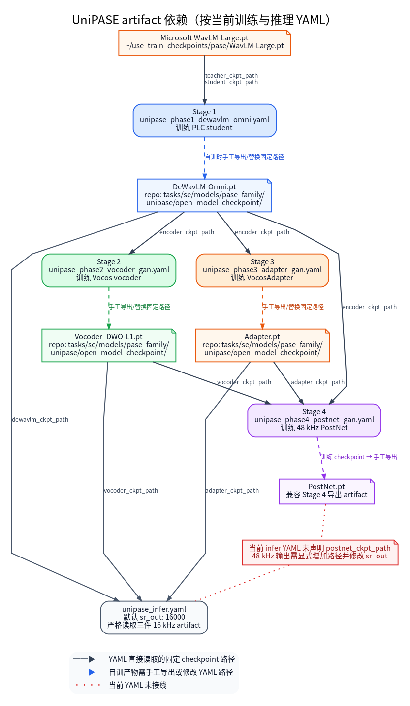

# UniPASE 训练配置 (`configs/se/urgent2026/pase/unipase`)

<p align="center">
  <strong>UniPASE (Cisco, 2025)：带丢包补偿（PLC）的 WavLM 生成式语音增强 + 48 kHz 宽带扩展</strong>
</p>

官方仓库：[Xiaobin-Rong/UniPASE](https://github.com/Xiaobin-Rong/UniPASE)。
整体结构：`DeWavLM-Omni (WavLM + PLC) -> VocosAdapter (noisy L1 + L24 -> enh L1)
-> VocosVocoder (16 kHz 波形) -> TFGridNet PostNet (8 kHz -> 24 kHz 宽带扩展)`。

**怎么读这份文档**：完整链路被拆成四个阶段，每个阶段单独训练一个组件；Stage 2 与 Stage 3 都只需要 Stage 1 的 encoder，两者之间没有先训关系，Stage 4 则要求前三者齐备。因此先看「4 阶段训练流水线」确定阶段，再按「权重衔接」准备前置 artifact 与 `WavLM-Large.pt`，最后用「训练命令」启动。Trainer 不会自动发现上一阶段的最新 checkpoint，`*_ckpt_path` 必须显式写对。

| 术语 | 一句话解释 |
|---|---|
| PLC（packet loss concealment，丢包补偿） | `DeWavLM-Omni` 相对普通 DeWavLM 多出的丢包补偿前端；因此 Stage 1 必须开启 Layer E 的 `packet_loss` 退化，否则该路径学不到东西 |
| encoder / adapter / vocoder / PostNet | 四个被分别训练的组件；encoder 负责编码，adapter 把编码特征映射到增强特征，vocoder 还原 16 kHz 波形，PostNet 做宽带扩展 |
| target-only 自编码 | 只输入干净语音、不做去噪的条件，用来单独训练 vocoder |
| MPD + MBD | 多周期 + 多频带波形判别器，只在训练期参与 |
| multi-scale discriminator（特征域） | Stage 3 用的判别器，作用于特征而非波形 |
| artifact | 阶段产物或官方发布权重（如 `DeWavLM-Omni.pt`、`Vocoder_DWO-L1.pt`） |
| `*_ckpt_path` | YAML 中声明前置权重路径的配置键；本目录不会自动发现 `exp/` 下的最新产物 |

### 配置顶部审计摘要

- **Model**：四阶段分别训练 `DeWavLM-Omni`、`VocosVocoder`、`VocosAdapter` 与
  `TFGridNet PostNet`；只有严格组合相容 artifact 才构成完整 UniPASE inference chain。
- **Params**：当前环境缺少完整实例化所需 checkpoint，记为 **not measured**。既有完整链
  参考值约 `546.5M`，论文参考值为 `545.7M`；训练期 discriminator 不计入推理参数。
- **MACs / FLOPs**：当前环境未完成组件 profile，均记为 **not measured**。论文
  encoder/adapter/vocoder/postnet 参考值为 `18.08/5.69/5.69/49.73 GMAC/s`；
  discriminator 与重采样开销未包含，不能称为本配置实测。
- **THOP**：**partial/unverified**（未运行），不能替代完整 waveform-native 链路的实测
  MACs/FLOPs。
- **1 秒复杂度输入/范围**：Stage 1–3 统一为 `B=1`、16 kHz、`[1, 16000]`；Stage 4 为
  `B=1`、48 kHz、`[1, 48000]`；均为 float waveform、标称幅度 `[-1, 1]`。任意输入采样率
  只属于完整推理 wrapper 的重采样能力，不改变内部 16 kHz/48 kHz 固定链路。
- **Trainer MOS 边界**：Stage 1 的 scalar feature MSE 与 Stage 3 的 feature-domain GAN
  都不输出增强音频，不能做音频 MOS/PESQ/STOI；Stage 2/4 虽输出 waveform，Trainer 也不计算
  DNSMOS/UTMOS，只能在 artifact 严格加载后离线评估完整链输出。
- **组件与 artifact 边界**：Stage 1 冻结 teacher、训练 PLC student；Stage 2 冻结 encoder、
  训练 vocoder + waveform discriminator；Stage 3 冻结 encoder、训练 adapter + feature
  discriminator；Stage 4 冻结 encoder/adapter/vocoder、训练 PostNet + waveform discriminator。
  discriminator 均仅训练期存在，不进入 `DeWavLM-Omni.pt` / `Vocoder_DWO-L1.pt` /
  `Adapter.pt` / `PostNet.pt` 推理 artifact。
- **纯推理配置**：`unipase_infer.yaml`（16 kHz）与 `unipase_48k_infer.yaml`（48 kHz，
  显式加载 PostNet）仅以 `data.mode: dynamic` 路由到 SE task；不包含 `train`、
  `validation`、`trainer` 或 `loss`。

---

## 4 阶段训练流水线

| 阶段 | 配置文件 | 模型 (generator) | 判别器 | Trainer | 输出权重 |
|------|----------|------------------|--------|---------|----------|
| **Stage 1** | [`unipase_phase1_dewavlm_omni.yaml`](unipase_phase1_dewavlm_omni.yaml) | `DeWavLMDistillModel`（`use_plc_frontend: true`） | — | `DualInputLossTrainer` | `DeWavLM-Omni.pt` |
| **Stage 2** | [`unipase_phase2_vocoder_gan.yaml`](unipase_phase2_vocoder_gan.yaml) | `UniPASEVocoderGenerator` | `PASEDiscriminator` (MPD+MBD) | `PASEGANTrainer` | `Vocoder_DWO-L1.pt` |
| **Stage 3** | [`unipase_phase3_adapter_gan.yaml`](unipase_phase3_adapter_gan.yaml) | `UniPASEAdapterGenerator` | `UniPASEMultiScaleDiscriminator` | `UniPASEAdapterGANTrainer` | `Adapter.pt` |
| **Stage 4** | [`unipase_phase4_postnet_gan.yaml`](unipase_phase4_postnet_gan.yaml) | `UniPASEPostNetGenerator` | `PASEDiscriminator` (MPD+MBD) | `PASEGANTrainer` | `PostNet.pt` |

**依赖与 warm-start 边界**：



[查看可编辑 Graphviz 源码](../../../../../docs/guides/se/assets/pase_family/unipase_stage_dependencies.dot)

> 图示表示 artifact 依赖，不表示 Trainer 自动扫描上一阶段 checkpoint。Stage 2 与 Stage 3
> 都依赖 Stage 1 encoder，二者完成后 Stage 4 才能组合 Stage 1/2/3；Stage 2 与 Stage 3
> 彼此没有直接 warm-start 关系。当前 YAML 默认使用固定的官方 `*_ckpt_path`，不会自动改用
> `exp/se/unipase_phase*/checkpoints/` 的最新产物；全流程自训必须手动导出兼容 artifact 并显式
> 替换路径。
> 例外：Stage 2 的 generator 使用 `generator_ckpt_path` 从 released
> `Vocoder_WavLM-L24.pt` 初始化（官方 `train_vocoder.py:95-99` 的 warm start）；
> 官方同时恢复的 discriminator 与两个 optimizer 状态来自未发布的 `model_350.tar`。
> 本仓库提供 `trainer.official_warm_start_ckpt`：提供该文件时恢复 `model` /
> `discriminator` / `optimizer_g` / `optimizer_d`；默认 `null` 时只恢复 generator，
> D/optimizer 从随机状态开始。

各阶段要点（与官方 `train/train_*.py` 对齐）：

- **Stage 1**：teacher/student 均由 `WavLM-Large.pt` 初始化，L24 特征 MSE；
  学生侧 `mask=True`（PLC），数据**必须**开启 Layer E packet_loss
  （20 ms 包、5%–25% 丢包率、最多连续 10 包，对齐官方 `simulation_train.yaml:57-61`），
  否则丢包检测为空、PLC 路径形同虚设。
- **Stage 2**：target-only（`prob_target_only: 1.0`）无条件自编码；encoder 为
  Stage 1 产物 DeWavLM-Omni，`output_layer=1`，`mask=False`（官方
  `cfg_train_vocoder.yaml:1-3` + `train_vocoder.py:268`）。
- **Stage 2/4 validation**：官方 validation `wav_len=4`；train 分别为 1 s / 2 s，
  配置已显式写 `data.validation.max_duration_seconds: 4`，不再继承 train 画布。
- **Stage 3**：输出 `(B, T, 1024)` 特征而非波形；loss = `200*MSE + 1*LSGAN + 1*feat`
  （官方 `train_adapter.py:245-252`）。专用 `UniPASEAdapterGANTrainer` 负责把
  clean 一并送入 generator（clean L1 特征作 MSE 目标）并把判别器接到特征域。
- **Stage 4**：`data.sample_rate: 48000` 映射为 `target_sr`，声学混合在 48 kHz 执行；
  16 kHz 冻结链路输出重采样到 48 kHz 后进入 `TFGridNet.forward`
  （训练模式全时域残差，**不是** `infer()` 的软门控残差）。推理请求 48 kHz 输出时，
  必须同时设置 `sr_out: 48000` 并提供有效的 `postnet_ckpt_path`；只有其中一项不能启用完整 PostNet 路径。

**数据仿真注释口径**：

- `target_type: dry` 对齐官方 `loaders/dataloader.py:203-205`：官方把 early-RIR 两行注释掉，
  clean 语音不做混响卷积（noisy 仍按 `prob_reverberation: 0.5` 卷积 RIR）。
- `rir_normalize: false` 表示 RIR 卷积前不做峰值归一化，保留原始 RIR 增益；各阶段统一使用
  `prob_reverberation: 0.5`，因此该字段在启用 RIR 的样本上生效。
- Layer D 是 post-mix amplitude conditioning（normalize → guard）；公共
  `peak_normalization_mode` 只控制 `off/joint`。Stage 1/3/4 关闭公共 D-normalize（`off`），
  noisy/clean 各自 peak 归一化由 `se.pase_preprocess` 的 `separate` 承担，并用
  `apply_after_channel: true` 把它放到 Layer E 信道退化之后，对齐官方
  `loaders/dataloader.py:327-330`“先增广、后分别归一化”的顺序；Stage 2 target-only 用
  `single`（只归一 clean），Layer E 关闭且归一化位于噪声混合之后，顺序已与官方一致，
  因此不设 `apply_after_channel`。
- `prob_wind_noise_sidechain: 0.05` 对齐官方 `simulation_train.yaml:24` 的 5% wind noise，
  四个阶段一致。Stage 2 是 target-only 自编码，最终 observation=clean，因此这条风噪路径
  不改变 clean target（与官方“仍按 5% 采样、但 clean 目标来自干净源”的口径一致）。
- `noisy_post_mix_degradations_enabled` 仅控制 Layer F；其值为 `false` 不会关闭 Layer D
  或 Layer E。Layer E 由 `prob_channel_enabled` 独立控制。
- Layer E 的增强名称枚举为 `bandwidth_limitation`、`clipping`、`codec`、`packet_loss`；
  增强数量由 `num_augmentations` 概率分布抽样。Stage 1/3/4 开启，Stage 2 关闭；
  `bandwidth_limitation.target_sr: 8000` 对齐官方硬编码的 8 kHz 有效带宽。

---

## 超参数对照（官方 → 本配置）

| 项 | Stage 1 | Stage 2 | Stage 3 | Stage 4 |
|----|---------|---------|---------|---------|
| clip 时长 | 4 s | 1 s (target-only) | 4 s | 2 s @ 48 kHz |
| batch size | 20 | 40 | 64 | 3 |
| validation batch size | 1 | 1 | 1 | 1 |
| epochs | 200 | 400 | 200 | 200 |
| AdamW max_lr（scheduler 峰值） | 1e-4 | 2e-4 | 2e-4 | 2e-5 |
| optimizer.lr（初始值） | 2e-6 | 2e-6 | 2e-6 | 1e-6 |
| warmup / decay_until | 10k / 110k | 20k / 220k | 10k / 110k | 5k / 55k |
| 损失权重 | MSE×1 | mel×15 + adv/feat×0.5 | MSE×200 + adv/feat×1 | mel×15 + adv/feat×0.5 |
| num_per_epoch | 40000 | 80000 | 128000 | 6000 |
| meta.seed | 34 | 43 | 0 | 43 |
| 精度 | fp32 | fp32 | fp32 | fp32 |

数值均逐项对齐官方 `configs/cfg_train_{dewavlm,vocoder,adapter,postnet}.yaml`（Stage 2
仅 generator warm start，D/optimizer 状态未恢复）
（`betas=(0.8, 0.99)`、`weight_decay=0.01`、`clip_grad_norm=3.0`、
`min_lr=1e-6` 四阶段一致）。`meta.seed` 与官方 `train/train_*.py` 一致。
官方训练脚本使用 **fp32**、没有 autocast，因此四个配置统一 `meta.use_amp: false`；
`meta.amp_dtype: bfloat16` 仅保留作参考，不代表启用混合精度。

`optimizer.lr` 与 `scheduler.max_lr` 是两个语义：前者是官方 `optimizer.lr` 的第一步
初始值，训练开始后由 `LinearWarmupCosineAnnealingLR` 的 `max_lr` 接管峰值调度。
表中 `optimizer.lr` 取官方 Stage 1/2/3 `2e-6`、Stage 4 `1e-6`，不再写成 `max_lr`。

source 语音过滤按官方 `loaders/dataloader.py:71` 的 `fs >= default_fs` 执行：Stage 1/2/3
的 train 与 validation split 都写 `speech_min_sample_rate: 16000`，Stage 4 写 `48000`，
低于阈值的源语音在 Dataset 构造期被过滤。

---

## 与官方的有意偏差

1. **epoch 语义**：本框架已把 `data.train.num_per_epoch` 接到 sampler；每个 epoch
   从全量 SCP 索引中最多无放回抽取该数量，若上限大于等于数据集大小则退化为全量遍历，
   不会有放回补齐到固定数量。配置保留官方字面 `epochs`，实际 steps 仍取决于
   `min(num_per_epoch, 数据集大小)`、batch、DDP 与 `drop_last`。
2. **Stage 4 validation clip 时长**：官方 val `wav_len=4`，本配置 `inherit_simulation: true`
   沿用 train 的 2 s（48 kHz 下 TFGridNet 显存占用大）；如需对齐官方可单独覆盖。
3. **Stage 2 validation clip 时长**：官方 val `wav_len=4`，本配置沿用 target-only
   train 的 1 s 切片。
4. **训练/验证裁剪与 batch**：四个 stage 的训练 split 显式设置 `speech.random_start: true`
   与 `repeat_to_max_duration: false`，对齐官方 `cfg_train_*.yaml` 的随机起点裁剪和零填充；
   validation 显式覆盖 `simulation_cfg.speech.random_start: false`，并按官方
   `validation_dataloader.batch_size` 设置 `data.dataloader.val_batch_size: 1`，
   `validation_epoch_interval: 1` 逐 epoch 验证。
5. **采样率口径**：官方 `selected_fs` 实际只用于 source 过滤（`loaders/dataloader.py:71`
   的 `fs >= default_fs`），仿真本身固定使用 `default_fs`——Stage 1–3 为 16 kHz、
   Stage 4 为 48 kHz。本目录已用 split 级 `speech_min_sample_rate`（Stage 1/2/3 为
   `16000`、Stage 4 为 `48000`，train 与 validation 同口径）复现该过滤，不再有
   “未过滤低采样率 source”的偏差。框架本身支持原生多采样率训练：省略
   `data.sample_rate` 后，`GroupedBatchSampler` 按 SR 分桶批处理，训练侧把 batch
   实际 `fs` 注入模型与 loss；官方 released recipe 固定 `default_fs`，复现时不要
   自行打开。
6. 官方 `train_vocoder.py:95-99` 有一段硬编码 resume 旧 checkpoint 的临时代码
   （WavLM-L24 声码器），属于官方仓库遗留，不予移植。

---

## 验证音频（trainer.val_audio）

四个 Stage 的配置都在 `trainer.val_audio` 下启用官方验证音频：仅 rank 0、仅在
validation 循环内、按官方 1-based epoch/step 条件（四个 Stage 均为
`epoch < start_epoch+10` 或 `epoch%10==0`；Stage 2/4 的 step 上限为 5，
Stage 1/3 为 10）写 `<trainer.exp_path>/samples/{step}_*.wav`。实现位于
`tasks/se/trainer/val_audio.py`：

- Stage 1：`{step}_noisy/_clean/_enh_epochNNN/_ref_epochNNN.wav`（16 kHz，
  `Vocoder_WavLM-L24`）；
- Stage 2：`{step}_true/_esti_epochNNN.wav`（16 kHz）；
- Stage 3：`{step}_noisy/_clean/_recon/_enh0/_enh_epochNNN.wav`（16 kHz，
  `Vocoder_DWO-L1` + `Vocoder_WavLM-L24`，三个重建项峰值归一到 0.9）；
- Stage 4：`{step}_noisy/_clean/_enh_16k/_enh_epochNNN.wav`（48 kHz，`_enh_16k`
  为 16k 中间波形重采样到 48k 后保存）。

`enabled: false` 时整段零开销；冻结 vocoder 只由写入器懒加载，不进入模型
`state_dict`/checkpoint。uid 使用 validation 循环的 1-based step（SEBatch 不携带
官方 `info['id']`）。

---

## 权重衔接

各 Stage 配置的 `*_ckpt_path` 默认指向仓库内 `tasks/se/models/pase_family/unipase/open_model_checkpoint/` 下的官方发布权重
（`DeWavLM-Omni.pt`、`Adapter.pt`、`Vocoder_DWO-L1.pt`、`PostNet.pt`），便于直接
从中间阶段起跑或做热启动对比；全流程自训时按依赖顺序替换为
`exp/se/unipase_phase*/checkpoints/` 下的上一阶段产物。

官方权重来源：HuggingFace [`Xiaobin-Rong/unipase`](https://huggingface.co/Xiaobin-Rong/unipase)
（另含仅评测用的 `Vocoder_WavLM-L24.pt`），下载脚本
`tools/model_tools/download_pase_pretrained.py --model unipase`。
`tests/test_unipase_official_parity.py` 与 `tools/verify/verify_unipase_official_weights.py`
用于数值核对：前者要求官方源码 checkout、所需官方权重和受控后端，组件测试的历史记录为
`max_abs_diff = 0.0`；后者以 SI-SNR > 60 dB 作为端到端判定阈值。两者都不是任意环境或音频的逐比特保证。目录内的 `README.md`/`config.json` 为
HF 仓库原始文件，按仓库 .gitignore 约定不纳入版本管理。

Stage 1 的 teacher/student 初始化需要微软官方 `WavLM-Large.pt`
（默认 `~/use_train_checkpoints/pase/WavLM-Large.pt`，与 pase 目录配置共享）。

---

## 训练命令

```bash
python train.py -C configs/se/urgent2026/pase/unipase/unipase_phase1_dewavlm_omni.yaml
python train.py -C configs/se/urgent2026/pase/unipase/unipase_phase2_vocoder_gan.yaml
python train.py -C configs/se/urgent2026/pase/unipase/unipase_phase3_adapter_gan.yaml
python train.py -C configs/se/urgent2026/pase/unipase/unipase_phase4_postnet_gan.yaml
```

多卡与仓库其它配置一致（`torch.distributed.run`）。Smoke test 见
`tests/test_unipase_*_smoke.py`。
