# SE 架构与模型说明

**姊妹文档**：[AEC_Architecture.md](AEC_Architecture.md)。

---

## SSOT：SE 相关代码路径（防漂移）

| 主题 | 代码路径 |
|------|----------|
| DeepFilterNet / DPDFNet 实现与默认超参 | `tasks/se/models/discriminative/deepfilternet.py`（入口）与 `tasks/se/models/modules/deepfilternet_impl.py`（`DeepFilterNet`、`Encoder`、`ErbDecoder`、`DfDecoder`） |
| 模型注册与 YAML 路由 | `tasks/se/models/discriminative/deepfilternet.py` |
| GTCRN / CoFi-Lite / BSRNN / FastEnhancer / FastULCNet / ULUNAS | `tasks/se/models/discriminative/gtcrn.py`、`tasks/se/models/discriminative/cofi_lite.py`、`tasks/se/models/discriminative/bsrnn.py` 与 `tasks/se/models/modules/bsrnn_impl/`、`tasks/se/models/discriminative/fastenhancer.py`、`tasks/se/models/discriminative/fast_ulcnet.py`、`tasks/se/models/discriminative/ulunas.py` |
| MeanFlowSE | `tasks/se/models/generative/meanflowse/model.py`、`tasks/se/trainer/meanflowse_trainer.py`、`configs/se/voicebank_demand/meanflowse_ncsnpp_offline.yaml` |
| RWSA-MambaUNet | `tasks/se/models/gan/generators/rwsa_mamba_unet.py`、`tasks/se/models/modules/rwsa_mamba_impl/`、`configs/se/urgent2026/gan/rwsa_mamba_unet_metricgan_dynamic.yaml` |
| 变体说明（DF2 / DF3 / DPDFNet） | `tasks/se/models/discriminative/deepfilternet.py` / `tasks/se/models/modules/deepfilternet_impl.py` 模块 docstring |

### 三模型实现与复现边界

- **RWSA-MambaUNet**：上游固定为 commit `02635ab7e92a0584fde729f8a55f398c2379da82`；framework wrapper、官方幅相语义、S/XS/M 结构与 resolution-wise attention identity 已对齐并有训练 YAML/结构测试，但尚未验证官方 checkpoint 或论文指标。
- **FastULCNet**：模型、官方 CRM/Comfi 语义、训练 YAML 与 `tools/verify/verify_fast_ulcnet_state_drift.py` synthetic 长序列工具均已存在。共享 STFT 使用标准 Hann，与官方 `hann75`/WOLA 不同；尚无 checkpoint 或真实 90 秒质量复现。
- **MeanFlowSE**：已有 complex-STFT、MeanFlow objective、FD-JVP、task-local trainer/config/tests 的纯 PyTorch NCSN++ 风格项目实现；它不是官方 checkpoint-compatible 结构，尚未训练复现论文指标。

### 默认频域设置（仓库常用 16 kHz）

与 `DeepFilterNet` 默认构造一致：`samplerate=16000`，`n_fft=320`（`freq_bins = n_fft//2+1 = 161`），`freq_df=4800`，`nb_erb=32`。`nb_df = int((freq_df / (samplerate // 2)) * freq_bins)` → 96。

---

> **编号说明**：以下首节为原《DeepFilterNet_Comparison_and_LSNR》稿件，文中「零、一、二…」为其自有章节号；后接《单模型分析》从「零、架构教学报告」重新计数，属正常现象。

# DeepFilterNet 系列：DPDFNet/DeepFilterNet 与 use_train 对比与 LSNR 分析

本文档合并自《DPDFNet_DeepFilterNet_对比分析》与《DeepFilterNet_LSNR_noise_分析》，统一描述 DeepFilterNet 系列（DeepFilterNet2、DeepFilterNet3、DPDFNet）在 use_train 中的复现、训练/验证流程、Loss 设计，以及 LSNR 所用 noise 的获取方式。

---

## 零、该系列是否都使用 LSNR？（结合论文）

结合 **DeepFilterNet2.pdf**（arXiv:2205.05474）、**DeepFilterNet3**、**DPDFNet.pdf**（arXiv:2512.16420）与官方实现：

**结论：是的，该系列（DeepFilterNet2、DeepFilterNet3、DPDFNet）在模型与训练中均使用 LSNR（Local SNR）。**

| 论文/模型 | 论文中 LSNR 表述 | 代码/实现中的 LSNR |
|-----------|------------------|---------------------|
| **DeepFilterNet2** | 摘要未逐字写 "LSNR"，但 Encoder 预测帧级 SNR，训练时用 clean/noise 算 GT，MSE 监督。 | Encoder 有 `lsnr_fc`，Loss 中 `LocalSnrTarget(clean, noise=noisy-clean)` + `LocalSnrLoss`，factor=0.0005。 |
| **DeepFilterNet3** | 与 DeepFilterNet 同框架。 | 同上，config 中 lsnr_min=-15、lsnr_max=35。 |
| **DPDFNet** | 保留 DF2 的增强框架（含 Encoder 与训练目标）。 | DPDFNet-main 中 Encoder 仍含 `lsnr_fc`，`forward` 返回 `(waveform_e, lsnr)`。 |

- **作用**：LSNR 为 Encoder 的帧级 SNR 估计，用于（1）训练时 MSE 辅助 loss；（2）推理时低 SNR 可关闭或减弱解码。
- **实现**：DeepFilterNet-main 在频域用 `LocalSnrTarget` 算 GT；use_train 在时域用 `compute_frame_snr` 算 GT，权重均为 0.0005。

---

## 一、LSNR loss 所用 noise 的获取方式（DeepFilterNet-main vs use_train）

### 1.1 结论（一句话）

**官方（DeepFilterNet-main）：Noise 不是数据集返回的，而是在 loss 的 forward 里用「noisy - clean」算出来的（复数谱域）。**

### 1.2 官方数据流

- Batch 只提供 **speech（clean）** 和 **noisy**（均为复数谱），不提供 noise。
- 训练循环中：`lsnr_gt = self.lsnr(clean, noise=noisy - clean)`，noise 在 loss 内现场计算。
- **LocalSnrTarget**：用 clean 与 noise 的复数谱算局部能量，再得局部 SNR（dB）。

### 1.3 与 use_train 的对应关系

| 项目 | DeepFilterNet-main | use_train |
|------|--------------------|-----------|
| noise 从哪来 | loss 里算 `noise = noisy - clean`（谱） | batch 不单独携带 noise；loss 内由 `noisy - clean`（波形）推导 |
| 域 | 复数谱 | 输入 batch 为波形；LSNR target 在时域短帧上计算 |
| 是否“仿真后的噪声” | 是 | 是 |

use_train 的 `SEBatch` 只携带 clean/noisy 波形，不返回独立 noise 通道；`DeepFilterNetLSNRLoss` 在 loss 内用 **`noise = noisy - clean`** 推导仿真后的噪声。它与官方的目标语义一致，但官方基于复数谱帧能量，本仓库基于波形短帧功率。

---

## 二、模型与算法复现

### 2.0 双解码器输出：ERB Gains 与 DF Coefs（与官方框图一致）

论文/官方结构图中，增强网络在频域的两路**显式预测**为：

| 输出名 | 模块 | 形状（典型） | 作用 |
|--------|------|--------------|------|
| **ERB Gains** | ErbDecoder（GRU + PConv/TConv 上采样 + Sigmoid） | **m：(B, 1, T, nb_erb)** | 每 ERB 带一个增益；经逆 ERB 矩阵扩到全 FFT bin，与复谱相乘（宽带包络抑制） |
| **DF Coefs** | DfDecoder（GRU + GroupedLinear + 与编码器浅层 c0 相加） | **(B, df_order, T, nb_df, 2)** | 在低频 **nb_df** 个 bin 上做 **df_order** 阶深度滤波（实/虚部系数） |

随后 **`Mask(spec, m)`** 与 **`DF Op(spec, df_coefs)`** 按配置顺序组合（如 `mask_method=before_df`），得到增强复谱再 iSTFT。**LSNR** 仅由 **emb** 分支预测，不参与上述两路解码。

**输入到特征的变换**：复谱 → **ERB Features**（幅度²×ERB 滤波器组，可选 dB）与 **Complex/DF Features**（前 **nb_df** 个频点的实部/虚部，归一化）。DPDFNet 与 DeepFilterNet2 在此之后的区别仅为 Encoder 是否含 **DPRNN**，**ERB Gains / DF Coefs 的语义与形状不变**。

### 2.1 总体架构对照

| 维度 | DeepFilterNet-main | DPDFNet-main | use_train (DeepFilterNet/DPDFNet) |
|------|--------------------|--------------|-----------------------------------|
| **输入/输出** | 频域：spec / feat_erb / feat_spec → enh, **mask(ERB gains)**, **DF**, lsnr | 时域：waveform → (waveform_e, lsnr) | **频域**：`noisy_spec` → `enhanced_spec`，可选返回 lsnr / df_alpha；STFT/iSTFT 由 trainer 管理 |
| **STFT** | libdf (C++) | 自实现 Stft/Istft (PyTorch)，Vorbis 窗 | 框架 `core.stft` 按 YAML `stft` 块执行；现有 16 kHz 配置使用 Hann 320/160 |
| **Encoder** | ERB + DF 双路径 → emb → lsnr_fc → lsnr | 同左，含 DPRNN(dprnn_num_blocks) | 同左，dprnn_num_blocks=0 为 DF2/DF3，2/4/8 为 DPDFNet |
| **LSNR 输出** | 有，lsnr_fc(emb) 映射到 [lsnr_min, lsnr_max] | 有，接口一致 | 有，Encoder 输出 lsnr，`forward` 可选 `return_lsnr` |
| **DPRNN** | 无（DF2/DF3） | 有 | 有，dprnn_num_blocks 可配 |
| **ERB 作用范围** | DF3: 仅高频 (erb_apply_above_bins)；DF2: 全频 | 全频 | 支持 erb_apply_above_bins |
| **变体** | DF2 / DF3 | DPDFNet-2/4/8 | 同一模型 YAML 参数区分 |

**结论（模型）**：use_train 的 `deepfilternet_impl` 与 **DPDFNet-main** 的 Encoder、双解码器、DPRNN 和 LSNR 语义对齐；对外则遵守仓库统一的 SE **谱进谱出**合同，不能表述为 DPDFNet-main 的波形接口。

### 2.2 Encoder 与 LSNR 细节

- **DeepFilterNet-main**：lsnr 来自 encoder 最后一层线性 + Sigmoid 后线性映射到 [lsnr_min, lsnr_max]。
- **DPDFNet-main / use_train**：`lsnr_fc = nn.Sequential(nn.Linear(emb_out_dim, 1), nn.Sigmoid())`，`lsnr = lsnr_fc(emb).squeeze(-1) * scale + offset`，一致。

### 2.3 前向接口差异

- **DeepFilterNet-main 训练**：数据为 HDF5 频域，`model.forward(spec=..., feat_erb=..., feat_spec=...)` → `enh, m, lsnr`。
- **DPDFNet-main**：`forward(waveform)` → `(waveform_e, lsnr)`。
- **use_train**：`forward(noisy_spec, lengths, fs, return_lsnr=False, return_alpha=False)` 消费 `(B,F,T,2)` 复谱；默认返回 `enhanced_spec`，`return_lsnr=True` 返回 `(enhanced_spec, lsnr)`，同时启用 `return_alpha=True` 时再返回 `df_alpha`。`MetricsCapableTrainer` 在模型外执行 STFT/iSTFT。

---

## 三、训练流程

### 3.1 数据与 batch

| 项目 | DeepFilterNet-main | use_train |
|------|--------------------|-----------|
| **训练数据** | HDF5，libdfdata，已做 STFT/ERB | 动态混合 `DynamicMixingDataset`（`tasks/se/data/dynamic_dataset.py`）或离线数据集（共享 `core/data/offline_dataset.py` 等） |
| **Batch 内容** | clean/noisy 为复频谱 | `SEBatch`（`core/data/speech_enhancement_batch.py`，任务侧再导出）：clean/noisy/sr/lengths（+可选 pure 标记）；collate 接受 4/7 元组样本并返回已校验 Batch，Trainer 拒绝 tuple/list 批；batch 不单独携带 noise |
| **Noise 来源** | GT LSNR 用 `noisy - clean`（频域，在 loss 内算） | 同样在 loss 内由 `noisy - clean` 推导（时域波形，见 `core/losses/model_specific/deepfilternet.py`） |

- use_train：训练 LSNR 不再需要单独的 noise 通道；`SEBatch` 只携带 clean/noisy，noise 由 loss 内部 `noisy - clean` 推导。

### 3.2 训练循环

- **DeepFilterNet-main**：每个 batch 传入 clean、noisy、enh、m、lsnr；loss 内部用 `noisy - clean` 算 lsnr_gt，再算 LocalSnrLoss。
- **use_train（MetricsCapableTrainer）**：trainer 先把 `batch.noisy` 波形转换为 `noisy_spec`，再调用模型。仅当 `trainer.use_lsnr_loss: true`、模型支持 `return_lsnr` 且 loss 接受 `predicted_lsnr` 时，模型返回 `(enhanced_spec, lsnr[, df_alpha])`；trainer iSTFT 得到 `enhanced` 后调用 `loss_fn(enhanced, clean, lengths, predicted_lsnr=lsnr, noisy=noisy[, predicted_alpha=df_alpha])`。否则模型只返回增强谱。该路径支持梯度累积、AMP、DDP。

---

## 四、验证流程

| 项目 | DeepFilterNet-main | use_train |
|------|--------------------|-----------|
| **验证 forward** | 同训练，算 loss | `_forward_model(noisy, lengths, fs)`：trainer 做 STFT → 模型增强谱 → iSTFT；不请求 LSNR/alpha |
| **指标** | config 可配 SDR/STOI 等 | `val_metrics`：SI-SDR、PESQ、STOI、ESTOI 等带参考客观指标 |

use_train 验证阶段不请求 LSNR/alpha 输出，也不计算对应辅助 loss，只做增强 loss 与带参考质量评估。DNSMOS、NISQA、UTMOS、SCOREQ 等无参考 MOS 指标统一通过 `evaluate/` 离线计算。

---

## 五、Loss 设计

### 5.1 主 Loss

- **DeepFilterNet-main**：MaskLoss + SpectralLoss + 可选 MultiResSpecLoss / SdrLoss，均在频域。
- **use_train**：仓库 YAML 使用显式 `CompositeLoss`（可组合 GTCRN compressed/log-ratio、SISNR 等注册项）；GTCRN-style 配方应显式展开为 `GTCRNCompressedSpectralLoss` 与 `GTCRNLogRatioLoss`。LSNR 配置下常用 **DeepFilterNetFullLossWithLSNR**（内嵌主 loss）。

### 5.2 LSNR 辅助 Loss

| 项目 | DeepFilterNet-main | use_train |
|------|--------------------|-----------|
| **形式** | `LocalSnrLoss`: MSE(pred_lsnr, target_lsnr) × factor | `DeepFilterNetLSNRLoss`: MSE(predicted_lsnr, gt_snr) × weight |
| **默认权重** | factor=0.0005 | weight=0.0005 |
| **GT 计算** | **频域**，STFT 帧上滑窗能量，再 10*log10 得 dB | **时域**，`compute_frame_snr(clean, noise, frame_length, hop_length)`，20ms 对应采样数 |

差异：官方在频域按帧能量算 LSNR；use_train 在时域按短时功率算 SNR。目标一致（让预测 lsnr 逼近局部 SNR），复现时以 use_train 的时域实现为准即可。

### 5.3 Alpha / DF 控制 Loss（可选）

- **DeepFilterNet-main**：DfAlphaLoss，根据 target_lsnr 惩罚低 SNR 用 DF、鼓励高 SNR 用 DF。
- **use_train**：`DeepFilterNet.forward(..., return_lsnr=True, return_alpha=True)` 可返回 `df_alpha`；当 loss 包含 `DfAlphaLossComponent` 或 `DeepFilterNetFullLossWithLSNR(use_alpha_loss=True)` 时，trainer 自动请求并注入 `predicted_alpha`。未启用相应 loss 时不请求该输出。

---

## 六、对照小结

1. **模型/算法**：use_train 的内部骨干复现 DPDFNet 的双路径 Encoder、DPRNN、双解码器与 LSNR/alpha 语义；公共模型合同则是谱进谱出。
2. **LSNR 用 noise**：官方在 loss 内用 `noisy - clean`（谱）；use_train 同样在 loss 内由 `noisy - clean` 推导（波形），语义一致、计算域不同。
3. **训练**：`MetricsCapableTrainer` 管理 STFT/iSTFT，并按 loss 需求请求 `return_lsnr` / `return_alpha`，`SEBatch` 无独立 noise 通道。
4. **验证**：验证仅请求增强谱，iSTFT 后计算增强 loss 与客观指标，不计算 LSNR/alpha 辅助项。
5. **Loss**：LSNR 默认权重均为 0.0005；主 loss 在 use_train 中可按配置组合，alpha 辅助项按 loss 配置显式启用。

整体上，use_train 保留 DPDFNet 的频域增强骨干和辅助训练目标，并将 STFT/iSTFT 移到 trainer，以遵守仓库统一的 SE 谱进谱出接口。

---

## 零、架构教学报告：如何阅读本文档

本小节面向**学习者**：读完可掌握各模型的**创新点**、**张量维度变化**、**基于何种结构创新**以及**模型间关系**。中英术语混合，技术表述严谨。

**阅读建议**
- **首次阅读**：先看 **0.1 术语与引用速查** 和 **0.2 模型关系与结构类型**，再根据需要跳转到具体模型小节；每个 SE 模型下均有 **「张量维度追踪」** 正文列表与 **「创新点结构张量维度变换」** 表，便于对照代码理解数据流。
- **查表速览**：**0.4 各模型创新点与维度追踪一览** 给出模型→核心创新→维度追踪所在位置，便于快速定位。
- **对比选型**：**三、模型结构对比表** 与 **五、模型对比与优化建议** 提供横向对比与工程选型建议。

### 0.1 术语与引用速查

| 术语 | 全称 / 含义 | 典型出处 |
|------|-------------|----------|
| **MHSA** | Multi-Head Self-Attention，多头自注意力 | Vaswani et al., *Attention Is All You Need*, NeurIPS 2017 |
| **Dual-Path RNN (DPRNN)** | 块内 RNN（intra，常沿频/子带）+ 块间 RNN（inter，沿时间） | Luo & Mesgarani, *Dual-Path RNN*, 等；思想为时/频分离建模 |
| **Band-Split** | 频谱按子带划分，每子带独立 embedding | BSRNN 系列（Yu et al., Interspeech/ICASSP） |
| **APReLU** | Adaptive / Affine PReLU，带仿射与可学习斜率的 PReLU | UL-UNAS (ULUNAS)，论文 Sec. III-C2 |
| **cTFA** | Causal Time-Frequency Attention，因果时频注意力（TA×FA） | ULUNAS，论文 Sec. III-C3 |
| **GRNN (ulunas)** | Grouped RNN：通道分两组，两组独立 GRU 再 concat | ULUNAS / GTCRN 中的 DPGRNN 内 |
| **FastGRNN / Comfi-FastGRNN** | 门控低秩 RNN；Comfi = 可训练互补滤波 h_comfi=γ·h+(1−γ)·λ | Fast-ULCNet；`tasks/se/models/modules/fast_ulcnet_impl/comfi_fast_grnn.py` |

- **MHSA 在代码中的位置**：FastEnhancer 的 `_Attention`（`tasks/se/models/discriminative/fastenhancer.py`）使用 `nn.Linear(channels, channels*3)` 得到 Q/K/V，再 `F.scaled_dot_product_attention(q,k,v)`，即标准 MHSA 实现；代码内无显式文献注释，但算法与 Vaswani et al. 一致。
- **RNNFormer 与 Dual-Path 的关系**：**思想关联**——都是**时域与频域分开处理**。DPRNN 用两条 RNN 路径（intra 沿频/块内，inter 沿时/块间）；RNNFormer 用**时域 GRU + 频域 MHSA**，用 Attention 替代频域 RNN，避免频带顺序假设，且更轻量。二者并非同一结构，但同属“时频分离”设计。

### 0.2 模型关系与结构类型（学习路径）

- **BSRNN**：Band-Split → **Time-LSTM（沿 T）→ Freq-LSTM（沿子带 K）** 两阶段，无卷积 Encoder；与 DPRNN 的 intra/inter 不同，但同属“先时后频”的两阶段 RNN。
- **FastEnhancer**：StridedConv Encoder → **RNNFormer（时域 GRU + 频域 MHSA）** → ConvTranspose Decoder；RNNFormer 为“时域 RNN + 频域 Attention”，与 DPRNN 思想相近、实现不同。
- **ULUNAS**：ERB + U-Net 式 Encoder（XConv/XDWS/XMB：**APReLU + cTFA**）+ **G-DPRNN** 瓶颈 + Decoder；创新集中在 **APReLU** 与 **cTFA（因果时频注意力）**，以及 NAS 搜索的块类型与宽度。
- **GTCRN**：ERB + SFE + Encoder + **DPGRNN×2**（Grouped 双路径：intra 频向 BiGRNN、inter 时向 GRNN）+ Decoder；与 BSRNN 的“双 LSTM”不同，这里是分组双路径 RNN。
- **FastULCNet**：Reorientation + Conv + **Comfi-FastGRNN**（Freq + 子带）+ Stage2 CNN + CRM；**Comfi-FastGRNN** 即 `comfi_fast_grnn.py` 中的 **FastGRNN 单元 + 可训练互补滤波**，用于长序列抗漂移。

### 0.3 各模型创新点与维度追踪一览

| 模型 | 核心创新（一句话） | 张量维度追踪位置 |
|------|--------------------|------------------|
| GTCRN | 超轻量 ERB + SFE + DPGRNN（分组双路径 RNN） | §1 下方「张量维度追踪」+ 创新点表 |
| BSRNN | Band-Split + Time-LSTM → Freq-LSTM 两阶段 | §2 下方「张量维度追踪」+ 创新点表 |
| DeepFilterNet/DPDFNet | ERB+DF 双路径 Enc + DPRNN×0/2/4/8 + LSNR | §3 |
| FastEnhancer | StridedConv + RNNFormer（时域 GRU + 频域 MHSA） | §4 下方「张量维度追踪」+ 创新点表 |
| FastULCNet | Comfi-FastGRNN + 压缩域 CRM | §5 创新点表 + Comfi-FastGRNN 释义 |
| ULUNAS | APReLU + cTFA（因果时频注意力）+ G-DPRNN + NAS | §5.5 下方「张量维度追踪」+ 创新点表 |
| CAGCRN | CATA 时延对齐 + TFGRU + TFAG | §6 创新点表 |
| DeepVQE | 双分支 Enc + AlignBlock + CCM | §7 创新点表 |

### 0.4 张量维度约定

- **B**：batch；**T**：时间帧数；**F**：频点/频 bin 数；**C / N / K**：通道或子带维度（依模型而定）。
- 频谱常用布局：**(B, F, T, 2)**（实部/虚部最后一维）或 **(B, T, F, 2)**；子带特征常见 **(B, N, T, K)**（N=channel，K=子带数）等，各小节会写明。
- 各 SE 模型小节中，**「张量维度追踪」** 以正文列表给出主数据流维度变化，**「创新点结构张量维度变换」** 以表格归纳关键模块的入/出维度；概念图只表达分区、层级与数据流，精确维度以正文为准。

---

## 一、SE 模型单模型分析

### 1. GTCRN

**模型结构分解（公式化）**

- **GTCRN = ERB + SFE(ShuffleNetV2) + Encoder(SFE+GTConv×3) + TRA(DPGRNN)×2 + SFE_decode + iERB + mask + iSTFT**
- 子模块含义：
  - **ERB**：Equivalent Rectangular Bandwidth，低频保持原分辨率、高频经 ERB 滤波器组压缩（本实现 65+64 频带，n_fft=512）。
  - **SFE**：Shallow Feature Extraction，Unfold 沿频带局部展开（kernel=3），类 ShuffleNetV2 块。
  - **Encoder**：ConvBlock×2 + GTConvBlock×3；GTConvBlock = SFE + 深度可分离卷积 + TRA + channel shuffle。
  - **TRA**：Temporal Recurrent Attention，沿时间维 GRU + FC + Sigmoid 得到通道注意力。
  - **DPGRNN**：Dual-Path Grouped RNN，intra-path 频维双向 GRNN、inter-path 时维单向 GRNN，各带 FC + LayerNorm + 残差。
  - **Decoder**：GTConvBlock×3（deconv）+ ConvBlock×2（deconv），与 Encoder skip 连接。
  - **_Mask**：复数域 mask（实部/虚部线性组合），再与输入复谱相乘。
- **前向数据流**：
  `(B,T) → STFT → (B,F,T,2) → _spec_to_feat → (B,3,T,F) → ERB.bm → SFE → Encoder → skips → DPGRNN×2 → Decoder(skips) → iERB.bs → _Mask(spec_2ch) → (B,F,T,2) → iSTFT → (B,T)`

**总体结构图（概念布局）**

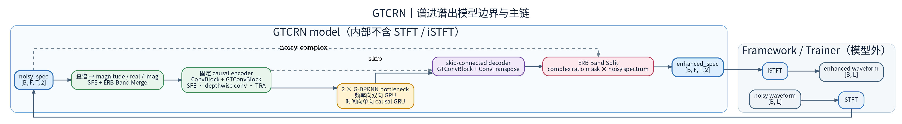

> 图中只表达模块分区、层级和数据流；精确 tensor shape、公式与实现路径以本节正文和下表为准。

**张量维度追踪（B=batch, T=帧, F=频bin, C=通道）**

- 输入波形 **`(B, T)`** 经 STFT 得 **`(B, F, T, 2)`**；`_spec_to_feat` 得 **`(B, 3, T, F)`**。
- `ERB.bm` 得 **`(B, 129, T, F)`**（65+64）；`SFE (Unfold k=3)` 得 **`(B, C×3, T, F)`**。
- `Encoder (GTConvBlock×3 等)` 得 **`(B, C, T, F)`**，并保存各层 `skips`。
- `DPGRNN×2` 输入 **`(B, C, T, F)`**：`intra` 为 `reshape (B*T, F, C) → BiGRNN → fc → LayerNorm → (B, T, F, C) + residual`；`inter` 为 **`(B, T, F, C) → permute (B, F, T, C) → reshape (B*F, T, C) → GRNN → fc → LayerNorm → (B, C, T, F) + residual`**。
- `Decoder(skips) → iERB.bs` 得 **`(B, 129, T, F) → (B, F, T, 2)`**；`_Mask(spec_2ch)` 保持 **`(B, F, T, 2)`**，iSTFT 输出 **`(B, T)`**。

**创新点结构张量维度变换**

| 创新模块/步骤 | 输入维度 | 输出维度 |
|---------------|----------|----------|
| STFT + _spec_to_feat | (B, T) | (B, 3, T, F) |
| ERB（固定） | (B, 3, T, F) | (B, 129, T, F) 低频65+高频64 |
| SFE (Unfold k=3) | (B, C, T, F) | (B, C×3, T, F) |
| GTConvBlock + TRA | Encoder 内 | 通道分组 + 时间维注意力 + shuffle |
| DPGRNN（intra→inter） | (B, C, T, F) | intra 频维 (B*T,F,C)；inter 时维 (B*F,T,C) → (B,C,T,F) |
| Decoder + Mask | skip + 解码 | (B, F, T, 2) |

**论文主要创新点**

1. **超轻量设计**：约 23.67K 可训练参数、~33 MMACs，面向实时/嵌入式；ERB 固定不训练，进一步省参数量。
2. **Grouped 设计**：GTConvBlock 与 DPGRNN 均采用通道分组（chunk×2、GRNN 分两组），在保持表达能力的同时显著减少参数与计算。
3. **双路径 RNN**：DPGRNN 同时建模频维跨带关系（intra 双向）与时维因果依赖（inter 单向），适合频谱增强。

**论文原文要点**（*GTCRN*, ICASSP 2024，**结构创新**）：① **ERB 固定不训练**，作为频带压缩前端省参数量；② **SFE（Shallow Feature Extraction）** 类 ShuffleNetV2 的 Unfold + 局部卷积，轻量频带展开；③ **GTConvBlock** 分组卷积 + SFE + 深度可分离 + TRA（时间维通道注意力）+ channel shuffle；④ **DPGRNN** 双路径：intra-path 频维双向 GRNN 建模跨带、inter-path 时维单向 GRNN 因果，分组与残差控制算力。整体在 23.7K 参数 / 39.6 MMACs/s 下达到可用质量。

**Loss**

- 训练 YAML 显式使用 **`CompositeLoss`**：`GTCRNCompressedSpectralLoss(weight=1.0)` + `GTCRNLogRatioLoss(weight=1.0)`。
- 压缩谱项固定以 `sqrt(real²+imag²+1e-12)` 计算增强/目标幅度，再形成 `30*(L_real+L_imag)+70*L_mag`（`c=0.3`），并在 full batch 计算；`1e-12` 是公式常数，不是可配置 clamp。log-ratio 项属于时域波形损失，使用尺度投影后的 `-log10(ratio+eps)`，由 Composite pure 路由仅在 non-pure 且 clean-energy 有效的样本上归约。它不是标准 `-10*log10` SI-SNR；与 `0.1*SISNRLoss` 的低 ratio 边界也不同。
- 配置：`configs/se/voicebank_demand/gtcrn_causal_offline.yaml`、`configs/se/dns_challenge3/gtcrn_causal_offline.yaml`（component 权重均为 1.0；compress_factor=0.3, lamda_ri=30, lamda_mag=70；STFT 几何由顶层注入）。
- **官方前端证据与复现边界**：固定 commit [`502ebfab`](https://github.com/Xiaobin-Rong/gtcrn/tree/502ebfab64da7c4a9af78dcb9c6ceef1ebb01c73) 的 [`loss.py`](https://github.com/Xiaobin-Rong/gtcrn/blob/502ebfab64da7c4a9af78dcb9c6ceef1ebb01c73/loss.py) 对 prediction/target spectra 以 `512/256/512 + sqrt-Hann` iSTFT 后计算 log-ratio，[`infer.py`](https://github.com/Xiaobin-Rong/gtcrn/blob/502ebfab64da7c4a9af78dcb9c6ceef1ebb01c73/infer.py) 则明确在 STFT/iSTFT 两端复用 sqrt-Hann；该配对只是官方手工、无包络归一化 WOLA 前端的产物：两个 sqrt-Hann 的逐点乘积为 Hann，50% overlap 下相邻 Hann overlap-add 为常数，并非公式本身的要求。同作者 [`SEtrain/loss_factory.py`](https://github.com/Xiaobin-Rong/SEtrain/blob/3ec437d1adef76376775caa9e639d01208426380/loss_factory.py) 的 waveform `HybridLoss` 使用普通 Hann STFT，并在同一 `y_pred/y_true` raw pair 上直接计算投影项。项目两个 component 的公式与官方 `HybridLoss` 逐项对齐（30/70 压缩谱权重、尺度投影 log-ratio 非 dB），同样接收同一 raw `(enhanced, clean)` pair 和同一个 `lengths`；`lengths=None` 时均使用完整波形。两者还可消费同一 framework STFT 的 direct spectra：谱项直接归约，log-ratio 项按各样本有效帧分组裁剪谱后，用继承顶层 `stft` 的几何与同窗 `torch.istft` 重建波形再归约；`torch.istft` 自带的窗包络归一化保证一致谱精确重建，因此项目不需要官方的 sqrt-Hann 配对。

**参数量/算力**

- 本实现：**Trainable 23.67K**，Total ~48.2K（含固定 ERB ~24.6K）；MACs ~0.034 G（1s @ 16kHz，thop 含 STFT）。
- 论文/官方（gtcrn-main）：23.67K trainable，33.0 MMACs；论文 39.6 MMACs/s。
- 差异：trainable 完全一致；MACs 因 thop/ptflops 口径或输入 shape 略异，结构已与官方对齐（见本文与 `tools/model_tools/audit_metrics.py`）。

**可复用/可优化模块**

| 模块 | 可复用场景 |
|------|------------|
| ERB | 任意需频带压缩/ERB 尺度特征的 SE 或 AEC 模型；可共享固定滤波器或改为可学习。 |
| SFE | 轻量局部频带特征扩展，可替代或补充 1D/2D Conv。 |
| TRA | 时间维通道注意力，可插入其他 T-F 模型做轻量 attention。 |
| DPGRNN | 双路径时-频建模，可作其他轻量 CRN 的 backbone 或替代单路径 RNN。 |
| GTConvBlock | 分组 + SFE + 深度可分离 + TRA + shuffle，适合低算力 encoder/decoder。 |

---

### 2. BSRNN（含 USR-BSRNN / URGENT 基线）

**模型结构分解（公式化）**

- **BSRNN = BandSplit → [Time-LSTM → Freq-LSTM]×num_layer → MaskDecoder**
- **BandSplit**：按子带划分频谱（模型 A：n_fft=960→481 bins、34 子带；模型 B：n_fft=2048→1025 bins、41 子带），每子带 Norm + Conv1d 映射到 channel 维，输出 (B, N, T, K)。
- **Time-LSTM**：沿时间维 LSTM，causal=True 时单向、False 时双向；hidden = hidden_factor×num_channel（通常 2×N）。
- **Freq-LSTM**：沿子带维 LSTM，始终双向，建模跨子带依赖。
- **MaskDecoder**：按子带 MLP（Norm→Conv→GLU）输出复数 mask（及可选的 residual）；use_residual=True 为 URGENT/模型 A，False 为 USR-BSRNN/模型 B。
- **因果/非因果**：仅 Time-LSTM 受 causal 控制；Freq-LSTM 始终双向；因果时无 pack_padded/因果 padding，与常见实现一致。

**前向数据流**：
`(B,F,T,2) → permute → (B,T,F,2) → BandSplit(fs) → (B,N,T,K) → [norm_time→Time-LSTM→fc_time→residual, norm_freq→Freq-LSTM→fc_freq→residual]×L → MaskDecoder → mask·x + residual → (B,F,T,2)`

**双路径说明**：BSRNN 的“双路径”是 **Time-LSTM（沿 T）→ Freq-LSTM（沿子带 K）** 两阶段顺序执行，与 DPRNN 的 intra-chunk / inter-chunk 两条并行 RNN 路径不同；思想上同为“时域 + 频域分离建模”，实现为两阶段 LSTM。

**总体结构图（概念布局）**

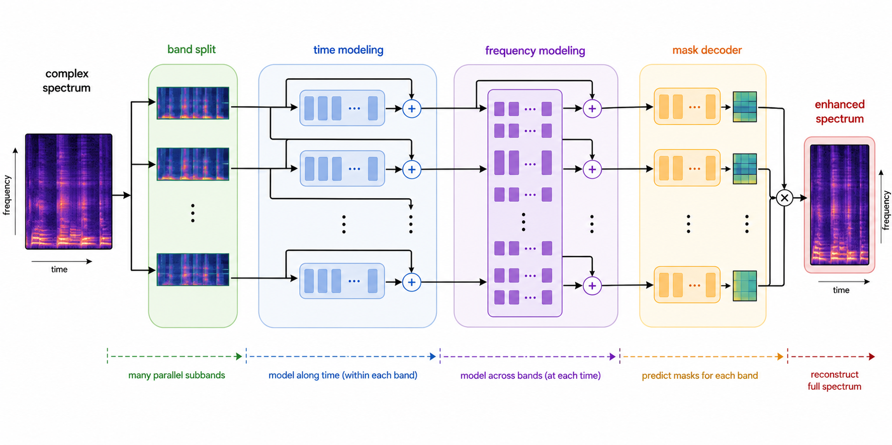

> 图中只表达子带并行、先时间后频率的层级和重建方向；精确 tensor shape、因果语义与实现路径以本节正文和下表为准。

**张量维度追踪（B=batch, T=帧, F=频bin, N=num_channel, K=num_subbands）**

- 输入复谱 **`(B, F, T, 2)`**（实部/虚部）经 `permute` 得 **`(B, T, F, 2)`**。
- `BandSplit` 得 **`(B, N, T, K)`**（每子带 `Norm+Conv1d`，`N=channel, K=子带数`）。
- 每层 `L`：`norm_time(skip)` 保持 **`(B, N, T, K)`**；`reshape (B*K, T, N) → Time-LSTM → (B*K, T, hdim) → fc_time → (B*K, T, N)`；reshape 回 **`(B, N, T, K)`** 后 `skip = skip + out`。
- 随后 `norm_freq(skip)` 保持 **`(B, N, T, K)`**；`permute → (B, T, K, N) → reshape (B*T, K, N) → Freq-LSTM → (B*T, K, N) → fc_freq`；reshape 回 **`(B, N, T, K)`** 后再次残差相加。
- `MaskDecoder(skip)` 输出 `mask (B, num_spk, T, F, 2)`，`residual` 同形；`mask·x + residual → permute → (B, F, T, 2)`。

**创新点结构张量维度变换**

| 创新模块/步骤 | 输入维度 | 输出维度 |
|---------------|----------|----------|
| permute | (B, F, T, 2) | (B, T, F, 2) |
| BandSplit | (B, T, F, 2) | (B, N, T, K) |
| Time-LSTM | (B*K, T, N) | (B*K, T, hdim) → fc → (B, N, T, K) |
| Freq-LSTM | (B*T, K, N) | (B*T, K, N) → fc → (B, N, T, K) |
| MaskDecoder | (B, N, T, K) | mask·x + residual → (B, F, T, 2) |

**论文主要创新点**

1. **Band-Split 子带独立建模**：按频带划分后分别 embedding 与 LSTM，兼顾时域与频域结构，与 espnet/URGENT 基线一致。
2. **Time-Freq 双 LSTM**：先时间后频率的两阶段 LSTM，显式分离时间与子带维度，便于控制因果性与参数量。
3. **USR-BSRNN**：通用采样率设计（按 fs 截断 ≥fs/2 的子带）、轻量 41 子带 + N=16、仅 mask 无 residual，适合多采样率与边缘设备。

**论文原文要点**（*USR-BSRNN*, ICASSP 2023，**结构创新**）：① **BandSplit** 按子带划分频谱，带宽与子带数可设计以平衡模型大小与性能；② **Time-LSTM → Freq-LSTM** 交错：先沿时间、再沿子带维建模，显式分离时/频；③ **通用采样率**：同一模型通过 band-splitting scheme 与超参设计，使低采样率输入仅使用部分子带（≥fs/2 截断），从而单模型多采样率且低 SR 时算力更小；④ **MaskDecoder** 子带级复数 mask，USR 轻量版无 residual。

**Loss**

- **URGENT 基线**：**MultiResL1SpecLoss**（`core/losses/freq_domain.py`），多分辨率幅度 L1 + 时域 L1，scale-invariant（scaling_factor），与 espnet2 严格对齐；配置：`configs/se/urgent2026/usr_bsrnn_noncausal_urgent26_offline_multires_l1_spec.yaml`。
- **Lite/因果**：显式 **`CompositeLoss`**（`GTCRNCompressedSpectralLoss + GTCRNLogRatioLoss`，两个 component 权重均为 1.0）；配置：`configs/se/urgent2026/usr_bsrnn_causal_urgent26_offline_hybrid.yaml`（文件名中的 `hybrid` 为历史命名）。

**参数量/算力**

- **URGENT2026 BSRNN baseline**：本实现 37.8008M，官方 ~37.8M，<0.1%；MACs 84.21 G（1s @ 48kHz，含整链路），README 约 ~78G，口径可能不同（见本文 MACs/参数量口径说明）。
- **USR-BSRNN (模型 B)**：本实现 0.475M，论文 0.35M（+35.7%，可能未计部分 LayerNorm/embedding）；MACs 0.529 G vs 论文 0.52 G（+1.7%），一致。
- **BSRNN causal 16k (N=64)**：3.5416M 参数，3.915 G MACs，无论文对照。

**可复用模块**

| 模块 | 可复用场景 |
|------|------------|
| BandSplit | 任意子带/多带 SE 或分离；可自定义 subbands 或复用 481/1025 预设。 |
| Time-LSTM / Freq-LSTM | 时-频两阶段 RNN 的通用模式，可替换为 GRU 或轻量化。 |
| MaskDecoder | 子带级复数 mask（+ 可选 residual），可用于其他 BandSplit 类模型。 |

---

### 3. DeepFilterNet / DPDFNet

**模型结构分解（公式化）**

- **DeepFilterNet = Encoder(ERB + DF 双路径) + [DPRNN 块]×dprnn_num_blocks + Decoder(ErbDecoder + DfDecoder) + LSNR 头**
- **Encoder**：ERB 包络 + 双路径（conv/GRU 分支），可选 enc_concat；GroupedLinear（enc_lin_groups, lin_groups）控制参数量；erb_apply_above_bins=null 全频 ERB，96 仅高频（DF3）。
- **DPRNN**：Dual-Path RNN 块数 = dprnn_num_blocks（0=DF2/DF3 baseline，2/4/8=DPDFNet-2/4/8）。
- **Decoder（与论文框图命名一致）**：
  - **ErbDecoder** → **ERB Gains**：张量 **m**，形状 **(B, 1, T, nb_erb)**，Sigmoid，经逆 ERB 映射为全频带掩码。
  - **DfDecoder** → **DF Coefs**：形状 **(B, df_order, T, nb_df, 2)**（实部/虚部），作用于输入 noisy spectrum 的 DF 频带，执行多帧复数深度滤波（DF Op）。
- **LSNR 头**：由 **emb** 预测帧级 SNR（训练辅助）；**不参与** ERB Gains/DF Coefs 的生成链路。
- **与 DF2/DF3/DPDFNet 对应**：
  - DF2（原版）：dprnn_num_blocks=0, enc_concat=true, enc_lin_groups=8, lin_groups=8, gru_variant=squeezed。
  - DF3：dprnn_num_blocks=0, enc_concat=false, enc_lin_groups=32, lin_groups=16, erb_apply_above_bins=96；官方 48kHz（STFT 960/480）。
  - DPDFNet baseline：dprnn_num_blocks=0, enc_lin_groups=32, lin_groups=16, gru_variant=squeezed_s（2.15M/0.36G）。
  - DPDFNet-2/4/8：dprnn_num_blocks=2/4/8，其余同 baseline。

**实时处理与前瞻边界**：DPDFNet 配置固定保留 `df_lookahead=2` 与 `conv_lookahead=2`，因此是带 2 帧未来上下文的 near-causal 模型，而非零前瞻的严格因果模型。cache 可复用历史状态并支持实时逐帧处理，但不能消除这 2 帧前瞻；在 16 kHz、`hop_length=160` 时，每帧 10 ms，固定算法前瞻约为 20 ms。

**默认频域超参与 `nb_df`（与 `deepfilternet_impl.py` 一致）**

- `freq_bins = n_fft // 2 + 1`。常用 **16 kHz + `n_fft=320`** → `freq_bins=161`。
- **`nb_erb`**：ERB 滤波器个数，默认 **32**（须被 8 整除）。
- **`nb_df`**：深度滤波覆盖的频 bin 数，**非独立超参**，由 `freq_df` 与采样率决定：
  - `nb_df = int((freq_df / (samplerate // 2)) * freq_bins)`
  - 默认 **`samplerate=16000`，`freq_df=4800`，`n_fft=320`** → `nb_df = int(4800/8000 * 161) = 96`。
- 特征图布局（Encoder 内 Conv2d 为 `(B, C, T, F)`，**F 为频维**）：
  - **ERB 支路**：`feat_erb` **F=`nb_erb`(32)** → `erb_conv0` → **32** → `erb_conv1` fstride=2 → **16** → `erb_conv2` → **8** → `erb_conv3` → **8**；可选 `dprnn_erb` 保持 `(B, conv_ch, T, 8)`。
  - **DF 支路**：`feat_spec` **F=`nb_df`(96)** → `df_conv0` → **96** → `df_conv1` fstride=2 → **48**；可选 `dprnn_df`；再 `df_fc_emb` 将展平后的 DF 特征投影到与 ERB 瓶颈同维后 **Concat/Add**，经 **`emb_gru`（Encoder 内 SqueezedGRU）** 得 `emb`。
- **解码器与 Encoder 不对称**：`ErbDecoder`、`DfDecoder` 各自含 **SqueezedGRU + 上采样/全连接**；`DfDecoder` 还与浅层 **`c0`** 旁路相加，输出 **DF Coefs**。
- **层数（默认）**：ERB Encoder **4**×`Conv2dNormAct`；DF Encoder **2**×；`ErbDecoder`：**`emb_gru`（`emb_num_layers` 默认 2 层 GRU）+ 8 个卷积子模块**（含 **2 次**频维上采样 8→16→32）；`DfDecoder`：**`df_gru`（`df_num_layers` 默认 2）+ `df_skip` + `df_out` + `df_convp(c0)`**。

**DeepFilterNet2/3 与 DPDFNet：相同 vs 不同（显著对照）**

| | **相同** | **不同** |
|---|----------|----------|
| **输入** | ERB Features（包络）+ Complex/DF Features（低频复谱） | — |
| **网络显式输出** | **ERB Gains (m)** + **DF Coefs** → 再 Mask + DF Op | — |
| **解码器拓扑** | ErbDecoder（多尺度 skip + 上采样）；DfDecoder（GRU + 与 c0 相加） | — |
| **Encoder** | 均为双路径 Conv + 瓶颈 emb_gru | **DPDFNet**：ERB/DF 两路末端各加 **DPRNN**（2/4/8）；DF2/3 为 **0** 块 |
| **融合** | DF2/DPDF：**Concat**；DF3：**Add** | DF3 **Split-Band**：ERB Mask 仅作用于高频段 |
| **参数量/MAC** | 同配置下 DPDFNet > DF2（因 DPRNN） | 见 Audit / 配置 `dprnn_num_blocks` |

**总体结构图（概念布局）**

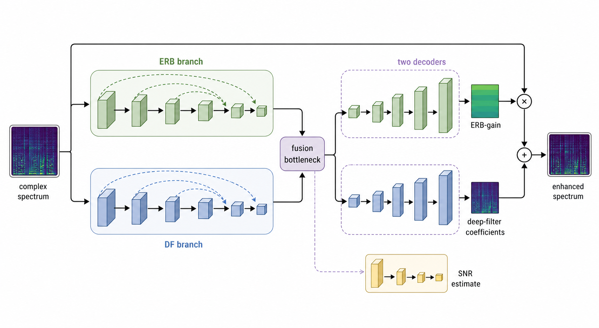

> 图中只表达双分支、融合、两路显式输出和辅助头的概念关系；精确 tensor shape、公式、变体参数与实现路径以本节正文和下表为准。

**局部机制图：ERB Gains 与 DF Coefs 的双解码路径**

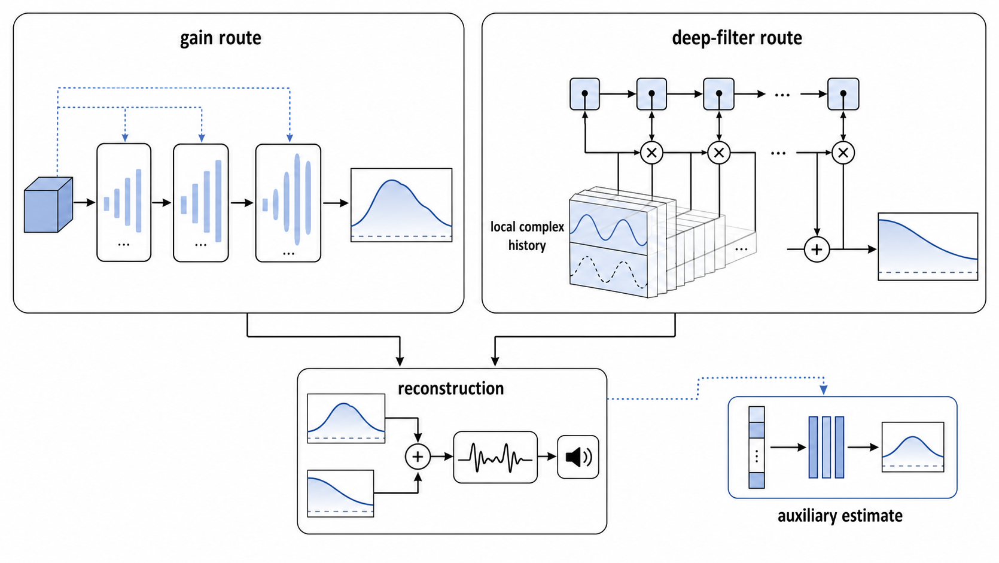

> 局部图只表达两种频域细化机制的分工；`m`、`DF Coefs`、`df_op` 和 LSNR 的精确语义与 shape 保留在下文。

**张量维度追踪（主流程，B=batch, F=频bin, T=帧, O=df_order）**

- 输入复谱为 **`(B, F, T, 2)`**；特征为 `feat_erb (B,1,T,nb_erb)`、`feat_spec (B,2,T,nb_df)`。
- `Encoder`：ERB 支路 `e0..e3`（+ 可选 DPRNN）；DF 支路 `c0,c1 → cemb`；`combine → emb (B,T,C)`。
- 两路解码器（与官方框图一致）：`ErbDecoder(emb, e3,e2,e1,e0) → ERB Gains m (B, 1, T, nb_erb)`；`DfDecoder(emb, c0) → DF Coefs (B, O, T, nb_df, 2)`。
- `Mask(spec, m) + df_op(spec, df_coefs) → 增强复谱 (B, F, T, 2)`；`lsnr_fc(emb) → (B, T)` 帧级 LSNR（训练辅助）。

**创新点结构张量维度变换**

| 创新模块/步骤 | 输入维度 | 输出维度 |
|---------------|----------|----------|
| 特征提取 | (B, F, T, 2) | feat_erb (B,1,T,nb_erb)；feat_spec (B,2,T,nb_df) |
| Encoder（ERB + DF 双路径） | 上式 | emb (B,T,C)；skip e0..e3, c0 |
| DPRNN×0/2/4/8 | 支路特征图 | DPDFNet：两路末端增强；0 块时等价恒等 |
| **ERB Gains** | emb + skips | **m：(B,1,T,nb_erb)** |
| **DF Coefs** | emb + c0 | **(B,O,T,nb_df,2)** |
| Mask + DF Op | spec, m, coefs | (B,F,T,2) |
| LSNR 头 | emb | (B,T) dB 尺度（训练用） |

**论文主要创新点**

1. **LSNR（Learnable SNR）**：学习型 SNR 估计头，可与 loss 结合或用于后处理。
2. **Dual-Path Encoder + Deep Filtering**：ERB 与 DF 双路径、GroupedLinear 与 SqueezedGRU_S，在保持质量下降低 RTF（+Simplified DNN 规格）。
3. **DPRNN 扩展**：DPDFNet 通过增加 DPRNN 块数（2/4/8）在参数量与算力间可扩展。

**论文原文要点**（**结构创新**）：**DeepFilterNet2**：① **双路径 Encoder**：ERB 包络分支 + 复谱/DF 分支，GroupedLinear、SqueezedGRU 等优化网络结构；② **Deep Filtering** 两阶段（ERB 包络 + 复谱精细滤波），Decoder 分 ErbDecoder 与 DfDecoder；③ **LSNR 头** 学习型 SNR，可参与训练监督。**DPDFNet**：④ 在 DF2 encoder 中**插入因果 Dual-Path RNN 模块**，加强长程时域与跨带建模，块数 2/4/8 可扩展；⑤ **over-attenuation loss** 缓解过衰减；推理时 LSNR 不参与输出。

**Loss**

- **GTCRN-style 简单训练**：显式 `CompositeLoss`，将 `GTCRNCompressedSpectralLoss(weight=1.0)` 与 `GTCRNLogRatioLoss(weight=1.0)` 展开；配置：`configs/se/urgent2026/dpdfnet2_causal_urgent26_offline_hybrid.yaml`、`configs/se/urgent2026/dpdfnet2_causal_urgent26_dynamic_hybrid.yaml`（文件名中的 `hybrid` 为历史命名）。
- **DeepFilterNet 专用组合**：`core/losses/composite.py` 也可显式组合 LSNR、多分辨率、over-attenuation 等组件；实现见 `core/losses/model_specific/deepfilternet.py`（`DeepFilterNetMultiResSpecLoss`、`DeepFilterNetOverAttenuationLoss`、`DeepFilterNetLSNRLoss` 等）。这些 component 与权重不应因 GTCRN 两项展开而被覆盖。

**参数量/算力**

- DPDFNet-2：2.4975M / 1.3529 G；DPDFNet-4：2.8477M / 2.36 G；DPDFNet-8：3.5482M / 4.3741 G；与论文表一致（§2.1）。
- DeepFilterNet2（DPDFNet baseline）：2.15M（实测）/ 0.3673 G；论文表 +Simplified DNN 2.31/0.36，仓库实测以 2.15M 为准（见本文 DeepFilterNet/DPDF 相关节）。

**可复用模块**

| 模块 | 可复用场景 |
|------|------------|
| ERB / ErbNorm | 频带压缩与归一化，可与其它 DF/CRN 共用。 |
| 双路径 Encoder（ERB+DF） | 多分支频谱编码，可迁移到其他 SE 骨干。 |
| DPRNN | 双路径 RNN 块，可插到任意 T-F 模型中做长程依赖。 |
| LSNR 头 | 辅助 SNR 估计或多任务学习。 |

### 4. FastEnhancer

**模型结构分解（公式化）**

- **FastEnhancer = StridedConv1d Encoder → RNNFormer×K → ScaledConvTranspose1d Decoder**
- 变体与 Table 1 对应：**H**=hop_size，**kernel**=kernel_size（列表），**L**=encoder blocks，**K**=RNNFormer blocks，**C1**=channels，**C2**=rnnformer channels，**F**=rnnformer freq。
- **StridedConv1d**：stride 通过 reshape 吸收到通道维，等效下采样且省 MACs。
- **RNNFormer**：**时域 GRU + 频域 MHSA**（Multi-Head Self-Attention），含可选 positional embedding；先沿时间维 GRU，再沿频维做自注意力，与 Dual-Path RNN 的“时频分离”思想一致，用 Attention 替代频域 RNN。
- **MHSA 引用**：频域 `_Attention` 使用 Q/K/V 线性层 + `F.scaled_dot_product_attention`，即 Vaswani et al., *Attention Is All You Need*, NeurIPS 2017 的标准 MHSA；代码中未写文献注释。
- **ScaledConvTranspose1d**：可学习 scale，可选 weight norm。

**前向数据流**：
波形或框架 STFT 后频谱进 → 若从波形则内部转频域 → StridedConv 编码 → RNNFormer 块 ×K → ConvTranspose 解码 → 复数 mask/估计 → 频谱出。

**总体结构图（概念布局）**

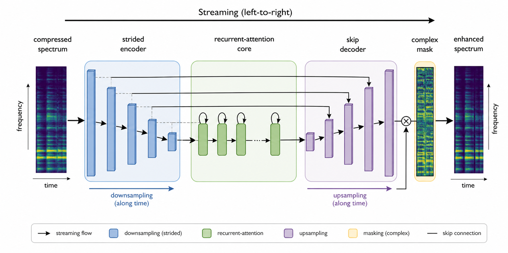

> 图中只表达流式方向、下采样/上采样和 skip 连接；精确 tensor shape、变体超参与实现路径以本节正文和下表为准。

**局部机制图：RNNFormer 双轴建模**

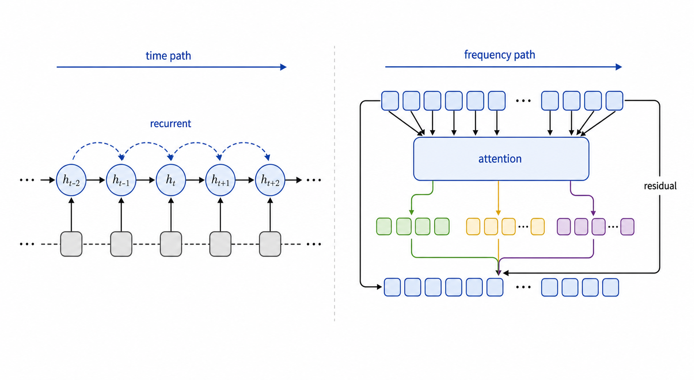

> 局部图仅表达时间单向递归与单帧频率注意力的分工；Q/K/V、`scaled_dot_product_attention` 和残差细节保留在正文。

**张量维度追踪（B=batch, T=帧, F=频bin, C=通道）**

- 输入 **`(B, F, T, 2)`** 经 `permute(0,2,3,1) + reshape` 得 **`(B*T, 2, F)`**。
- `enc_pre + encoder → (B*T, C1, F′)`，其中 **`F′ = n_fft/2 // stride`**；`rf_pre: freq_linear + Conv1d → (B*T, C2, F_rf)`，其中 **`F_rf = rnnformer freq`**。
- `view(B,T,C2,F_rf).permute(1,0,3,2) → (T, B, F_rf, C2)`。
- 每个 `RNNFormerBlock`：时域 GRU 为 `view(T, B*F_rf, C2) → GRU → view(T, B, F_rf, C2); fc + norm + residual`；频域 MHSA 为 `view(T*B, F_rf, C2) → qkv → Q,K,V → scaled_dot_product_attention → view(T, B, F_rf, C2); fc + norm + residual`。
- `permute(1,0,3,2) + reshape → (B*T, C2, F_rf)`；`rf_post → (B*T, C1, F′)`；`decoder + dec_post (concat skip) → (B*T, 2, F′)`；最终 `reshape → (B, F, T, 2)`。

**创新点结构张量维度变换**

| 创新模块/步骤 | 输入维度 | 输出维度 |
|---------------|----------|----------|
| permute + reshape | (B, F, T, 2) | (B×T, 2, F) |
| StridedConv1d Encoder | (B×T, 2, F) | (B×T, C1, F′) |
| rf_pre | (B×T, C1, F′) | (T, B, F_rf, C2) |
| RNNFormer 块（时域 GRU + 频域 MHSA） | (T, B, F_rf, C2) | 同维，残差连接 |
| rf_post + decoder + dec_post | concat skip | (B, F, T, 2) |

**论文主要创新点**

1. **速度优先的流式设计**：StridedConv 与 RNNFormer 平衡时频建模与延迟/算力，适合实时与边缘部署。
2. **多尺度变体 T/B/S/M/L**：从 0.022M（T）到 1.1M（L），参数量与 Table 1 一致，便于按场景选型。
3. **RNNFormer**：GRU 与 attention 结合，在轻量下增强长程依赖。

**论文原文要点**（*FastEnhancer*，**结构创新**）：① **StridedConv1d**：将 stride 通过 reshape 吸收到通道维，等效下采样且减少 MACs，利于低延迟；② **RNNFormer 块**：时间轴 RNN（GRU）做轻量时域建模 + 频轴 Transformer 捕获跨带全局关系，避免 DPRNN 的频带顺序假设；③ **简单 encoder-decoder**：无复杂子带分解，Pre/Post RNNFormer 线性层可初始化为 filterbank，整体为速度与质量折中；④ 多尺度变体 T/B/S/M/L 通过 channel、block 数扩展。

**Loss**

- 无现成 FastEnhancer YAML；新增仓库配置应使用显式 **`CompositeLoss`**。若沿用 GTCRN-style 目标，展开 `GTCRNCompressedSpectralLoss(weight=1.0)` + `GTCRNLogRatioLoss(weight=1.0)`，顶层 STFT 注入几何。

**参数量/算力**

- 本实现与论文 Table 1 非常接近（T 0.0225M～L 1.1119M）；MACs 大模型（M/L）低于论文值，可能因 FLOPs vs MACs 口径或输入长度（见本文 MACs 口径说明）。

**可复用模块**

| 模块 | 可复用场景 |
|------|------------|
| StridedConv1d | 高效时域/频域下采样，可替代普通 Conv1d stride。 |
| RNNFormer 块 | 轻量 GRU+Attention 模块，可嵌入其它流式 SE 或编解码器。 |
| ScaledConvTranspose1d | 上采样 + 可学习尺度，可用于其它 decoder。 |

---

### 5. FastULCNet

**模型结构分解（公式化）**

- **FastULCNet = Channel Reorientation + Conv Block + Freq-FastGRNN(Comfi-FastGRNN) + 子带 FastGRNN×2 + FC×2 + Stage2 CNN + CRM + 功率律解压**
- **Channel reorientation**： (B,T,F) → (B,T,n_bands,window_size)，论文 1.5kHz、overlap 0.33 → window_size=48, hop=33, n_bands=8。
- **Conv Block**：4 层可分离卷积 32→64→96→128，MaxPool(1,2)×3。
- **Freq-FastGRNN**：Comfi-FastGRNN，64 单元双向；Comfi 为可训练互补滤波 h_comfi = γ·h + (1-γ)·λ，缓解长序列漂移。
- **子带 FastGRNN**：2 块×2 层×128 单元，输入 192 维。
- **FC**：两层，输出 freq_dim（257）。
- **Stage2 CNN**：2×Conv2d(32, 1×3) + pointwise 2 通道。
- **CRM**：Complex Ratio Mask，输入为压缩域 real/imag（E/R/C 类型）。

**前向数据流**：
`(B,F,T,2) → 功率律压缩 → reorientation → Conv Block → Freq-ComfiFastGRNN → pointwise → 子带 ComfiFastGRNN×2 → FC → 中间特征(mask, phase) → Stage2 CNN → CRM(压缩域) → 功率律解压 → (B,F,T,2)`

**总体结构图（概念布局）**

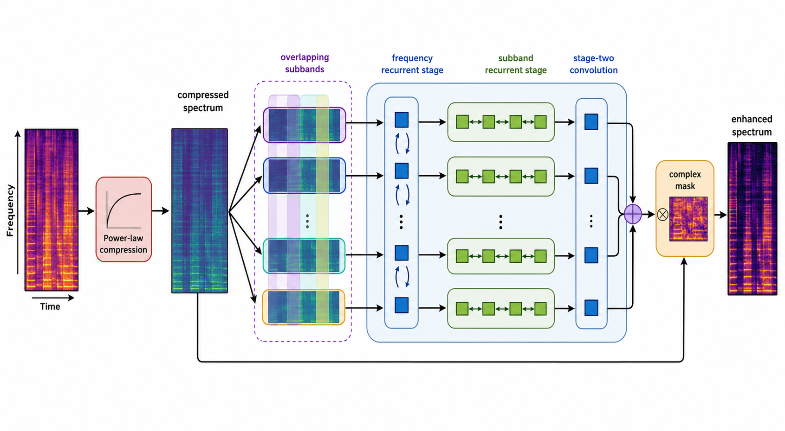

> 图中只表达压缩、重排、两级递归和复数掩码的布局；精确 tensor shape、Comfi 公式与实现路径以本节正文和下表为准。

**张量维度追踪（主流程，B=batch, T=帧, F=频bin, n_bands=8, win=48）**

- 输入 **`(B, F, T, 2)`** 经功率律压缩得到压缩域 `real/imag`。
- `Channel Reorientation → (B, T, n_bands, window_size)`；`Conv Block`（4 层 `32→64→96→128 + MaxPool`）→ **`(B, 128, T, F′)`**。
- `Freq-ComfiFastGRNN` 沿频维，64 单元双向，使用 **`h_comfi = γ·h + (1−γ)·λ`**。
- `pointwise → 子带 ComfiFastGRNN×2`（192 维 → `2×2×128`）→ `FC → (B, T, 257)` 等。
- `Stage2 CNN + CRM(压缩域 E/R/C)` 输出复数比掩码；功率律解压得到 **`(B, F, T, 2)`**。

**创新点结构张量维度变换**

| 创新模块/步骤 | 输入维度 | 输出维度 |
|---------------|----------|----------|
| 功率律压缩 | (B, F, T, 2) | 压缩域 real/imag |
| Channel Reorientation | (B, T, F) | (B, T, n_bands, window_size) |
| Conv Block | Reorient 输出 | 32→64→96→128 + MaxPool(1,2)×3 |
| Freq-ComfiFastGRNN | Conv 输出 | 64 单元双向，h_comfi=γ·h+(1−γ)·λ |
| 子带 ComfiFastGRNN×2 | 192 维 | 2 块×2 层×128 单元 |
| Stage2 CNN + CRM | FC 257 + 中间 mask/phase | 压缩域 E/R/C 复数比掩码 → (B, F, T, 2) |

**论文主要创新点**

1. **Comfi-FastGRNN**：FastGRNN + 可训练 γ/λ 互补滤波，长序列（如 90s）下状态更稳定。
2. **CRM 在压缩域**：在功率律压缩后的 real/imag 上做复数比掩码，与论文式(5) 一致。
3. **轻量频带+子带 RNN**：Freq 双向 + 子带 2×2 层，在保持质量下控制参数量与算力。

**论文原文要点**（*Fast-ULCNet*，**结构创新**）：① **Comfi-FastGRNN**：在 FastGRNN 上增加可训练互补滤波 h_comfi = γ·h + (1−γ)·λ，缓解长序列前向时 RNN 状态漂移导致的性能衰减；② **Channel Reorientation**：将 (T,F) 变为 (T, n_bands, window_size) 的频带滑窗表示，与 ULCNet 一致；③ **功率律压缩域 CRM**：在压缩后的 real/imag 上估计复数比掩码（E/R/C）；④ 以 **FastGRNN 替代 ULCNet 中的 GRU**，Freq 与子带两处均用 Comfi-FastGRNN，参数量与延迟显著降低。

**Loss**

- **MagnitudePlusComplexL1Loss**（`core/losses/freq_domain.py`）：论文式(5)，幅度 L1 + 复谱 L1，单分辨率 STFT。
- 配置：`configs/se/voicebank_demand/fast_ulcnet_offline.yaml` 已接通 FastULCNet 与该 loss，并按固定官方 commit `f1dcfb48df4aed05812c590696d306fb221bd52a` 使用 512/128 block 参数。共享 STFT 为标准 Hann，不等同于官方 `hann75`/WOLA；该配置尚无 checkpoint 或真实 90 秒质量复现。
- 长序列工具：`tools/verify/verify_fast_ulcnet_state_drift.py` 只验证 synthetic 整段前向与 temporal hidden drift，不计算真实语音质量。

**参数量/算力**

- 本实现与论文/官方对齐（Conv 4 层、Freq 64、子带 128×2×2、FC 257、CRM E）；若有 audit_metrics 条目或 Integration 文档可对照具体数值。

**可复用模块**

| 模块 | 可复用场景 |
|------|------------|
| Comfi-FastGRNN | 长序列 RNN 需抗漂移时，可替换普通 GRU/LSTM。 |
| CRM (E/R/C) | 任意复数域 mask 估计，可单独抽离做复数比掩码。 |
| Channel Reorientation | 频带滑窗特征，可用于其它子带/多带模型。 |
| ERB/频带划分 | 与 Conv+RNN 搭配的频域前端，可与其他轻量 SE 共用思路。 |

**Comfi-FastGRNN（GRNN）释义**（实现：`tasks/se/models/modules/fast_ulcnet_impl/comfi_fast_grnn.py`）
- **GRNN 在此处指 FastGRNN**：门控更新 h = z⊙h_prev + (σ(ζ)(1−z) + σ(ν))⊙h_hat，可选低秩 W/U（w_rank, u_rank）以省参数，与 GRU/LSTM 的“门控”不同（单门 z + 单更新非线性）。
- **Comfi**：可训练互补滤波 h_comfi = γ·h + (1−γ)·λ，γ、λ 为参数，缓解长序列时隐状态漂移。
- 与 **ULUNAS/GTCRN 中的 GRNN** 不同：后者为 **Grouped RNN**（通道分两组、两组独立 GRU 再 concat），不涉及 FastGRNN 或 Comfi。

---

### 5.5 ULUNAS（UL-UNAS）

- **论文**: UL-UNAS: Ultra-Lightweight U-Nets for Real-Time Speech Enhancement via Network Architecture Search (IEEE/ACM TASLP 2026, arXiv:2503.00340)
- **官方代码**: [Xiaobin-Rong/ul-unas](https://github.com/Xiaobin-Rong/ul-unas)

**模型结构分解（公式化）**

- **ULUNAS = ERB(Band Merge) + Encoder(XConv/XMB/XDWS×5) + DPGRNN×num_dpgrnn + Decoder + ERB(Band Split) + 幅度 mask**
- **ERB**：与 GTCRN 同族，65+64 频带（bm/bs），固定滤波器。
- **Encoder**：XConvBlock、XDWSBlock、XMBBlocks，均含 **AffinePReLU（APReLU）+ cTFA（因果时频注意力）+ 可选 Shuffle**；NAS 默认 [XConv, XMB, XDWS, XMB, XDWS]，strides [2,2,1,1,1]，channels [12,24,24,32,16]。
- **DPGRNN**：Dual-Path Grouped RNN，intra 频维 BiGRNN、inter 时维 GRNN，与 GTCRN 的 DPGRNN 同族（此处称 G-DPRNN）。
- **创新点**：**APReLU**（仿射 + 可学习斜率 PReLU，论文 Sec. III-C2）+ **cTFA**（Causal Time-Frequency Attention：TA 分支时间维 GRU→Sigmoid，FA 分支通道池化→BiGRU→Sigmoid，at×x×af，论文 Sec. III-C3）；以及 NAS 搜索的块类型与宽度。

**总体结构图（概念布局）**

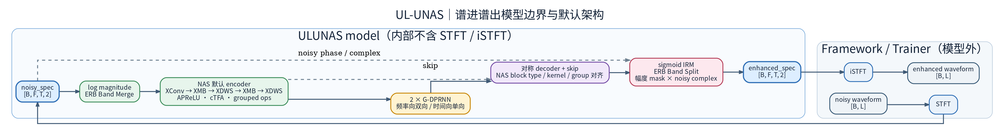

> 图中只表达 U-Net 层级、skip 连接和分组递归瓶颈；精确 tensor shape、APReLU/cTFA 公式、NAS 配置与实现路径以本节正文和下表为准。

**局部机制图：APReLU 与 cTFA**

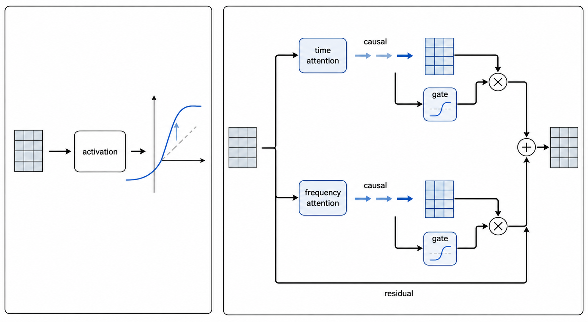

> 局部图只表达激活与时频门控的概念分支；精确公式、tensor shape、NAS 配置与实现路径以正文为准。

**张量维度追踪（B=batch, T=帧, F=频, C=通道, W=width）**

- 输入 **`(B, F, T, 2)`**：`mag = sqrt(real^2+imag^2)`；`feat = log10(mag).permute(0,2,1).unsqueeze(1) → (B, 1, T, F)`。
- `ERB.bm → (B, 1, T, 129)`（65+64）。Encoder 各块：`(B, C_in, T, W_in) → Conv/XDWS/XMB(APReLU, cTFA, Shuffle) → (B, C_out, T, W_out)`。
- `DPGRNN: (B, C, T, W) → permute (B, T, W, C)`；`intra: reshape (B*T, W, C) → BiGRNN → fc → LayerNorm → (B, T, W, C) + residual`；`inter: (B, T, W, C) → permute (B, W, T, C) → reshape (B*W, T, C) → GRNN → fc → LayerNorm → permute → (B, T, W, C) + residual`；输出 `→ permute (B, C, T, W)`。
- `Decoder(skip) → sigmoid mask (B, 1, T, 129)`；`ERB.bs → (B, 1, T, F)`；`mask * spec_2ch → (B, F, T, 2)`。

**创新点结构张量维度变换**

| 创新模块/步骤 | 输入维度 | 输出维度 |
|---------------|----------|----------|
| ERB.bm | (B, 1, T, F) | (B, 1, T, 129) |
| XConv/XDWS/XMB（APReLU + cTFA） | (B, C, T, W) | (B, C′, T, W′) |
| DPGRNN（intra→inter） | (B, C, T, W) | (B, C, T, W) |
| Decoder + ERB.bs | skip + 解码 | (B, 1, T, F) |
| mask × spec | (B, F, T, 2) | (B, F, T, 2) |

**论文主要创新点**

1. **APReLU**：h(x)=γ·x+β+PReLU(x)，γ/β (C,W)、α (C)，增强表达与稳定训练。
2. **cTFA**：因果时频注意力，TA（时间维 GRU）与 FA（频维 BiGRU 在通道池化后）相乘得到 at×x×af。
3. **NAS**：块类型、通道、宽度、kernel、stride 由 NAS 搜索（Table IV）。
4. **G-DPRNN**：与 GTCRN 同族的双路径分组 RNN 作为瓶颈。

**可复用模块**：ERB、APReLU、cTFA、Shuffle、DPGRNN、XConv/XDWS/XMB 块。

---

### 6. Conformer

- **论文**: *Conformer: Convolution-augmented Transformer for Speech Recognition*, Gulati et al., Interspeech 2020（SE 适配参考 ESPnet `conformer_separator.py`）
- **参数量/MACs**: 9.80M / 312.9M（n_fft=512, 16kHz, 0.5s 输入，下同）
- **掩膜**: CRM（复数比值掩膜，复数乘法应用）；因果可选（ConvolutionModule 单侧 padding，注意力仍全局）

**模型结构分解（公式化）**

- **Conformer = Linear 嵌入 + RelPositionalEncoding + N×ConformerBlock(½FFN + Rel-MHSA + ConvModule + ½FFN) + Linear + 复数掩膜**

**总体结构图（概念布局）**

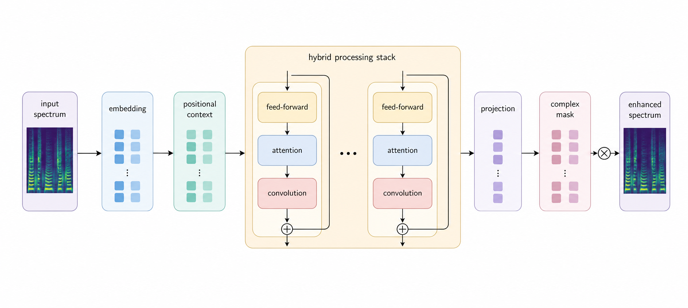

> 图中只表达模块层级与残差数据流；精确 tensor shape、Transformer-XL 注意力公式、因果 padding 与实现路径以本节正文为准。

**精确前向数据流与 shape**

- `Input (B, F, T, 2) → reshape (B, T, F*2)` → `Linear(F*2, d_model)` 嵌入 → `RelPositionalEncoding`（Transformer-XL 式相对位置编码）。
- `N × ConformerBlock` 依次包含：`½ × FeedForward (LN → Linear → Swish → Dropout → Linear)`；`MultiHeadedSelfAttention (pos_bias_u/pos_bias_v + rel_shift)`；`ConvolutionModule (Pointwise → GLU → Depthwise → BN → Swish → Pointwise)`；`½ × FeedForward + LayerNorm`。
- `Linear(d_model, F*2) → reshape (B, F, T, 2)` 得复数掩膜；`noisy_spec ⊗ mask` 使用复数乘法 **`(a+bi)(c+di)`**。

**关键实现**：Transformer-XL content(AC)+positional(BD) 四项注意力分解；ConvModule 支持因果模式（左 padding）+ GLU 门控。

**适用场景**：中等参数量（~10M）、低算力的 Transformer SE 基线；支持因果模式，可改造为流式。

---

### 7. TFGridNet

- **论文**: *TF-GridNet: Making Time-Frequency Domain Models Great Again for Monaural Speaker Separation*, Z.-Q. Wang et al., ICASSP/TASLP 2023
- **参数量/MACs**: 8.04M / 77.4G（计算量极大，不适合实时）
- **掩膜**: 无（直接估计干净复数谱）；非因果

**模型结构分解（公式化）**

- **TFGridNet = Conv2d Encoder + N×GridNetBlock(帧内 BLSTM → 帧间 BLSTM → 时维 MHA) + ConvTranspose2d Decoder**

**总体结构图（概念布局）**

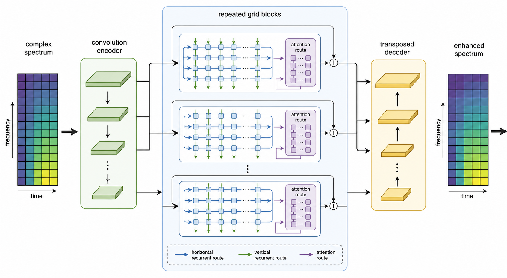

> 图中只表达时频网格中的横向/纵向递归与注意力路线；精确 tensor shape、overlap 规则与实现路径以本节正文为准。

**精确前向数据流与 shape**

- `Input (B, F, T, 2) → permute (B, 2, T, F) → Conv2d(2, emb_dim, k=3×3) + GroupNorm`（Encoder）。
- `N × GridNetBlock` 依次执行：`Intra-frame BLSTM`（每帧内沿频率维，Full-band，`Unfold/BLSTM/Fold`）；`Sub-band BLSTM`（每个频率 bin 沿时间维，维度对调）；`Multi-head Self-Attention`（时间维全局注意力）。
- `ConvTranspose2d(emb_dim, 2, k=3×3)`（Decoder）→ `permute (B, F, T, 2)`，直接输出增强频谱。

**关键实现**：`emb_ks/emb_hs` 控制子带分组粒度与 overlap padding（`olp = emb_ks - emb_hs`）；AllHeadPReLULayerNorm4DC 用于 Q/K/V 投影后非线性；MACs 随 F×T 线性增长（77G，远高于其他模型）。

**适用场景**：高精度**非实时**离线增强的上界参考。

---

### 8. MossFormer2

- **论文**: *MossFormer2: Combining Transformer and RNN-Free Recurrent Network for Enhanced Time-Domain Monaural Speech Separation*, S. Zhao, B. Ma, ICASSP 2024
- **参数量/MACs**: 27.23M / 870.4M（缩小配置 hidden_dim=256/depth=6；论文全量 512/24）
- **掩膜**: PSM（ReLU 非负幅度掩膜 × 原相位重建）；非因果

**模型结构分解（公式化）**

- **MossFormer2 = power_compress(mag,0.3) → Conv1d Enc + ScaledSinuEmbedding + N×(FLASH Attention + GatedFSMN) + Conv1d Dec + PSM 掩膜**

**总体结构图（概念布局）**

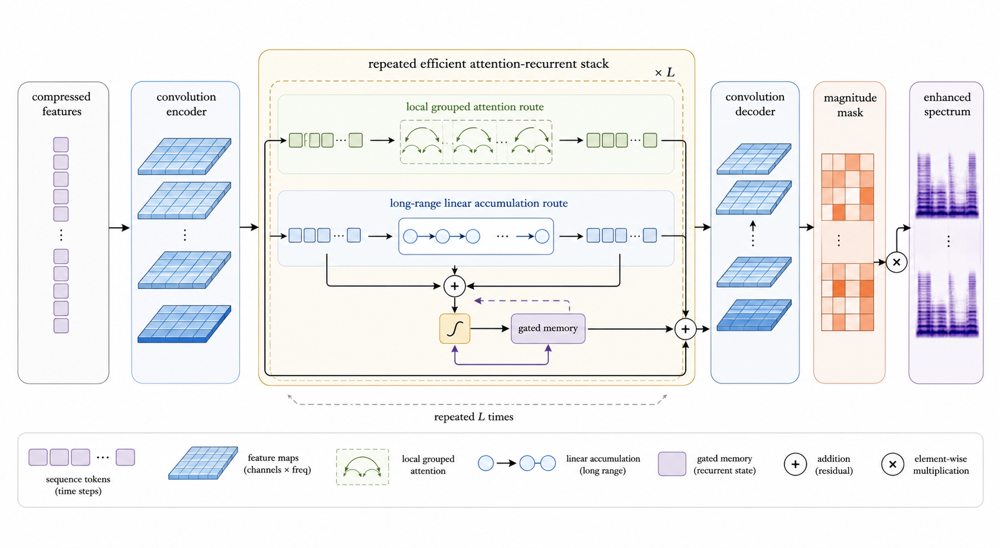

> 图中只表达编码、重复高效注意力/记忆模块、解码和幅度掩膜的布局；精确 tensor shape、FLASH 两路公式与实现路径以本节正文为准。

**精确前向数据流与 shape**

- `Input (B, F, T, 2)` → 提取 `mag, real, imag` → `power_compress(mag, 0.3)` → `concat [cmag, real, imag] (B, 3F, T)`。
- `MossFormer2MaskNet`：`LayerNorm → Conv1d(3F, H)`（Encoder）→ `ScaledSinuEmbedding`（可学习缩放正弦位置编码）。
- `N × (FLASHAttention + GatedFSMN)`：FLASH 为 `Token-shift → ScaleNorm → FFConvM → OffsetScale(Q/K×4)`，其 `Intra-group: ReLU²(QK^T/g) × V`、`Inter-group: cumsum(K^TV) × Q`，以及 `Gate: (att_u × v) × sigmoid(att_v × u)`；GatedFSMN 为 `LN → split(v,u) → UniDeepFsmn(u) → v × sigmoid(u)`。
- Decoder 为 `PReLU → Conv1d×2 → Tanh×Sigmoid gating → Conv1d(H, F)`；输出 `mask (B, F, T) × mag → phase 重建 → enhanced_spec (B, F, T, 2)`。

**关键实现**：FLASH 序列分 group（默认 256），组内二次注意力 + 组间 cumsum 线性注意力（O(n)）；OffsetScale 用 einsum 广播避免 reshape 维度不匹配；Token Shift 半通道偏移提供免费局部混合；UniDeepFsmn 用 `order//2` padding + 输出裁剪保证长度对齐。

**适用场景**：长序列友好的中等规模离线增强（线性注意力计算高效）。

---

### 9. BSRoFormer

- **论文**: *Music Source Separation with Band-Split RoFormer*, Ju-Chiang Wang et al., arXiv 2309.02612
- **参数量/MACs**: 12.73M / 12.2G
- **掩膜**: CRM（复数乘法）；非因果

**模型结构分解（公式化）**

- **BSRoFormer = BandSplit(子带独立嵌入) + N×(Time-Transformer + Freq-Transformer, RoPE) + MaskEstimator 复数掩膜**

**总体结构图（概念布局）**

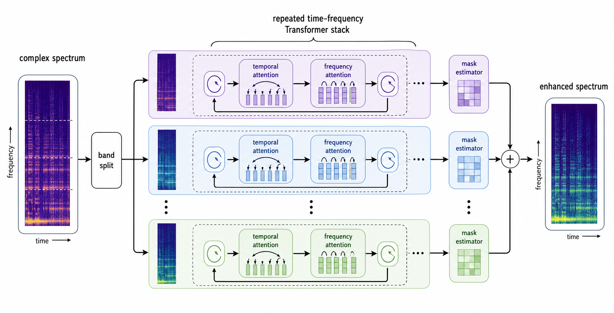

> 图中只表达子带并行、时间/频率交替建模和掩膜汇合；精确 tensor shape、RoPE 实现与频带预设以本节正文为准。

**精确前向数据流与 shape**

- `Input (B, F, T, 2) → reshape (B, T, F*2) → BandSplit`：预定义子带划分为低频细 `2 bins` 至高频粗 `49 bins`，`n_fft=512` 共 `40 bands`；每子带 `RMSNorm → Linear(band_bins*2, dim) → stack (B, T, n_bands, dim)`。
- `N × (Time-Transformer + Freq-Transformer)`：`Time-Transformer: reshape (B*n_bands, T, dim) → Attn(RoPE) + FFN`；`Freq-Transformer: reshape (B*T, n_bands, dim) → Attn(RoPE) + FFN`。
- `RMSNorm → MaskEstimator`（每子带 `MLP + GLU → concat`）→ `(B, T, F*2) → reshape (B, T, F, 2)` 复数掩膜 → `noisy_spec ⊗ mask`（复数乘法）。

**关键实现**：RoPE 自实现（`rotate_half` + `apply_rotary`，含 seq_len 缓存与 SDPA，2026-07 优化）；门控注意力 `out = attn_out × sigmoid(gate)`；内置 n_fft=512（257 bins）与 n_fft=1920（961 bins）两套子带预设。

**适用场景**：源自音乐源分离，宽带信号；子带结构适配不同频率分辨率需求；时频 Transformer 可并行。

---
## 三、SE 模型结构对比表

| 模型 | 结构分解（公式化） | 参数量(M) | 算力(G MACs) | 主要 Loss | 配置路径 | Loss 文件路径 | 论文创新点摘要 |
|------|--------------------|-----------|--------------|-----------|----------|----------------|----------------|
| GTCRN | ERB + SFE + Enc(GTConv×3) + DPGRNN×2 + Dec + Mask | 0.0237(train)/0.0482(total) | ~0.034 | CompositeLoss（GTCRN 两项） | `configs/se/voicebank_demand/gtcrn_causal_offline.yaml`、`configs/se/dns_challenge3/gtcrn_causal_offline.yaml` | `core/losses/hybrid.py` + `core/losses/composite.py` | 超轻量 Grouped+双路径 RNN、ERB 固定 |
| CoFi-Lite | 内部 sqrt-Hann STFT + ERB(64+65) + SFE + MobileNetV2 双路径 Enc + CPF + InterRNN + 包络/细节双 mask Dec + 内部 iSTFT | 0.0831(train)/0.1082(total) | 0.01287(paper) | CoFiLiteHybridLoss | `configs/se/dns_challenge3/cofi_lite_causal_offline.yaml` | `core/losses/model_specific/cofi_lite.py` | waveform-native 超轻量双路径包络/细节建模、跨路径融合 |
| BSRNN (URGENT) | BandSplit → Time-LSTM → Freq-LSTM×6 → MaskDecoder(residual) | 37.8 | ~84(1s@48k) | MultiResL1SpecLoss | `configs/se/urgent2026/usr_bsrnn_noncausal_urgent26_offline_multires_l1_spec.yaml` | `core/losses/freq_domain.py` | 子带划分、Time-Freq 双 LSTM、scale-invariant |
| BSRNN (Lite) | 同上，41 子带 N=16，mask-only | 0.475 | 0.529 | CompositeLoss（GTCRN 两项） | `configs/se/urgent2026/usr_bsrnn_causal_urgent26_offline_hybrid.yaml` | `core/losses/hybrid.py` + `core/losses/composite.py` | USR 多采样率、轻量 mask-only |
| DeepFilterNet/DPDFNet | ERB+DF Enc + DPRNN×0/2/4/8 + Dec + LSNR | 2.15~3.55 | 0.36~4.37 | CompositeLoss | `configs/se/urgent2026/dpdfnet2_causal_urgent26_dynamic_hybrid.yaml`、`configs/se/urgent2026/dpdfnet2_causal_urgent26_offline_hybrid.yaml` | `core/losses/composite.py` + `core/losses/hybrid.py` + `core/losses/model_specific/deepfilternet.py` 等 | LSNR、双路径 Enc、DPRNN 可扩展 |
| FastEnhancer | StridedConv Enc → RNNFormer×K → ConvTranspose Dec | 0.022~1.11(T/B/S/M/L) | 0.05~2.8(口径差异) | 无现成 YAML；应显式 Composite | 无现成 YAML | `core/losses/composite.py` | StridedConv+RNNFormer、多尺度变体 |
| FastULCNet | Reorient + ConvBlock + ComfiFastGRNN + 子带 FastGRNN×2 + FC + Stage2 CNN + CRM | 0.3385 | 0.1834 | MagnitudePlusComplexL1Loss | `configs/se/voicebank_demand/fast_ulcnet_offline.yaml` | `core/losses/freq_domain.py` | Comfi-FastGRNN、官方 CRM；标准 Hann 非官方 hann75/WOLA |
| MeanFlowSE | Complex STFT + NCSN++ 风格 backbone + MeanFlow objective + FD-JVP + 一步 displacement | 42.3852 | 84.7736 | 模型内 MeanFlow objective | `configs/se/voicebank_demand/meanflowse_ncsnpp_offline.yaml` | `tasks/se/models/generative/meanflowse/model.py` | 项目实现，不兼容官方 checkpoint；未训练复现指标 |
| RWSA-MambaUNet | 幅相压缩 + DenseEncoder + TF-Mamba U-Net + resolution-wise shared attention + mask decoder | 1.946664(G) / 2.128314(G+D) | 未测量 | MPSEnetCompositeLoss + MetricGAN | `configs/se/urgent2026/gan/rwsa_mamba_unet_metricgan_dynamic.yaml` | `core/losses/model_specific/metricgan.py` | 固定官方 commit、wrapper/结构对齐；未验证官方 checkpoint/指标 |
| ULUNAS | ERB + Enc(XConv/XMB/XDWS×5, APReLU+cTFA) + DPGRNN×2 + Dec + ERB.bs + mask | — | — | 幅度 mask | 无现成 YAML（实现：`tasks/se/models/discriminative/ulunas.py`） | — | APReLU、cTFA、NAS、G-DPRNN |
| Conformer | Linear + RelPosEnc + N×ConformerBlock(½FFN+RelMHSA+ConvMod) + CRM | 9.80 | 0.313 | （无现成配置，可用 CompositeLoss） | 无现成 YAML（实现：`tasks/se/models/discriminative/conformer.py`） | — | Macaron FFN、Rel-MHSA、ConvModule |
| TFGridNet | Conv2d Enc + N×GridNetBlock(帧内/帧间 BLSTM+MHA) + ConvT Dec | 8.04 | 77.4 | （同上） | 无现成 YAML（实现：`tasks/se/models/discriminative/tf_gridnet.py`） | — | 时频网格交替、直接估计、算力极大 |
| MossFormer2 | power_compress + Conv1d Enc + N×(FLASH+GatedFSMN) + PSM | 27.23 | 0.870 | （同上） | 无判别式 MossFormer2 YAML；现有 `configs/se/urgent2026/gan/mossformer_gan_metricgan_dynamic.yaml` 是 `MossFormerGANGenerator` | — | FLASH 线性注意力、GatedFSMN、Token Shift |
| BSRoFormer | BandSplit + N×(Time/Freq Transformer, RoPE) + MaskEstimator CRM | 12.73 | 12.2 | （同上） | 无现成 YAML（实现：`tasks/se/models/discriminative/bs_roformer.py`） | — | 子带划分、RoPE 时频交替 |

*FastULCNet 与 MeanFlowSE 的本地 Params/MACs 均来自对应 YAML，经 `tools/model_tools/audit_metrics.py` 按 1 秒、16 kHz 输入 profile；MACs 使用 THOP 口径，FastULCNet 通常不计 STFT/iSTFT，MeanFlowSE 的 STFT/iSTFT 与部分复数算子可能未计。RWSA-MambaUNet 的 Params 为本配置实测，MACs 因 CPU 无法执行 Triton/Mamba kernel 且 DeformConv 的 THOP coverage 未验证而未测量。表中 MACs 不等同于 FLOPs，三者均未运行独立 FLOPs profiler。其他参数量/算力空白项可来自 `tools/model_tools/audit_metrics.py` 或后续补跑；SE 数据以本文与 audit_metrics 为准。`model.type` 到实现模块的完整映射以 `tasks/se/models/__init__.py::_MODEL_REGISTRY_MAP` 为准；本表中的配置路径仅表示现有示例，不构成支持清单。*

---

## 四、跨模型可复用模块汇总

| 模块名 | 出现模型 | 可复用/优化建议 |
|--------|----------|------------------|
| **ERB** | GTCRN, DeepFilterNet/DPDFNet, CAGCRN | 统一 ERB 滤波器接口（固定/可学习），供 SE 与 AEC 共用；可做不同 n_fft/fs 预设。 |
| **SFE / Shallow Feature Extraction** | GTCRN | 轻量频带局部展开，可迁移到其它 CRN 或 AEC 前端。 |
| **DPGRNN / 双路径 RNN** | GTCRN, DeepFilterNet(DPRNN) | 时-频双路径范式，可抽象为通用 DualPathRNN 层，供 GTCRN/DPDFNet 等复用。 |
| **TRA (Temporal Recurrent Attention)** | GTCRN | 轻量时间维通道注意力，可插入任意 T-F 模型。 |
| **BandSplit** | BSRNN | 子带划分与 embedding 可单独成库，支持 481/1025/257 等预设与自定义。 |
| **Time-LSTM / Freq-LSTM** | BSRNN | 两阶段 LSTM 模板，可换 GRU 或轻量化实现。 |
| **MaskDecoder（子带 mask+residual）** | BSRNN | 与 BandSplit 配套，可用于其它子带分离/增强模型。 |
| **LSNR 头** | DeepFilterNet | 辅助 SNR 或多任务头，可与 CompositeLoss 等组合。 |
| **StridedConv1d** | FastEnhancer | 高效下采样 building block，可替代普通 stride conv。 |
| **RNNFormer 块** | FastEnhancer | 轻量 GRU+MHSA（时域 GRU + 频域 Attention），可作流式 SE 通用块。 |
| **Comfi-FastGRNN** | FastULCNet | 长序列 RNN 抗漂移，可替换其它模型的 GRU/LSTM；实现见 `tasks/se/models/modules/fast_ulcnet_impl/comfi_fast_grnn.py`。 |
| **APReLU / cTFA** | ULUNAS | 仿射 PReLU + 因果时频注意力，可插入其它 T-F 编码块。 |
| **CRM (Complex Ratio Mask)** | FastULCNet | 复数比掩码 E/R/C，可抽离为通用复谱 mask 模块。 |
| **CATA / AlignBlock** | CAGCRN, DeepVQE | 双流时延对齐与融合；DeepVQE 使用 AlignBlock，CAGCRN 使用 CATA。 |
| **GTCRN 风格骨干** | GTCRN | GTCRN 是 SE 模型。 |

**优化优先级建议**

1. **高**：ERB、DPGRNN/DPRNN、BandSplit+MaskDecoder — 多模型共用，统一接口与实现可减少重复与不一致。
2. **中**：CATA/AlignBlock、CRM、Comfi-FastGRNN — AEC 与长序列场景直接受益。
3. **低**：StridedConv1d、RNNFormer、LSNR 头 — 按具体模型与需求引入或替换。

---

## 五、模型对比与优化建议

### 5.0 模型结构类型与异同（代码与论文对照）

本节从**代码**（use_train 实现）与**论文**表述同步归纳各模型的结构类型、异同点，便于选型与消融。结构分类与代表模型见下表；DeepFilterNet vs DPDFNet 及 CAGCRN / DeepVQE 的实现对照见后文。

**表：结构类型与模型归属（代码+论文）**

| 结构类型 | 含义（代码/论文） | 代表模型 | 代码位置 / 论文要点 |
|----------|------------------|----------|----------------------|
| **CRN（卷积循环网络）** | Encoder 以 Conv 为主 + RNN 瓶颈/重复块，时频二维卷积与 RNN 结合 | GTCRN, CAGCRN | GTCRN：`tasks/se/models/discriminative/gtcrn.py`（Encoder=ConvBlock+GTConvBlock，DPGRNN×2）；CAGCRN：`tasks/aec/models/discriminative/cagcrn.py`（ERB→Encoder(CATA)→TFGRU×3→Decoder→TFAG）；论文均称 CRN/Conv-Recurrent。 |
| **双路径 RNN（Dual-Path）** | 显式 intra（频维/块内）与 inter（时维/块间）两路 RNN，或双流 Encoder 后融合 | GTCRN(DPGRNN), DeepFilterNet(ERB+DF), DPDFNet(DPRNN) | GTCRN：`DPGRNN` intra 双向 + inter 单向（`tasks/se/models/discriminative/gtcrn.py`）；DeepFilterNet：ERB 路径 + DF 路径 Concat/Add（`deepfilternet_impl.py` Encoder）；DPDFNet：同上 + `DPRNNBlock` 在 ERB/DF 两路末端（`dprnn_num_blocks` 2/4/8）。 |
| **Band-Split 子带建模** | 频谱按子带划分，每子带独立 embedding，再 Time-LSTM / Freq-LSTM 两阶段 | BSRNN, USR-BSRNN | `tasks/se/models/modules/bsrnn_impl/bsrnn_core.py`：`BandSplit` → Time-LSTM → Freq-LSTM × L → `MaskDecoder`；论文 Band-Split RNN，无卷积 encoder。 |
| **Encoder-Decoder（非 CRN）** | 无“CRN”命名，以 1D Conv / StridedConv + RNN/Attention 为主，无 ERB 子带 | FastEnhancer, FastULCNet | FastEnhancer：`StridedConv1d` → `RNNFormer`×K → `ScaledConvTranspose1d`（`tasks/se/models/discriminative/fastenhancer.py`）；FastULCNet：Reorientation + Conv + ComfiFastGRNN + 子带 FastGRNN + Stage2 CNN + CRM（`tasks/se/models/discriminative/fast_ulcnet.py`）。 |
| **双流 AEC + 对齐** | mic/ref 双输入，显式时延对齐（CATA / AlignBlock）后融合再增强 | CAGCRN, DeepVQE | CAGCRN：`CATA` cross-attention；DeepVQE：原生 `AlignBlock`（分别见两个 `tasks/aec/models/discriminative/*.py` 实现）。 |

**异同要点（按组）**

- **DeepFilterNet vs DPDFNet**（代码与论文一致）
  - **相同**：ERB 包络 + Deep Filtering 双路径 Encoder，GroupedLinear/SqueezedGRU，ErbDecoder + DfDecoder，LSNR 头训练时辅助。
  - **不同**：① **DPRNN**：DPDFNet 在 ERB 路径与 DF 路径末端各插 `DPRNN`（`dprnn_num_blocks`=2/4/8），DF2/DF3 为 0（代码 `deepfilternet.py` / `deepfilternet_impl.py` Encoder）；② **融合**：DF2/DPDFNet 用 Concat，DF3 用 Add；③ **Mask**：DF3 分频（低频无 Mask），DF2/DPDFNet 全频。论文：DPDFNet 在 DF2 encoder 中集成因果 dual-path 模块，over-attenuation loss。

- **CAGCRN / DeepVQE**（当前代码）
  - **CAGCRN**：轻量联合 AEC+NS；**CATA** + **TFGRU** + **TFAG**，见 `tasks/aec/models/discriminative/cagcrn.py`。
  - **DeepVQE**：双分支 Encoder + **AlignBlock** + GRU Bottleneck + Decoder + **CCM**，见 `tasks/aec/models/discriminative/deepvqe.py`。

- **CRN 与双路径**：GTCRN、CAGCRN 属 **CRN**（卷积+循环）。GTCRN 的 **DPGRNN** 与 DeepFilterNet 的 **DPRNN** 均为**双路径 RNN**（intra/inter）。DeepFilterNet/DPDFNet 的“双路径”还指 **ERB 流 + DF 流** 的 Encoder 双分支，与 RNN 块内 dual-path 是不同层级。

- **Band-Split 与 CRN**：BSRNN **无** 时频二维卷积 Encoder，而是 BandSplit → LSTM 两阶段，与 GTCRN/DeepFilterNet 的 Conv+ERB 编码不同；FastEnhancer 为 1D StridedConv + RNNFormer，无 ERB/BandSplit。

**交叉引用**：DeepFilterNet/DPDFNet 变体差异与数据流以源码 `tasks/se/models/modules/deepfilternet_impl.py` 为准；AEC 实现见 `tasks/aec/models/discriminative/cagcrn.py`、`tasks/aec/models/discriminative/deepvqe.py`。

### 5.1 模型对比小结

| 维度 | 轻量/嵌入式 | 多采样率/URGENT | 实时降噪/去混响 | 长序列/流式 | AEC/多任务 |
|------|------------|-----------------|------------------|-------------|------------|
| **代表模型** | GTCRN, FastEnhancer-T | BSRNN (URGENT/Lite) | DeepFilterNet/DPDFNet | FastULCNet, FastEnhancer | CAGCRN, DeepVQE |
| **参数量级** | 0.02M～0.05M | 0.35M～37.8M | 2.15M～3.55M | 0.02M～1.1M / 待测 | 依模型与配置 |
| **算力特点** | &lt;0.1 G MACs | 0.5～84 G (依 SR) | 0.36～4.37 G | 0.05～2.8 G | 依实现 |
| **结构共性** | ERB/CRN/分组 | BandSplit+双 LSTM | 双路径 ERB+DF(+DPRNN) | StridedConv/RNN 或 Comfi+CRM | 双流+对齐(CATA/AlignBlock) |
| **Loss 倾向** | 显式 Composite（GTCRN 两项） | MultiResL1 / 显式 Composite | Composite（GTCRN 两项或 LSNR 等） | Magnitude+Complex L1 / 显式 Composite | CompositeLoss（AEC 与 SE 共用 `core/losses`） |

- **SE 内部**：GTCRN 与 FastEnhancer 偏极轻量；BSRNN 覆盖 URGENT 基线与大参数量、以及 USR 轻量多 SR；DeepFilterNet 系列在质量与实时性间可扩展（DPRNN 块数）；FastULCNet 针对长序列与压缩域 CRM。
- **AEC**：当前实现包括 CAGCRN（CATA+TFGRU+TFAG）和 DeepVQE（AlignBlock+CCM）；两者不是同一模型的别名。

### 5.2 优化建议

**（1）模块与接口**

- 将 **ERB**、**DPGRNN/DPRNN**、**BandSplit+MaskDecoder** 抽象为统一接口（如 `tasks/se/modules/`），便于跨模型复用与消融；对 ERB 提供 n_fft/fs 预设与可学习选项。
- **CATA / AlignBlock** 在 AEC 中可做对比实验（延迟鲁棒性、双讲）；CRM 与 LSNR 头可单独评估对客观指标与主观听感的影响。

**（2）训练与数据**

- 各模型在**相同或可比的训练/验证集**（如 Voicebank-DEMAND、DNS、URGENT 官方划分）上复现，并统一评估脚本（PESQ/STOI/SI-SDR 等），便于公平对比。
- DeepFilterNet/DPDFNet 的 **LSNR 辅助 loss** 无需单独 noise 通道，noise 由 loss 内 `noisy - clean` 推导；BSRNN 多采样率训练需 `find_unused_parameters: true`，每条 offline SCP 记录须内嵌真实采样率；长序列模型（FastULCNet）建议验证 Comfi 对 90s 级序列的稳定性。

**（3）可复现性与评估**

- 在文档与配置中**固定随机种子、数据划分与评估协议**，并注明与论文/官方仓库的差异（如 MACs 口径、LayerNorm 计入参数量等）。
- 对 URGENT、DNS、Microsoft AEC 等公开赛/数据集，建议给出**与官方 baseline 或榜单的对照**（若适用），以增强科研可复现性。

**（4）工程与选型**

- **嵌入式/实时**：优先考虑 GTCRN、FastEnhancer-T/B、DeepFilterNet2/DPDFNet-2；BSRNN-Lite 适合多 SR 边缘。
- **高质量/离线**：BSRNN (URGENT)、DPDFNet-4/8、DeepVQE-base；AEC 双讲与延迟敏感场景优先 CAGCRN/DeepVQE（显式对齐）。

### 5.3 新模型训练建议与外部依赖（Conformer/TFGridNet/MossFormer2/BSRoFormer）

| 模型 | 建议 batch_size (24GB VRAM) | 建议 batch_size (80GB VRAM) | 训练注意事项 |
|------|---------------------------|---------------------------|-------------|
| Conformer | 32 | 64–128 | 轻量级，训练快速 |
| TFGridNet | 4–8 | 16–32 | 计算量极大，建议开启 `meta.gradient_checkpointing: true`；BLSTM 对序列长度敏感 |
| MossFormer2 | 16 | 32–64 | `group_size` 应小于序列帧数；论文全量 depth=24 需更大 VRAM |
| BSRoFormer | 16 | 32–64 | 子带数影响频率 Transformer 维度；`ff_mult=4` 可适当降低以省显存 |

> **通用建议**：OOM 时优先尝试 `meta.gradient_checkpointing: true`（约 33% 训练时间换 40–60% 激活显存），
> 其次降低 `max_duration_seconds` 或 `batch_size`。

- **外部依赖**：Conformer/TFGridNet 纯 PyTorch；MossFormer2/BSRoFormer 需 `einops`（已在 `requirements.txt`）。
- **统一接口**：4 个模型均为频谱进/频谱出 `(B, F, T, 2)`，STFT/iSTFT 由框架执行，YAML `stft` 块的 `n_fft` 自动注入 `model.args`；经 `@MODEL_REGISTRY.register` 注册（`tasks/se/models/discriminative/`）。
- **配置现状**：原 4 个 `*_noncausal_urgent26_offline_CompositeLoss.yaml` 已于 2026-07 经维护者确认**有意移除**；如需训练，可参考 `configs/se/urgent2026/` 现存配置格式自编 YAML，loss 组合沿用 CompositeLoss（SI-L1_wav + MR-SI-Rel + MR-Suppress）。
- **掩膜策略**：Conformer/BSRoFormer 为 CRM（复数乘法）；TFGridNet 直接估计（无掩膜）；MossFormer2 为 PSM（幅度掩膜 × 原相位）。

## 附录：URGENT2026 多采样率数据策略

URGENT2026 挑战赛支持**多采样率混合训练**（16kHz、24kHz、48kHz）。要点如下。

- **语音/噪声/RIR/风噪**：均可多采样率；SCP 使用 4 列格式 `uid fs length path`；动态混合时优先匹配采样率，否则自动重采样。
- **data.sample_rate**：动态模式为模拟混合时的目标采样率（建议 48000）；离线模式不设则从每条严格四列 SCP 的第 2 列读取真实采样率。
- **离线共享 Module**：`core/data/offline_multitrack.py` 统一 filtered index、source length/SR cache、sample-local RNG、strict/fallback/placeholder 生命周期及 mono/finite/resample/slice-pad primitives；SE 的 SCP/JSON/list parser、clean/noisy 配对和四元组输出仍由 `core/data/offline_dataset.py` Adapter 独立负责。
- **BSRNN 多采样率**：模型内部统一 48kHz STFT，`BandSplit.forward(fs=...)` 根据输入 fs 截断 ≥fs/2 的子带；16k 输入用 26/34 子带，48k 用满 34 子带。多 SR 训练需配置 `find_unused_parameters: true`。
- **配置**：动态混合 `data.mode: dynamic`、`data.sample_rate: 48000`；离线多 SR 不设 sample_rate，clean/noisy SCP 均提供完整 `uid fs length path`。详见 `tasks/se/data/dynamic_dataset.py`、`tasks/se/models/discriminative/bsrnn.py`、`configs/se/urgent2026/`。

---
*数据与口径：`tools/model_tools/audit_metrics.py`、本文；维护时先改代码再同步本文与 HTML。*
