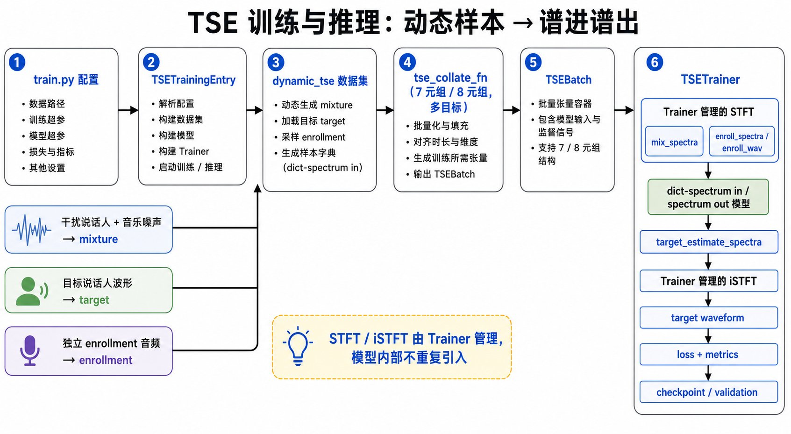

# TSE 架构与模型说明

**姊妹文档**：[SE_Architecture.md](SE_Architecture.md)、[AEC_Architecture.md](AEC_Architecture.md)。使用指南与命令手册见 `tasks/tse/README.md`。

---

## SSOT：TSE 相关代码路径（防漂移）

| 主题 | 代码路径 |
|------|----------|
| TSE 模型 | registry 含 `tasks/tse/models/discriminative/` 的 `TSE_BSRNN_SPK` 与 `TSE_Modular`；`tasks/tse/models/modular_spec.py` 做组合解析与能力判定，`TSE_Modular` 实现 BSRNN speaker/spatial 及预提取 visual/textual 路径，并支持非 causal mono `tfmap.type=embedding` 与 speaker latent/block 条件注入 |
| SpeakerEncoder | `tasks/tse/models/speaker/encoder.py`（vendored ECAPA-TDNN / ResNet34，句级 + 帧级双输出） |
| TSE 损失 | `core/losses`（`CompositeLoss`；TSE 无自有 loss） |
| TSE 训练入口 | `train.py`（统一入口，按 `data.mode: dynamic_tse` / `offline_tse` 路由）。TSE 专用逻辑在 `tasks/tse/trainer/tse_trainer.py`、`tasks/tse/trainer/entry.py` |
| TSE 数据 | typed cue：`tasks/tse/cue_contract.py`；动态：`tasks/tse/data/dynamic_dataset.py`；离线：`tasks/tse/data/wesep_adapter.py` + `offline_dataset.py`；canonical dict item / validated batch：`tasks/tse/data/collate.py`、`tasks/tse/data/batch.py` |
| 推理/部署 | 整句 `tasks/tse/inference/extractor.py`；文件推理 `tasks/tse/inference/adapter.py` + artifact/UID/sidecar `tasks/tse/inference/artifacts.py`、`sidecar.py`；waveform streaming `tasks/tse/inference/streaming.py`；TorchScript `tasks/tse/inference/torchscript.py`；ONNX `onnx/models/streaming_tse.py` |
| REAL-TSE 评测 | `evaluate/eval_pipeline_tse.py`（spksim/dnsmos/timing/ter + 有参考指标） |
| 示例配置 | `configs/tse/dynamic/tse_bsrnn_spk.yaml` |

---



> 本图只概括 `TSETrainer` 的训练与验证路径；`STFT/iSTFT` 由 trainer 管理，模型只消费和产出谱。整句推理与预提取模式的独立 `SpeakerEncoder` 接线以 `tasks/tse/inference/extractor.py` 和正文为准。

## 一、TSE 在 core + 任务模块架构中的挂载方式

TSE 遵循与 SE/AEC 完全相同的「core 基础设施 + 任务包」分层：`core/` 提供入口路由、trainer 模板、仿真管线、tasks/ss 的数据、模型、训练和推理模块；`tasks/tse/` 只承载任务专属的 dataset、模型、trainer hook 与推理评测。

### 1. 入口路由（detect_task）

```
train.py
  → core/trainer/entry.py::detect_task(cfg)
      data.mode == "dynamic_tse"  →  TaskInfo(task="tse", subtask="dynamic_tse", ...)
      data.mode == "offline_tse"  →  TaskInfo(task="tse", subtask="offline_tse", ...)
  → TSETrainingEntry("TSE_Train").run()
```

- `detect_task` 识别 `dynamic_tse` 与 `offline_tse`；SE/AEC 的 mode 判定逻辑不变。
- `train.py` 按 `task_info.task == "tse"` 路由到 `TSETrainingEntry`。

### 2. TSETrainingEntry（`tasks/tse/trainer/entry.py`）

继承 `core/trainer/entry.py::UnifiedTrainingEntry`（照 `AECTrainingEntry` 模式），覆写以下 TSE 接线：

- `_validate_config`：两种模式都校验 data/model/speaker fbank 采样率一致。`dynamic_tse` 的 train/validation `speech_scp` 只接受 strict JSONL；identity 由 JSONL 的 `dataset_id` / `speaker_id` 构造，`data.train` / `data.validation` 下的 `spk2enroll_json` 必须是 nested `dataset_id -> speaker_id -> [path]`。`meta.evaluation_only: true` 配置在 TSE training entry 入口直接拒绝。`offline_tse` 的 train/validation 均走独立 `TSEOfflineDataset`，不套用这些动态资源规则。
- `_resolve_tse_distributed_cfg`：按模型 cue 配置推导 `distributed.find_unused_parameters`。当前所有合法配置下推导恒为 `False`（speaker encoder 构造即被每次前向调用，冻结参数不在 DDP expected-grad 集合内），函数保留显式分析以便未来 cue/encoder 使用模式变化时扩展。
- `_resolve_spk_classifier_cfg`：按 loss 是否含 `SpeakerCrossEntropyLoss` 分量（`weight == 0` 视为未启用）推导 `model.args.multi_task`，并从 train dataset 的 `speaker_identity_to_idx` 大小注入 `spks_in_train`（显式配置冲突时报错）。
- `build_loaders`：接受 `dynamic_tse` / `offline_tse`，统一经 `tasks.tse.data.build_dataset` 分派，再使用 `GroupedBatchSampler` + `partial(tse_collate_fn, ...)`；validation label-space 显式复用 train identity 映射。
- `build_model`：`tasks.tse.models.register_tse_models(only=model.type)` 后走 `core.models.build.build_model`；`import core.losses` 完成 loss 注册（TSE 无自有 loss）。

动态模式在 Dataset 边界 fail-closed：SCP 与 JSON speech manifest 均不支持；strict JSONL 以自身 `dataset_id` / `speaker_id` 为主事实，`data.train` / `data.validation` 的 enrollment resource 必须是 nested `{dataset_id: {speaker_id: [path, ...]}}`。`prepare_dynamic_tse_manifests.py` 可从用户自有单说话人资源原子生成这两份清单，并永久拒绝 REAL-T evaluation assets。validation 默认 `inherit_simulation: true` 时可以用 split-local `speech_scp`、`music_scp` 和 `spk2enroll_json` 覆盖 train resource；仅当 `inherit_simulation: false` 时，validation 才必须显式提供本地 `spk2enroll_json`。

离线模式在 `samples_list` / `samples_jsonl` 中二选一，并要求每个 split 显式声明 `manifest_format`、`path_base`、`target_selection`、`mix_variant`、`cue_schema` 和 `enabled_cues`；启用 cue 时另提供 `cues_yaml`。`wesep_adapter.py` 严格解析全部目标、多文件通道以及 audio/spatial/visual/textual 索引，不按后缀或文件存在性猜 schema/路径；`TSEOfflineDataset` 解码 speaker waveform、speaker embedding、spatial `npy/fields`（static/track typed cue）、visual `npy/muse_frontend`（预提取帧级特征，raw `mp4` 在构造期拒绝）与 textual `json/dae_keyword_phoneme`；四类 cue 的 index 解析与解码均已接线，但本机尚无已整理的 visual/spatial 数据集，也没有对应的真实训练闭环。GenerationManifest v2 的 `tse-wesep-offline-v1` adapter 会构造生产 `TSEOfflineDataset(strict_load=True)`、遍历全部样本、解码全部 enrollment candidate 并写 publication receipt。官方 REAL-T v1.0.0 是 evaluation-only benchmark，不属于训练数据。

动态模式的 enrollment 增强边界固定为 TSE-local runtime 组件：`tasks/tse/data/enrollment_augment.py` 提供 `EnrollmentAugmentor`。`EnrollmentAugmentor` 无状态且由 Dataset 注入 RIR/noise provider，不写入 mixture 的 `AcousticScenePlan`，也不由 pseudo-target generator 离线物化。TSE pseudo-target generator 当前版本为 `2.0`；dynamic enrollment augmentation 和 waveform stems 不属于其 publication。

### 3. TSETrainer 与 MetricsCapableTrainer 模板

`TSETrainer`（`tasks/tse/trainer/tse_trainer.py`）继承 `core/trainer/metrics_trainer.py::MetricsCapableTrainer`，照 `AECTrainer` 模式实现模板 hook：

| hook | TSE 实现 |
|------|----------|
| `_unpack_batch` / `_batch_to_device` | trainer 入口只接受 collate 已验证的 `TSEBatch`，tuple 显式拒绝；`TSEBatch.to()` 递归搬运 waveform、target 与全部 typed cue tensor |
| `_forward_and_compute_loss` | `_forward_tse_batch` 委托 `tasks/tse/model_io.py`：按完整模型 I/O 合同装配 waveform、spectrum 和 typed cue。`mixture [B,C,T]` 只做一次 STFT，再按固定 `num_targets [B]` 展开为 `R=sum(num_targets)` 行，与 `target [R,T]` 和 cues 对齐；`TSEExtractor` 共用输出解码边界 |
| 预提取 `spkemb` | `joint_training=false` 且启用 `spkemb` 时，trainer 用独立、冻结的 `SpeakerEncoder` 从 `batch.cues.speaker_waveform` 在线生成句级 `spk_embedding`；encoder 不进入主模型、optimizer、DDP 或 compile。train 与 validation 都走 `_compute_spk_embedding`，并严格校验 checkpoint identity、shape、dtype、device 与 finite 值 |
| SSA（`trainer.ssa_prob`） | `_maybe_ssa_cues`：命中时先 no-grad 预前向得自估计 est0（nan_to_num + 能量下限防护，不达标回退原 cue），再替换 speaker waveform cue 做训练前向；仅训练路径、仅 joint_training=true |
| multi-task speaker CE | `_composite_spk_ce_kwargs`：模型输出含 `spk_logits` 且 loss 为含 `SpeakerCrossEntropyLoss` 分量的 CompositeLoss 时，注入 `spk_logits`/`spk_labels` kwargs（照 AEC state detector 接线范例） |
| dual self-estimated objective | `trainer.objectives.dual_self_estimated` 是 canonical 配置；训练时计算原 enrollment 与 detached self-estimate 两路输出，默认 `0.4/0.6` 加权、validation 保持单路 |
| `_sanitize_batch_inputs` / `_maybe_count_silence_placeholders` | NaN/Inf 清零；占位样本按 mixture+target 双零能量判定（照 AEC 判据） |
| `_val_forward_loss` | 验证侧单 batch 前向（core `_validation_epoch` 模板 hook）：上交 `(est, target, lengths, fs)`，复用 core 带参考 val metrics（SI-SDR/PESQ/ESTOI）；MOS 统一经 `evaluate/` 离线计算 |

DDP / AMP / EMA / checkpoint / epoch-tail 全部走基类：`_train_epoch_tail_label = "TSE"`，epoch-tail 残差梯度处理经基类 `_handle_epoch_tail_gradients()`（红线：禁止自写 `world_size > 1` 守卫）。

---

## 二、与 SE/AEC 的复用对照

| 组件 | SE | AEC | TSE |
|------|-----|-----|-----|
| 训练入口 | `train.py` 路由 + `SETrainingEntry` | `train.py` 路由 + `AECTrainingEntry` | `train.py` 路由 + `TSETrainingEntry` |
| Trainer 模板 | `MetricsCapableTrainer` | 同左（dict 谱进谱出先例） | 同左（照 AECTrainer 模式） |
| 模型接口 | 谱进谱出 + 外置 STFT | **dict 多字段输入**：mic/farend 两路语义至少映射为 `mic_spectra` / `farend_spectra`，并可按模型能力携带其他字段 → `nearend_estimate_spectra` 等输出 | model I/O 边界可按合同装配 waveform/spectrum/typed cue；两个既有模型消费 speaker waveform/embedding，`TSE_Modular` 另可消费 spatial、visual（`representation=features`）与 textual（`phoneme_ids`）cue，输出 `target_estimate_spectra` |
| 仿真/离线管线 | A–F / clean-noisy pair | A–F + farend/echo 与 AEC 专属模型输入前端 / mic-farend-nearend | 动态 A–F + speaker waveform cue；离线显式 WeSep manifest/path/target/mix/cue schema，解码 waveform/embedding、spatial、visual（预提取 features）与 textual cue |
| Dataset 资源键 | — | `aec_ref_echo_*` 经 expand 提升 | 动态：nested `spk2enroll_json`、`music_scp` 与提升后的 enrollment/target 参数；离线：`samples_list`/`samples_jsonl` 二选一 + `manifest_format`、`path_base`、`target_selection`、`mix_variant`、`cue_schema`、`enabled_cues`、按需 `cues_yaml` |
| collate/batch | tuple 样本 → `collate_fn` → validated `SEBatch` | tuple 样本 → `aec_collate_fn` → validated `AECBatch` | canonical dict item → `tse_collate_fn` → validated `TSEBatch`；`mixture [B,C,T]`、`target [R,T]`、`num_targets [B]`，tuple 拒绝 |
| loss / metrics / sampler | `core/losses`、`core/metrics`、`GroupedBatchSampler` | 直接复用 | 直接复用 |
| 评测 | `evaluate/eval_pipeline_se.py` | `evaluate/eval_pipeline_aec.py` | `evaluate/eval_pipeline_tse.py`（REAL-TSE 四指标） |

TSE mixture 仿真在 Dynamic 中先按 **Layer A → Layer B → 场景内 interference → Layer C** 组装 mixture，再执行固定的 Dynamic post-mix 顺序 **`pre-finite → D-normalize → D-guard → E → F → task-post-EF → final-guard → post-finite`**。Dataset 仿真统一只有 Layer A–F；post-mix 完成后，scene-wide `TimeTransformPlan` 再统一执行 target-SR resample 以及同步 crop/tile/gap/canvas。enrollment 独立处理且不进入 mixture timeline。Layer D 是 post-mix amplitude conditioning，内部固定为 normalize → guard：`D-normalize` 按配置对 `mixture` / `primary_target` / `noise` / 全部 `alternate_target/N` 执行 peak normalization；`D-guard` 随后按这些 scene stems 的共同峰值生成唯一安全 scale 并同比缩放，enrollment 不参与。Layer E 的 clipping 属于 channel degradation，Layer F 的 clipping 属于 observation/device degradation；只有 Layer E clipping operation 实际 `applied` 时，Layer F 才仅跳过 clip，F 的其他操作继续执行。`final-guard` 是独立的确定性 safety，只保护最终 `mixture`，不再联动 target/noise/alternate targets。相对 SE 的增量仅三处，全部在 `tasks/tse/data/dynamic_dataset.py` 内：

1. **干扰说话人支路**：Layer B 直接抽样 `prob_target_only` / `prob_interference_only` /
   `prob_noise_only` / `prob_interference_noise_only` / `prob_target_noise` /
   `prob_target_interference` / `prob_target_interference_noise` 七个 canonical scene。
   含 interference 的场景按 `num_interferers` 抽取至少 1 个不同 canonical identity，
   各路先走 Layer A，再按 `sir_range` 定标并在 Layer C 前混入。干扰与目标共享同一次
   RIR；Babble/hubbub 仍是 Layer C `noise_scp` 的 additive noise，不等于可分说话人
   interference。
2. **Layer C Music/Wind 路由**：music pool = 分类 JSON/JSONL 内嵌 role + 显式 `music_scp` 扩池；每次 additive source read（单源、双源两次、enrollment）都独立按 `music_ratio` 决定 family，balanced dual 不绕过 Music。双源禁止 Music+Music；ordinary+ordinary 分类完整时必须异类。仅 `music_ratio=1` 且 Music pool 非空允许 ordinary 为空，此时无 ordinary second 合法退化单源。Wind pool 同样由内嵌 role + 显式 `windnoise_scp` 扩增；命中 side-chain 后，`noise_mix_prob` 未命中时 Wind 替代普通 additive read，命中双源时 Wind 再叠加一段 ordinary/Music additive noise。
3. **enrollment 仿真**（Layer A-enroll + Layer C-enroll）：`enrollment_duration`（默认 8s）定长裁剪/拼接 + `enrollment_db` RMS 归一；增强由 `enrollment_augment` 独立控制，包括 `prob_speed`、`prob_pitch`、`prob_eq`、`prob_reverb`、`prob_noise`、`prob_lowpass` 及对应范围。注册音频使用独立的 static/near RIR provider，不进入 mixture timeline；Layer E/F 不作用于 enrollment。多目标运行期若 alternate enrollment 构造失败，直接抛出不可恢复错误，不发布稀疏 `alternate_target/N` / `enrollment/N` role。

采样 controller 只作用 train：继承到 validation 的 train `sampling` 会被剥离，validation 显式配置有效 sampling 则 fail-fast；validation label-space 仍由 entry 注入 train 的 canonical identity 映射。

---

## 三、core 追加点清单（纯追加，默认不生效）

| 位置 | 追加内容 | 对 SE/AEC 的影响 |
|------|----------|------------------|
| `core/data/simulation_configs.py` | shared Layer A-F 字段；TSE 场景字段为 `prob_interference_only`、`prob_interference_noise_only`、`prob_target_interference`、`prob_target_interference_noise`、`num_interferers`、`sir_range`、`music_ratio`、`prob_timeline`、`overlap_ratio_range`、`snr_reference` | SE/AEC 不配置 TSE-only 字段；共享字段由 task contract 校验 |
| `core/data/dataset_build.py` | `expand_simulation_cfg_tse_dataset_keys()`、TSE 动态资源校验与通用 `DatasetBuildSpec` 协议 | 零影响（SE/AEC 使用各自 spec，不启用 TSE expander） |
| `core/data/constants.py` / `core/trainer/entry.py` | `normalize_data_mode` 与 `detect_task` 识别 `dynamic_tse` / `offline_tse` | 零影响（只在 TSE mode 命中） |
| `core/losses/speaker_ce.py` | `SpeakerCrossEntropyLoss`（multi-task speaker CE 辅助任务分量，`ignore_index=-1` 跳过未知说话人） | 零影响（SE/AEC 配置不引用） |

`tasks/tse/data/__init__.py::build_dataset` 通过同一 TSE `DatasetBuildSpec` 分派：`dynamic_tse` 使用 `TSEDynamicMixingDataset`，`offline_tse` 使用 spec 的 `offline_dataset_factory` 构建 `TSEOfflineDataset`。共享 builder 只投递已解析 lifecycle request，不解释 WeSep/cues 字段；两条路径最终都输出唯一 canonical dict item，由 `tse_collate_fn` 构造并验证 `TSEBatch`，trainer 不根据字段猜测数据来源，也不接受 tuple。

---

## 四、离线 TSE（许可允许的数据 / teacher pseudo-target）

```yaml
data:
  mode: offline_tse
  train:
    samples_list: "~/use_train_data/tse/train/raw.list"
    manifest_format: path_list
    path_base: manifest_relative
    target_selection: all
    mix_variant: default
    cue_schema: wesep_v0_1
    enabled_cues: [audio]
    cues_yaml: "~/use_train_data/tse/train/cues.yaml"
  validation:
    samples_list: "~/use_train_data/tse/dev/raw.list"
    manifest_format: path_list
    path_base: manifest_relative
    target_selection: all
    mix_variant: default
    cue_schema: wesep_v0_1
    enabled_cues: [audio]
    cues_yaml: "~/use_train_data/tse/dev/cues.yaml"
```

也可用 `samples_jsonl` 直接指向一个 samples 文件，此时 `manifest_format: jsonl`。`path_base: recipe_root` 还必须给绝对 `recipe_root`；runtime 不做路径搜索回退。`cue_schema: none` 必须配 `enabled_cues: []` 且省略 `cues_yaml`。当前 Dataset 物化 audio waveform/embedding、spatial static/track cue、visual 预提取 features 与 textual phoneme ids；raw `mp4` 需要可选视频后端并在构造期拒绝。索引解析与解码能力不等于本机已有对应数据集或已完成训练闭环。REAL-T release 只接入评测 identity 和指标，不接入训练。

---

## 五、现有扩展模型与部署边界

- registry 含 `TSE_BSRNN_SPK`、`TSE_Modular` 两个模型身份；`TSE_Modular` 是 runtime STFT 的 BSRNN 组合，frontend 已接线 speaker（`usef`/`tfmap`/`context`/`spkemb`）、spatial、visual（预提取 features）与 textual，`supports_streaming=False`、`supports_multi_task=False`。双 self-estimated objective 已迁移到 `TSETrainer`。WeSep frame-embedding recipe 已迁移为 `configs/tse/offline/tse_modular_speaker_tfmap_emb_wesep.yaml` 及 block fusion 变体，使用 `separator.rnn_norm_eps: 1e-5` 和显式 `pretrained_prefix`。
- causal `TSE_BSRNN_SPK`：模型级 `TSEStreamingState` 上增加 centered STFT/WOLA waveform session；ONNX 与 TorchScript 共用固定 enrollment loopback + temporal cache flat ABI。
- ONNX 正式发布只允许 `onnx/verify/verify_3way_tse.py`；TorchScript 发布同时写 config/checkpoint fingerprint sidecar。
- 文件推理按模型 IO 合同声明的 cue role 读入 `speaker_waveform`/`speaker_embedding`/`spatial`/`visual`/`textual` 文件与 `attributes['cues']` inline JSON，并把全部 cue 文件、inline cue JSON 与 speaker 前端身份（checkpoint/fbank/preprocess）绑定进 UID/sidecar/manifest（`tse-inference-artifact-v6`、`tse-inference-manifest-v4`）。streaming/ONNX 仍只覆盖 speaker 条件，spatial/visual/textual 不进入这两条路径。
- `models/modular_spec.py` 纯解析 speaker、spatial、visual、textual 与 backbone 组合并判定能力：`implementation_available` 要求 `backbone=bsrnn`、speaker 特性属于 `usef`/`tfmap`/`context`/`spkemb`（`listen` 未接线）；`tfmap.type=embedding` 还要求 mono、centered Hann、`win_length=n_fft`、非 causal，并要求 encoder fbank 的 32 ms/8 ms（随 STFT 几何推导）对齐；visual 为 `representation=features`（raw video 未接线），其余组合在 `require_implemented=True` 下于构造期抛 `NotImplementedError`。它不构造 frontend/separator，`TSE_Modular`（`models/discriminative/tse_modular.py`）已在 registry 中，frontend 接线完整但不承诺上游 checkpoint parity；本机尚无已整理的 spatial/visual 数据集或对应真实训练闭环，textual 已在 LibriMix-keywords 上跑通一个 epoch 的训练、checkpoint 重载与带真实 keyword 的文件推理。

---

## 六、模型 TSE_BSRNN_SPK（结构速览）

移植自 wesep-real-tse（REAL-TSE-Challenge baseline），按 AEC DeepVQE 先例改造为 cue-aware dict 多输入、谱进谱出接口。mixture 与 enrollment 是两路语义，具体展开为多个按需字段：

- **结构**：BandSplit（16k/win512 → 32 子带）→ SubbandNorm → 6×BSNet（时间 ResRNN + 频率 ResRNN）→ BandMasker 复数掩码；单说话人 `nspk=1`。
- **接口**（谱参数由顶层 `stft` 块经 `model.args` setdefault 注入，构造时 pop 并校验 `win_length == n_fft`）：

  ```
  forward({"mix_spectra": [B,F,T,2],            # 必需
           "enroll_spectra": [B,F,Te,2],        # listen/usef/tfmap 时按需
           "enroll_wav": [B,Te],                # joint context/spkemb 时按需
           "spk_embedding": [B,192]})           # non-joint spkemb 时按需
    -> {"target_estimate_spectra": [B,F,T,2]}
  ```

- **5 种可插拔 speaker cue**（`features` 配置，严格 deep_update，未知键报错）：
  | cue | 作用域 | 输入依赖 | 说明 |
  |-----|--------|----------|------|
  | `listen` | 谱 | `enroll_spectra` | 谱域前缀拼接（enroll 谱 + glue 零谱帧拼到 mix 谱前，输出裁掉前缀；原实现的波形拼接在谱进谱出下的数学等价改造） |
  | `usef` | 谱 | `enroll_spectra` | USEF 跨谱注意力，输出拼接为输入通道 |
  | `tfmap` | 谱 | `enroll_spectra` | TF 注意力图拼为第 3 通道（谱进谱出下仅支持 `type='spec'`） |
  | `context` | 帧级 embedding | `enroll_wav` → ECAPA 帧级特征 (B,512,T_e) | cross-attention 融合；**仅 joint 模式** |
  | `spkemb` | 句级 embedding | `enroll_wav` → ECAPA 句级 (B,192)，或预提取 `spk_embedding` | SpeakerFuseLayer 融合（multiply） |

- **joint / 预提取双模式**：`joint_training=true`（默认）时模型内含 vendored ECAPA-TDNN（`tasks/tse/models/speaker/`，去 wespeaker 依赖），与比赛 checkpoint 对齐；`false` 时 `spkemb` 接收模型外生成的 `spk_embedding`，`context` 不支持，`listen` / `usef` / `tfmap` 仍可用 `enroll_spectra`。训练与验证已由 `TSETrainer` 接线：独立冻结的 `SpeakerEncoder` 从 `batch.cues.speaker_waveform` 生成 embedding，再通过 `tasks.tse.model_io.build_tse_model_inputs` 注入模型；整句推理由 `TSEExtractor` 执行同类外置提取。这里的“预提取”指 embedding 在 TSE 分离模型前向之外计算，并非要求 Dataset 在磁盘中预存 embedding。
- **比赛 checkpoint 兼容边界**：STFT/iSTFT 无权重（剥离不影响键名），主 checkpoint 的 wesep wrapper 与 `module.` 前缀可被识别。官方主 checkpoint 已包含 ECAPA；`configs/tse/inference/` 下的官方变体配置将独立 `speaker_encoder.pretrained` 置为 `null`，`TSEExtractor` 在 joint 模式构造时也会强制跳过训练配置遗留的独立 ECAPA 预加载，然后在复制任何参数前执行主 state 的 key/shape/dtype strict gate。`tools/verify/verify_tse_official_ckpts.py` 负责在 checkpoint 和 REAL-T DEV 波形可用时执行四变体的真实波形、确定性、有限值、长度和峰值门禁；非 joint 模式仍必须提供独立 speaker checkpoint。该边界不修改或放宽 fail-closed 逻辑。

---

<p align="center">
  <sub>UTF-8 Markdown · 最后更新: 2026-09-22</sub>
</p>
