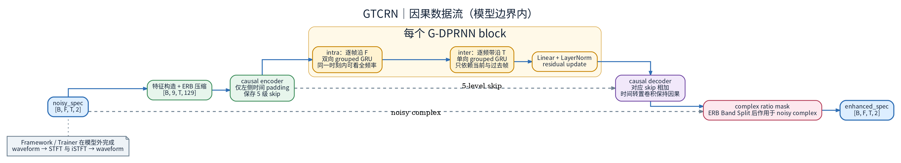
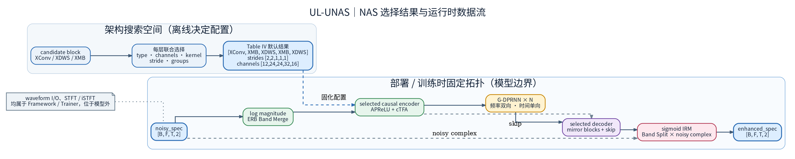
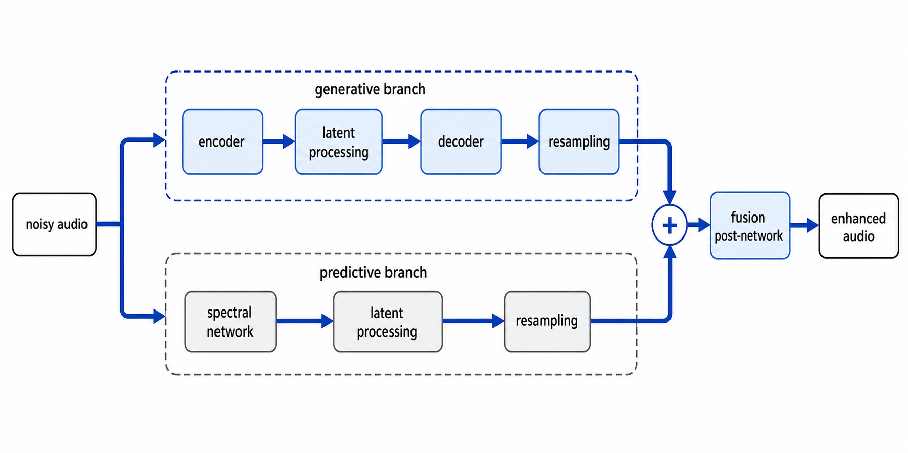
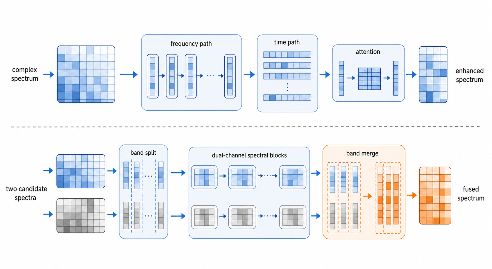

# Xiaobin-Rong 模型系列深度分析：GTCRN → UL-UNAS → PASE → StuPASE → UniPASE → GAP-URGENet

**姊妹文档**：[pase_family_learning_guide.md](../../guides/se/pase_family_learning_guide.md)（PASE 系列学习指南，§8 含 PASE/StuPASE 移植与逐组件数值对齐记录）、[SE_Architecture.md](../SE_Architecture.md)。

本文档对南京大学 Xiaobin-Rong 作者线的六个语音增强模型做机制级分析。所有架构事实与数字均来自对本地官方开源仓库的实际阅读与实测（参数量用 `sum(p.numel())` 现算，见各节标注），论文未在本地核实的声明一律标注信息来源。

> **作者线定位**：同一作者线同时经营两条几乎对立的产品线——
> **端侧超轻量线**（GTCRN 48K 参数、33 MMACs/s，目标是 CPU 实时）与
> **通用大模型线**（PASE 系列 ~400M→~590M 参数，目标是离线全能增强、低幻听）。
> 两线在 GAP-URGENet 上合流：生成支路（大模型线）+ 判别式 Predictor（TFGridNetV3）由 PostNet 融合。

---

## 一、总览：两条产品线的定位分野

| 模型 | 发表 | 参数量 | 算力 | 流式/因果 | 输入特征 | 输出目标 | 核心创新 |
|---|---|---|---|---|---|---|---|
| **GTCRN** | ICASSP 2024 | 48.2K 总 / 23.7K 可训练（实测 48245/23669） | 33.0 MMACs/s | ✅ 因果，零 look-ahead | ERB 压缩复谱（mag+RI 3ch） | CRM 复数掩膜 | ERB+SFE、GTConvBlock（channel shuffle）、TRA、DPGRNN |
| **UL-UNAS** | IEEE TASLP（arXiv 2503.00340） | 171.3K 总 / 146.8K 可训练（实测 171328/146752） | 未实测（README 未给，ptflops 本地缺失） | ✅ 因果，零 look-ahead | ERB 压缩 log-mag（1ch） | IRM 幅度掩膜 | NAS 搜 U-Net 块（XConv/XDWS/XMB）、AffinePReLU、cTFA |
| **PASE** | AAAI 2026（arXiv 2511.13300） | encoder 315M + decoder ~76M | 离线 | ❌ | WavLM L1+L24 特征 | 波形（Vocos ISTFT head） | WavLM 音位先验 + DRD 表征蒸馏，低幻听生成式 SE |
| **StuPASE** | Interspeech 2026（arXiv 2603.09234） | encoder 315M + CFM 189.5M + vocoder | 离线（8 步 ODE） | ❌ | WavLM L24 特征 + noisy mel | 100 维 log-mel → 波形 | DiT 条件流匹配（CFM）两阶段生成，studio-quality |
| **UniPASE** | IEEE TASLP（arXiv 2604.14606） | 315M + 114.5M + 113.7M + 2.8M | 离线 | ❌ | 任意采样率 → WavLM L1+L24 | 16k/48k 波形 | L1 表征域 Adapter、PLC 丢包补偿、PostNet 带宽扩展 |
| **GAP-URGENet** | ICASSP 2026（arXiv 2604.01832，URGENT 2026 客观评测第 1，team WR） | ~586M 总计（逐模块实测见 §五） | 离线（8s 分段拼接） | ❌ | 双支路 16k → 48k | 48k 波形 | 生成-预测双支路 + 双通道 TFGridNetV3 PostNet 融合 |

两条线的分野本质上是**优化目标不同**：

- **端侧线**优化「每帧 MACs × 参数量」的帕累托前沿：一切设计（ERB 压缩、channel shuffle、分组 RNN、深度可分离卷积）都是在 23K~147K 可训练参数的预算内挤出建模容量。损失与评测是经典判别式体系（VCTK-DEMAND PESQ、DNSMOS）。
- **大模型线**优化「低幻听 + 通用性」：把增强搬到预训练 SSL 模型（WavLM-Large）的表征空间，用生成式方法（GAN 声码器 / Flow Matching）"重新生成"干净语音，避免判别式映射在重度损伤下编造内容。评测转向 URGENT Challenge 的非侵入式指标（DNSMOS/UTMOS 等）。

---

## 二、端侧超轻量线

### 2.1 GTCRN（ICASSP 2024）

官方实现为单文件 `gtcrn.py`（345 行，仓库 `gtcrn-main/`）。整体是 **ERB 压缩域上的卷积 U-Net + 双路径 RNN 瓶颈 + CRM 掩膜**：



*图：GTCRN 的总体分区与数据流示意；精确模块名、tensor shape、因果实现和数值以正文为准。*

**实现级 shape/data trace（精确细节）**：

1. `spec`：`(B,F=257,T,2)`，参数为 `[n_fft=512, hop=256, sqrt-hann]`。
2. `mag/real/imag` 堆叠为 `(B,3,T,257)`。
3. `ERB.bm`：低频 65 bin 保留，高频 192 bin 压为 64 个 ERB 子带，得到 `(B,3,T,129)`。
4. `SFE(3)` 对频率邻域执行 `unfold`，得到 `(B,9,T,129)`。
5. Encoder：`ConvBlock(stride f/2) ×2 → GTConvBlock ×3 (dilation 1,2,5)`，得到 `(B,16,T,33)`。
6. 瓶颈为 `DPGRNN ×2`，`F=33, C=16`。
7. Decoder：`GTConvBlock(deconv) ×3 + ConvBlock ×2`，U-Net skip 相加。
8. `ERB.bs`（`erb_fc` 转置矩阵）→ CRM mask → 复数乘回原谱 → ISTFT。

**模块机制**：

- **ERB 压缩**（`ERB`）：65 个线性低频 bin 直通（保相位精度），192 个高频 bin 经固定的三角 ERB 滤波器组（`erb_fc`，`requires_grad=False`）压成 64 个子带，共 129 维。等于用听觉感知先验把网络要建模的频率维砍掉一半——低频语音基频/谐波区保分辨率，高频噪声区只要子带能量。逆变换 `ierb_fc` 就是滤波器组的转置。这两个固定矩阵占 24576 个参数（48.2K 与 23.7K 之差，README 明确说明）。
- **SFE**（Subband Feature Extraction）：`nn.Unfold(1×3)` 把每个频率 bin 的左右邻域拼进通道维，3ch→9ch。本质是一次无参数的局部频率相关性显式编码，让第一层卷积直接看到子带上下文。
- **GTConvBlock**（Grouped Temporal Convolution，ShuffleNetV2 思想）：通道对半劈开，一路走 `SFE → pointwise conv → 深度卷积（时间维因果 padding，dilation 1/2/5 多尺度）→ pointwise conv → TRA`，另一路恒等，最后 **channel shuffle** 交错合并。深度卷积 groups=hidden、时间核 3 配膨胀率 {1,2,5}，用极小代价覆盖多尺度时域上下文；shuffle 保证两路信息充分混合。
- **TRA**（Temporal Recurrent Attention）：对每个通道沿频率维求能量均值 `(B,C,T)`，过一个**因果 GRU** + Linear + sigmoid 得到帧级门控，逐帧调制特征。是给卷积块补"长时包络感知"的廉价注意力（每块只加一个 C→2C→C 的 GRU）。
- **DPGRNN**（Grouped Dual-Path RNN 瓶颈）：intra-RNN 沿**频率轴**（双向 GRNN，帧内全带建模）→ inter-RNN 沿**时间轴**（单向 GRNN，跨帧建模），各接 FC + LayerNorm + 残差。GRNN 把输入/隐状态对半劈给两个小 GRU 再 concat，参数量近似减半。两个 DPGRNN 串行，是整网的时序建模主力。
- **CRM 掩膜**：decoder 末层 `is_last=True` 用 Tanh 出 2 通道掩膜，与带噪复谱做复数乘法（`s_r = x_r·m_r − x_i·m_i`），同时修正幅度与相位。

**流式/因果设计**：所有时间维卷积都是左侧 padding（`pad_size=(k_t−1)·dilation` 手工左补），inter-RNN 单向，TRA 的 GRU 单向；intra-RNN 的双向是沿频率轴的，不构成时间维 look-ahead。`__main__` 里有因果自检（拼接不同尾段，前缀输出 bit 级一致）。官方 `stream/` 目录提供流式 ONNX 版本，12 代 i5-12400 上 **RTF 0.07**（据官方 README）。README 还记录一个流式化细节：GRNN 里显式的 feature shuffle 在流式下不可行，改为由后续 FC 层隐式完成特征重排。

**性能**（据官方 README）：VCTK-DEMAND 上 SISNR 18.83 / PESQ 2.87 / STOI 0.940，超过 RNNoise（PESQ 2.29）并与 DeepFilterNet（1.8M 参数）持平；DNS3 盲测 DNSMOS-P.808 3.44。论文口径 23.7K/39.6 MMACs，仓库口径更新为 48.2K/33.0 MMACs（ERB 固定权重计入参数、低频映射改为 concat 后 MACs 下降）。

### 2.2 UL-UNAS（IEEE TASLP，arXiv 2503.00340）

官方实现同为单文件（`models/ulunas.py`，558 行）。**骨架不变**（ERB → 卷积 U-Net → 2×DPGRNN → 掩膜），但每一块都换成了 NAS 搜出来的高效算子，且注意力从 TRA 升级为 cTFA：



*图：UL-UNAS 的总体分区、NAS 搜索和因果数据流示意；候选块、精确配置、tensor shape 与掩膜实现以正文为准。*

**实现级 shape/data trace（精确细节）**：

1. `wav`：`(B,L)` → STFT → `log10|X|`：`(B,1,T,257)`。
2. `ERB.bm`：`(B,1,T,257)` → `(B,1,T,129)`。
3. Encoder：5 个 NAS 块，widths `129→65→33→33→33`；types `[XConv, XMB, XDWS, XMB, XDWS]`；strides `[2,2,1,1,1]`；groups `[1,2,2,2,2]`；channels `[12,24,24,32,16]`；kernels `[(3,3),(2,3),(2,3),(1,5),(1,5)]`。
4. 瓶颈为 `DPGRNN ×2`，`C=16, F=33`。
5. Decoder：同构 deconv 块 + skip 相加，末层 sigmoid。
6. `ERB.bs` → IRM（同一掩膜乘复谱 R/I 两路）→ ISTFT。

**相对 GTCRN 的改进点**：

- **NAS 可搜索块**：编码器/解码器不再手写，而是在三种候选块上搜结构——
  - `XConvBlock`：单个分组卷积 + BN + AffinePReLU + cTFA（+可选 Shuffle），最便宜的"普通卷积"候选；
  - `XDWSBlock`：pointwise conv（分组+Shuffle）→ 深度卷积 + cTFA，即深度可分离版本，对应 GTConvBlock 的轻量化方向；
  - `XMBBlocks`：MobileNet 倒残差风格 `pconv → dconv → pconv`，通道不变时带残差，容量最大的候选。
  搜出的默认结构（论文 Table IV，本框架移植版 docstring 亦注明）在两头用便宜块降采样、中间交替放 XDWS/XMB。
- **AffinePReLU**：PReLU 之外再加一组逐通道×逐频率的仿射变换 `w·x+b`（PReLU 负半轴斜率仍逐通道可学），用 O(C·F) 参数换逐 TF 单元的增益自适应。
- **cTFA**（causal Time-Frequency Attention）= TA + FA：TA 即 GTCRN 的 TRA（时间维因果 GRU 门控）；FA 是新增的频率注意力——对每帧能量谱按压缩比 r=4 分组，用**双向 GRU 沿频率轴**建模子带间关系（双向沿频率不破坏时间因果），sigmoid 后逐频点调制。两者相乘：`at[...,None] · x · af[:,None]`。
- **输入/输出简化**：输入只用 log-mag 单通道（GTCRN 是 mag+RI 三通道），输出从 CRM 退为 **IRM**——sigmoid 掩膜同乘复谱两路，只修幅度不修相位。这是端侧线"相位建模收益不抵成本"的明确取舍。
- DPGRNN 沿用，仅 FC 输出维写法从 `hidden→hidden` 改为 `hidden→input_size`（默认配置下二者相等，无实际差异）。

**流式/因果**：时间维全部 `ZeroPad2d([0,0,k_t−1,0])` 左侧补零；cTFA 的 TA 单向、FA 沿频率双向；`__main__` 同样有因果自检（误差 < 1e-8 判因果）。参数量实测 **171.3K 总 / 146.8K 可训练**（README 未给口径；MACs 本地无法实测——ptflops 缺失，官方 README 亦未列，此处为如实缺口）。客观指标表同样未在 README 给出，需查论文。

### 2.3 GTCRN 与 UL-UNAS 逐项对照

| 维度 | GTCRN | UL-UNAS |
|---|---|---|
| 可训练参数（实测） | 23,669 | 146,752（约 6.2 倍） |
| 输入特征 | mag + real + imag 三通道 | log10-mag 单通道 |
| 频率压缩 | ERB(65+64) → 129 | 同一套 ERB 实现（代码逐行一致） |
| 编码器块 | 手写 ConvBlock ×2 + GTConvBlock ×3（dilation 1/2/5） | NAS 搜出的 XConv/XDWS/XMB 组合 |
| 注意力 | TRA（仅时间维门控） | cTFA = TA + FA（时间+频率双门控） |
| 激活 | PReLU（末层 Tanh） | AffinePReLU（逐通道×逐频率仿射 + PReLU） |
| 瓶颈 | DPGRNN ×2（C=16, F=33） | DPGRNN ×2（同构，FC 写法略异无数值差异） |
| 掩膜 | CRM（复数掩膜，修相位） | IRM（幅度掩膜，sigmoid 下同乘 R/I） |
| 时间维因果手段 | 手工左侧 padding + 单向 inter-RNN | `ZeroPad2d([0,0,k_t−1,0])` + 单向 TA/inter-RNN |
| 自检 | `__main__` 因果性 + ptflops | `__main__` 因果性（<1e-8）+ ptflops |

从对照可以看出 UL-UNAS 的定位：**在仍属"超轻量"的预算内（147K 可训练），用 NAS 把 GTCRN 手写的每一层都换成搜索出的最优算子，同时把输入/输出简化为纯幅度域**——用 6 倍参数换结构最优性与训练稳定性，放弃相位建模。

### 2.4 端侧线设计哲学小结

1. **频率维做减法，时间维做加法**：ERB 砍频率分辨率省算力，省下来的预算全投给时间建模（多尺度膨胀卷积 + dual-path RNN + 帧级注意力）。
2. **分组 + shuffle 贯穿始终**：channel shuffle（卷积块）、GRNN（RNN）都把通道劈半分别处理再混合，在参数减半的同时保持信息流通——ShuffleNetV2/ grouped-RNN 思想在 SE 的落地。
3. **单文件、无依赖、可流式**：两个模型官方都只有一个几百行的 `.py`，自带 ptflops 复杂度和因果性自检，工程上直接可嵌入；GTCRN 已被 sherpa-onnx 等社区推理框架收录（据官方 README News）。

---

## 三、通用大模型线：PASE → StuPASE → UniPASE → GAP-URGENet

四代的共同底座（据本框架学习指南与官方仓库核对）：**WavLM-Large 编码器（~315M，7 层 CNN 下采样 320 倍 → 50 fps，24 层 Transformer，1024 维/16 头）、Vocos 范式解码器（ConvNeXt backbone + ISTFT head，n_fft=1280/hop=320）、MPD+MBD LS-GAN、多尺度 Mel L1 重建损失、URGENT 数据仿真、AdamW(0.8/0.99)+LinearWarmupCosineAnnealing+grad clip 3.0 训练骨架**。每一代解决的问题与继承关系：

### 3.1 PASE（AAAI 2026）：确立"WavLM 表征 + 声码器直出"范式

- **要解决的问题**：判别式 SE 在重噪声/混响下产生幻听（hallucination）；直接生成波形又容易语义跑偏。
- **机制**：**DRD**（Denoising Representation Distillation）——冻结的原始 WavLM 吃 clean 取 L24 特征作 teacher，可训练副本吃 noisy 学出同样表征，得到 **DeWavLM**；解码端把 L24（音位/语义主线）与 L1（声学细节，经 Linear 投影）**逐元素相加**，进 12 层 ConvNeXt 的 VocosBackbone，ISTFT head 直出 16k 波形。语义由 L24 锚定、细节由 L1 补，这是低幻听的核心主张。
- **训练 3 阶段**：clean-only 单流 vocoder GAN 预训练 → DeWavLM 蒸馏 → 双流 GAN 微调。

### 3.2 StuPASE（Interspeech 2026）：把"生成"从声码器中剥离

- **要解决的问题**：PASE 一步直出波形，声码器既要学声学又要"脑补"损伤内容，保真度受限。
- **机制**：两阶段生成——**DeWavLM-R**（在 PASE DeWavLM 之上用 dry target 二次蒸馏，更去混响）出 L24 表征作条件；**CFM**（条件流匹配，DiT 12 层/1024 维，189.5M，F5-TTS 同款框架，RoPE + AdaLN-Zero）在 **100 维 log-mel 空间**做掩蔽 infilling 训练（掩蔽 70%~100% 区段算 MSE，CFG 条件丢弃），推理从噪声走 8 步 Euler ODE 生成干净 mel；再由 clean-only 训练的 Mel-Vocos 声码器转波形。声码器职责单一化（纯自编码），生成难度交给迭代生成模型。
- **继承**：WavLM 底座、MPD+MBD、多尺度 mel、GAN 骨架全部沿用；DeWavLM-R 从 PASE 的 DeWavLM 热启动。
- **代价**：ODE 采样不可微，推理级联不能端到端训练；延迟进一步远离实时。

### 3.3 UniPASE（IEEE TASLP，arXiv 2604.14606）：表征域 Adapter + 通用损伤

- **要解决的问题**：从"去噪/去混响"扩展到 **Universal SE**——削波、编解码损伤、丢包、带宽限制一个模型通吃，且吃任意输入采样率。
- **机制**（详见学习指南 §2.3）：
  - **角色反转的双表征**：PASE 让 L24 当主线，UniPASE 让 **L1 浅层声学表征当增强目标**、L24 只做条件——浅层保声学细节，深层语义负责"指导"。`VocosAdapter`（proj(L24)+L1 → 12×ConvNeXt，114.5M）输出**增强后的 L1 特征**（仍在表征空间），再由 `VocosVocoder`（dim=1024，113.7M）出 16k 波形。
  - **PLC**：检测 20ms 全零包（zero_ratio≥0.99），把对应帧的 CNN 特征替换为**可学习 mask_emb**（wav2vec2 预训练掩码同构），让 Transformer 自行补全；蒸馏阶段 student 就带掩码训练，与数据侧的丢包增广（5%~25% 丢包率）配套。
  - **PostNet**：ESPnet TFGridNetV3 改的轻量模型（2.8M），16k→48k 带宽扩展；训练全时域残差、推理改**软门控残差**（8kHz 以下保输入谱，只叠高频预测），避免动低频引入失真。
- **训练 4 阶段**：DeWavLM-Omni 蒸馏（student 带 PLC 掩码）→ L1 vocoder GAN → **Adapter 特征域 GAN**（MSE×200 + MultiScaleDiscriminator 对抗，系列中唯一的非波形域对抗）→ PostNet 48k GAN。

### 3.4 GAP-URGENet（ICASSP 2026）：生成-预测融合

- **要解决的问题**：URGENT 2026 Challenge——生成式模型感知质量高但客观指标（尤其保真类）常输给判别式；判别式指标高但有伪影。**两条路线各取所长**。
- **机制**：UniPASE 生成支路 + TFGridNetV3 判别式 Predictor 双路并行，48k 域由 PostNet 融合。详见 §五专项。
- **继承**：生成支路三个模块（DeWavLM-Omni / Adapter / Vocoder）直接是 UniPASE 架构，训练脚本都在 UniPASE 仓库（据官方 README Note）；本仓库只新增 Predictor 与 PostNet 两个训练阶段。注意官方强调 GAP-URGENet 的 5 个 checkpoint 与 UniPASE 发布的**不同**（全部在 URGENT 2026 官方训练语料上重训）。

### 3.5 训练管线对照

四代都是**多阶段独立训练**（前段冻结作后段组件），阶段产物即发布 ckpt：

| 阶段 | PASE（3 段） | StuPASE（3 段） | UniPASE（4 段） | GAP-URGENet（+2 段） |
|---|---|---|---|---|
| 表征蒸馏 | DeWavLM（L24 MSE） | DeWavLM-R（dry target，从 PASE 热启动） | DeWavLM-Omni（student 带 PLC 掩码） | 复用 UniPASE 流程（URGENT 语料重训） |
| 声码器 | 单流→双流 Vocos GAN | mel Vocos GAN（clean-only） | L1 Vocos GAN（clean-only） | 同上 |
| 核心增强 | （双流即完整模型） | CFM 流匹配训练 | Adapter 特征域 GAN（MSE×200+MSD） | 同上 |
| 新增 | — | — | PostNet 48k BWE GAN | **Predictor（HybridLoss 判别式）+ PostNet 融合 GAN** |

训练骨架四代统一：AdamW(betas 0.8/0.99, wd 0.01) + LinearWarmupCosineAnnealing + grad clip 3.0 + DDP；声码器阶段全部 clean-only（先学"干净语音长什么样"）；验证只看训练同款 loss + 存样音，客观指标线下算（据官方训练脚本与本框架学习指南 §4）。

### 3.6 演进脉络一句话

```
PASE    ：WavLM 特征 → 声码器直出波形（确立表征空间生成范式 + DRD 蒸馏）
StuPASE ：把生成挪到 mel 空间，CFM 迭代生成（保真↑，可微性/速度↓）
UniPASE ：把增强挪到 L1 表征空间，+PLC +任意采样率 +48k（通用性↑）
GAP     ：生成支路不动，旁边加判别式 Predictor，PostNet 融合（客观指标↑）
```

---

## 四、两线对比与融合趋势

| 维度 | 端侧线（GTCRN / UL-UNAS） | 大模型线（PASE 系列 / GAP-URGENet） |
|---|---|---|
| 参数量 | 48K ~ 171K | 391M ~ 586M（差 3~4 个数量级） |
| 算力 | 33 MMACs/s 级，CPU RTF 0.07（GTCRN，据 README） | 单 WavLM-Large 编码器即超实时预算；StuPASE 再叠 8 步 ODE |
| 延迟/流式 | 因果、零 look-ahead、ONNX 流式部署成熟 | 全离线；WavLM 全局注意力、Vocos 内 AttnBlock、BiLSTM、ODE 均不可流式 |
| 输入特征 | STFT 复谱 / log-mag + ERB 压缩 | WavLM SSL 表征（L1/L24）+ mel |
| 建模域 | 压缩频谱域 → 掩膜 | 表征空间 / mel 空间 → 波形再合成 |
| 训练范式 | 判别式（掩膜回归，压缩谱损失体系） | 生成式（GAN 声码器 / Flow Matching）+ 表征蒸馏 |
| 泛化目标 | 去噪（VCTK-DEMAND/DNS3 体系） | Universal SE：去噪/去混响/削波/编解码/丢包/带宽扩展 |
| 评测 | PESQ/STOI/SISNR/DNSMOS | URGENT 非侵入式指标（DNSMOS/UTMOS/NISQA 等） |

**合流的三个信号**：

1. **GAP-URGENet 是最直接的合流**：生成支路（大模型线产物）与判别式 Predictor（TFGridNetV3，本质上是端侧线所代表的"频谱域判别式回归"路线的重型版）并行，由 PostNet 在 48k 域融合。生成保感知、预测保保真，融合的 PostNet 自己也是判别式 TFGridNetV3。
2. **DPGRNN 与 TFGridNet 的 intra/inter 对偶呼应**：端侧线的 DPGRNN（intra 沿频率双向 GRU 建模帧内全带结构 → inter 沿时间单向 GRU 建模跨帧动态，各配 FC+LN+残差）与 TFGridNetV3 的 GridNetV3Block（intra BiLSTM 沿频率 → inter BiLSTM 沿时间 → 多头自注意力，各配 LN+残差）是**同一个 dual-path 设计思想**在两个资源量级上的实现——GTCRN 用分组 GRU 把它压到 23K 参数里，TFGridNet 把它放大到 22M 并加注意力。设计 DNA 一脉相承。
3. **大模型线的后处理正在"判别式化"**：UniPASE PostNet 与 GAP PostNet 都是 STFT 域判别式小模型，负责大模型不擅长的带宽/保真收尾——端侧线的技术（频谱映射、软门控残差）以"后处理"身份进入大模型 pipeline。

---

## 五、GAP-URGENet 专项

仓库 `gap-urgenet/`（ICASSP 2026，arXiv 2604.01832，URGENT 2026 Challenge 客观评测第 1，team WR，据官方 README 与 leaderboard 图）。入口 `models/gap_urgenet.py`：



*图：GAP-URGENet 的生成支路、预测支路和 48 kHz 融合位置示意；精确模块名、采样率、tensor shape、对齐策略与实现路径以正文为准。*



*图：局部机制示意，概念图只表达频率/时间建模、注意力、分带与合并关系；具体层数、窗口、频点和通道数以正文为准。*

**实现级 data/shape trace（精确细节）**：

1. 输入 `noisy` 支持任意 `sr`。
2. 生成支路：`DeWavLM-Omni(sr→16k, PLC) → VocosAdapter → VocosVocoder`，输出 `enh_gen_16k`，再 resample 到 48k。
3. 预测支路：`noisy→16k → Predictor(TFGridNetV3)`，输出 `enh_pred_16k`，再 resample 到 48k。
4. PostNet 融合：`stack([pred_48k, gen_48k])` 得到 `(B,2,L)`，送入 `PostNet(双通道TFGridNetV3+BandSplit)`，输出 48k 波形。
5. 输出 resample 回 `sr_out`（默认等于 `sr_in`），并执行长度对齐 `pad/crop`。

### 5.1 五模块逐一详解（参数量除注明外均为本地实测，`sum(p.numel())`）

| 模块 | 实现文件 | 关键配置 | 参数量 |
|---|---|---|---|
| DeWavLM-Omni（Encoder） | `models/wavlm/`（WavLM.py + feature_extractor_plc.py） | WavLM-Large，output_layer=[1,24]，PLC mask_emb | ~315M（据系列学习指南/WavLM 官方口径，本地未逐一实测） |
| VocosAdapter | `models/adapter/vocos/adapter.py` | proj(1024) + VocosBackbone + head；**默认 cfg** dim=1024/inter=4096/12层 → 实测 **139.70M**；**官方 ckpt cfg** dim=1024/inter=**3702**/12层 → **130.01M**（已从 ckpt 复核，见 5.4）；UniPASE 口径 inter=3072 → 114.52M | 以 ckpt 内 `cfg` 为准（见 5.4） |
| VocosVocoder（Decoder） | `models/vocoder/vocos/vocoder.py` | 默认 cfg dim=768/inter=2304 → 65.64M；**dim=1024/inter=3072 → 实测 113.73M**（与 UniPASE vocoder 口径一致） | 同上，以 ckpt 内 `cfg` 为准 |
| Predictor | `models/predictor/tfgridnet.py` | n_layers=10, lstm_hidden=200, attn_head=8, emb_dim=96, emb_ks=4/emb_hs=1 | **实测 22.09M**（22087196） |
| PostNet | `models/postnet/tfgrid_cws.py` | n_imics=2, n_bands=3, n_layers=5, lstm_hidden=100, emb_dim=96 | **实测 4.78M**（4777751） |

总参数 **~586M**（315 + 130.01 + 113.73 + 22.09 + 4.78，官方 ckpt 就位后已逐模块复核，2026-07-28）；此前"本地无官方 ckpt 无法复核 Adapter"的不确定项已消除——GAP 官方 Adapter ckpt 内 cfg 为 `intermediate_dim=3702`（一个非典型取值），实测 130.01M。

**Predictor**（判别式支路）：ESPnet TFGridNetV3 移植。输入逐 utterance 做 `(x−mean)/(std+1e-12)` 归一化（docstring 强调非 scale-invariant 损失下必须如此），STFT 按时长参数化（fft/hop/win=0.032/0.016/0.032s × sr；16k 下即 512/256/512，hann），复谱 RI 两通道经 `conv(2→96)` 进 **10 个 GridNetV3Block**，`deconv` 直接回归复数谱（无掩膜无压缩），ISTFT 后乘回 std。

`GridNetV3Block` 内部是三段式（`models/predictor/tfgridnet.py:170-442`）：

1. **intra BiLSTM**：沿**频率轴**做帧内全带建模。输入先 pad 到 emb_ks 对齐，发布配置 emb_ks=4 ≠ emb_hs=1，走 `unfold` 成重叠 4-bin 窗口 → BiLSTM(hidden=200) → `ConvTranspose1d` 折回，LayerNorm + 残差。
2. **inter BiLSTM**：沿**时间轴**做跨帧建模，同样 unfold/BiLSTM/deconv 结构 + LN + 残差。
3. **多头自注意力**：V3 相对 V2 的加速点——Q/K/V 用 1×1 conv 一次出全部 head（`attn_conv_Q/K/V` + 逐 head 的 PReLU-LN），在 TF 网格上做全局注意力后 concat 投影。这解释了"offline"定位：BiLSTM 与全局注意力都需要整句可见。

**PostNet**（融合器）：48k STFT（n_fft=1536，hop=768——代码内 `int(48000*0.032)` 硬编码）。**BandSplit** 把 769 个频率 bin 切成 3 个重叠子带（`assert n_freqs == 769` 硬编码，见 5.4），双通道输入 stack 成 `(B, 2·2·3=12, T, 257)` 进 conv，5 个 GridNetV3Block（lstm_hidden=100，比 Predictor 小一半），deconv 出 `n_srcs·2·n_bands` 再 `bs.inverse` 拼回全带。注意它**没有** UniPASE PostNet 的软门控残差——是直接回归的融合器。

**长音频推理**（`inference/inference_long.py`）：8s 分段、4s hop（4s 重叠），每段独立过全模型，拼接时保留每段中段（首段留前 6s、中段留 [2s,6s)、尾段留 2s 后），最后峰值归一化回输入电平。

### 5.2 训练阶段与损失（只开源两阶段）

| 阶段 | 脚本 / 配置 | 可训练模块 | 损失 | 关键超参 |
|---|---|---|---|---|
| 生成支路（3 步） | **未开源**，见 UniPASE 仓库（据 README） | DeWavLM-Omni / Vocoder / Adapter | 同 UniPASE | — |
| Predictor | 上游仓库 `train/train_predictor.py` + `configs/cfg_train_predictor.yaml` | Predictor | **HybridLoss**：压缩谱 RI ×30 + 压缩谱 Mag ×70 + 带符号 SDR 变体 ×1（compress_factor=0.3） | AdamW(0.8/0.99, wd 0.01)，max_lr 1e-4，warmup 10k→cosine 至 110k，bs 1，4s 切片，200 epochs，多采样率 [16k~48k] |
| PostNet | 上游仓库 `train/train_postnet.py` + `configs/cfg_train_postnet.yaml` | 仅 PostNet + 判别器（Encoder/Adapter/Decoder/Predictor 全部 `from_pretrained(frozen=True)` 冻结） | **GAN**：15×MultiScaleMel（48k，7 尺度 win 32~2048）+ adv×1 + feat-matching×1，判别器 MPD[2,3,5,7,11]+MBD[2048,1024,512] | lr 1e-6→4e-6，warmup 5k，仅 10 epochs（微调性质，配置里 resume=True），bs 1，48k-only 数据 |

HybridLoss 的 SDR 项实现为 `-2·log10(‖ŷ‖/‖ŷ−y‖)`（`utils/loss_factory.py:81-85`）——非 SI-SDR，是带符号的 SNR 型项。PostNet 的 `MultiScaleMelSpectrogramLoss` 直接取官方 `loss.py` 的 `sampling_rate` 参数（配置 48000，n_mels=[5,10,20,40,80,160,320]）。

### 5.3 与 UniPASE 的继承关系

- 生成支路三模块的**代码**与 UniPASE 同源（Adapter/Vocoder 文件结构一致；Encoder 即 UniPASE 的 PLC 前端），**训练脚本**直接引用 UniPASE 仓库（README Step 1）。
- **权重不同**：README 明确 GAP-URGENet 的 5 个 checkpoint 全部在 URGENT 2026 官方训练语料上重训，与 HF 上 UniPASE 权重不通用。本地证据（2026-07-28）：两侧的 `DeWavLM-Omni.pt` sha256 不一致（文件大小差 3016 字节），证实确为不同训练产物。
- 相比 UniPASE 新增的只有 Predictor（判别支路）与 PostNet（从"单通道带宽扩展"改为"双通道融合"，去掉了软门控残差，加了 BandSplit）。

### 5.4 已知工程注意点

1. **`inference_long.py` 的 `end_tmp` bug**：`inference_file()` 分段循环里，尾段处理分支 `audio_patches[-1] = torch.cat((audio_patches[-1], audio[:, end_tmp:end]))` 引用的 `end_tmp` 只在循环正常迭代过一轮后才赋值。当音频短于约 6s（首个分段直接落入"尾段 ≥ 2s"分支）时，`end_tmp` 未定义，抛 `NameError`。短音频应走 `inference.py`（非分段版）。
2. **BandSplit 硬编码 769**：`models/postnet/tfgrid_cws.py::BandSplit.forward` 内 `assert n_freqs == 769`，与 48k/1536 点 STFT 强绑定；改采样率或 n_fft 必须同步改这里（UniPASE 移植版同构）。
3. **Adapter/Vocoder 配置以 ckpt 内 cfg 为准**：两者的 `from_pretrained` 都是从 ckpt 的 `cfg` 字段构造模型（`cls(**cfg)`），代码里的默认构造参数不代表发布权重结构。已从官方 ckpt 复核（2026-07-28）：GAP Adapter cfg 为 dim=1024 / intermediate_dim=**3702** / 12 层 → **130.01M**；UniPASE Adapter 为 inter=3072 → 114.52M；Vocoder 为 dim=1024 / inter=3072 → 113.73M。
4. **`from_pretrained` 用 `load_state_dict(strict=False)`**：缺失/多余 key 不报错，换 ckpt 时需人工核对 key 匹配（本框架移植版已改为 fail-closed 的 `load_artifact_module`，见 §六）。
5. 双支路长度对齐用 pad/crop（`gap_urgenet.py:68-71`），生成/预测两路的 ISTFT 长度差异被静默吸收，长音频分段拼接时依赖外层电平归一化兜底。

---

## 六、对本训练框架的启示与复现现状

### 6.1 已复现清单

| 官方模型 | 本框架位置 | 验证状态 |
|---|---|---|
| GTCRN | `tasks/se/models/discriminative/gtcrn.py`（谱域接口，注册进 MODEL_REGISTRY） | 官方 .tar 权重加载 271/271、missing/unexpected=0/0（官方容器/层命名与框架缩写不同，推理脚本层做 key 映射：`tools/verify/infer_official_ckpts.py`）；测试音频推理通过 |
| GTCRN 流式 | `onnx/models/streaming_gtcrn.py`（StreamConv2d/StreamConvTranspose2d + 显式 tensor cache：conv_cache/tra_cache/inter_cache，对齐 gtcrn-main/stream） | ONNX 流式导出链路 |
| UL-UNAS | `tasks/se/models/discriminative/ulunas.py`（NAS 默认结构 docstring 注明 Table IV） | 官方 .tar 权重直接加载 431/431、0/0；测试音频推理通过 |
| PASE | `tasks/se/models/pase_family/pase/model.py` + `common/vocoder_backend.py` + `common/vocos/` | 外部 checkout 可用时的组件 parity（`tests/test_pase_wavlm_parity.py`，`atol=1e-5`、`rtol=1e-4`）+ 历史官方权重端到端推理记录 |
| StuPASE | `tasks/se/models/pase_family/stupase/`（CFM/DiT、mel vocoder） | 相同种子/权重条件下的官方 ckpt 数值比对记录；外部源码与权重为前提 |
| UniPASE | `tasks/se/models/pase_family/unipase/`（PLC 前端、Adapter、MSD、Vocoder、PostNet） | `tests/test_unipase_official_parity.py` 在官方 checkout、所需权重和受控后端齐备时运行；组件测试记录过 `max_abs_diff=0.0` |
| GAP-URGENet | `tasks/se/models/pase_family/gap_urgenet/`（predictor/ + postnet/ + 级联模型 + 训练 wrapper；GridNetV3Block/BandSplit 复用 `unipase/postnet/tfgrid_cws_res.py`，生成支路复用 unipase 三件套） | `tests/test_gap_urgenet_official_parity.py` 需官方 checkout/权重；组件测试 CPU 断言 diff=0，CUDA 使用 `<1e-6` 容差；另有历史端到端推理记录 |

历史审计环境曾记录六模型官方权重位于各自 `open_model_checkpoint/` 目录，并由 `tools/verify/infer_official_ckpts.py` 固化端到端加载与推理（2026-07-28 全部通过）。权重不随 Git 分发，复现时须自行准备对应权重。

### 6.2 复现策略（可复用经验）

- **共享底座 + vendor 差异**：WavLM、MPD/MBD、GAN/mel 损失两个官方仓库逐字节相同 → 直接共享；`VocosBackbone` 加 `num_res/num_attn` 参数化（默认值向后兼容）供 PASE/StuPASE/UniPASE 三处复用；数值不同的（ISTFT head 的 mag clamp 域、PLC 前端、Adapter）各自 vendor。
- **逐阶段训练 wrapper**：多阶段流水线不改动模型本体，每阶段写一个薄 wrapper（`DeWavLMDistillModel`/`UniPASEAdapterGenerator`/...），配最小覆写的 Trainer（`DualInputLossTrainer` 双输入标量损失、`PASEGANTrainer` 波形域 GAN、`UniPASEAdapterGANTrainer` 特征域 GAN），复用基类全部 accum/AMP/DDP 逻辑。
- **parity 测试分层**：组件级（key 集合 + forward 比对，按测试定义的容差）→ 官方权重端到端（SI-SNR>60 dB 等脚本阈值）→ 训练 smoke（每 stage 一个 pytest）。外部 parity 均要求官方源码 checkout 和对应权重；缺失时按设计 skip。
- **对 GAP-URGENet 复现的直接启示**：Predictor 与 PostNet 均已落地；外部 parity 测试在 CPU 上要求零差异、CUDA 上使用 `<1e-6` 容差。PostNet 训练阶段由 `GAPURGENetPostNetGenerator`（冻结四模块链 + 双通道融合）+ 复用的 `PASEGANTrainer` 实现，与官方 `train_postnet.py` 的 GAN 配方一致；`GAPHybridLoss` 有与官方数值比较的历史记录。BandSplit 769 硬编码已保留并注释，`end_tmp` bug 所在的长音频脚本未移植。

---

## 七、参考资料

**论文**：
- GTCRN: *GTCRN: A Speech Enhancement Model Requiring Ultralow Computational Resources*, ICASSP 2024（IEEE Xplore 10448310）
- UL-UNAS: *UL-UNAS: Ultra-Lightweight U-Nets for Real-Time Speech Enhancement via Network Architecture Search*, IEEE TASLP, arXiv 2503.00340
- PASE: arXiv 2511.13300（AAAI 2026）
- StuPASE: arXiv 2603.09234（Interspeech 2026）
- UniPASE: arXiv 2604.14606（IEEE TASLP）
- GAP-URGENet: *GAP-URGENet: A Generative-Predictive Fusion Framework for Universal Speech Enhancement*, ICASSP 2026, arXiv 2604.01832, doi:10.1109/ICASSP55912.2026.11463702

**官方仓库**：
- [Xiaobin-Rong/gtcrn](https://github.com/Xiaobin-Rong/gtcrn)（`gtcrn.py`、`stream/`、README）
- [Xiaobin-Rong/ul-unas](https://github.com/Xiaobin-Rong/ul-unas)（`models/ulunas.py`、README）
- [Xiaobin-Rong/gap-urgenet](https://github.com/Xiaobin-Rong/gap-urgenet)（`models/`、`train/`、`configs/`、`inference/`、README）
- [cisco-open/pase](https://github.com/cisco-open/pase)、[Xiaobin-Rong/unipase](https://github.com/Xiaobin-Rong/unipase)（PASE 系列官方仓库）

**本框架文档与代码**：
- `docs/guides/se/pase_family_learning_guide.md`（PASE 系列学习指南；原 `docs/01_Architecture/PASE_StuPASE_Architecture.md` 与 `docs/02_User_Guides/se/pase_stupase_data_simulation.md` 已分别并入其 §8、§9）
- `tasks/se/models/pase_family/`（pase/stupase/unipase/gap_urgenet）、`tasks/se/models/discriminative/{gtcrn,ulunas}.py`、`onnx/models/streaming_gtcrn.py`

**数字核实说明**：GTCRN/UL-UNAS/Predictor/PostNet/Adapter/Vocoder 参数量为本地 `sum(p.numel())` 实测（Adapter/Vocoder 已于 2026-07-28 从官方 ckpt 内 cfg 复核）；WavLM-Large 315M 与各代 decoder/CFM 参数量引自本框架学习指南（其本身与官方仓库核对过）；UL-UNAS 的 MACs 与客观指标未能本地核实，已在正文标注。
