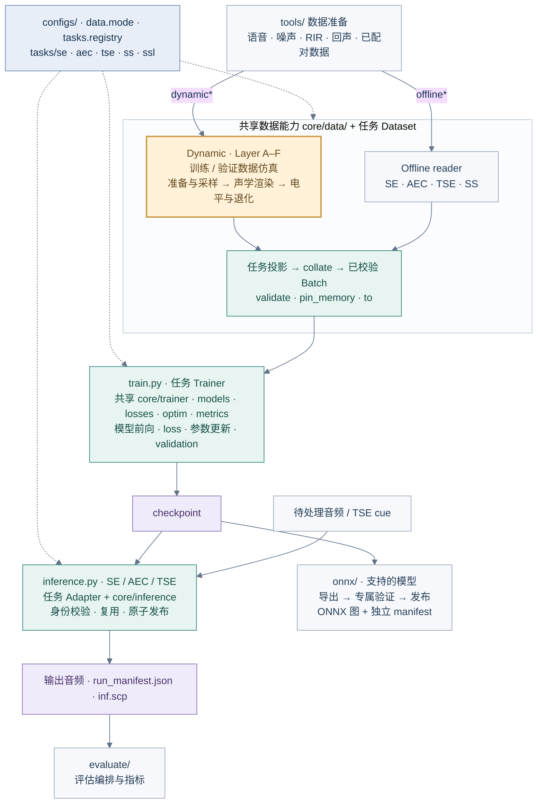
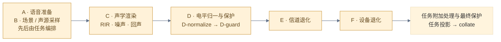

# README 架构图

本页维护 README 总览图的可编辑结构。任务清单与入口以 [`tasks/descriptors.py`](../../tasks/descriptors.py) 为准；共享实现位于 `core/`，任务专属数据、模型、Trainer 与 Adapter 位于 `tasks/<task>/`。总览只展示主要依赖与产物流向，具体模型支持范围见各任务 README。

## 框架总览

实线表示数据或产物流向，虚线表示配置与任务路由。Dynamic 与 Offline 是两条可选数据路径；Offline reader 不在训练时重放完整 A–F。

## Dynamic 仿真职责

Dynamic Dataset 通过 Layer A–F 构造训练 / 验证样本；A–F 不进入模型推理或 ONNX 部署图。各层表示仿真职责：SE/AEC 先准备主语音再抽场景，TSE/SS 先抽场景或声源再准备语音；因此 A/B 合并为一个编排区域。声学能力按任务与配置启用，图中不表示每个样本都执行全部增强。

完整 post-mix 次序由 [`POST_MIX_STAGE_ORDER`](../../core/data/post_mix_pipeline.py) 定义：`pre-finite → D-normalize → D-guard → E → F → task-post-EF → final-guard → post-finite`。Layer F 由 Dataset 的 `noisy_post_mix_degradations_enabled` 控制；关闭时整层跳过。各波形角色能在哪一层修改，由 `PostMixRoleContract` 约束。

## 支持边界与维护

- 五个任务共九种 `data.mode`；SSL 仅有 `dynamic_ssl`，监督目标为 IPD / DOA / VAD 等空间信息，SSL 指空间声源定位。
- 五任务 collate 均交付已校验的 Batch；STFT / waveform / feature 前端按模型 I/O 合同选择。
- 根文件推理开放 SE/AEC/TSE；SS 提供包内 `SSExtractor` / `SSInferenceAdapter`，SSL 无公开音频文件推理入口。
- Streaming 与 ONNX 按具体模型开放，任务存在不代表该任务所有模型均可部署。ONNX 使用独立的图与 manifest 发布事务；音频 `run_manifest.json` 属于文件推理生命周期。
- 修改图时先更新本页 Mermaid 与对应代码事实，再更新 README 中的视觉图。图像模型负责视觉呈现，本页结构与实现代码负责定义架构关系。

对应实现与详细说明：[`train.py`](../../train.py)、[`tasks/registry.py`](../../tasks/registry.py)、[`core/inference/`](../../core/inference/)、[`onnx/README.md`](../../onnx/README.md)、[仿真流程逻辑](../guides/simulation/Simulation_Flow_Logic.md)、[架构文档](../architecture/README.md)。

视觉生成说明

使用 Codex 内置图像模型生成 PNG，供中英文 README 共用。图中 `use_train` 下方的副标题固定为「通用语音前端训练框架」。设计为浅色横向技术总览：深蓝标题与任务路由，琥珀色突出 Dynamic A–F，青绿色区分共享训练与推理，紫色标记 checkpoint；连线清楚，避免立体透视和装饰性背景。

图中必须保留 A/B 的任务编排、Offline 到 Batch 的旁路、A–F 在训练 / 验证 Dataset 中的作用范围，以及 checkpoint 到文件推理和 ONNX 的独立分支；展示数据准备、五任务、共享训练、验证、评估与部署。生成时以本页节点、边和支持边界为内容依据，不增加未经实现的能力。生成结果需目视核对文字与连线。

