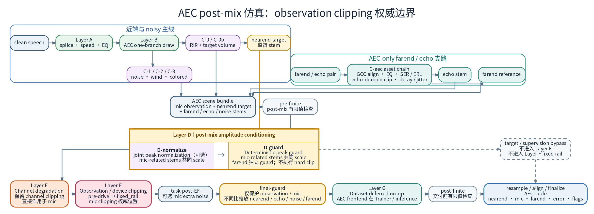
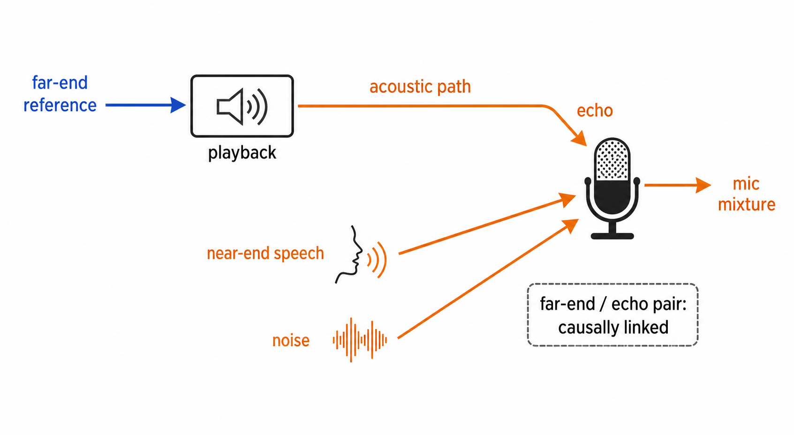
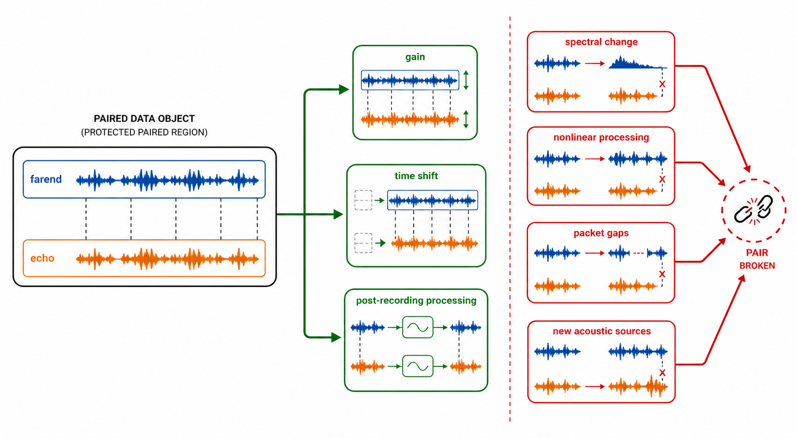
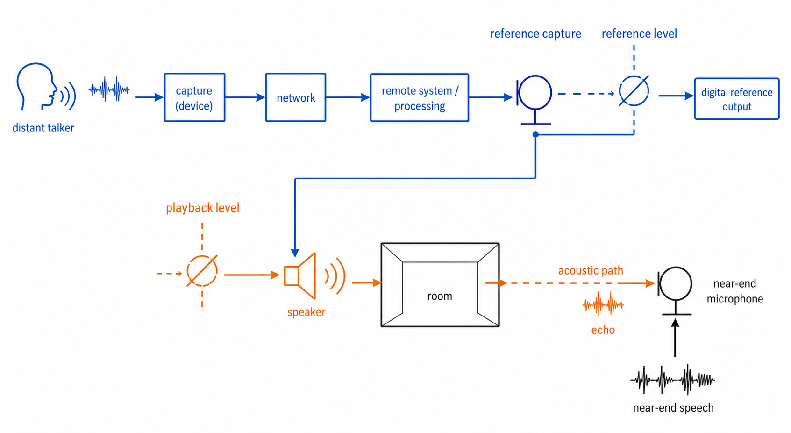
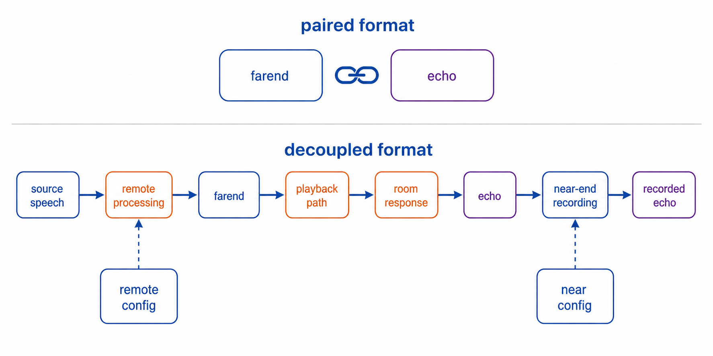
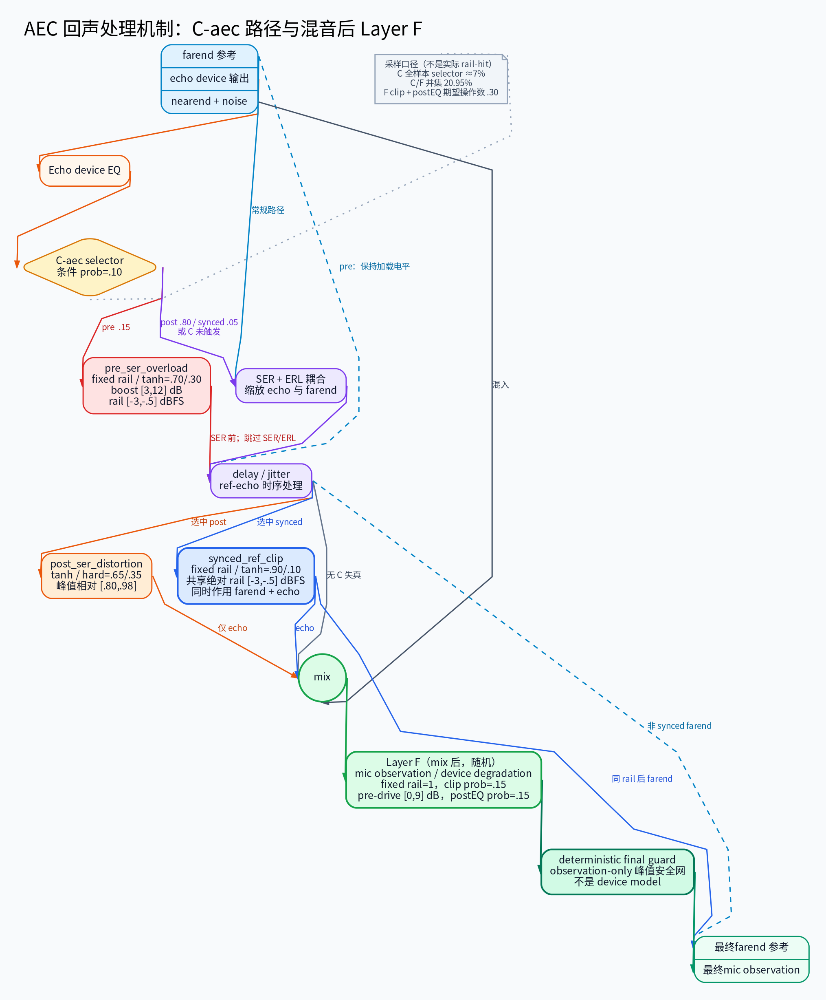

# AEC 数据仿真与增强设计（farend / echo 审计 + 回声截幅）

AEC 的训练数据主要由仿真在线合成：拿干净近端语音、噪声、房间 RIR（房间冲激响应，描述「某个房间里从某个位置到麦克风」的声学传播）和一批真实的 `farend`/`echo` 录音对，按配置拼出麦克风信号。本文专门讲其中**远端参考（farend）**与**回声（echo）**两路信号的规则：哪些增强物理上成立、哪些会让数据自相矛盾，以及两个已实现的增强——回声截幅 `aec_echo_clipping`（模拟播放过载/削波）和播放端设备 EQ `aec_echo_device_eq`（模拟扬声器频响着色）。

`aec_echo_clipping` / `aec_echo_device_eq` 已在当前四个模型 family、十份 YAML 的 Microsoft Challenge AEC 生产配置中启用
（`enabled: true`，见 `configs/aec/microsoft_challenge/**/*.yaml`）。

术语与缩写：`farend` = 远端参考，`echo` = 回声，`mic` = 麦克风信号，RIR = 房间冲激响应；SER（Signal-to-Echo Ratio，信号回声比：回声相对近端语音的响度，`SER < 0` 表示回声更响）、ERL（Echo Return Loss，回声回损：扬声器到麦克风的衰减），电平统一按 dBFS RMS 口径描述；manifest 指声明本批数据用哪些音频文件的 JSON 清单。

**本文负责**：物理约束、审计结论与增强设计（`(farend, echo)` 因果对、现役 SER/ERL 电平耦合、`aec_echo_clipping` / `aec_echo_device_eq` 设计）。**不负责**的部分直接指向权威出处：**执行顺序与配置键现状**以 [`../simulation/Simulation_Flow_Logic.md`](../simulation/Simulation_Flow_Logic.md) 为准；**一切延迟机制**（GCC 对齐 / 随机延迟 / `aec_time_delay_jitter` / AEC 专属模型输入前端）以 [`AEC_Delay_Alignment.md`](AEC_Delay_Alignment.md) 为准。与这两篇重叠的细节（延迟三层、Layer D/E/F 逐层行为）本文只保留要点与链接，不再重复展开，避免口径分叉。

相关文档：训练入门与 AEC/SE 流程对比见 [`AEC_Training_Primer.md`](AEC_Training_Primer.md)。

---

## 1. 概述与核心结论

先给结论，细节在后面各节：

- **farend 电平怎么定**：常规路径先用 SER 定 echo 电平，再由 ERL 耦合派生 farend 电平（`far_db = echo_db + ERL`），farend 电平不是独立随机量；C-0b 的 post-RIR 音量标定与 Layer E/F 只作用于 mic 一侧，属于正确的物理建模（§4）。
- **echo 怎么造**：SER 缩放、延迟与分支占比遵循当前合同（§5）。
- **回声数据的形态**：`farend` 始终是模型使用的 mono reference `[T]`；echo 资产可以是
  mono source `[T]`，也可以已经是麦克风侧的 `[C,T]` image。`[C,T]` echo 直接加入
  mic observation，不能再卷一次 RIR；`[T]` echo 只有在多通道场景下，才按 loudspeaker actor
  的 source-specific RIR 映射为 `[C,T]`，SER/ERL 在 echo image 上一次性统一缩放。仓库不要求
  也不实现「从干净 farend 重新合成整条播放链路」的完整 echo synthesizer。
- **物理约束**：`(farend, echo)` 是因果对——echo 就是 farend 经过播放-房间-录制链路的结果，
  所以合法增强只有三类：线性增益、时间偏移、录制后处理（§3）。只改 farend 不改 echo 的
  「远端链路仿真」会打断这个配对关系（§4.2）。
- **已经实现的增强**：
  - `aec_echo_clipping`：回声截幅，三条路径（`post_ser_distortion` / `pre_ser_overload` /
    `synced_ref_clip`），补上「参考干净/失真 × 回声失真」这些独立分布（§7）。
  - `aec_echo_device_eq`：在 C-aec 阶段、SER/截幅之前只对 `echo` 施加随机 EQ
    （模拟近端播放扬声器频响），不影响 `farend`；当前四个模型 family、十份 YAML 的 Microsoft Challenge 配置默认 `enabled: true, prob: 0.25`（§8）。

---

## 2. A–F 仿真管线架构对比

仿真管线被拆成 Layer A–F：A 是语音预处理，B 抽场景分支，C 做声学混合（RIR、噪声、C-aec 回声），D 做幅度调理，E 是信道退化，F 是设备退化；AEC 的模型输入前端不属于这六层。下面第一张图给全局关系，随后逐层列出每一层会改动 `mic` / `farend` / `echo` 中的哪几路（`❌ 无` 表示该层不碰这一路，Layer 之外的收尾阶段单独列出）。



> 图片用于展示 A–F 仿真与 AEC 模型输入前端的边界；下面的 Layer 表保留每个信号分支的精确作用域。

```
Layer    近端 noisy (mic) 口径          远端 farend ref            回声 echo
─────────────────────────────────────────────────────────────────────────────
A-1      模式A splice / 模式B单utterance  ❌ 无                      ❌ 无
A-2      speed/pitch/EQ 扰动              ❌ 无                      ❌ 无
A-3      普通对齐 / fixed silence canvas  ❌ 无                      ❌ 无
A-4      70Hz HP filtfilt                ❌ 无                      ❌ 无
C-0      RIR 混响                        —                          —（来自manifest）
C-0b     post-RIR target volume          ❌ 无                      ❌ 无
C-aec    —                               资产GCC预对齐；通常ERL定电平  资产GCC预对齐→EQ→三路径条件时序（§7）
D-normalize  可配置peak normalization（joint时统一缩放）  joint时同比缩放  joint时随mic同比缩放
D-guard      deterministic peak guard（统一安全缩放）     独立安全保护    随mic相关stems统一缩放
E        channel degradation（含channel clipping，仅mic） ❌ 无  echo audit stem不逐轨更新
F        observation/device degradation（device clipping = fixed rail + pre-drive，仅mic） ❌ 无  echo audit stem不逐轨更新
final-guard  observation-only deterministic safety         ❌ 无           echo audit stem不更新
AEC frontend  仅 AEC 模型输入前端；Trainer/validation/inference 均解析并在 STFT 前调用；仅 `delay_alignment.enabled=true` 或配置 `linear_aec` 时实际执行，禁用时 mic/farend 直通；inference 每文件仍调用
```

> C-aec 的可选 windowed GCC 只清理磁盘 `(farend, echo)` pair 的资产固有 lag，属于资产预对齐，
> **不是 AEC 模型输入前端**。当前十份动态生产配置均直接消费离线预对齐 manifest，并设置
> `aec_ref_echo_fine_gcc_align: false`，因此 Dataset 不再执行在线 GCC。常规路径以 SER 缩放 echo
> （dBFS RMS 口径），再由 ERL 耦合设置 farend（`far_db = echo_db + ERL`，非独立抽样）；
> `pre_ser_overload` 是显式例外，会跳过 SER/ERL/farend 重定电平。随机 delay/jitter 位于三路径
> 各自规定的位置，精确顺序见 §7.1。

**设计原则**：

- **Dynamic Dataset 的阶段边界**：Dynamic Dataset 执行共享 A–F、`task-post-EF`、`final-guard` 与 `post-finite`；`AECDeploymentFrontend` 不属于 Dataset 仿真，Trainer/validation/inference 均解析并在 STFT 前调用；仅 `delay_alignment.enabled=true` 或配置 `linear_aec` 时实际执行，禁用时 mic/farend 直通，inference 每文件仍调用。Layer A 先按 `silence_pad_prob` 预判：模式 A 保留 splice/crop/tile/zero-pad；模式 B 只加载单 utterance，并在 A-2 后构造固定 `max_duration` 静音画布，短语音只放一次、长语音只连续 crop 一次。该单人语音准备契约由 SE/AEC/TSE/SS 的动态 Dataset 共用；新 TSE/SS 的场景编排顺序见 [多源指南](../simulation/Multi_Source_Simulation.md)。
- **C-0 RIR shared full-peak 与 runtime 双模式**：当前直接承载 `simulation_cfg` 的 AEC 动态训练配置统一显式设置 `rir_normalize: true`；static full/early 共用 full peak，moving 全 sequence/early 共用 full-sequence peak。随后 C-0b 以 post-RIR early target 测量并抽取目标 dBFS，将同一 gain 同步施加到 full、early 与最终 target；noise / echo 均在此步骤之后混入。runtime 仍支持 `rir_normalize: false`：此时保留资产 raw gain，但 `source_volume_normalization_enabled` 启用时仍执行上述 C-0b 合同。
- **AEC spatial provenance**：启用 `spatial_enabled` 时，C-0 的权威场景事实是 provider 前固定的 `spatial_scene_plan`（包含真实 room、array、actor 与 moving trajectory）；`AECRunContext` 和 `SimulationTrace` 均发布该字段。此路径不再把 mono `acoustic_scene_plan` 作为空间 C-0 事实；后者仅保留给 legacy mono 路径。
- **Offline Dataset 不执行仿真或部署前端**：`offline_aec` 只读取、重采样并同步裁补真实/预混 `mic/farend/nearend[/error]`；是否执行前端由顶层 `aec_frontend` 人为指定，Trainer/validation/inference 均在 STFT 前调用；仅 `delay_alignment.enabled=true` 或配置 `linear_aec` 时实际执行，禁用时 mic/farend 直通，inference 每文件仍调用，与 dynamic batch 使用同一 seam。
- **统一部署前端**：训练、validation 和 `inference.py` 均解析并在 STFT 前调用前端；仅 `delay_alignment.enabled=true` 或配置 `linear_aec` 时按同一顺序实际执行**可选 Streaming GCC-PHAT → 可选 LinearAEC**，禁用时 mic/farend 直通，inference 每文件仍调用。`aec_frontend.linear_aec.bulk_delay` 当前仅接受 `0`；需要延迟补偿时启用前置 Streaming GCC-PHAT。
- **远端参考**：Dataset 内只做加载→可选资产预对齐→SER/ERL 耦合定电平→（可选 synced 截幅）；Layer E/F 不碰数字参考。当前生产使用预对齐资产并关闭 Dataset 在线 GCC。
- **回声信号**：在 C-aec 中与 near-end 独立处理（SER+延迟，可选 EQ/截幅），混入组装后的 `mic`；E/F 直接变换该 mic observation，独立 `echo` audit stem 不逐轨更新。
- **当前模型状态**：DeepVQE、LocalVQE、CAGCRN、DBGNet 四个模型 family、十份 Dynamic 生产 YAML 均关闭 Dataset 在线 GCC 与 `AECDeploymentFrontend` 的 Streaming GCC，且均未配置 LinearAEC。十份配置统一使用 `[0,80] ms` 纯 `Beta(2,4)` 随机 echo delay，并消费预对齐 manifest；DeepVQE meeting 使用 `align_delay: 10`（90 ms 最大回看跨度）。前三者依靠 AlignBlock/CATA；DBGNet 使用论文派生的 FTG 结构，并配合仓库工程化 delay/jitter 增强，也不显式叠加 GCC。

逐信号（noisy/clean/farend/echo）逐层作用域详表见
[`../simulation/Simulation_Flow_Logic.md`](../simulation/Simulation_Flow_Logic.md)。

---

## 3. 物理约束：`(farend, echo)` 是因果对

### 3.1 完整通话物理链路



> 图中概括远端参考、播放设备、声学回声路径与近端麦克风之间的因果关系；`farend`、`echo` 的数据位置和不可拆分约束见下表。

一句话版本：`farend` 是还没进声学域的「数字参考」，`echo` 是它走完「DAC → 功放 → 扬声器 → 房间 → 麦克风 → ADC」之后被录下来的结果。训练数据拿到的是这条链路的**两端点**，中间环节已经被固化在录音里，无法拆开单独改。

| 信号 | 在链路中的位置 | 声学链路固化状态 |
|------|---------------|----------------|
| `farend` | 链路中"即将送入 DAC 的数字参考信号" | —（尚未进入声学域） |
| `echo` | 链路中"近端 ADC 之后" | DAC → PA → 扬声器 → 回声路径 → Mic → ADC **已固化** |
| 两者之间的映射 | `farend` × `[DAC+PA+Speaker+Room+Mic+ADC]` → `echo` | **不可拆分改写** |

### 3.2 核心原则

一句话：**凡是改动 `farend` 的操作，`echo` 必须同步经历同样的改动**，否则两者就不再是同一段物理链路的两端。在这个前提下，合法的增强只有三类：



> 图中只表达配对约束、允许路径与会断裂配对的路径；精确原则如下：
>
> 1. **线性增益变化**：增益是线性因子，不破坏频谱对应关系。
> 2. **时间偏移**：时移保持频谱关系。
> 3. **录制后处理**：发生在 echo 录制之后，作用于 noisy 整体。
>
> 除此之外的“远端链路仿真”均破坏配对一致性，在此数据格式下无解。已有 echo 资产的空间
> 映射属于 observation 装配，不会改变 `(farend, echo)` 的配对事实。

如果只改 farend 不改 echo，farend↔echo 的物理对应关系就断裂了，
模型学到的是"错误的映射"，这比没有增强危害更大。

---

## 4. 远端参考（farend）仿真审计

### 4.1 当前电平与链路合同

这一节回答「训练数据里 `farend` 和 `echo` 的电平是怎么定的」：先用 SER 定回声电平（`echo_db`），再用 ERL 耦合推出远端参考电平（`far_db`），二者不是各自独立抽样。

- 常规路径先按 SER 从 near-end clean 电平派生 `echo_db`，再在 `far_db_range` 物理可行域与 `erl_range` 的交集中抽取 ERL，并计算 `far_db = echo_db + ERL`；farend 电平不是独立随机变量。
- `pre_ser_overload` 是显式例外：跳过 SER 与 ERL/far_db 耦合，echo 由加载电平、boost 和绝对 rail 决定，farend 保持加载电平。
- 近端 C-0b 使用 RMS 口径，以 post-RIR early target 标定并同步缩放 full/early/target。
- mic/ref 走独立物理链路，因此 Layer E/F 只处理 mic observation；当前成对数据也不对 farend 单独施加 EQ、Codec、NS、AGC 或丢包处理，避免破坏 farend↔echo 对应关系。

ref/echo 电平耦合的物理依据如下：



> 图中 `A_ref`（远端录音电平）与 `V`（近端播放音量）是物理链路中的不同控制点；当前 runtime 并未将两者实现为两个独立随机量，而是用 SER 确定 echo 电平、再用 ERL 耦合派生 farend 电平。

mic 链与 ref 链仍是不同的后处理边界：

- **上行（mic）**：声波 → 麦克风 → ADC → [硬件处理] → mic 信号。
- **下行（ref）**：网络 → 解码 → [OS 音频栈] → 参考信号。

mic 侧的带宽限制/clipping 不应影响 ref。

### 4.2 为什么"远端链路仿真"对成对数据不可行

下表列出常见的「远端链路仿真」提议，以及它们在成对数据格式下的断裂点——任何对 farend 频谱/时序的改变，只要 echo 没有同步经历，pair 就断裂：

| 提议的增强 | 断裂点 |
|------------|--------|
| 远端背景噪声 | farend 含噪但 echo 无对应噪声 → 训练信号矛盾 |
| 远端 Mic 频响 / 房间混响 | 现实中声波必同步反映到回声，成对数据中无法同步 |
| Codec 编解码 | farend 窄带但 echo 全频 → "从残缺参考估计全频回声"现实中不可能 |
| 丢包 + PLC | PLC 外推段在 echo 中没有物理对应物 |
| NS / AGC | 对 farend 的非线性/时变处理，echo 未同步经历即为噪声 |

针对 `farend` 的频谱变化、非线性处理、时间不连续和新增声学源，都要先切换到 §4.3 的解耦数据格式才有物理意义（配对增强的可行边界见 §3.2 的图）。

### 4.3 未来方向：解耦数据格式

要实现远端链路仿真（Codec、NS、AGC、丢包、PLC、PA 非线性等），需换数据格式：



> 图中只表达当前成对格式与未来解耦格式的总体因果关系；精确输入字段和训练时动态生成顺序如下：
>
> - 当前格式（成对）：`input: (farend, echo)`，作为不可拆分的原子对。
> - 需要格式（解耦）：`input: (source_speech, RIR_bank, far_config, near_config)`。
> - 训练时动态生成：`source_speech → [远端仿真: NS/AGC/Codec] → farend`；`farend → [PA仿真: 增益/非线性/扬声器频响] → speaker_out`；`speaker_out → [RIR卷积] → echo_raw`；`echo_raw → [近端录制仿真: Mic EQ/ADC/Codec] → echo`。
> - 这样 `farend` 和 `echo` 始终保持因果一致性。

需要准备：远端语料库、独立 RIR 数据库、PA/扬声器非线性仿真模块、
Codec/NS/AGC 仿真模块（可调用 ffmpeg / webrtc 库）。

---

## 5. 回声（echo）仿真审计

### 5.1 回声数据来源

回声来自 `real_farend_echo_pair_json` 指定的 JSON manifest（清单），里面是一批已经配好对的 `(farend, echo)`：

| 数据类型 | 生成方式 | 覆盖的物理特性 |
|---------|---------|--------------|
| 真实录制 | 扬声器播放 → 房间传播 → 麦克风录制 | 真实扬声器失真、真实房间声学、真实设备频响 |
| 合成数据 | farend ⊗ RIR (+ 可选非线性处理) | 可控的 RIR 多样性 |

**当前设计**：回声以预生成方式提供，管线不做声学仿真（不额外卷积 RIR），只做**混合层面的变化**（SER、延迟、音量、可选 EQ/截幅）。

**清单与配置诊断合同**：manifest 必须是仅含 `pairs` 与可选 `meta` 的对象，形如 `{"pairs": ["stereo.wav"], "meta": {...}}`；`pairs` 每项必须是非空 stereo 路径字符串，固定按 ch0=echo、ch1=farend 读取。裸 array root、二元/单元 list、dict pair、字段别名、双文件模式及 `real_farend_echo_pair_scp` 均立即失败，且不受 `strict_load` 影响。`strict_load: false` 只允许跳过 schema 已合法但音频资源不可用的路径，并记录 `_farend_echo_manifest_diagnostics`，不改变剩余 pair 的顺序、场景 branch、flags 或 waveform。`ser_range`、随机延迟 Beta 参数、`aec_time_delay_jitter`、`aec_echo_device_eq` 与 `aec_echo_clipping` 的未知 nested key、类型和非有限值均在构造前 fail-fast；dynamic AEC 配置预检与真实构建使用同一 unknown-key 合同。

### 5.2 管线中的回声处理流程



> 图片只概括 C-aec 组件关系，不代表三条截幅路径共享同一线性顺序；canonical path-local 参数、条件时序与物理语义以 §7.1–§7.4 为准。

#### 5.2.1 echo/ref 时序与监督同步关系

设磁盘 pair 为 `far_disk[t]` 与 `echo_disk[t] ≈ H{far_disk}[t-d_disk]`。通用 Dataset 能力可先用
windowed GCC 尽量消除 `d_disk`，再在 `prob_echo_only` 模式下注入随机延迟 `d_random`；当前生产直接读取
离线预对齐 manifest 并设置 `aec_ref_echo_fine_gcc_align: false`，因此不执行这一步在线 GCC：

```text
far_model_pre_g[t] = far_aligned[t]
echo_aug[t]        = echo_aligned[t - d_random]
mic[t]             = near_full[t] + noise[t] + echo_aug[t]
target[t]          = near_early[t]                  # joint task 常用口径
```

因此随机延迟只移动 echo stem；echo 随后进入 mic，所以 mic 中的回声分量同步改变，但
near-end target 不移动。`sync` 模式会同时移动 farend 与 echo，只形成 pair 整体平移，不改变
ref→echo 相对 lag，不能用作模型时延鲁棒性增强。jitter 同样保持 farend 不动，只在已施加的
base random delay 上重定时 echo；现役生产值把它限制为极偶发 route/buffer sudden-jump 压力桶，
不是主体 delay、持续 drift 或 periodic jitter。详细轨迹语义见 [`AEC_Delay_Alignment.md`](AEC_Delay_Alignment.md)。

磁盘 GCC、可选 AEC 模型输入前端 streaming GCC 和模型内部 AlignBlock/CATA/FTG 属于不同层次：磁盘 GCC
只清理源 pair，是 C-aec 资产预对齐；训练、validation 与推理均解析并在 STFT 前调用 AEC 模型输入前端，但仅
`delay_alignment.enabled=true` 或配置 `linear_aec` 时实际执行，禁用时 mic/farend 直通，inference 每文件仍调用；模型内部对齐只改变模型特征。它们都不移动 mic 或监督 target。

#### 5.2.2 当前正式配置的系统拓扑

| 模型 | 随机 echo delay | AEC 前端 streaming GCC | 模型内部对齐 | `aec_frontend.linear_aec` |
|------|-------------------|-----------------------|----------------|-------------------|
| DeepVQE | `[0,80] ms` 纯 Beta(2,4)；极偶发纯 sudden_jump 压力桶 | 关闭 | AlignBlock（`align_delay: 10`），最大回看跨度 90 ms | 无 |
| LocalVQE | `[0,80] ms` 纯 Beta(2,4)；极偶发纯 sudden_jump 压力桶 | 关闭 | AlignBlock，约 1008 ms | 无 |
| CAGCRN | `[0,80] ms` 纯 Beta(2,4)；极偶发纯 sudden_jump 压力桶 | 关闭 | CATA（`align_delay: 6`，当前帧+前 5 帧；16 ms 下 80 ms） | 无 |
| DBGNet | `[0,80] ms` 纯 Beta(2,4)；极偶发纯 sudden_jump 压力桶 | 关闭 | FTG 软跟踪/对齐 | 无 |

因此四个模型 family、十份 Dynamic 生产 YAML 的现役配置都关闭 `aec_frontend.delay_alignment`，并统一使用
`aec_frontend.input_routing: mic_farend`；主体时延覆盖来自 0–80 ms Beta delay 与各模型内部机制，不依赖模型输入前端 Streaming GCC-PHAT 或极偶发 jitter。仓库已具备
可选 Streaming GCC-PHAT、由 `aec_frontend.linear_aec` 配置的 LinearAEC、其生成的 runtime error 经 STFT
转为 `error_spectra` 后注入 Trainer，以及 UltraDPCAEC 三输入联合融合能力；当前没有启用这些组合的正式训练 YAML，它们仍是能力态，而非现役训练方案。

### 5.3 Layer B 七分支中回声的语义

Layer B 为每个样本抽一路场景，决定这个样本里有没有回声、回声和谁混。下表左两列是各分支的概率与 mic 构成（概率取 DBGNet 生产配置），右两列说明监督目标和回声在这类样本里扮演的角色。

| 分支 | 概率(DBGNet) | mic 构成 | target | 回声角色 |
|------|-------------|---------|--------|---------|
| `prob_target_only` | 0.05 | clean_target | clean_target | 无回声 |
| `prob_noise_only` | 0.05 | noise | 0（joint）/ noise（aec） | 无回声 |
| `prob_echo_only` | 0.05 | echo | 0 | 纯回声场景，训练纯回声消除 |
| `prob_noise_echo_only` | 0.05 | noise + echo | 0（joint）/ noise（aec） | 噪声中的纯回声消除 |
| `prob_target_noise` | 0.2 | noisy_speech | clean_target（joint）/ noisy_speech（aec） | 无回声（纯降噪） |
| `prob_target_echo` | 0.2 | noisy_speech + echo | clean_target（joint）/ noisy_speech（aec） | 双讲（无噪），训练 AEC 保留近端语音 |
| `prob_target_noise_echo` | 0.4 | noisy_speech + echo | clean_target（joint）/ noisy_speech（aec） | 全场景（双讲+噪声），主训练分支 |

**设计要点**：`prob_echo_only` / `prob_noise_echo_only` 的 target 为 0（要求完全消除回声）；
近端分支的 `joint` target 为 `clean_target`（去除 echo、noise 与 full RIR 相对 early RIR 的差异），
而 `aec` target 为 `noisy_speech`（仅去除 echo，保留近端的噪声/混响）；因此 `prob_target_echo` 的
mic observation 应写为 `noisy_speech + echo`，监督 target 不与 echo 相加。40% 概率落在最复杂的
`prob_target_noise_echo`。

### 5.4 SER 缩放

SER 缩放决定这个样本里回声比近端语音响多少：以近端 clean 语音的 dBFS RMS 为参考抽一个 SER 目标，反推出 echo 的目标电平，再用 ERL 耦合定下 farend 电平。下面的伪代码就是这段逻辑。

```python
# tasks/aec/data/dynamic_dataset.py `_run` C-aec 段（dBFS RMS 口径）
clean_db = 10·log10(mean(clean²))              # 近端语音电平，下限钳位 -60 dBFS
# 可行窗口抽取（与 ERL 同款）：由 echo_db 硬钳位域 [-60, 0] 反推窗口，
# 消除极端音量样本在钳位边界的 effective-SER 堆积；
# 钉死区间或空窗口（clean_db >= ser_hi）时使用全域抽取并钳位
ser_db   ~ U(max(ser_lo, clean_db), min(ser_hi, clean_db + 60))   # ser_range 默认 [-20, 20]
echo_db  = clamp(clean_db - ser_db, -60, 0)    # 全域抽取路径使用该钳位
echo     = scale_signal_to_dBfs_rms(echo_raw, echo_db)
physical_erl = [far_lo - echo_db, far_hi - echo_db]
effective_erl = intersection(configured_erl, physical_erl)  # 闭区间，lo == hi 合法
erl_db   ~ Beta(1.5, 1.5) → effective_erl
far_db   = echo_db + erl_db                    # 保证 ∈ far_db_range（默认 [-40, -12]）
farend   = scale_signal_to_dBfs_rms(farend, far_db)
```

SER（Signal-to-Echo Ratio）以近端 clean speech 的 dBFS RMS 为参考，控制回声的相对响度（`SER < 0` 表示回声比 clean 响；配置 `ser_range: [-20, 20]`）。farend 电平由 `far_db_range` / `erl_range` 的 ERL 耦合决定（§4.1）。

`tasks/aec/data/erl_coupling.py` 统一计算 configured、physical 与 effective 三层 ERL 闭区间；configured 与 physical 空交集时 Dataset fail-closed，即使 `strict_load: false` 也不得降级为静音 placeholder。成功样本在 `c3_erl_range_audit` 记录三层区间和 selected ERL；`deep_check_aec_simulation.py` 以该字段执行 range gate；报告内 `anomalies` 非空时该脚本返回非零（报告仍写出，供定位问题）。

### 5.5 Layer D/E/F 对回声的影响（要点）

Layer D 是 post-mix amplitude conditioning，内部固定为 normalize → guard。唯一发布 schema 是 `simulation_by_layer['D']` / `layer_d_facts` 聚合 `{'stage_order': ('D-normalize', 'D-guard'), 'normalize': {...}, 'guard': {'mic_related': five_keys, 'farend': five_keys}}`，每组 `five_keys` 均为 `roles` / `threshold` / `peak` / `scale` / `applied`；不发布任何顶层 normalize 或 farend-guard 旁路。`D-normalize` 的 anchor 是 mic/nearend/noise/echo，farend 使用同一 follower scale。`D-guard` 对 mic/nearend/echo/noise/farend 五路 coupled bundle 一次计算共同安全 scale；`mic_related` / `farend` 只是同一结果的角色视图。final-guard 位于 E/F 后，只保护组装后的 `mic` observation，不再修改 stems 或 `farend`。Layer E/F 同样只直接变换组装后的 `mic` observation；独立保存的 `echo` audit stem 不在 E/F 中逐轨更新，因此经过非线性退化后不能假定最终 mic 仍可按 stems 线性分解。

- Layer D 的固定顺序是 `D-normalize → D-guard`：先执行可配置的 peak normalization，再执行 deterministic peak guard。
- `D-normalize` joint 模式的 target peak 和唯一 scale 只由 mic 决定，再同比施加到 nearend、noise、echo 与 farend；farend 不参与 peak max。
- `D-guard` 由五路 AEC coupled bundle 共同触发并共用安全 scale；farend 不再独立 guard。
- Layer E 保留 URGENT channel degradation 中的 clipping；它表达信道退化配方，不是设备 observation clipping 的权威边界。设备 clipping 的 canonical 位置是 Layer F 的 fixed rail + pre-drive 路径。
- Layer F 是 observation/device degradation 的权威位置。设备 clipping 以固定 rail 配合 pre-drive 建模：pre-drive 决定信号撞 rail 的程度，rail 不随样本峰值移动；只改 `mic` observation，不裁 nearend/target、noise、echo audit stem 或其他 supervision。
- C-aec 的 `aec_echo_clipping` 仍是混合前的独立回声域失真，不得与 Layer E channel clipping 或 Layer F observation/device clipping 混写。

逐层执行顺序与配置键现状见
[`../simulation/Simulation_Flow_Logic.md`](../simulation/Simulation_Flow_Logic.md)。

### 5.6 echo state label 生成

除了波形，Dataset 还能为每个样本额外产出一路逐帧的「场景状态」标签，供 DBGNet 的 state detector 这类模型做辅助监督。标签只有三类：FST（远讲单讲）、DT（双讲）、NST（粗粒度无回声）。

```python
# tasks/aec/data/dynamic_dataset.py `_compute_state_label_tensor`
#   + tasks/aec/data/state_label.py（compute_aec_state_label / compute_aec_state_scenario_label）
state_label = compute_aec_state_label(
    nearend, echo, hop, win_length,
    near_threshold_db=-40, echo_threshold_db=-50, ...
)
```

帧级 3-class 状态标签定义为 FST=`far-end single talk`（`echo-only`）、DT=`near-end+echo`、
NST=粗粒度 no-echo（`silence`、`noise-only`、`near-only`、`near+noise`）。标签由 oracle
nearend/echo stem 的逐帧能量计算，不受 mic 信号中噪声/混响的影响——**使用 oracle echo，
而不是 mic 中估计的回声**。

活动检测先做 pre-emphasis，再按各 stem 自身峰值归一化；`near_threshold_db` /
`echo_threshold_db` / `noise_threshold_db` 均表示相对该归一化峰值的帧 RMS 门限。pre-emphasis
采用逐样点离散滤波 `y[n]=x[n]-alpha*x[n-1]`；16/32 kHz DBGNet 配置均沿用经典语音前端
系数 `alpha=0.97`，保持相同的离散频率响应定义。固定系数不等价于保持物理 Hz 过渡频率：
采样率翻倍时，响应在物理频率轴上相应伸缩。
`absolute_floor_after_norm` 是在**峰值归一化域**与相对门限取 `max` 的线性 RMS floor，
不是原波形的绝对幅度门限，也不是 dBFS 门限。因此不能仅凭该值审计输入电平或据此宣称过滤了绝对静音。需要审计时调用纯函数
`compute_state_activity_diagnostics()`：`pre_normalization_peak` / `pre_normalization_rms`
记录 pre-emphasis 后、峰值归一化前的实际电平，`floor_hit_rate` 记录归一化后帧 RMS 命中
floor 的比例，`floor_suppression_rate` 记录本可通过相对 dB 门限、但被该 floor 拦截的帧比例。
该诊断不参与标签计算，默认 state label 输出 ABI 与标签分布不变。

noise bit 使用 label 专用 noise stem（`_last_noise_additive_1d`）：含 Layer C
加性噪声（C-1/C-2/C-3；colored noise 位于 C-3，从产生起即归入 noise stem）与 mic extra noise。
Layer E channel clipping、Layer F observation/device clipping、joint full/early RIR target mismatch、sidechain wind 等会令最终 mic 不可按目标 stem 线性分解；此时依赖该分解的 final SNR/SER 与 reconstruction residual 为 N/A。ERL 只依赖实际 farend/echo stem，仍可单独审计。

### 5.7 声学标定与 realized 审计口径

仿真过程中的电平指标分几个层次：抽签抽到多少（candidate）、实际想做成多少（nominal）、标定时算出来多少（calibration）、最后波形里真的是多少（realized）。审计报告必须标明用的是哪一层，不能把抽签值或中间比值说成最终观测指标。

导出 `simulation_by_layer` 时必须区分以下层次，不得把 draw、标定目标或中间 stem 比值称为最终观测指标：

- **Layer A-3**：`a3_alignment_mode` 直接复用 `repeat_export.align_mode`，可为 `silence_fixed_canvas`、`tile_to_max`、`crop_to_max`、`pad_zero` 或 `off`；`a3_mode` 在 fixed canvas 时为 `fixed_silence_canvas`，否则为 `standard`。`a3_fixed_canvas_applied` / `a3_tile_applied` 分别表示实际走过的路径。
- **配置与实际动作分离**：`a3_repeat_to_max_duration_enabled` 只表示配置开启；`repeat_to_max_duration_applied` 只在真实 `tile_to_max` 时为 `true`，fixed canvas 必须为 `false`。`a3_silence_duration_policy=fixed_canvas_remainder` 表示最终静音量来自固定画布余量；未应用时为 `not_applied`。实现未记录精确 crop 起点，因此 `a3_crop_start_samples` 保持 `null`，不得伪造为 0。
- **candidate**：候选随机量，例如 primary SNR draw、wind SNR candidate 与是否请求 sidechain；候选未必实际采用。
- **nominal**：实际选中的混合目标，例如 selected primary SNR、逐个 additive mix 的目标 SNR、wind sidechain 是否实际施加。
- **calibration / aggregate realized**：C-1/C-3 都复用 `mix_noise` 的**各自 active-region power** 标定；colored noise 额外记录 `nominal_snr_db`、标定前 active power、scale 与 `calibration_realized_snr_db`。`layer_c_aggregate_realized_snr_db` 则在 Layer C 汇总后的 physical noise stem 上重新做 active detection，表示 Layer C aggregate realized，不是最终 mic 指标。
- **realized**：Dataset direct/generator trace 中，在 A–F post-mix 完成后、最终裁剪前按实际波形重测；该字段名不表示 Trainer 的 `AECDeploymentFrontend` 输出。**realized_final** 是裁剪/重采样后的最终导出波形重测。两者分别携带 applicability 与 reason code。

`prob_echo_only` / `prob_noise_echo_only` 没有 near-end 场景语义：C-aec 仍可保留用于缩放 echo 的 **latent SER draw**（`c3_ser_db_drawn`），但场景 realized SER 必须为 N/A，reason 为 `scenario_has_no_nearend`。同理，URGENT wind waveform 仍按原 sidechain 算法生成与混入；一旦 compressor 非线性改变 near-end 并使样本不可分解，不能从 stem 比值伪造 final SNR/SER。

---

## 6. 物理合法的增强：覆盖现状与可扩展项

| 类别 | 增强 | 位置 | 覆盖状态 |
|------|------|------|---------|
| 线性增益 | ERL 耦合定 farend 电平（`far_db = echo_db + ERL`） | C-aec | ✅ `far_db_range` / `erl_range` |
| 线性增益 | SER 缩放（回声→近端强度比） | C-aec | ✅ |
| 线性增益 | post-RIR early-target 音量标定（full/early/target 共 gain） | Layer C-0b | ✅ |
| 时间偏移 | GCC-PHAT 对齐（消除磁盘固有延迟） | C-aec 加载 | ✅ 能力已实现；当前生产使用离线预对齐资产并关闭 Dataset 在线 GCC |
| 时间偏移 | 随机 echo 延迟（网络抖动/缓冲） | C-aec | ✅ |
| 录制后处理 | Layer E 信道退化（带宽/channel clipping/编解码/丢包） | `_run` E | ✅ |
| 录制后处理 | Layer F observation/device degradation；device clipping = fixed rail + pre-drive | `_run` F | ✅ |
| 数值安全 | deterministic final safety guard | post-mix `final-guard` | ✅ |
| 非线性（echo 域） | `aec_echo_clipping` 三路径（§7） | C-aec | ✅ 已实现 |
| 频响（echo 域） | `aec_echo_device_eq`（§8） | C-aec | ✅ 已实现 |
| 时变增益 (fading) | 网络音量波动/AGC | — | 可加（慢变 envelope 调制 farend） |
| 时变延迟 (drift) | 采样率不匹配累积漂移 | — | 实现能力可由 `aec_time_delay_jitter` 的 drift 类型覆盖；现役生产配置未启用，仅使用极偶发 pure sudden-jump route/buffer 压力桶（见 [`AEC_Delay_Alignment.md`](AEC_Delay_Alignment.md)） |
| 多路径延迟 | 多反射到达时间不同 | — | 可加（echo 复制多份各加延迟衰减） |
| SER 分布整形 | 长尾/尖峰分布 | — | 可加（调整 SER 采样分布） |
| 远端 Codec / 丢包+PLC / NS/AGC | — | — | ❌ 不可加（§4.2），需解耦数据格式（§4.3） |

**结论**：在配对的 farend/echo 格式下，管道已较完整。

---

## 7. 回声截幅增强：`aec_echo_clipping`

真实设备上，扬声器播放音量过大、或远端参考本身已经失真时，回声里会带上削波（clipping，波形被削平产生谐波失真）。如果训练数据里「参考干净 + 回声失真」这种组合从不出现，模型在真实设备上就会遇到没见过的输入。这个增强就是按配置概率造出这类失真，并区分三种失真的物理来源。

### 7.1 三条路径及物理边界

C-aec 的 selector（抽签器）先在含 echo 的样本中按 `prob` 决定是否进入截幅桶，触发后再按 `path_probs` 选择且只选择一条路径：

| 路径 | 精确时序 | 阈值口径与 variant | 物理语义 |
|------|----------|--------------------|----------|
| `post_ser_distortion` | 正常完成 SER/ERL 耦合与 farend 定电平，随后施加随机 delay/jitter，最后只处理 echo | `peak_relative_threshold_range` × echo 当时自身 peak；`tanh` / `hard` | reference tap 在播放非线性之前；模拟只污染声学 echo 的后级失真，farend 保持线性参考 |
| `pre_ser_overload` | selector 选中后跳过 SER 抽样、ERL 耦合与 farend 重定电平；先对加载并经可选 device EQ 的 echo 施加 boost + clip，再进入随机 delay/jitter | `overload_boost_db_range` + **绝对** `rail_dbfs_range`；`fixed_rail` / `tanh` | 模拟播放链输入过强导致的过载；echo 响度与失真深度刻意耦合，farend 保持加载电平 |
| `synced_ref_clip` | 正常完成 SER/ERL 耦合与 farend 定电平，施加随机 delay/jitter 后，echo 与 farend 共用同一次 rail/variant 抽样 | **绝对** `rail_dbfs_range`；`fixed_rail` / `tanh` | reference tap 位于共享非线性之后；作为可计数的错误/受污染参考压力桶，不代表主流 playback-input reference |

这里的绝对 rail 与 peak-relative 不能互换：`rail_dbfs_range: [-3.0, -0.5]` 先转换为相对满刻度的固定线性 rail `10^(rail_dbfs/20)`，不随当前 waveform peak 移动；`peak_relative_threshold_range: [0.90, 0.99]` 则以截幅当下 echo peak 的比例生成阈值，随样本电平缩放。`synced_ref_clip` 共享的是同一个**绝对 `rail_dbfs` 和 variant**，不是共享 `threshold_frac`，也不是按 echo/farend 各自 peak 生成两条 rail。

Layer D 的 normalize → guard 和 E/F 后的 final-guard 都是幅度保护，不产生 clipping。Layer E channel clipping 与 Layer F observation/device clipping 都只处理组装后的 mic，但属于另外两个退化边界；它们不得与混合前的 C-aec echo clipping 合并解释。

### 7.2 关键概念：截幅 ≠ 音量，selector ≠ rail hit

- **硬截幅** `out = np.clip(x, -rail, +rail)`：仅当输入样点真实越过 rail 时削平波峰并产生谐波；选中 `fixed_rail` 但所有样点均在 rail 内时，真实 rail-hit 为 0。
- **软饱和** `out = rail * np.tanh(x / rail)`：使用同一个 rail 控制非线性尺度，但不是硬阈值命中事件；非零样点可以变化，不能把这种变化计作 `fixed_rail` 的真实越轨样点。
- **peak-relative 截幅**：先由 `threshold_frac × peak_before` 得到本样本阈值；近静音会短路，因此 selector/path/variant 已抽中也不保证 waveform 实际变化。
- **审计口径**：selector 表示随机门控及路径/variant 被选中；`applied` 表示输出 waveform 是否真实变化；rail-hit 则必须由 clip 前 waveform 与绝对 rail 比较。三者是不同事件，禁止用配置概率或 selector 计数冒充真实撞 rail 比例。Layer F 的 `simulation_by_layer['F']['observation_clipping']` 已发布 `clipped_sample_count` / `clipped_sample_ratio` / `clipped_frame_count` / `clipped_frame_ratio` / `longest_clipped_run_samples` 等 sample-level runtime facts；C-aec 的 `simulation_by_layer.C.c3_echo_clipping` 也已发布 `echo_rail_hit` / `farend_rail_hit` / `rail_hit` / `clipped_sample_count` / `rail_sample_count` / `clipped_sample_ratio`，以及 `echo_rail_facts` / `farend_rail_facts` 两路 rail facts。
- **截幅后的数值安全**：`D-guard` 可对 mic-related stems 共同缩放并独立保护 farend；E/F 后的 final-guard 只保护 observation。安全缩放不会抹掉已经形成的失真形状。

### 7.3 Canonical path-local YAML 与有限 legacy 兼容

当前生产配置只写 canonical path-local schema；公共门控保留在顶层，每条算法参数归属其消费路径：

```yaml
aec_echo_clipping:
  enabled: true
  prob: 0.15
  path_probs: {post_ser_distortion: 0.80, pre_ser_overload: 0.15, synced_ref_clip: 0.05}
  paths:
    post_ser_distortion:
      variant_probs: {tanh: 0.35, hard: 0.65}
      peak_relative_threshold_range: [0.90, 0.99]
    pre_ser_overload:
      variant_probs: {fixed_rail: 0.80, tanh: 0.20}
      overload_boost_db_range: [0.0, 6.0]
      rail_dbfs_range: [-3.0, -0.5]
    synced_ref_clip:
      variant_probs: {fixed_rail: 0.95, tanh: 0.05}
      rail_dbfs_range: [-3.0, -0.5]
```

当前十份动态生产配置的 C-aec `pre_ser_overload` boost 范围面向会议麦克风基础训练中的轻到中度播放过载；`9 dB` 仅适合专项压力测试。

`normalize_echo_clipping_config()` 只接受 canonical `paths` schema：`post_ser_distortion`、`pre_ser_overload` 和 `synced_ref_clip` 各自声明对应的 `variant_probs` 与 range。旧的顶层扁平字段不再映射，作为未知键直接 fail-fast；未知 path、path-local 未知键或不合法 variant 同样直接拒绝。

### 7.4 当前生产概率与 Layer F

当前四个模型 family、十个 Microsoft Challenge Dynamic YAML variant 统一使用上述 C-aec 参数。`prob: 0.15` 是**含 echo 样本内**的条件 selector 概率；按当前 Layer B 中含 echo 分支总概率 `0.70`，折算到全部训练样本约为 `0.70 × 0.15 = 10.5%`。三条路径占全部样本的 selector 概率分别约为 `8.4%`、`1.575%`、`0.525%`，仍都不是实际 rail-hit 率。

Layer F 独立作用于完整 mic observation，当前生产值为 `prob_clip: 0.15`、`clip_variants: [fixed_rail]`、`clip_variant_probs: {fixed_rail: 1.0}`、`clip_pre_drive_db_range: [0.0, 9.0]`，固定 rail 为 `±1.0`；`prob_post_eq: 0.15`。若按独立 selector 计算，C-aec selector 与 Layer F clip selector 的全样本并集为 `0.105 + 0.15 - 0.105 × 0.15 = 23.925%`。Layer F clip 与 post-EQ 可在同一样本叠加，因此每样本期望操作数是 `0.15 + 0.15 = 0.30`，不是“30% 样本恰好执行一次”。以上都只是 selector/期望值；Layer F 即便已选中 `fixed_rail`，`0–9 dB` pre-drive 后也可能没有样点越过 `±1.0`。真实 rail-hit 可由 sample-level runtime facts 审计；下述 verifier 聚合 C-aec 的实际事实，不将 selector 并集或 C-aec 统计外推为 Layer F 实测截幅率。

C-aec clipping 若同步更新 echo audit stem 与实际混入 mic 的 echo，样本仍可保持 decomposable；只有 waveform/stem 不一致或其他 reason 成立时才标记不可分解。Layer F 则只改最终 observation，不逐轨改写 echo stem，两者不可互换。

### 7.5 验证

`tools/verify/aec/verify_aec_echo_clipping.py` 当前提供 `enabled: true` vs `false` 的以下聚合：

1. **path / capture-point 分布**：强制 `prob_target_echo` 样本中 path 与 capture point 的计数和比例。
2. **回声峰值/RMS 变化**：聚合 `peak_after - peak_before` 与 `rms_after - rms_before` 的均值。
3. **state label 分布**：聚合 FST/DT/NST 帧占比。
4. **实际改写与绝对 rail 命中**：整体及逐 path 聚合 `echo_applied` / `farend_applied` / `any_applied` 和 `echo_rail_hit` / `farend_rail_hit` / `rail_hit`，同时输出 `count`、`observed`、`rate`。applied 以全部样本为分母；rail-hit 仅以有绝对 rail facts 的样本为分母，缺少事实时为 `null`。
5. **采样点与同步一致性**：`absolute_rail_samples` 按 `sum(clipped_sample_count) / sum(rail_sample_count)` 聚合；检查 `aec_disk` 的 farend 与训练输出、echo 与最终 echo stem、两路长度与输出长度一致。任一不一致直接报错，不发布通过报告。

验证器复用可选 trace stems，输出数值聚合和一致性事实。谐波失真、相关系数及
ERLE/PESQ/双讲质量需由独立效果评估提供。

---

## 8. 回声设备 EQ：`aec_echo_device_eq`

不同设备的扬声器频响不一样，同一段参考信号播放出来、再被麦克风收到，频谱会带上设备特有的着色。这个增强就在 C-aec 阶段、SER/截幅之前对 `echo` 单独施加随机 EQ（equalizer，均衡器：按频率加权），模拟这种着色，不改 `farend`。

这条 echo-only 近似有明确的 tap-point 前提：数字 farend/reference 必须在播放着色之前采集，因而 EQ 位于 reference tap 与扬声器输出之间；如果真实设备在播放着色之后采集 reference，则该着色也应出现在 reference 中，不能只改 echo。满足此前提时，EQ 作用于已固化的 echo 波形，属于对 reference 下游声学链路结果的扰动，不破坏 farend↔echo 因果对应——与 §4.2 中“只改 farend”的情形不同。

当前四个模型 family、十份 YAML 的 Microsoft Challenge AEC 配置默认 `enabled: true, prob: 0.25`，`variant_probs: {random_eq: 0.75, bass_boost: 0.25}`。该 `0.25` 是 echo-path device EQ 的事件概率；Layer F 对完整 mic observation 执行的 post-mix EQ 仍独立使用 `prob_post_eq: 0.15`，两者不能互相迁移或合并概率。`random_eq` 随机生成 1--5 段中心频率位于 100 Hz 至 Nyquist-100 Hz、Q 位于 0.5--3.0 的平滑 peaking-biquad，并以单向 SOS 级联执行，因此是稳定、因果且无 centered STFT pre-ringing 的设备着色。各段 gain 仍从 `random_eq_db_range` 抽取，但正 gain 总和按 `max(0, db_max)` 预算同比缩放，负 gain 的绝对值总和按 `max(0, -db_min)` 预算同比缩放，使整体频响限制在 `[min(0, db_min), max(0, db_max)]` dB（仅容许浮点数值误差）；无需新增或修改 YAML 字段。

其中 `bass_boost` 保留当前算法、名称和数值：低频近似保持不变，cutoff 以上成分被衰减，从而提高低频相对高频的比例，形成**相对 bass emphasis**。真实链路中的低频强调可来自扬声器/麦克风频响、用户/OEM device EQ、箱体或桌面耦合，以及近讲麦克风的 proximity effect；这些都是 spectral coloration，不是 clipping。当前 echo-only 变体只近似 reference tap 下游的播放着色，房间主要空间效应仍由 RIR 承载。它与极偶发 route/buffer jump 一样属于低概率压力桶，不应被解释成普遍设备假设。

### 8.1 离线仿真产物与字段语义

`tools/prepare_data_tools/generators/aec/generate_simulated_testset.py` 当前 generator version 为 **2.18**。历史 2.13 起要求 `simulation_by_layer['D']` / `layer_d_facts` 严格使用 `{'stage_order': ('D-normalize', 'D-guard'), 'normalize': {...}, 'guard': {'mic_related': five_keys, 'farend': five_keys}}` 聚合；2.14 增加 colored-noise Hz/PSD 审计语义；2.15 收敛 A–F/post-F realized 字段；2.16 对应共享背景模块与 Music 资源能力；2.17 接入共享在线 RIR 与更新审计。旧 manifest 可能使用 2.9、2.11–2.17，但均不是 current；其中 2.9 的旧 STFT `random_eq` 音频也已失效。2.18 manifest 必须严格匹配当前 schema，不保留顶层 normalize、独立 trace normalize、顶层 farend guard、旧版独立槽位、旁路字段、兼容 alias 或 fallback；七场景目录使用 `adapter=none`。版本或 schema 不匹配时按 CLI 提示使用 `--force` 重建。

每个样本 `meta.json` 的顶层 SNR 字段精确语义如下：

- `snr_db_primary_candidate`：普通主噪声候选 SNR；来源优先为 `simulation_by_layer.C.acoustic_audit.candidate.primary_snr_db`。
- `snr_db_wind_candidate`：wind sidechain 候选 SNR；即使该样本最终未采用 wind，它仍可保留候选 draw。
- `snr_db_selected_nominal`：实际选中的 primary nominal SNR；wind sidechain 实际采用时选 wind candidate，否则选普通主噪声 candidate。它是混合目标，不是最终波形重测值。
- `snr_db_realized`：从 `realized_final.snr_db` 提取的最终裁剪/重采样后波形实测值；不适用或非有限值写为 `null`。A–F post-mix 完成后、最终裁剪前的对应值位于顶层 `realized.snr_db`，不表示 Trainer `AECDeploymentFrontend` 的输出。

该 generator 当前不改写 Layer-B `prob_*`：`main()` 先按原配置解析 kwargs，只构造并复用一个 Dataset，再对每个场景调用 `dataset.get_sample_with_trace(index, force_branch=scenario, capture_stems=True)`。普通 `__getitem__` 不参与生成，因为它会按训练概率抽样 Layer B，而不是强制指定场景。由此导出的 `simulation_by_layer.B.force_branch` 记录本次显式请求的 canonical 场景，`simulation_by_layer.B.branch` / 顶层 `branch` 记录实际采用的分支；三者应一致，不能再把非 `null` 的 `force_branch` 解读为概率覆盖或普通训练抽样。

上述 generator 字段映射与场景强制只改变离线导出和审计，不改变仿真波形；Layer-B 概率仍只是原训练配置。URGENT wind waveform 仍按现有 sidechain 算法生成与混入，未改为 additive wind，也未改 compressor 或 `(compressed_nearend + wind) / 2` 语义。

---

## 9. 总结

| 评估项 | 结论 |
|-------|------|
| SER/ERL 耦合的 ref/echo 电平控制 / C-0b 音量标定 / E-F 不对称 | ✅ 均为当前物理建模合同 |
| SER 缩放 / 分支设计 / D/E/F 与 state label 语义 | ✅ 设计完备正确 |
| 播放端过载 / 回声截幅 | ✅ 已实现为 `aec_echo_clipping` 三路径 |
| 回声设备 EQ | ✅ 已实现为 `aec_echo_device_eq` |
| 模型内部软对齐 | ✅ 四个模型 family、十份 Dynamic 生产 YAML 的现役配置均依靠 AlignBlock、CATA 或 DBGNet FTG；`aec_frontend.delay_alignment` 当前全部关闭 |
| streaming GCC + Linear AEC + residual-aware NN | 📝 组件与 UltraDPCAEC 已支持，但无正式训练 YAML/完整在线部署闭环 |
| 时变增益 / 时变延迟 / 多路径延迟 | 📝 可扩展项（§6） |
| 远端链路仿真（Codec/NS/AGC/丢包） | ❌ 成对数据格式下不可行，需解耦格式（§4.3） |

---

## 10. 附录：相关代码位置

| 文件 / 函数 | 内容 |
|------|------|
| `tasks/aec/data/dynamic_dataset.py`（模块头注释） | A–F 仿真管线说明 |
| `tasks/aec/data/dynamic_dataset.py` `_run()` | 管线主流程；C-aec 段：load / device EQ / selector / 三路径条件时序 / 随机 delay / jitter |
| `tasks/aec/data/dynamic_dataset.py` `_load_farend_echo_pair_aligned()` / `_apply_random_echo_delay()` | C-aec 加载对齐与随机延迟实现 |
| `tasks/aec/data/dynamic_dataset.py` `_compute_state_label_tensor()` + `tasks/aec/data/state_label.py` | 帧级 state label 生成 |
| `tasks/aec/data/echo_clipping.py` | `select_echo_clip_path` / `apply_peak_relative_clip` / `apply_playback_overload` / `ser_db_from_power_ratio` |
| `core/data/dynamic_dataset_base.py` Layer D normalization/guard helpers + `tasks/aec/data/post_mix_adapter.py` `TaskPostMixAdapter` | Layer D 的 canonical `D-normalize → D-guard` 编排与 AEC role 处理；final-guard 的 observation-only 安全缩放 |
| `core/data/dynamic_dataset_base.py` `_apply_layer_ef()` | Layer E/F orchestration |
| `core/data/post_augment.py` `apply_post_augmentations()` | Layer F observation/device degradation；含 fixed-rail + pre-drive clipping |
| `core/data/simulation/urgent_impl.py` `clipping_aug` | Layer E clipping（AEC 配置未启用） |
| `core/data/simulation_configs.py` | Layer F clip 默认参数 |
| `core/data/dataset_build.py` `AEC_REF_ECHO_DATASET_KEYS` | AEC ref/echo 数据集键（含 `aec_echo_clipping`） |
| `tools/verify/aec/verify_aec_echo_clipping.py` | 截幅统计验证脚本 |
