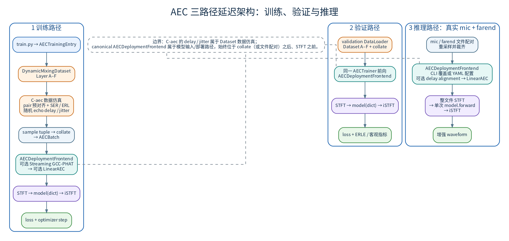
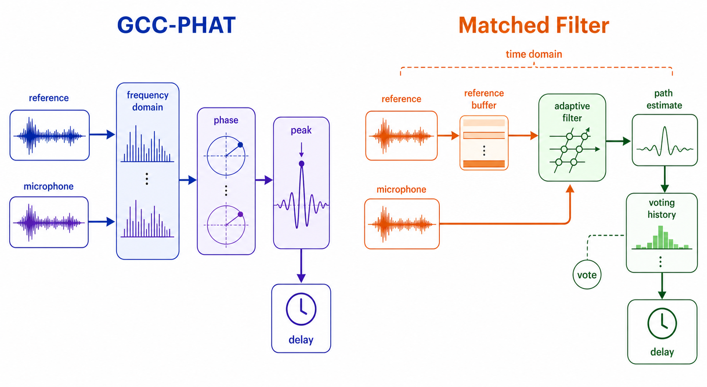
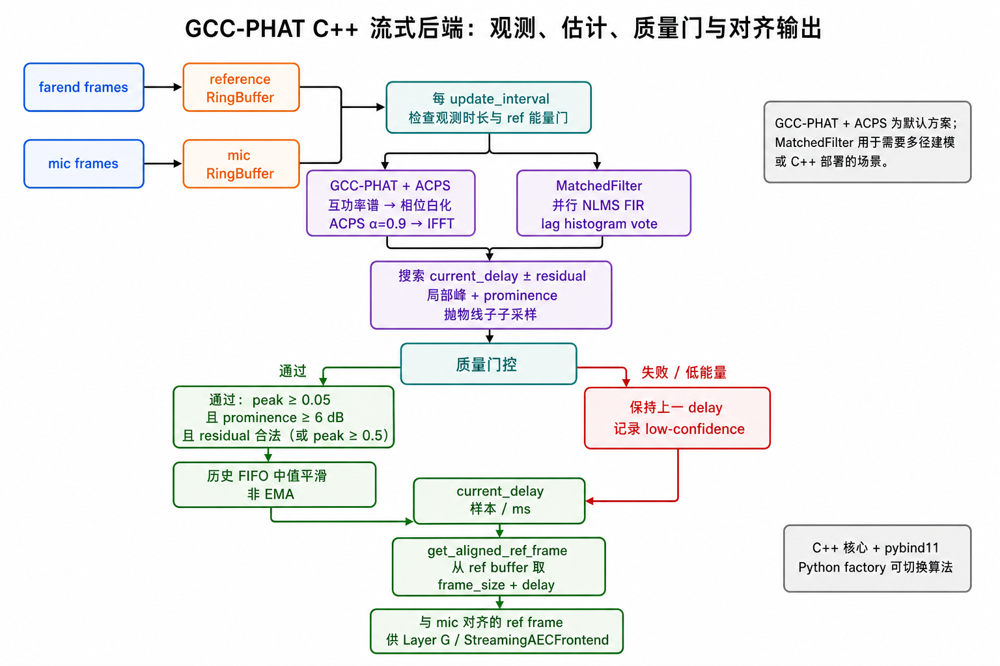

# AEC 时间延迟与对齐（三路径设计 + 算法对比 + C++ 部署）

本文是一切延迟机制（磁盘固有延迟 GCC 对齐 / 随机 echo 延迟 /
`aec_time_delay_jitter` / AEC 专属模型输入前端）的**唯一权威文档**。

为什么 AEC 要专门处理延迟：模型要知道「现在这一刻的麦克风信号，对应的是多久之前的远端参考」。播放队列、系统缓冲、网络抖动、设备采样率不匹配都会让这个错位量变化，训练数据必须覆盖这些情况，部署端又要把它对齐回来。

术语：**GCC-PHAT**（相位变换广义互相关）是经典的时延估计方法——比较两路信号的相位差，找出它们错开了多少采样点；**lag** 就是错开量；**jitter / drift / SRO** 分别指延迟的随机跳变、缓慢漂移、采样率不匹配造成的累积漂移；**residual（残差）** 指对齐后仍剩余的那一点错位。

本文统一维护 AEC 数据管道中与**时间延迟**相关的完整设计：

- **Part 1**：三路径（训练 / 验证 / 推理）延迟架构——磁盘固有延迟的 GCC 预对齐、
  随机 echo 延迟增强、样本内 jitter、AEC 专属模型输入前端；
- **Part 2**：延迟估计算法对比——GCC-PHAT / GCC+ACPS / MatchedFilter 的原理与实测；
- **Part 3**：GCC-PHAT C++ 后端（`GccPhatEstimatorCpp`）的部署细节。

所有结论以当前代码为准（文件:行号可跳转核对）。相关文档：
A–F 仿真全流程见 [`../simulation/Simulation_Flow_Logic.md`](../simulation/Simulation_Flow_Logic.md)。

---

# Part 1：三路径延迟架构（训练 / 验证 / 推理）

（[DOT source](assets/AEC_Delay_Alignment/01_three_path_delay_architecture.dot)）

> 图片展示三种场景的延迟处理层次；入口、配置继承和确定性行为以紧随其后的对比表为准。

## 1. 三场景对比

同一套延迟处理，在训练、验证、推理三种场景下的开关与入口不同：训练要造出各种延迟让模型学到鲁棒性，验证固定随机量以保证可复现，推理只处理真实音频、不做随机增强。逐项对比如下。

| 维度 | 训练（train split） | 验证（val split） | 测试/推理 |
|------|--------------------|------------------|-----------|
| 入口 | `AECTrainingEntry.build_loaders()` → Dataset → collate → `AECTrainer` | 与训练相同；val 配置仍按 `inherit_simulation` 合并 | `inference.py:run_aec_inference_batch()`；独立 `StreamingAECFrontend` 属另一套帧/块式 API |
| Dataset | `dynamic_aec` 只执行 Layer A→F、AEC 附加阶段和 final deterministic safety；`offline_aec` 只读取/齐长预混轨道 | 同训练 | 不使用训练 Dataset，直接读取真实 mic/farend pair |
| C-aec pair GCC | dynamic Dataset 用 windowed GCC-PHAT 清理磁盘 `(farend, echo)` 资产的固有 lag；这是**资产预对齐**，不是 `AECDeploymentFrontend` 模型输入前端 | 同训练（继承同一配置） | 不执行 C-aec；库级 `align_farend_to_mic` 可按需独立调用 |
| 随机 echo delay / jitter | C-aec 在资产预对齐后只移动 echo stem；配置决定分布与范围 | 同训练，但随机量固定在 epoch 0 派生（见 §4） | 不执行训练随机增强，真实 pair 自带延迟 |
| SER / EQ / clip | C-aec 执行 SER/ERL、可选 `aec_echo_device_eq` / `aec_echo_clipping`；echo clipping 不会使 Layer F clipping 跳过 | 同训练 | 不执行训练增强 |
| AEC 模型输入前端 | `AECTrainer._run_aec_frontend()` 在 collate 后、STFT 前统一执行：**可选 Streaming GCC-PHAT → 可选 LinearAEC** | 与训练相同，复用同一 Trainer 顺序 | `inference.py` 同样在 STFT 前调用 `AECDeploymentFrontend.process_batch()`，顺序与训练/验证一致；该前端不属于仿真 |
| 确定性 | Dataset 增强随 epoch 变化且可复现；canonical frontend 为确定性算法 | val Dataset 固定 epoch 0；canonical frontend 同样确定 | canonical frontend 无随机性 |

### 1.0 两类入口与算法边界

| 层级 | 配置/调用入口 | 算法与执行合同 |
|------|---------------|----------------|
| canonical typed 入口 | 顶层 `aec_frontend` → `AECFrontendConfig` → `AECDeploymentFrontend` | `aec_frontend.delay_alignment` 与 `aec_frontend.linear_aec` 分别配置可选 Streaming GCC-PHAT 与 LinearAEC；训练、验证和 `inference.py` 共用，波形域顺序固定为前者、后者、STFT。delay estimator 固定 `gcc_phat`；LinearAEC 后端为 `speex`、`pfdkf`、`pfdkf_torch` |
| generic / standalone 入口 | `create_delay_estimator()`、独立 `StreamingAECFrontend` | 通用 estimator 可选 `gcc_phat` / `matched_filter`；不改变 AEC 模型输入前端的 **delay estimator 固定 GCC-PHAT** 合同，也不代表 Dataset 执行仿真 |

`aec_frontend.linear_aec.bulk_delay` 当前仅接受 `0`，非零值会在构造 backend 前 fail-fast。需要延迟补偿时，应在 LinearAEC 前启用可选 Streaming GCC-PHAT。

Speex backend 可选的 C batch helper 只优化逐帧调用，不改变 MDF DSP 算法。Linux 上首次使用时，helper 按 C 源码、编译参数与平台 ABI 生成 SHA-256 内容身份，写入 `${XDG_CACHE_HOME:-~/.cache}/use_train/linear_aec/`；并发进程通过 `fcntl.flock` 独占锁串行构建，编译结果经同目录临时文件和 `os.replace` 原子发布。它不会在 `tasks/aec/data/` 源码树生成 `_speex_batch.so`；目录创建、加锁、编译、发布或加载任一步失败都只禁用 C batch fast path，并保持现有纯 `ctypes` 逐帧处理降级。

### 1.1 四层延迟机制不能混称为“GCC 对齐”

| 层次 | 处理对象与动作 | 目的 | 执行位置 |
|------|----------------|------|----------|
| C-aec pair 预对齐 | 加载 `(farend, echo)` 后用 windowed GCC 估计资产固有 lag；constant pair 给 `farend` 前补零，时变 pair 用 offset-crop | 清理不同录制/生成资产的不可控固有错位，建立统一增强起点 | dynamic Dataset C-aec；**资产预对齐，不是 AEC 模型输入前端** |
| 随机 echo delay / jitter | 预对齐后只移动 echo stem；echo 随后混入 mic，farend 与 near-end target 不移动 | 受控覆盖播放队列、系统 buffer、时间戳错位、SRO/跳变等延迟分布 | dynamic Dataset C-aec；训练 domain randomization |
| AEC 模型输入前端 | 可选 Streaming GCC-PHAT 对齐 farend，随后可选 LinearAEC 生成 residual | 复用 AEC 专属模型输入前端的波形处理 | 训练/验证由 `AECTrainer`、推理由 `inference.py` 在 STFT 前各调用一次 |
| 模型内部软对齐 | AlignBlock/CATA/FTG 在特征回看中选择、融合或跟踪 ref | 由神经网络吸收输入错位 | 模型本体；不是模型输入前端 GCC |

因此，“C-aec pair GCC + 随机 delay”不等于部署端理想对齐后再造延迟：前者只是 dynamic Dataset 的资产准备与增强。Dataset 仿真只包含 Layer A–F；AEC 专属模型输入前端只在 Trainer/推理的 STFT 前执行。

### 1.2 当前四个模型家族的配置状态

| 模型家族 | C-aec 随机延迟 | 模型内部机制 | `aec_frontend.delay_alignment` | LinearAEC |
|------|----------------|--------------|-----------------------------------------|-----------|
| DeepVQE | 纯 Beta(2,4)，0–80 ms；纯 sudden_jump p=0.03、±20 ms | AlignBlock，最大回看跨度约 90 ms | 关闭 | 未配置 |
| LocalVQE | 纯 Beta(2,4)，0–80 ms；纯 sudden_jump p=0.03、±20 ms | AlignBlock，约 1008 ms | 关闭 | 未配置 |
| CAGCRN | 纯 Beta(2,4)，0–80 ms；纯 sudden_jump p=0.03、±20 ms | CATA，`align_delay=6`：当前帧加前 5 帧；16 ms hop 下历史跨度 80 ms | 关闭 | 未配置 |
| DBGNet | 纯 Beta(2,4)，0–80 ms；纯 sudden_jump p=0.03、±20 ms | FTG 对 farend 做软跟踪/对齐 | **关闭** | 未配置 |

当前四个模型家族对应十份 Dynamic 生产 YAML（DBGNet 五份：16 kHz hybrid、32 kHz hybrid/MBRCL/MR-SI-L1-SS，其中 MR-SI-L1-SS 另有 base 容量；DeepVQE 三份；CAGCRN 与 LocalVQE 各一份），均关闭 `aec_frontend.delay_alignment`，并都走 `input_routing: mic_farend`。四个家族的随机 delay/jitter 都是会议硬件工程策略，非论文分布；四者均不显式叠加 Streaming GCC-PHAT。canonical Streaming GCC-PHAT 与 LinearAEC 仍是可选能力：配置会被解析，但仅在 `delay_alignment.enabled=true` 或配置 `linear_aec` 时由 Trainer/Inference 在 STFT 前执行；两者都未配置时前端直通。若未来启用，必须在训练、验证和部署/推理保持同一 `aec_frontend`。

### 1.3 将 stereo echo/ref 预对齐物化到磁盘

对于同一路径、固定 `ch0=echo`、`ch1=farend` 的 stereo 语料，可在生成训练 manifest 前运行离线物化工具：

```bash
python -m tools.prepare_data_tools.generators.aec.prealign_stereo_echo_ref \
    --input-root /path/to/raw_stereo_pairs \
    --output-root /path/to/gcc_prealigned_pairs \
    --workers 16
```

脚本递归保持相对目录结构，默认保持源采样率与 WAV/FLAC header 不变、不改变 frame 数；也可显式指定 `--output-sample-rate`（如 16000/32000，内部用 soxr `VHQ` 高保真重采样，soxr 缺失时 fail-closed 不静默降级）、`--output-format`（soundfile 格式名，如 FLAC/WAV，指定后输出扩展名替换为对应规范后缀如 `.flac`）与 `--output-subtype`（如 PCM_16/PCM_24，需搭配 `--output-format`，缺省取该格式 soundfile 默认 subtype）。请求任一转换时低置信文件也从 byte copy 改为解码→重采样→重编码；GCC 估计与 farend 前补零仍在源采样率上完成（记录中 `applied.tau_samples` 按源采样率记账），残差校验在重编码后的输出采样率上执行。离线 GCC 只清理固有 delay：constant 估计按 Dataset 同口径给 farend 前补零并裁回原长度；time-varying 估计不按 trajectory 逐点物化，而是取轨迹中按时间排序的第一可靠窗 `tau0`，对整段 farend 只做一次固定前补零+裁回，使段初对齐并有意保留段中相对 `tau0` 的真实漂移，交给模型或部署侧实时 GCC/AEC。低置信或钳制后补齐量为 0 的文件执行 byte copy（未请求转换时）；time-varying 缺少可靠轨迹点则 fail-closed。训练、离线分析与物化工具共用 `clamp_gcc_delay_samples`：正 `bias_seconds` 表示估计器固定正偏差，实际补齐为 `max(0, raw_tau_seconds - bias_seconds)`，再应用 `max_pad` 与 `min_pad_samples`。

Generator v3 对输入和输出都采用 fail-closed 事务边界。扫描时固化每个源文件的 device/inode/size/mtime identity；worker 用 `O_NOFOLLOW` 打开并复制到本事务 owned staging，读取前、读取后及路径级别复核 identity。GCC、低置信 byte copy 和 residual 校验均只消费同一份 snapshot，公开发布前再次复核原路径，输入处理中被替换或改写会使整轮失败。

实际变换文件先在 output 同级的 owned staging tree 中写入并校验 header，再重新读取编码结果，用同一 `estimate_gcc_tau_windowed` 参数执行 residual gate。constant 验收范围为 `full_pair`；time-varying 验收范围为首个可靠 1s 窗 `initial_window`，输出仍为 time-varying 不构成失败。两者均要求 residual 高置信且与 `expected_tau_ms = max(0, original_tau_ms - applied_tau_samples * 1000 / sr)` 的误差不超过 `--max-residual-error-ms`（默认 5.0ms）。由于 applied delay 已扣除 bias，配置正 bias 时 expected residual 通常接近该 bias，而不是强制为 0。残差门未通过时按 `--on-residual-failure` 处理：`copy`（默认）把该文件改写为不对齐的原始音频（请求转换时仍重采样/重编码），records 标记 `policy=copy_residual_gate_failure` 并保留失败详情，任务继续——与低置信文件同一哲学，样本保留、不施加无法验证的对齐；`abort` 则整轮 fail-closed 中止。每条 `gcc_prealign_records.jsonl` 的 `residual_check` 记录 scope、expected/estimated/error、置信与通过状态；`gcc_prealign_summary.json` 汇总 checked/passed 数和 residual error 的 max/mean/p50/p95。它们是生成审计 sidecar，**不是训练 manifest**。

全部音频和两个 sidecar 完成且 fsync 后，工具在 output 同级 lock 下提交完整目录集合：首次发布用原子 rename，`--overwrite` 用 Linux `renameat2(RENAME_EXCHANGE)` 原子交换。worker、residual、输入 identity 或 commit 前 fsync/exchange 任一失败时，公开 output 保持原集合不变，不会出现部分更新或版本混合；commit 后清理被替换集合失败只告警并保留 owned 备份目录，不回滚已持久化的当前集合。完成后再生成或切换 `real_farend_echo_pair_json` 指向当前输出根，并把对应训练配置的 `aec_ref_echo_fine_gcc_align` 设为 `false`，避免 Dataset 再次执行 GCC 造成二次对齐。此时 constant 固有 delay 已清理，但少量 time-varying 段中固有 delay 被有意保留；仿真随机 delay/jitter 仍在其上叠加。manifest 生成完成前不要修改正式 YAML。

## 2. 数据流（文字版）

这一节用文字缩进图画出训练/验证时一个 batch 的完整路径，重点是两条分支：Dataset 分支负责造数据（Layer A–F），Trainer 分支负责把数据送进模型（模型输入前端 → STFT → 模型 → iSTFT）。两者由同一个顶层配置驱动，但执行位置和方法不同。

### 2.1 生产训练 / 验证（Dataset 与 canonical frontend 分层）

```
AECTrainingEntry
  ├─ Dataset 分支：_dataset_config_without_aec_frontend(cfg) 深拷贝并剥离 AEC frontend 配置
  │   → DynamicMixingDataset：
  │       Layer A  clean 预处理（splice/变速/EQ/crop/高通）
  │       Layer B  场景分支抽签（7 分支，prob_* 之和=1）
  │       Layer C  C-0 RIR 卷积 → C-1/C-2 噪声
  │                C-aec（仅回声分支，rng 来自独立 _aec_rng_b3(index)）：
  │                  1. manifest pair 读取与 canonicalize
  │                  2. 【延迟1】windowed GCC-PHAT 磁盘固有延迟预对齐
  │                  3. 随机 crop / 尾部补零
  │                  4. 可选 device EQ → SER/ERL；按路径施加 echo clipping
  │                  5. 【延迟2】随机 echo delay
  │                  6. 【延迟2b】可选 aec_time_delay_jitter
  │       Layer D  post-mix amplitude conditioning（normalize → guard）
  │                D-normalize 执行 peak normalization；D-guard 使 mic 相关 stems
  │                共用安全 gain，并对 farend 独立执行安全缩放
  │       Layer E  channel degradation（含 channel clipping，仅 mic）
  │       Layer F  observation/device degradation（仅 mic）
  │                clipping = fixed rail + pre-drive；仅 E clipping 实际 applied 时跳过
  │                F 其他操作不跳过；C-aec echo clipping 不触发跳过
  │       Final    deterministic safety
  │   → aec_collate_fn
  └─ Trainer 分支：原始 cfg → AECTrainer
      → resolve_aec_frontend_config(原始 cfg)
      → AECTrainer._forward_aec_batch
          → _run_aec_frontend：canonical AECDeploymentFrontend
            （可选对齐固定 gcc_phat；可选 LinearAEC）
            对每个 batch 在 STFT 前仅执行一次
          → STFT → model(dict) → iSTFT
```

`AECTrainingEntry` 将 Dataset 所需配置传入其副本；AEC 专属模型输入前端的配置入口是原始配置中的顶层 `aec_frontend`。该前端只在 Trainer/Inference 的 STFT 前执行一次，不能与 Dataset 仿真混为一谈。

### 2.2 测试/推理与 standalone 边界

`inference.py` 的整文件 AEC 路径在 STFT 前实例化同一个 canonical `AECDeploymentFrontend`；独立 `StreamingAECFrontend` 则是另一套帧/块式部署 API。`--aec_stream_align` / `--aec_no_stream_align` 互斥，且只覆盖解析后 `aec_frontend.delay_alignment.enabled`，其余前端设置保持配置解析结果。训练与 validation 的 seam 位于 collate 后、STFT 前，推理的 seam 位于整文件 STFT 前，三者共享 canonical frontend，但都不把执行权交回 Dataset。

推理不做任何随机 delay / SER / EQ / clip。若启用对齐，canonical `AECDeploymentFrontend` 固定 `gcc_phat`；standalone `StreamingAECFrontend` 或直接 `create_delay_estimator` 的调用方仍可显式选择 `matched_filter`，该能力不表示 matched 是 canonical 可选算法。

### 2.3 评估链路（`evaluate/eval_pipeline_aec.py`）

- 真实集（AEC-Challenge 布局 mic + lpb）：`run_inference_aec_paired`（`evaluate/eval_pipeline_common.py`）→ shell 调
  `inference.py`（`--aec_no_stream_align` 可选，默认不传 → 尊重 YAML）
  → ERLE/PESQ/DNSMOS 等指标。评估自身不做额外延迟处理。
- 仿真测试集（7 场景）：`python -m tools.prepare_data_tools.generators.aec.generate_simulated_testset`
  用训练 pipeline 渲染固定测试集（`--seed` 默认 42，每场景 `--num-samples`
  默认 10），**走完整延迟链**（含 windowed GCC + 随机延迟），逐样本写
  `mic/farend/nearend/noisy_se.wav + meta.json`；随后同样经 `inference.py` 推理。
- 离线备用对齐：`tasks.aec.inference.align_farend_to_mic`
  （`tasks/aec/inference/offline_alignment.py`，与训练同一 windowed GCC 内核）是库级
  工具，供离线 PyTorch 分析/脚本使用；`inference.py` 主路径不调用它（主路径用
  流式估计器）。注意：不存在 `--aec_offline_align` CLI 开关。

## 3. 延迟相关 metadata 字段

Dataset 每处理一个样本，都会把「这次实际做了多少对齐、加了多少延迟、置信度如何」写进一组审计字段，供离线导出、测试集生成和分析脚本读取。它们只用于审计，**不会随 batch 传给模型**。

记录在 `_load_farend_echo_pair_aligned` 的 `load_meta` 与 `_run` 的
`c3_load_meta` 中，最终挂到 `_last_simulation_stems["simulation_by_layer"]["C"]["c3_disk_pair_load"]`
（`tasks/aec/data/dynamic_dataset.py` `_run()` 的 stems 记录段），供 `export_simulation_stems` /
canonical `aec.generate_simulated_testset`（meta.json）/ 分析工具消费；**不经 collate
传给模型**。

| 字段 | 含义 |
|------|------|
| `gcc_tau_ms` | 实际应用的预对齐量（ms，bias/max_pad/min_pad 钳制后；时变对为 crop 位置的局部 tau） |
| `gcc_peak` | 参与聚合窗的质量门 peak 幅值（fast 取 min，full_scan 取 median） |
| `gcc_prominence` | 线性 prominence = peak/mean（同聚合口径） |
| `gcc_time_varying` | 全量扫描 IQR > `gcc_tv_iqr_ms` 判定时变 |
| `gcc_low_confidence` | 所有窗未过质量门（tau=0，zero_pad，样本保留） |
| `gcc_mode` | `windowed_fast` / `windowed_full_scan` / `low_confidence` / `estimation_failed` / `disabled` |
| `random_delay_ms` | 实际施加的随机前导延迟（ms；未触发为 0.0） |
| `time_delay_jitter` | `aec_time_delay_jitter` 模块的元数据（applied、jitter_type、num_events 等）；未触发时为 None |
| `pair_manifest_index` / `farend_path` / `echo_path` | 清单溯源 |
| `crop_start_samples` / `zero_pad_end_samples` | crop/pad 位置 |

## 4. 验证集确定性

val Dataset 固定使用 epoch 0 派生的随机量；train/val loader 分别以实验 seed 和 `seed + 1` 固定 generator。val 继承的随机延迟、SER 与噪声混合在同一 run 的各 epoch 保持一致。

## 5. jitter 模块（`aec_time_delay_jitter`）

Layer C-aec 步骤 6 在 `echo_path` 上执行分数延迟重采样：保持 farend 不变，由 `_run` 用 jittered echo 组装各场景的 mic。配置支持 `sudden_jump`、`gradual_drift`、`periodic_jitter` 与 `mixed`，并由 `enabled`、`prob`、类型参数、事件密度、幅度、过渡时间和 `max_relative_jitter_ms` 控制。训练 Dataset 从 `aec_ref_echo_delay_range_ms` 的最大值派生相对 jitter 与最终总延时上限；base delay 为 0 时仍可形成 jitter 轨迹。

`time_delay_jitter` 元数据写入 `simulation_by_layer.C.c3_disk_pair_load`。`gcc_tau_ms` 表示已应用的资产预对齐补偿量，不能与 `random_delay_ms`、jitter 标量直接相加后当作模型输入 residual；最终 residual 必须从实际 mic/ref 或 oracle echo/ref 重新估计。

## 6. 共享内核与配置入口

- `tasks/aec/inference/gcc_phat_core.py` 是 Dataset、`offline_alignment.py` 和分析脚本共用的估计内核。
- Dataset 配置覆盖资产预对齐、随机延迟和 `aec_time_delay_jitter`；AEC 模型输入前端入口是顶层 `aec_frontend.delay_alignment.enabled`。
- `aec_frontend.linear_aec` 与 `aec_frontend.input_routing` 同属顶层 `aec_frontend`；`inference.py` 的 `--aec_stream_align` / `--aec_no_stream_align` 只覆盖 canonical `enabled`。
- `tools/verify/gcc_quality_gate.py` 对空评估集、NaN/Inf 与超出允许数量的不可读 pair fail-closed。

## 7. GCC 质量门合同

GCC 估出的延迟要过一道质量门才会被采用：互相关峰既要有足够绝对高度，又要明显高于背景均值，否则该窗口作废（低置信，等价于这次不做对齐），样本本身仍然保留。当前 `aec_ref_echo_gcc_peak_threshold=0.05`，`aec_ref_echo_gcc_prominence_db=6.0`。候选窗仅在两门同时满足时通过：

```text
peak >= 0.05
peak >= mean / 10^(-6.0/20)
```

Dataset windowed GCC 与 AEC 模型输入前端的流式估计器使用同一口径。

---

# Part 2：延迟估计算法对比

本部分的两算法切换仅描述 standalone `create_delay_estimator` 通用工厂；canonical
`AECDeploymentFrontend` 固定 `gcc_phat`，不允许选择 `matched_filter`。两种通用流式算法
共用相同接口（`push_ref` / `push_mic` / `get_aligned_ref_frame`），通过
`StreamingDelayEstimatorConfig.algorithm` 切换：

```python
cfg = StreamingDelayEstimatorConfig(algorithm="gcc_phat")   # 默认
cfg = StreamingDelayEstimatorConfig(algorithm="matched_filter")
est = create_delay_estimator(cfg)
```

## 8. 算法原理

### 8.1 GCC-PHAT + ACPS（默认方案）

**GCC-PHAT**：利用两信号频域互功率谱的相位信息估计时延。



1. 对 mic 和 ref 做 FFT；2. 互功率谱 `R(f) = MIC(f) × conj(REF(f))`；
3. PHAT 归一化 `W(f) = R(f)/|R(f)|`（只留相位，消除幅度影响——所有频率等权，
   产生尖锐互相关峰）；4. IFFT 得广义互相关；5. 约束范围内找峰值。

**ACPS（Accumulated Cross-Power Spectrum）优化**：解决延迟接近 buffer 长度时
单帧有效重叠不足、峰值被噪声淹没的问题——在 PHAT 之前对互功率谱指数加权累积：

```
R_accum(f) = α × R_accum(f) + (1-α) × R_new(f)    # 现行默认 α=0.8
W(f) = R_accum(f) / |R_accum(f)|
```

等效于更长的"虚拟分析窗"。α=0 等同标准 GCC-PHAT；当前 `acps_alpha=0.8`，观测权重为 0.2，配置范围为 `0 <= acps_alpha < 1`。Python/C++ 公共合同还包括：

- `StreamingDelayEstimatorConfig` 的全部数值字段必须 finite 且满足范围约束；`push_ref` / `push_mic` 只接受一维 finite 样本，并在修改 ring buffer、更新 cadence 或 ACPS 前拒绝 NaN/Inf，失败调用不污染状态。
- ACPS 仅在候选频谱、归一化与 IFFT 结果完整 finite 后提交；缓存 ACPS 的 shape/nfft 不匹配或含非有限值时，从当前观测重新起步。`reset()` 清空 mic/ref buffer、更新余数、中值窗口与 ACPS，并把 delay 恢复到 `coarse_ms`。
- 搜索窗始终以上一轮 `current_delay` 为 center；绝对峰值门和 prominence 门绑定到最终选中峰。
- selected integer lag 的一阶差分去均值 abs NCC 使用 `threshold = sqrt(2 * ln(2M / false_accept_prob) / N)` 独立门控；默认 `false_accept_prob=1e-4`。非法窗口、重叠不足、低方差、非有限结果或 `threshold >= 1` 均 fail-closed，Python/C++ 保持一致。
- `alpha` / `smooth_alpha` 控制回看中值窗口而非 EMA：`history_len = max(3, floor(1/alpha+0.5))`；偶数窗口取中间两项平均值。
- 调用方按 `push_ref → push_mic → get_aligned_ref_frame` 逐帧处理；不足 `frame_size` 的文件尾帧仍按实际长度推送和取回，
  不要求补成整帧。`get_aligned_ref_frame` 对负数、非整数及超过共享 ref capacity 的请求 fail-fast。

### 8.2 Matched Filter（AEC3 风格 NLMS）

用自适应 FIR 滤波器逼近回声路径脉冲响应，从收敛后的系数中取峰作为延迟。上图右侧给出其降采样、并行 NLMS 与直方图投票的概念链路；精确更新公式见下文。

NLMS 更新：`s = Σ h[k]×x[shift+i+k]`；`e = y[i] - s`；`α = smoothing × e / Σx²`；`h[k] += α×x[...]`。
直方图投票：每次有效估计投一票到 lag bin，超出窗口的投票自然过期；双阈值（初始 5 票快速锁定，收敛后 20 票防跳变）。
Python/C++ matched-filter 公共输入边界为 finite 一维 normalized audio，逐样本绝对值必须位于 **`[-16, 16]`**；
ref 或 mic 单边先到形成的 pending skew 在追加后最多 **16384 samples**，越界调用在写 ring/pending 前拒绝，避免缺失 peer
导致无界增长。内部 IIR/NLMS/聚合状态非 finite 时 estimator 立即 `reset()` 后报错；调用方不得继续复用失败前状态。

## 9. 关键设计差异

| 维度 | GCC-PHAT + ACPS | Matched Filter |
|------|-----------------|----------------|
| 计算域 | **频域**（FFT/IFFT） | **时域**（NLMS 自适应 FIR） |
| 记忆性 | ACPS 指数累积（现行默认 α=0.8） | NLMS 递归更新 + 直方图累积 |
| 归一化 | 相位白化（|R|→1） | 能量归一化（e/Σx²） |
| 估计内容 | 仅延迟（互相关峰值） | 完整回声路径脉冲响应（取峰） |
| 多径处理 | 弱（单峰值） | 强（滤波器可建模多径） |
| 降采样 | 无 | 4 倍降采样 + IIR 滤波 |
| 决策机制 | 显著性+邻域prominence | 直方图投票（滑动窗口） |
| 搜索范围 | 受 buffer 长度限制 | 多滤波器级联覆盖大范围 |

## 10. 选型结论

| 算法 | 优势 | 劣势 | 适用场景 |
|------|------|------|---------|
| GCC-PHAT（纯） | 简单、快速、跳变响应快 | 大延迟弱回声和单帧噪声更困难 | 固定设备、强回声 |
| **GCC-PHAT + ACPS（AEC 前端固定算法）** | ACPS 不增加额外 FFT，改善弱回声稳定性 | 多径分辨率不如 MF；平滑过强会拖慢跳变重捕获 | AEC 模型输入前端 |
| Matched Filter | 可建模多径；直方图投票稳定 | 弱回声收敛困难；复杂度高 | standalone `create_delay_estimator` / `StreamingAECFrontend` |

当前共享默认如下；canonical 固定 `algorithm: gcc_phat`，是否启用仍由 YAML 或 `inference.py` 的 CLI 覆盖决定：

```yaml
aec_frontend:
  delay_alignment:
    enabled: false
    algorithm: gcc_phat
    buffer_ms: 500.0
    coarse_ms: 50.0
    residual_ms: 50.0
    update_ms: 100.0
    alpha: 0.15
    acps_alpha: 0.8
    ref_thresh_db: -50.0
    peak_thresh: 0.05
    prominence_db: 6.0
    false_accept_prob: 1.0e-4
    min_obs_ms: 200.0
    frame_size: 160
```

`coarse_ms=50.0` 与 `residual_ms=50.0` 构成 `[0,100]ms` 搜索窗；`false_accept_prob=1e-4` 是固定安全参数。

### 10.1 benchmark 命令与质量门

```bash
python tools/verify/streaming_gcc_benchmark.py \
    --search representative \
    --backend both \
    --duration 4.5 \
    --output /tmp/streaming_gcc_benchmark.json
```

若已准备 16 kHz、`*_mic.wav` / `*_lpb.wav` 配对的真实集：

```bash
python tools/verify/streaming_gcc_benchmark.py \
    --search representative \
    --backend both \
    --duration 4.5 \
    --real-root /path/to/aec_challenge_pairs \
    --real-limit 8 \
    --real-jitter-threshold-ms 5.0 \
    --output /tmp/streaming_gcc_benchmark.json
```

排名精度只来自有 oracle 的合成 delay trajectory；无 oracle 真实音频只做 finite 与 delay 抖动稳定性 veto。每个 dev/holdout oracle 非 jump 场景须收敛、`p95 error <= 15ms` 且 `false lock <= 1%`；每个 nearend-only seed 须 `false activation <= 1%` 且最终 delay 不越过 `max(10ms, frame duration)`；每个 jump 场景须 `reacquisition <= 2s` 且 final error `<= 15ms`；全场景须 finite 且 `jitter p95 <= 5ms`。候选须同时通过 dev、冻结 holdout 和 CPU ratio `<= 1.25`。`--backend both` 还要求 Python/C++ 选择相同参数并通过逐场景 parity；启用真实集时叠加 real-audio veto。任一门失败时命令非零退出，只有 `gate_failures` 为空时 `report.passed=true`。

---

# Part 3：GCC-PHAT C++ 后端部署

仓库后端由 C++ estimator 核心与 pybind11 绑定共同实现，并通过 Python factory 加载；当前文件
**不提供稳定的无 Python C++ ABI**。生产训练由 canonical `AECDeploymentFrontend` 使用 GCC 后端；
独立 `StreamingAECFrontend` 与通用 factory 则属于 standalone/direct 边界。

## 11. 代码位置

| 文件 | 说明 |
|------|------|
| `tasks/aec/inference/csrc/delay_estimator_ext.cpp` | **C++/pybind 实现**（GCC-PHAT + MatchedFilter） |
| `tasks/aec/inference/csrc/pocketfft_hdronly.h` | 第三方 FFT 库 (header-only, numpy 同款) |
| `tasks/aec/inference/csrc/setup.py` | Python 绑定构建脚本 |
| `tasks/aec/inference/streaming_delay_estimator.py` | 通用配置层 `StreamingDelayEstimatorConfig` + standalone 工厂函数 `create_delay_estimator()` |
| `tasks/aec/inference/aec_frontend.py` | canonical `AECDeploymentFrontend` 与配置 resolver；算法固定 `gcc_phat` |
| `tasks/aec/trainer/entry.py` | 生产入口解析 canonical 配置，并向 Dataset 副本仅传递数据管道所需配置 |
| `tasks/aec/trainer/aec_trainer.py` | collate 后、STFT 前仅执行一次 `_run_aec_frontend()` |
| `tasks/aec/data/dynamic_dataset.py` | 只执行 Layer A–F；Dataset 无 AEC 模型输入前端配置读取或校验 |
| `tasks/aec/inference/streaming_aec_frontend.py` | standalone 帧/块式 API (`StreamingAECFrontend`) |

## 12. C++ 实现细节

整体流程（每 `update_interval` 触发一次）：



> 图片展示 RingBuffer、GCC-PHAT/ACPS 或 MatchedFilter、峰值质量门控和对齐帧输出的概念顺序；窗口和阈值仍以如下说明为准。

关键实现（`delay_estimator_ext.cpp`，以下用稳定符号定位）：

- **PHAT 白化**（`GccPhatEstimatorCpp::update_delay()`）：`R[i] = R[i] / (|R[i]| + eps)`，仅保留相位。
- **ACPS 累积**（`GccPhatEstimatorCpp::update_delay()`）：`R_accum_[i] = α·R_accum_[i] + (1-α)·R[i]`；α=0 关闭。
- **搜索范围**（`GccPhatEstimatorCpp::update_delay()`）：以上一轮估计 `current_delay_` 为中心、`max_residual_samples_`
  为半宽；延迟始终非负（回声不可能早于参考）。
- **峰值搜索**（`GccPhatEstimatorCpp::update_delay()`）：与 Python `StreamingDelayEstimator._find_peak_in_cc()` 对齐——
  搜索窗内找局部极大值，保留幅值超过 `max(peak_thresh, 0.7×global_max)` 的强峰；
  对每个强峰算局部邻域（半宽 `clamp(search_len/16, 1, 8)`）prominence，
  取不低于最大 prominence 90% 的候选，选距 `search_center` 最近者
  （对多峰互相关比全局最大峰更稳健）；最后抛物线插值细化到子采样精度。
- **selected-lag NCC 统计门**（`GccPhatEstimatorCpp::update_delay()`）：子采样峰取最近整数 lag 后，按 §8.1 的一阶差分、去均值 `abs NCC` 及
  `M/N/false_accept_prob` 统计阈值公式校验；`threshold >= 1`、低方差或非法观测 fail-closed。
- **质量门控**（`GccPhatEstimatorCpp::update_delay()`）：NCC 统计门通过后还需满足 ① `peak >= peak_thresh`；② `peak >= mean/prominence_linear`
  （`prominence_linear = 10^(-prominence_db/20)`）；③ `|tau - current_delay_| <= max_residual`
  或 `peak >= 0.5`（离群抑制硬阈值兜底）。
- **中值滤波平滑**（`GccPhatEstimatorCpp::update_delay()`）：回看窗口 FIFO，取中位数（非 EMA）；
  `history_len = max(3, floor(1/smooth_alpha+0.5))`，如 alpha=0.15 → 窗口=7。
- **`get_aligned_ref_frame` 语义**（`GccPhatEstimatorCpp::get_aligned_ref_frame()`）：从 ref_buf 读最新 `frame_size+delay`
  个样本，取前 `frame_size` 个——即 delay 样本前的 ref，与 mic 中的回声对齐。

## 13. 配置参数

### 13.1 C++ 构造函数参数（`GccPhatEstimatorCpp`）

| 参数 | 类型 | 默认值 | 说明 |
|------|------|--------|------|
| `sr` | int | 16000 | 采样率 (Hz) |
| `buffer_ms` | float | 500.0 | 分析缓冲区时长 (ms) |
| `coarse_ms` | float | 50.0 | 初始粗延迟假设 (ms)，reset 后起始值 |
| `residual_ms` | float | 50.0 | 精细搜索半宽 (ms)，围绕 `current_delay_`；与 coarse 构成默认搜索窗 [0, 100]ms |
| `update_ms` | float | 100.0 | 延迟估计更新间隔 (ms) |
| `smooth_alpha` | float | 0.15 | 中值滤波窗口系数，`history_len = max(3, floor(1/alpha+0.5))` |
| `ref_thresh_db` | float | -50.0 | 参考信号能量阈值 (dBFS)，低于则跳过本次更新 |
| `peak_thresh` | float | 0.05 | 互相关峰值绝对阈值（见 §7） |
| `prominence_db` | float | 6.0 | 峰值显著度阈值 (dB) |
| `false_accept_prob` | float | 1e-4 | selected integer lag 的一阶差分去均值 abs NCC family-wise 误接受概率 |
| `acps_alpha` | float | 0.8 | ACPS 累积系数（0=关闭） |
| `min_obs_ms` | float | 200.0 | 最小观测时长 (ms) |
| `eps` | float | 1e-12 | 数值稳定常数 |

### 13.2 canonical 配置映射

入口是顶层 `aec_frontend.delay_alignment`；canonical 延迟估计器只接受 `gcc_phat`，其后可按同一 `aec_frontend` 配置运行 LinearAEC。`aec_frontend.linear_aec.bulk_delay` 当前仅接受 `0`：

| YAML 参数 | Config 属性 | C++ 参数 | 说明 |
|-----------|-------------|----------|------|
| —（训练采样率） | `sample_rate` | `sr` | 16000 |
| `buffer_ms` | `buffer_duration_ms` | `buffer_ms` | 500.0（需 ≥ 最大回声延迟） |
| `coarse_ms` | `coarse_delay_ms` | `coarse_ms` | 50.0（搜索窗中心） |
| `residual_ms` | `max_residual_delay_ms` | `residual_ms` | 50.0（窄搜索半宽，覆盖 [0, 100]ms） |
| `update_ms` | `update_interval_ms` | `update_ms` | 100.0 |
| **`alpha`** | **`smooth_alpha`** | **`smooth_alpha`** | **注意：YAML 中叫 `alpha`** |
| `ref_thresh_db` | `ref_energy_threshold_db` | `ref_thresh_db` | -50.0 |
| `peak_thresh` | `peak_threshold` | `peak_thresh` | 0.05（推荐，§7） |
| `prominence_db` | `peak_prominence_db` | `prominence_db` | 6.0 |
| `false_accept_prob` | `false_accept_prob` | `false_accept_prob` | 1e-4；生产可显式配置，benchmark 固定不搜索 |
| `acps_alpha` | `acps_alpha` | `acps_alpha` | 0.8 |
| `min_obs_ms` | `min_observation_ms` | `min_obs_ms` | 200.0 |
| —（内部数值常数） | `eps` | `eps` | 1e-12 |
| `algorithm` | `algorithm` | — | canonical 固定 `"gcc_phat"`；非构造参数 |
| `frame_size` | — | — | 160（每帧推送样本数；非构造参数） |

上表前 13 行严格按当前 C++ 构造签名
`sr, buffer_ms, coarse_ms, residual_ms, update_ms, smooth_alpha, ref_thresh_db, peak_thresh, prominence_db, false_accept_prob, acps_alpha, min_obs_ms, eps`
排列；`sr` 与 `eps` 没有 AEC 模型输入前端 YAML 别名。通用 factory 的 standalone/direct 配置仍可将
`algorithm` 设为 `matched_filter`，但不经过该 canonical 生产映射。

## 14. API 接口

### 14.1 Standalone Python 工厂函数

此接口允许 `algorithm="gcc_phat"` 或 `algorithm="matched_filter"`；它不表示 canonical
`AECDeploymentFrontend` 可选择 matched。

```python
from tasks.aec.inference.streaming_delay_estimator import (
    StreamingDelayEstimatorConfig,
    create_delay_estimator,
)

cfg = StreamingDelayEstimatorConfig(
    sample_rate=16000,
    buffer_duration_ms=500.0,
    coarse_delay_ms=50.0,
    max_residual_delay_ms=50.0,
    update_interval_ms=100.0,
    smooth_alpha=0.15,
    ref_energy_threshold_db=-50.0,
    peak_threshold=0.05,
    peak_prominence_db=6.0,
    false_accept_prob=1e-4,
    acps_alpha=0.8,
    min_observation_ms=200.0,
    eps=1e-12,
    algorithm="gcc_phat",
)
est = create_delay_estimator(cfg)
# 始终返回 _ValidatedDelayEstimator；内部只尝试 _native/ 的 C++ 扩展，拒绝后才警告并回退 Python。
```

`_ValidatedDelayEstimator` 统一 Python/C++/MatchedFilter 的 public finite、帧维度与 aligned-ref capacity
检查；如需诊断实际后端，读取稳定只读属性 `est.backend_identity`（`"cpp"` 或 `"python"`），
业务代码不应依赖 `est._estimator` 的具体类名。

### 14.2 pybind C++ 类接口（仓库内部）

pybind 注册导出 `GccPhatEstimatorCpp` 的构造函数，以及 `push_ref`、`push_mic`、`delay_ms`、
`delay_samples`、`get_aligned_ref_frame`、`reset`。这些方法在当前扩展中接收或返回
`py::array_t<float>` 等 Python 绑定类型，供 Python wrapper 调用；它们不是稳定的原生 C++ ABI。
仓库内定位应使用 `class GccPhatEstimatorCpp` 与对应方法符号，而不要依赖源码行号或私有成员。

### 14.3 调用时序

```
loop {
    ref_frame = est.preflight_input(read_ref(hop_size), "reference")
    mic_frame = est.preflight_input(read_mic(hop_size), "microphone")
    est.push_ref(ref_frame)              // ① 两路预检通过后，先推参考（积累到 RingBuffer）
    est.push_mic(mic_frame)              // ② 推麦克风（累积 update_interval 样本后同步触发 update_delay）
    aligned_ref = est.get_aligned_ref_frame(hop_size)  // ③ 用最新估计值取对齐参考
    output = aec_model(mic_frame, aligned_ref)         // ④ 送 AEC 模型
}
```

以上是直接调用 generic estimator 时调用方必须保证的 standalone/direct 时序：完整 ref/mic pair 在任一状态提交前，
先对两路执行 estimator-specific `preflight_input`，两路均通过后才允许 `push_ref → push_mic`；因此 matched-filter
的幅度或 pending-skew 预检失败时，不得出现只推进 ref 或只推进 mic 的部分状态。
`StreamingAECFrontend.process_pair()` / `push_chunk()` 已在内部执行完整 pair 预检，外部调用方不需要重复预检。
该 pair 事务保护不扩展 canonical 的算法集合。

`StreamingAECFrontend` 的 `center=False` 是默认因果模式；`center=True` 明确引入 `n_fft//2` lookahead。
在 centered chunk API 中，warm-up 零只是 lookahead 占位，不计为已合成输出；流结束必须调用一次 `flush()`，
它施加右侧 reflect padding 并返回被 lookahead 延后的真实尾部。`push_chunk()` 与 `flush()` 拼接后去掉前导
`lookahead_samples`，应恰好得到与输入等长的输出；重复 `flush()` 返回空数组。对 `center=False`，`flush()` 也只允许
作为当前流的**最终调用**来排空 OLA 尾部，不得 flush 后继续 push；无论 center 模式如何，新流开始前都必须先
`reset()`。`reset()` 同时清空 frontend/model cache 和 delay estimator，避免上一流的 sample/spec/OLA buffer、
median history 或 ACPS 泄漏。

frontend 对 streaming `(spectrum, cache)` 与 offline dict 输出统一校验 schema、shape、dtype 和 finite，iSTFT/OLA
也必须 finite。任一模型输出、cache 或 OLA 校验/执行失败都会把当前流标记为 poisoned；之后即使空 chunk 或
`flush()` 也必须拒绝，调用方只能 `reset()` 后开始新流。事务候选只递归复制 cache 的 dict/list/tuple 容器，
**不会深 clone cache tensor**；若模型原地修改 tensor，共享 storage 可能已经污染，不能声称失败可回滚，仍须 reset。

**并发所有权契约**：每条音频流使用一个独立 estimator 实例，并由一个 owner thread 串行执行上述完整调用序列。
C++ 内部 mutex 只保证单个 public method 对实例状态的互斥访问；它不把分开的 `push_ref` 与 `push_mic`
合并为 ref/mic pair 原子事务。若两个线程交错调用，同一时刻的 ref/mic 可能错误配对，因此不得跨流共享实例，
也不得用“C++ 有 mutex”作为多 producer 安全依据。

## 15. 编译、固定目录加载与构建身份

从仓库根目录执行实际构建命令：

```bash
python tasks/aec/inference/csrc/setup.py build_ext --inplace
```

`_NativeDirBuildExt` 把扩展固定写到 `tasks/aec/inference/_native/`，即
`tasks/aec/inference/_native/delay_estimator_ext<EXTENSION_SUFFIX>`；运行时 `_load_delay_estimator_extension()` 只接受这个位置，不从 `tasks/aec/inference/csrc/`、site-packages 或其他 `sys.path` 副本加载同名模块。已预加载模块的 `__file__` 必须精确等于获准扩展；扩展 mtime 早于 `tasks/aec/inference/csrc/delay_estimator_ext.cpp` 时回退 Python。

Linux/macOS 当前编译选项是 `-std=c++17 -O3 -DNDEBUG -fPIC`，Windows 为 `/std:c++17 /O2 /DNDEBUG /EHsc /D_USE_MATH_DEFINES`；编译参数保留标准 finite/NaN 语义。benchmark 报告记录 build identity；路径、binary/source 存在性与 stale gate 任一不满足时 fail-closed。

**原生 C++ 嵌入（无 Python）**：仓库当前未提供可直接链接的稳定 C++ ABI，不能把上述 pybind 类当作公共接口。若产品需要原生嵌入，应自行抽离 `RingBuffer`、FFT 与 estimator 核心，把 `py::array_t` / GIL 相关类型改写为明确的原生 span/pointer 接口，并建立独立 ABI、生命周期、并发与数值 parity 测试；仓库内稳定定位仅限类/方法符号，不承诺复制若干类和头文件即可成为受支持集成。

## 16. 测试验证

从仓库根目录运行范围内回归：

```bash
python -m pytest -m unit \
    tests/test_streaming_delay_estimator.py \
    tests/test_inference_short_input.py \
    tests/test_streaming_gcc_benchmark.py -q

python -m pytest -m integration \
    tests/test_gcc_phat_cpp_python_parity.py -q

python -m pytest -m unit tests/test_streaming_aec_frontend.py -q \
    -k "center_push_chunk_flush_returns_real_tail_once_and_reuses_after_reset or reset_clears_estimator_and_prevents_cross_stream_leakage or nonfinite_pair_rejected_before_any_state_is_committed"
```

Python 合成自测仍可直接运行：

```bash
python tasks/aec/inference/streaming_delay_estimator.py
```
