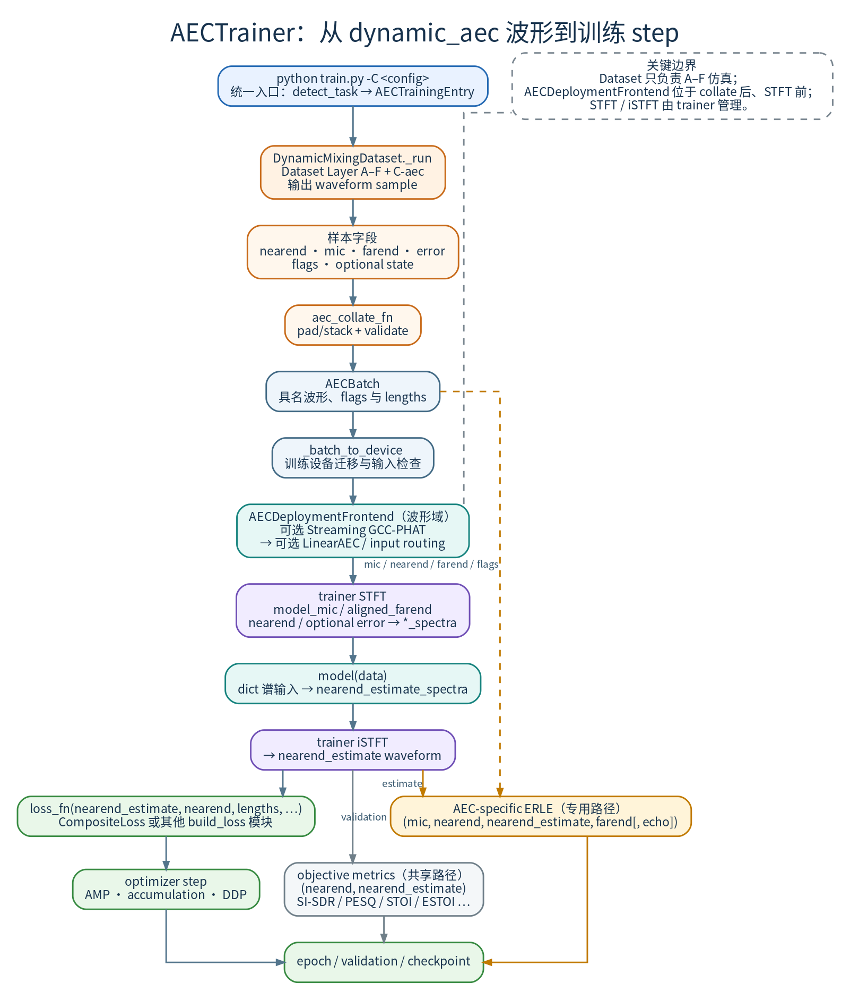
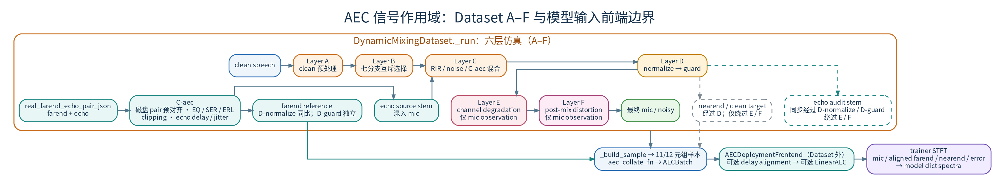
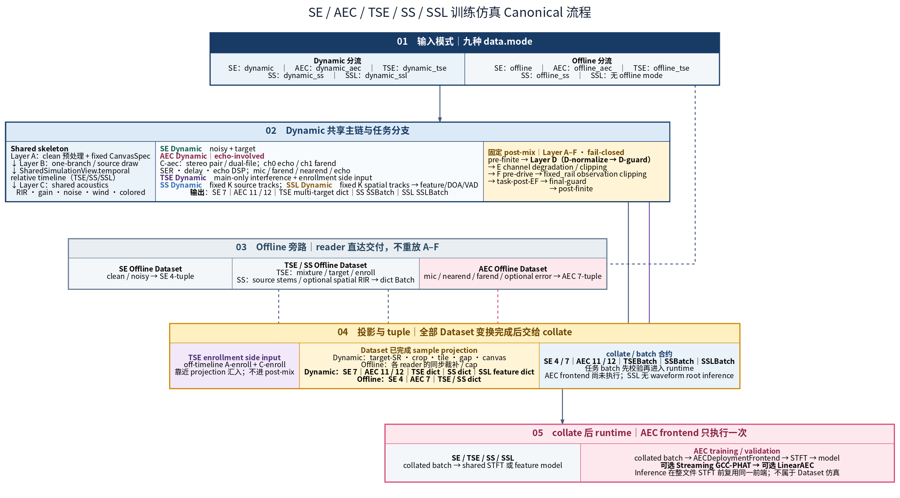
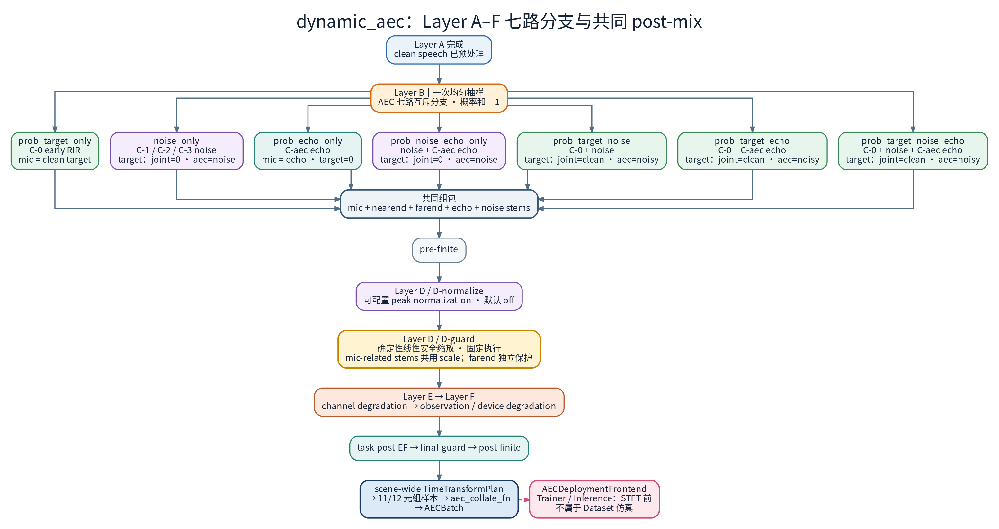
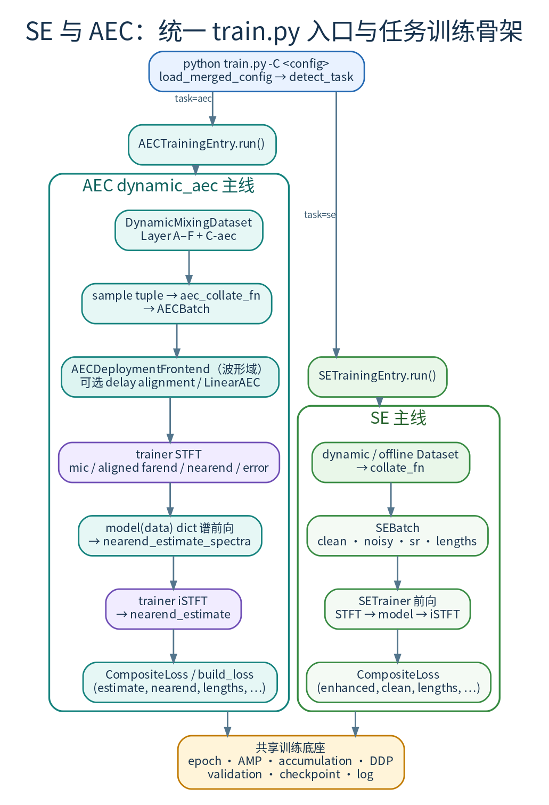

# AEC 训练入门：经典框图 ↔ `AECTrainer` 与 AEC/SE 流程对比

本文是 AEC 训练的第一站，面向第一次读这套代码的人：先建立「回声消除要做什么、数据长什么样」的直觉，再把这些直觉对上具体代码。分两部分：

- **Part 1**：把「自适应回声消除」常见的教科书/博文框图，逐环节对应到本仓库的 **`train.py` 的 AEC 路由 + `AECTrainer`**（AEC 的 Trainer，负责一个 epoch 的训练/验证循环）和 **`core.losses`**（损失函数，典型组合 `CompositeLoss`），方便从公式跳到代码。经典叙述可参考：[声学回声消除(AEC)原理与实现 - 凌逆战](https://www.cnblogs.com/LXP-Never/p/11703440.html)。
- **Part 2**：AEC 与 SE（Speech Enhancement，语音增强，只做降噪不去回声）两条训练全流程的对比（仿真管线、场景分支、批组包、训练骨架）。

**先记住四路信号**，后面所有表格都在用它们：`farend` 远端参考（对方传来的、即将送进扬声器播放的信号）、`echo` 回声（`farend` 经「扬声器-房间-麦克风」这条物理链路后的结果）、`mic` 麦克风混合（模型输入，≈ 近端语音 + 回声 + 噪声）、`nearend` 近端目标（模型应输出的、不含回声的近端语音）。训练目标就是让模型用 `mic` 与 `farend` 估出 `nearend`。

**想直接跑起来**：`python train.py -C configs/aec/microsoft_challenge/<model>/<config>.yaml`。配置文件选择、数据准备与推理命令见 [`../../../tasks/aec/README.md`](../../../tasks/aec/README.md)；只关心训练数据怎么造，见 [`AEC_Data_Simulation.md`](AEC_Data_Simulation.md)。

相关文档：仿真审计与增强设计见 [`AEC_Data_Simulation.md`](AEC_Data_Simulation.md)；A–F 仿真全流程权威版见 [`../simulation/Simulation_Flow_Logic.md`](../simulation/Simulation_Flow_Logic.md)；SE 侧视角见 [`../se/SE_vs_AEC_Training_Framework.md`](../se/SE_vs_AEC_Training_Framework.md)。

---

# Part 1：经典 AEC 框图 ↔ 代码

## 1. 符号与 batch 字段（先背这一行）

同一路信号在不同地方有三个名字，别被绕晕：教科书里写作 \(x(n)/s(n)/d(n)\)，DataLoader 里是波形键 `farend` / `nearend` / `mic`，进入模型前又变成谱 `farend_spectra` / `nearend_spectra` / `mic_spectra`。谱由 STFT（短时傅里叶变换：把波形按窗切成帧，每帧变换到频域）得到，本仓库统一在 trainer 里做，模型内部不重复做。

| 博文/教材常用记号 | 含义                      | DataLoader 里（波形）                                                                                  | STFT 后（谱，`_forward_aec_batch` 写入）                                |
| ----------------- | ------------------------- | ------------------------------------------------------------------------------------------------------ | ----------------------------------------------------------------------- |
| \(x(n)\)          | 远端参考                  | `farend`                                                                                               | `farend_spectra`                                                        |
| \(s(n)\)          | 近端语音（希望保留/估计） | `nearend`                                                                                              | `nearend_spectra`                                                       |
| \(y(n)\)          | 真实回声\(x*w\)           | 与`mic−nearend` 一致的残差支路                                                                        | 残差在 loss/trainer 内用`mic−nearend` 计算，batch 不单独传 `nontarget` |
| \(d(n)\)          | 麦克风混合                | `mic`                                                                                                  | `mic_spectra`                                                           |
| \(e(n)\)          | 线性 AEC 残差             | `error`（可选，LAEC 前端输出）                                                                         | `error_spectra`                                                         |
| —                | 场景标签                  | `is_pure_noise` / `is_pure_echo` / `is_pure_echo_noise` / `has_echo`（bool）；可选 `state`（帧级标签） | 传入 model dict 供条件分支；`state` 用于 DBGNet 等 state detector 模型  |

常见合成关系（噪声 \(v\) 在动态数据里可能并入 `mic`）：

\[
d(n) = s(n) + y(n) + v(n),\qquad y(n) = (x * w)(n).
\]

## 2. 经典框图 ↔ 本仓库：总对照表

下表一行对应自适应 AEC 的一个常见模块：左列是博文/教材里的环节，中间两列说明它在数据与 `AECTrainer` 里的落点，最后一列是有哪些现成指标。实现文件：**`tasks/aec/trainer/aec_trainer.py`**（前向 + loss kwargs 组装）；**损失定义在 `core/losses/`**（**`CompositeLoss`** + 子项），入口：**`train.py -C <config>`**。


| 博文 / 框图环节              | 典型公式或信号                                                      | Dataset / collate 波形键 | `AECTrainer._forward_aec_batch` 内 | 验证 / 指标（可选） |
| ---------------------------- | ------------------------------------------------------------------- | ------------------------ | ---------------------------------- | ------------------ |
| 远端参考\(x\)                | 送入滤波器/网络的参考                                               | `farend` | `_run_aec_frontend` 可选先做 Streaming GCC-PHAT，再 `stft(aligned_farend)` → `farend_spectra` | — |
| 麦克风观测\(d\)              | 混合信号                                                            | `mic` | 同一 canonical frontend 可选运行 LinearAEC，随后 `stft(model_mic)` → `mic_spectra` | ERLE 等用 `mic` 与估计量 |
| 近端目标\(s\)                | 希望输出接近近端                                                    | `nearend` | `stft(nearend)` → `nearend_spectra` | `val_metrics` 用 `(nearend, nearend_estimate)` |
| 线性 AEC 残差\(e\)           | 线性前端消除部分回声后的残差                                        | Offline 可从 `error_scp` 读取预生成 `error`；Dynamic Dataset 不运行 LinearAEC | runtime LinearAEC 在 STFT 前生成 `error`，再转为 `error_spectra`；runtime 与预生成 error 冲突时拒绝 | — |
| 场景标签                     | 纯噪/纯回声/纯回声噪/含回声标识                                     | `is_pure_noise` / `is_pure_echo` / `is_pure_echo_noise` / `has_echo`；可选 `state` | 传入 `model(data)`；ERLE 在含回声样本上计算 | — |
| 线性 AEC：估计回声\(\hat y\) | \(\hat y = x * \hat w\)                                             | Dataset 只提供 mic/ref，不执行部署前端 | AEC 专属模型输入前端按配置执行可选 GCC-PHAT → 可选 `speex` / `pfdkf` / `pfdkf_torch` LinearAEC；Legacy TDC 已删除 | — |
| 减法器：误差\(e\)            | \(e = d - \hat y\)；若直接估 \(\hat s\) 则监督 \(\hat s \approx s\) | — | `nearend_estimate = istft(nearend_estimate_spectra)` | — |
| 双讲 DTD / 步长控制          | 双讲时限制\(\hat w\) 更新                                           | 由数据分布与训练策略体现 | 无独立 DTD 张量；模型从 mic/ref 学习双讲鲁棒 | — |
| 非线性残余抑制 NLP/RAES      | 线性后仍残留的回声                                                  | 复杂失真由数据覆盖 | 同一 model 在频域掩蔽/回归中吸收 | — |

训练与 validation 都由 `AECTrainer` 在 STFT 前调用同一 `AECDeploymentFrontend`；`inference.py` 也复用该 frontend。波形域顺序固定为**可选 Streaming GCC-PHAT → 可选 LinearAEC → STFT**。`enable_tdc` 已从 LinearAEC schema 删除，不能再把延迟补偿描述为 LinearAEC 内部步骤。

## 3. Loss（配置 `loss.type: CompositeLoss`）

Loss（损失函数）衡量「模型输出与目标差多远」，值越小越好，反向传播由它驱动。AEC 默认配置用 `CompositeLoss`：把多个子损失加权求和，权重写在 YAML 里；子项在各自内部对波形再做多分辨率 STFT，因此谱域/时域子损失可以任意组合。

**`_forward_aec_batch`** 之后，**`AECTrainer`** 通过 **`_composite_ss_undesired_kwargs`** 组装可选 kwargs（`undesired_ref` / `undesired_enhanced`、纯分支门控），然后直接调用 loss：

| 内层`loss`                                 | 调用方式                                                         | 说明                                                                                                                                              |
| ------------------------------------------ | ---------------------------------------------------------------- | ------------------------------------------------------------------------------------------------------------------------------------------------- |
| **`CompositeLoss`**（`core.losses`）       | **`loss_fn(nearend_estimate, nearend, lengths[, 分支门控 …])`** | 与**`SETrainer`** 相同：子项（如 **`SIL1WavSeTrainLoss` / `MRSIRelCspecL2Loss`**）在各自内部对波形再做多分辨率 STFT。                             |
| **其它** `build_loss` 模块（非 Composite） | **`loss_fn(nearend_estimate, nearend, lengths, **kwargs)`**      | 所有 AEC loss 统一波形位置参数接口；state/pure 分支等经 kwargs 注入；本仓库 AEC 基线不再维护单独的 `tasks/aec/losses/`。 |

与经典框图对照：本仓库的神经网络直接输出近端估计 \(\hat s\)（`nearend_estimate`），不先估回声再相减；显式的「估计回声并相减」只发生在可选的 LinearAEC 前端。原 **`AECComplexMSE` / `AECMixedLoss`**（旧 `tasks/aec/losses`）已删除，谱域/时域子损失统一在 `CompositeLoss` 的 YAML 中组合。

## 4. 一条数据在 trainer 里的顺序（简图）

一个训练 step 的顺序是：DataLoader 取样本 → collate（把一个 batch 的多个样本拼成等长张量）→ 搬到 GPU → AEC 模型输入前端 → STFT → 模型 → iSTFT → loss。下图画出这条链路。

（[DOT source](assets/aec_training_primer/01_trainer_data_flow_overview.dot)）

> 图中按当前代码概括 `train.py → AECTrainingEntry → dynamic_aec → sample tuple → collate → AECBatch → AECDeploymentFrontend → STFT → dict 模型 → iSTFT → loss/step`；精确 tuple 契约、函数名与谱/波形转换保留如下。

```text
Dataset 样本为 7/11/12 元组，collate 直接输出 AECBatch，按名包含：
(nearend, mic, farend, fs, lengths, error, error_mask,
 is_pure_noise, is_pure_echo, is_pure_echo_noise, has_echo[, state])
# collate 输入接受 7/11/12；其余长度均显式拒绝。
# AECBatch 提供 validate/pin_memory/to/batch_size；Trainer 拒绝 tuple/list 批。
```

执行顺序：

1. batch 解包并由 `_batch_to_device` 搬到训练设备。
2. `_forward_aec_batch` 先执行仅 AEC 的 `AECDeploymentFrontend`：按顶层 `aec_frontend.delay_alignment.enabled` 可选运行唯一的 Streaming GCC-PHAT，再按配置可选运行 LinearAEC；该模型输入前端不属于仿真。
3. AEC 模型输入前端完成后才进入谱域与模型：
   - `STFT(model_mic,aligned_farend,nearend,error,…) → *_spectra`；
   - `model(data) → nearend_estimate_spectra`；
   - `iSTFT → nearend_estimate`。
4. 调用 `loss_fn(nearend_estimate, nearend, lengths[, …])`。

训练与 validation 均保证 `_batch_to_device → AECDeploymentFrontend → STFT/model`。

## 5. 仿真管线对各信号的作用域（摘要）

仿真管线把「读干净的语音」到「造出训练用的 `mic`」这段过程拆成 Layer A–F（A 是语音预处理，B 抽场景分支，C 做声学混合即 RIR/噪声/回声，D 做幅度调理，E 是信道退化，F 是设备退化）。`tasks/aec/data/dynamic_dataset.py:_run` 只执行 Layer A→F、AEC 附加阶段与 final deterministic safety，Dataset 不额外引入编号层。训练与 validation 由 `AECTrainer` 在 collate 后、STFT 前执行仅 AEC 的 `AECDeploymentFrontend`，`inference.py` 在整文件 STFT 前执行同一模型输入前端。下面三小段说明三层边界分别改了哪些信号。

（[DOT source](assets/aec_training_primer/02_signal_scope_overview.dot)）

> 图已按当前所有权重绘：Dataset 仅执行 A–F 仿真；farend 对齐与可选 LinearAEC 位于 `aec_collate_fn` 之后的 Trainer / inference 模型输入前端，再进入 STFT，不属于 `_run` 仿真阶段。逐层作用对象、延迟语义和精确配置仍以正文与关联文档为准。

- **clean 目标与 mic 相关 stems**：Layer C-0 生成 early RIR target，Layer C-0b 以 post-RIR early reference 标定并把同一 gain 施加到 full/early/target。Layer D 是 post-mix amplitude conditioning，内部固定为 normalize → guard：`D-normalize` 按配置执行 peak normalization，`D-guard` 再由任一 mic-related stem（mic/nearend/echo/noise）越界共同触发，使这些轨道共用同一安全 scale 以保持线性分解；Layer E/F 不直接处理 clean/监督 stem。
- **farend 参考**：Dataset 内只在 C-aec 的磁盘资产预对齐（GCC pad）、ERL 耦合电平缩放 `far_db = echo_db + ERL` 与 Layer D amplitude conditioning 中被修改；`D-normalize` 可按配置同比缩放 farend，`D-guard` 对 farend 独立安全缩放；farend 不参与 mic-related stems 的共同 guard scale，Layer E/F 与 final deterministic safety 也不处理 farend。随机 echo 延迟默认 `echo_only` 模式只 pad echo，不改 farend 时序。若 AEC 模型输入前端启用 delay alignment，则它在 STFT 前再次对齐 farend；这不是 Dataset 仿真。
- **mic/noisy 输入**：经过完整的 A→F 管道，post-mix 顺序固定为 `pre-finite → D-normalize → D-guard → E → F → task-post-EF → final-guard → post-finite`。Layer E 保留 channel degradation clipping；Layer F 是 observation/device clipping 的权威位置，以 fixed rail + pre-drive 只处理 mic。仅当 Layer E clipping 实际 applied 时跳过 Layer F clipping，Layer F 的其他操作仍执行；C-aec echo clipping 不触发该跳过。final deterministic safety 是无随机性的 observation-only 最终安全网，不修改 stems 或 farend。AEC 模型输入前端的固定顺序是“可选 Streaming GCC-PHAT → 可选 LinearAEC → STFT”。

逐层 × 逐信号的作用域详表、farend/echo 仿真审计与增强设计，统一维护在
[`AEC_Data_Simulation.md`](AEC_Data_Simulation.md)；A–F 仿真全流程与 `simulation_cfg`
配置速查见 [`../simulation/Simulation_Flow_Logic.md`](../simulation/Simulation_Flow_Logic.md)。

---

# Part 2：AEC vs SE 训练全流程对比

## 6. A–F 仿真架构总览



> 图 6：当前 Dataset 只有 Layer A–F；clean target 绕过 observation-only 的 Layer E/F，`AECDeploymentFrontend` 则位于 collate 后、STFT 前，不是额外仿真层。图表源和完整合同见 [`Simulation_Flow_Logic.md`](../simulation/Simulation_Flow_Logic.md)。

## 7. SE `_run` vs AEC `_run`


| 环节                   | SE`_run`                         | AEC`_run`                                                                            |
| ---------------------- | -------------------------------- | ------------------------------------------------------------------------------------ |
| 随机分区               | 多层分支（依 SE simulation_cfg） | 七路互斥分支（Layer B，见 §8）                                                       |
| 回声门控               | 无                               | 无独立`prob_add_echo`；回声参与由分支直接决定（`need_c3=True` 分支触发 C-aec）       |
| C-aec farend/echo 加载 | 无                               | 需 C-aec 的分支：独立 RNG → 磁盘加载 → GCC-PHAT 对齐 → SER 缩放 → 随机 echo 延迟 |
| 音量规整               | Layer C-0b 可选 post-RIR 音量归一化 | Layer C-0b 在 RIR 后、noise/echo 混入前执行可选音量归一化；post-mix Layer D 固定执行 `D-normalize → D-guard`，先按配置 peak normalization，再做 deterministic peak guard |
| `_run` 返回值          | `(clean, noisy, sr)` 三元组      | `(clean_1d, noisy_1d, sr, aec_disk_ctx)` 四元组                                      |
| `__getitem__` 返回值   | 7 元组样本（dynamic）                     | 11/12 元组（见 §9）                                                                 |

## 8. 七分支的层参与与监督语义

Layer B 会为每个样本均匀抽一路场景（七路概率之和 = 1.0），决定这个样本属于「只有近端语音」「纯噪声」「纯回声」「噪声+回声」「近端+噪声」「近端+回声」「近端+噪声+回声」中的哪一种，也就决定了模型的输入与训练目标。**分支定义、每路 noisy 构成、`task=joint` / `task=aec` 两套监督目标的完整表格以 SSOT 为准：** [`Simulation_Flow_Logic.md` §0.3 Layer B 细节](../simulation/Simulation_Flow_Logic.md)。AEC 侧只需记住三点：

- 有回声的分支（`prob_echo_only` / `prob_noise_echo_only` / `prob_target_echo` / `prob_target_noise_echo`）走 C-aec（从磁盘加载 farend/echo 对并做对齐与电平缩放）；`prob_noise_only` / `prob_target_noise` / `prob_target_noise_echo` 走 C-1/C-2 加性噪声；`prob_target_only` 两者都不走。
- C-0 / C-0b 在所有分支都执行。纯噪声/纯回声分支（`prob_noise_only` / `prob_echo_only` / `prob_noise_echo_only`）在默认 `task=joint` 下监督目标是**全零**：模型要把这类输入压到静音。
- 纯回声分支里 C-0/C-0b 的作用只是产出一个 early-reference target 供 SER 标定参考，不参与最终监督目标。

各分支的层执行顺序（`_run` 概念顺序）：

（[DOT source](assets/run_branch_order.dot)）

> 图 7：AEC 场景分支的输入参与、共享混合与输出合并；分支监督语义见 [`Simulation_Flow_Logic.md` §0.3](../simulation/Simulation_Flow_Logic.md)，组包细节见 §9。

> 注：C-aec 的 SER/ERL 缩放以 post-RIR、已完成 C-0b 统一增益的 early-reference `clean_target` 功率为参考（`tasks/aec/data/dynamic_dataset.py::DynamicMixingDataset._run` 的 C-aec 段），而不是 dry source 或 full-RIR mic stem；该参考与分支最终监督目标无关——因此 `prob_noise_echo_only` 等纯回声分支即使目标为全零，SER 标定仍使用同一 early-reference target。

## 9. Layer F 之后：AEC 11/12 元组组包

样本在 Layer F 之后还要经过采样率对齐、裁剪、按分支挑选轨道，最后打包（组包）成一个固定顺序的元组（tuple）交给 collate。下面第一张表是组包顺序，第二张表是每个分支各路的来源，最后是元组字段定义。

| 顺序 | 代码位置（概念）           | 近端 clean/noisy                                                 | AEC 清单 farend/echo                                                                                    |
| :--: | -------------------------- | ---------------------------------------------------------------- | ------------------------------------------------------------------------------------------------------- |
|  0  | `_run` 返回前              | 七路分支之一 → Layer D（`D-normalize → D-guard`）→ E channel degradation → F observation/device degradation → final deterministic safety | C-aec 加载的 farend/echo 经 SER + 延迟后存入`aec_disk_ctx`（按分支角色 key）；无 C-aec 分支 ctx 为 None |
|  1  | `_apply_target_sr`         | 按`target_sr` 重采样                                             | `resample_aec_disk_context`：ctx 内所有 farend/echo 同比例重采样                                        |
|  2  | `_apply_final_time_plan`   | tile/居中裁窗到`max_duration`                                    | 作为 extras 与近端同一裁窗/tile，保证时间对齐                                                           |
|  3  | `_assemble_training_tuple` | 按分支确定 mic 与 nearend（SE-only 分支走`_pack_se_only`）       | 从`aec_disk_ctx` 取对应角色的 farend/echo                                                               |
|  4  | `_finalize_sample`         | 可选`mic_extra_noise`；四轨按最短长度截齐；numpy → torch.Tensor | Dynamic Dataset 的 `error` 是零占位、`error_mask=False`；不在 Dataset 内运行 LinearAEC                    |

各分支的 mic/nearend/farend 来源：


| 分支                           | mic                                 | nearend                                       | farend / error                                                                             |
| ------------------------------ | ----------------------------------- | --------------------------------------------- | ------------------------------------------------------------------------------------------ |
| `prob_target_only` / `prob_target_noise` | noisy（SE 式，无回声）              | clean_target（默认 task=joint）               | 全零 farend；error 全零、`error_mask=False`                                                |
| `prob_noise_only`                   | noisy（纯噪声，无回声）             | task=joint：全零；task=aec：噪声 pass-through | 全零 farend；error 全零、`error_mask=False`                                                |
| `prob_noise_echo_only`              | noisy（噪+回声已混入`_run`）        | 全零                                          | `ctx["noise_echo"]` 的 farend/echo；Dynamic error 为零占位                               |
| `prob_echo_only`                    | noisy（纯回声或 SER 缩放后）        | 全零                                          | `ctx["prob_echo_only"]` 的 farend/echo；Dynamic error 为零占位                                |
| `prob_target_echo`             | noisy（近端+回声已混入`_run`）      | clean_target                                  | `ctx["target_echo_disk"]` 的 farend/echo；Dynamic error 为零占位                        |
| `prob_target_noise_echo`       | noisy（近端+噪声+回声已混入`_run`） | clean_target                                  | `ctx["target_noise_echo_disk"]` 的 farend/echo；Dynamic error 为零占位                  |

若顶层 `aec_frontend.linear_aec` 启用，`AECTrainer` 会在 collate 后由 canonical frontend 生成 runtime LinearAEC residual；Offline Dataset 则可从清单读取预生成 error。二者都不能解释成 Dynamic Dataset 内生成真实 LAEC 残差。

**`task=aec` vs `task=joint` 的监督目标差异**（`tasks/aec/data/dynamic_dataset.py` 的 `_run` 分支赋值；当前十份 Microsoft Challenge Dynamic 生产 YAML 覆盖 4 个 model family：DBGNet 五份（16 kHz hybrid；32 kHz hybrid、MBRCL、MR-SI-L1-SS small、MR-SI-L1-SS base）、DeepVQE 三份、CAGCRN 与 LocalVQE 各一份，且全部为默认 `task=joint`）：

- **`task=joint`（默认）**：监督目标为去回声 + 降噪 + 去混响的 `clean_target`；**非语音分支**（`prob_noise_only` / `prob_echo_only` / `prob_noise_echo_only`）目标为**全零**——模型须把纯噪声 / 纯回声输出压到静音。上表与 [`Simulation_Flow_Logic.md` §0.3](../simulation/Simulation_Flow_Logic.md) 表中的「全零 / clean」均按此默认描述。
- **`task=aec`**：只去回声，**回声外成分 pass-through**——`prob_noise_only` / `prob_noise_echo_only` 目标为噪声分量本身，`prob_target_noise` / `prob_target_echo` / `prob_target_noise_echo` 目标为带噪近端 `noisy_speech`（保留噪声与混响）；`prob_echo_only` 仍为全零，`prob_target_only` 仍为 `clean_target`。这是既定行为，并非 bug。

11/12 元组字段定义：


| 索引 | 字段                 | 类型                 | 含义                                                                                |
| :--: | -------------------- | -------------------- | ----------------------------------------------------------------------------------- |
|  0  | `nearend`            | torch.Tensor         | 近端干净目标（仿真 clean_target 或全零）                                            |
|  1  | `mic`                | torch.Tensor         | 麦克风输入：近端 noisy + 可选回声（已在`_run` 中混入）                              |
|  2  | `farend`             | torch.Tensor         | 远端参考；SE-only 分支为全零                                                        |
|  3  | `fs`                 | int                  | 采样率                                                                              |
|  4  | `lengths`            | torch.Tensor int32   | 实际长度（样本数）                                                                  |
|  5  | `error`              | torch.Tensor float32 | Dynamic 为全零占位；Offline 可读取预生成 LAEC 残差；runtime LinearAEC 可在 Trainer 中重建 |
|  6  | `error_mask`         | bool                 | Dataset 输入 error 是否有效；mixed batch 中无 residual 行在 STFT 前显式回退到该行 `mic` |
|  7  | `is_pure_noise`      | bool                 | 纯噪声分支标识                                                                      |
|  8  | `is_pure_echo`       | bool                 | 纯回声分支标识                                                                      |
|  9  | `is_pure_echo_noise` | bool                 | 纯回声+噪声分支标识                                                                 |
|  10  | `has_echo`           | bool                 | 样本含磁盘回声清单成分；ERLE 还需显式 echo stem 或可证明无噪声的 `prob_echo_only`          |
|  11  | `state`              | torch.Tensor（可选） | `(T,) int64` 帧级互斥类别索引；`(T,3)` multi-label 当前不受 head/loss/metrics 支持     |

## 10. 训练骨架对比（脚本 → 批 → 前向 → 损失）

SE 与 AEC 共用同一个 `train.py` 入口、同一套 Trainer 骨架、同一套 loss 接口，差别集中在数据和前向：AEC 多一路 `farend` 参考、模型是 dict 谱进谱出。逐项对比如下。

（[DOT source](assets/training_skeleton_comparison.dot)）

> 图 8：SE 与 AEC 均从统一 `train.py` 按任务分派到各自 entry；AEC 的 sample tuple 经 `aec_collate_fn` → `AECBatch` 后，先运行波形域 `AECDeploymentFrontend`，再由 trainer 执行 STFT、dict 模型前向与 iSTFT。


| 项目         | SE                                                       | AEC                                                                                                                     |
| ------------ | -------------------------------------------------------- | ----------------------------------------------------------------------------------------------------------------------- |
| 入口         | `train.py`                                               | `train.py -C <config>`（统一路由）                                                                  |
| `data.mode`  | dynamic / offline / …                                   | `dynamic_aec`                                                                                                           |
| 近端 Dataset | `tasks.se.data.dynamic_dataset.DynamicMixingDataset`           | `tasks.aec.data.dynamic_dataset.DynamicMixingDataset` + `real_farend_echo_pair_json`                                          |
| `_run` 返回  | `(clean, noisy, sr)` 三元组                              | `(clean, noisy, sr, aec_disk_ctx)` 四元组                                                                               |
| Collate      | `collate_fn` 接受 4/7 元组样本，输出已校验的 `SEBatch`                                                 | `aec_collate_fn` 接受 7/11/12 元组样本，输出已校验的 `AECBatch`；其余样本长度和 tuple/list 批显式拒绝 |
| Trainer      | `SETrainer`                                              | `AECTrainer` → `MetricsCapableTrainer`                                                                                 |
| 前向         | `_forward_model`（STFT → model → iSTFT）               | `_forward_aec_batch`（STFT mic/farend/nearend → model(dict) → iSTFT `nearend_estimate`）                              |
| 损失         | `CompositeLoss(nearend_estimate, nearend, lengths, ...)` | 同 SE；额外注入`_composite_ss_undesired_kwargs`（`undesired_ref` 等）                                                   |
| 验证对       | `(clean, enhanced)`                                      | `(nearend, nearend_estimate)`                                                                                           |

## 11. 延伸阅读（仓库内）


| 主题                                         | 路径                                                                                                                                                                                                                                                                                               |
| -------------------------------------------- | -------------------------------------------------------------------------------------------------------------------------------------------------------------------------------------------------------------------------------------------------------------------------------------------------- |
| AEC 与 SE 训练框架对比（SE 侧视角）          | [`../se/SE_vs_AEC_Training_Framework.md`](../se/SE_vs_AEC_Training_Framework.md)                                                                                                                                                                                                                   |
| farend/echo 仿真审计、物理约束、回声截幅增强 | [`AEC_Data_Simulation.md`](AEC_Data_Simulation.md)                                                                                                                                                                                                                                                 |
| A–F 仿真全流程与`simulation_cfg` 速查        | [`../simulation/Simulation_Flow_Logic.md`](../simulation/Simulation_Flow_Logic.md)；仿真核心实现见 **`core/data/simulation/`**（`tasks/aec/data/dynamic_dataset.py` 直接 import `core.data.simulation.*`）                                                                                               |
| 三路径（训练/验证/推理）时间延时设计         | [`AEC_Delay_Alignment.md`](AEC_Delay_Alignment.md)                                                                                                                                                                                                                                                 |
| 顶层`stft` 与 trainer 前向                   | `train.py`（AEC 路由）、`tasks/aec/trainer/entry.py`、`tasks/aec/trainer/aec_trainer.py`                                                                                                                                                                                            |
| 推理/评测 mic↔farend 路径配对               | `evaluate/aec_pairing.py`（`inference.py`、`evaluate/eval_pipeline_aec.py`）                                                                                                                                                                                                                       |
| AEC 批量推理与流式边界                       | `inference.py` 对文件集逐文件实例化 canonical `AECDeploymentFrontend`，在整文件 STFT 前按配置执行“可选 Streaming GCC-PHAT → 可选 LinearAEC”，随后全文件 STFT + 单次 `model.forward()`；这不是神经网络逐帧流式推理。`StreamingAECFrontend` 是另一套独立 PyTorch 帧/块式部署 API。 |
| 推理 ref/mic 时间对齐                        | `inference.py` 的 `--aec_stream_align` / `--aec_no_stream_align` 互斥且只覆盖 canonical `aec_frontend.delay_alignment.enabled`，未传时尊重 YAML；其他前端设置保持解析值。独立 `tasks/aec/inference/streaming_aec_frontend.py` 不属于该批量推理链路。离线备用为 `tasks.aec.inference.align_farend_to_mic`（`tasks/aec/inference/offline_alignment.py`，库级工具，非 CLI）。 |
| 帧级 state detector                           | `tasks/aec/models/state_detector.py` 提供 `AECStateDetectorHead`；当前仅 DBGNet 显式集成，DeepVQE 拒绝启用。                                                                                                                                                                                               |

---

*图由同名 Graphviz `.dot` 生成（见各图后的 DOT source 链接），概括的是所有权与主数据流：`sample tuple → collate → AECBatch → AECDeploymentFrontend → STFT → model(dict) → iSTFT`。精确分支、tuple 兼容与配置语义以正文表格及源码为准。接口变更时请同步更新本文。*
