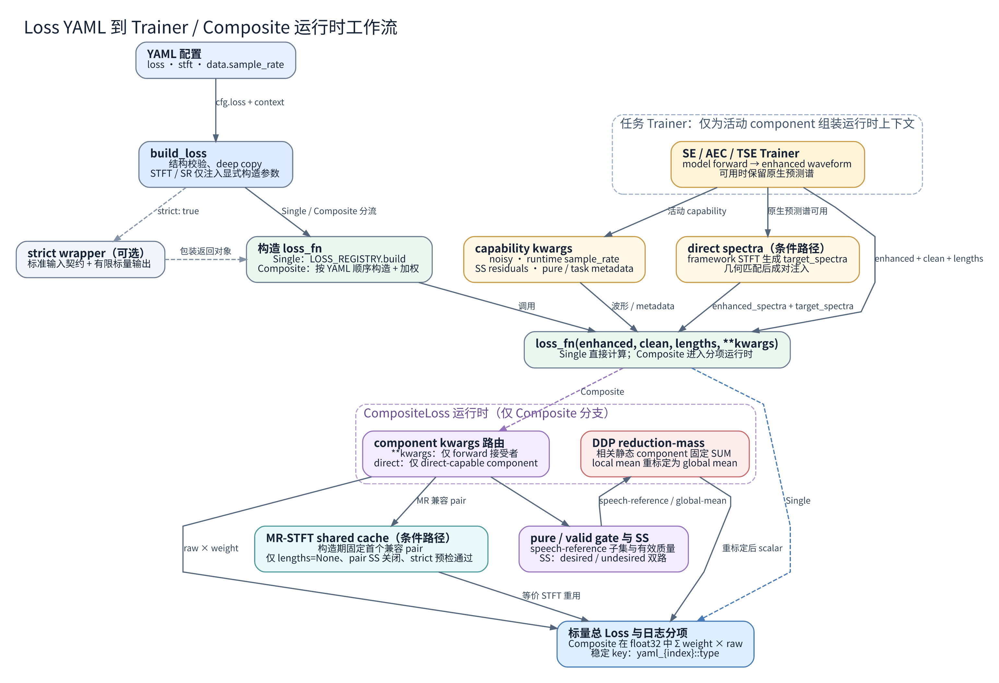

# Loss YAML / Trainer 配置契约

> **第一次配 loss 就先看这段。** 你只需要在 YAML 里写 `loss.type` / `loss.args` / `loss.strict`（组合目标再加 `components`），其余由框架补齐：`build_loss` 按 `type` 查注册表、注入顶层 `stft` 与 `data.sample_rate`，Trainer 再按 Loss 自己声明的 capability 传入波形、退化输入或模型原生谱。本页说明这条链路上的契约；各 Loss 的公式与逐项行为在专题页。想直接动手：从第 2 节抄 schema，第 9 节挑一个示例，第 10 节末尾跑验证命令（预期全部 pass）。

先认识几个贯穿全文的名词：

- **STFT 上下文**：STFT（short-time Fourier transform，把波形切成短帧再变换到频域）的六个参数 `n_fft` / `hop_length` / `win_length` / `window` / `center` / `normalized`。模型和支持注入的 Loss 共用顶层 `stft`，避免出现两套前端几何。
- **capability（能力声明）**：Loss 的类属性，声明它需要哪些额外输入，例如 `noisy` 退化波形、采样率、模型原生谱。Trainer 只向声明过的 Loss 传对应参数。
- **direct spectra**：模型直接输出的预测谱，不经“谱 → 波形 → 再 STFT”的往返，避免不一致预测谱被投影成一致谱。
- **DDP**：多卡数据并行训练；各进程必须执行完全相同的集合通信调用序列，否则会挂死。
- **reduction mass**：一条样本（或一帧）在全局平均的分母里占多少权重；DDP 下靠它把各卡的局部均值还原成全局均值。
- **pure gate**：样本被标成纯噪声 / 纯回声 / 纯回声加噪声时，只依赖干净语音参考的 component 会被路由到其余样本上计算。

本文是仓库中 **Loss YAML 结构、构建上下文与 Trainer 路由语义的唯一契约页**。它回答“配置如何写、框架实际传什么、哪些组合会被拒绝”，主体是 YAML、builder、Trainer capability、Composite、SS、DDP、direct spectra、cache 与可直接运行的生产配方；逐项公式、函数原理、优化意义、输入输出、mask/reduction/梯度边界分别见 [波形与通用频谱 Loss 手册](Waveform_and_Spectral_Losses.md)、[论文对照 Loss 指南](Paper_Aligned_Losses.md) 和 [任务与模型特定 Loss 实现参考](Task_and_Model_Specific_Losses.md)。

必要的论文边界仅保留严格一对一关系：[TAPLoss](../../paper/loss/CMU/01_TAPLoss.md)、[Loud-loss](../../paper/loss/IMU-SpeechLab/02_Loud-loss.md)、[MBRCL](../../paper/loss/Concordia/03_MBRCL.md) 三篇 canonical 分别只支撑对应实现。`SIL1WavSeTrainLoss`、`MRSIRelCspecL2Loss`、`MRSpecSuppressPenaltyLoss`、SS desired/undesired 双路能量混合，以及三项均启用 component-level SS 的完整三项组合配方均为**用户自研**，不得归因于 se_train、论文、CAGCRN、DeepVQE 或 MBRCL。运行契约以 [`core/losses/`](../../../core/losses/)、[`build_loss`](../../../core/losses/build.py) 和 Trainer 实现为准。

## 1. 当前构建边界

训练入口的实际调用是：

```python
loss_fn = build_loss(
    cfg["loss"],
    stft_cfg=cfg.get("stft"),
    sample_rate=cfg["data"].get("sample_rate"),
)
```

对应源码：[`core/trainer/entry.py`](../../../core/trainer/entry.py#L1544-L1549)、[`core/losses/build.py`](../../../core/losses/build.py#L421-L524)。

### 仓库工作流图：YAML 到 Composite 运行时



- **类型**：`generated-method`（仓库工作流图）；**后端**：Graphviz DOT（布局与 SVG）+ `.kimi-code/tools/resvg`（PNG）；**evidence mode**：repository-grounded。
- **事实来源**：构建分流与 STFT/SR 注入见 [`core/losses/build.py`](../../../core/losses/build.py#L421-L524)；任务侧 capability kwargs 与 direct spectra 组装见 [`core/trainer/metrics_trainer.py`](../../../core/trainer/metrics_trainer.py#L77-L242)、[`tasks/se/trainer/metrics_trainer.py`](../../../tasks/se/trainer/metrics_trainer.py#L67-L89)、[`tasks/aec/trainer/aec_trainer.py`](../../../tasks/aec/trainer/aec_trainer.py#L153-L196)、[`tasks/tse/trainer/tse_trainer.py`](../../../tasks/tse/trainer/tse_trainer.py#L1148-L1181)；Composite 的 component 路由、DDP reduction-mass 和 MR-STFT cache 门控见 [`core/losses/composite.py`](../../../core/losses/composite.py#L377-L897)。
- **边界**：解释图，非论文原图；虚线表示 optional strict wrapper 或仅适用于 Composite 的分支，标记为“条件路径”的节点只在 capability 或运行条件满足时启用。
- **可复现源**：[Graphviz DOT](../../diagrams/loss_composite_runtime.dot)；[SVG](../../diagrams/loss_composite_runtime.svg)。执行 `dot -Tsvg <dot> -o <svg>`，再以 `.kimi-code/tools/resvg --sans-serif-family "Noto Sans CJK SC" --monospace-family "Noto Sans Mono CJK SC" --languages zh-CN --zoom 2 <svg> <png>` 生成 PNG；本图不使用 ArchScope，固定来源 `HaozheZhang6/archscope@04bae8488aa30fb694c9c14abc35e6f4d8900328` 不适用。

注册集合以当前 `import core.losses` 后的 `LOSS_REGISTRY` 为准；`TAPLoss` 与 `AcousticLoss` 共享同一实现，`CompositeLoss` 由 builder 特判而不注册。新增损失会改变总数，可用以下命令核对：

```bash
python -c "import core.losses; from core.utils.registry import LOSS_REGISTRY as R; ks=tuple(R.keys()); vs=[R.get(k) for k in ks]; print(len(ks), len({id(v) for v in vs}), R.get('TAPLoss') is R.get('AcousticLoss'), 'CompositeLoss' in ks)"
```

动态 TSE 只要在 `data.train.simulation_cfg` 里把 `prob_interference_only` / `prob_noise_only` / `prob_interference_noise_only` 任一项设为大于 0（即启用无目标场景），entry 就要求 `AbsentTargetLoss` 或 `L1WavLoss` 至少有一项权重非零。仅有 `SISNRLoss` 时零 target 不提供抑制梯度；现役模板将 `AbsentTargetLoss` 与 SI-SNR 组合。公式与 lengths mask 见 [静音目标 Loss](Waveform_and_Spectral_Losses.md#25-absenttargetloss)，数据场景见 [多源仿真](../simulation/Multi_Source_Simulation.md)。

本页只覆盖标准 `build_loss` / `self.loss_fn` 路径。`MPSEnetCompositeLoss` 等模型专用 objective 即使已注册，也可能采用非标准 `forward_dict` 签名；`MetricGANCompositeTrainer`、adapter distillation 等自行维护 objective 的 Trainer 不能仅靠修改本页所示 YAML 自动接入标准波形 Loss。

## 2. YAML schema

### 2.1 单一 Loss

```yaml
loss:
  type: L1WavLoss
  args: null
  strict: true
```

顶层仅允许：

| 键 | 必需 | 语义 |
|---|---:|---|
| `type` | 是 | `LOSS_REGISTRY` 中的精确注册名。空值或未知名称在 registry 查找时失败。 |
| `args` | 否 | 构造参数 mapping；省略或 `null` 等价于 `{}`。list、string、number、bool 均拒绝。 |
| `strict` | 否 | 当前经 `bool(...)` 解释；YAML 必须写未加引号的 `true` / `false`。字符串 `"false"` 非空，会被解释为 `true`。 |

`weight`、`components`、`name`、`enable_ss_undesired_energy` 不是单一 Loss 顶层键。结构层未知键会立即报 `KeyError`；例如 `arg` 会提示接近的 `args`。`args` 内部不是任意扩展区：它原样进入目标类构造函数，未知参数通常由显式 Python 签名报 `TypeError`；只有目标类明确接收的参数才合法。

结构验证见 [`_validate_single_loss_config`](../../../core/losses/build.py#L314-L329)，回归测试见 [`tests/test_loss_build.py`](../../../tests/test_loss_build.py#L456-L520)。

### 2.2 `CompositeLoss`

```yaml
loss:
  type: CompositeLoss
  strict: true
  enable_ss_undesired_energy: false
  components:
    - type: L1WavLoss
      name: waveform-l1
      weight: 1.0
      args: null
      enable_ss_undesired_energy: false
```

Composite 顶层仅允许：

| 键 | 必需 | 语义 |
|---|---:|---|
| `type` | 是 | 必须为 `CompositeLoss`。 |
| `components` | 是 | 非空 list；每项必须是 mapping。 |
| `strict` | 否 | 当前经 `bool(...)` 解释；控制 Composite 的严格数值检查，并由外层 strict wrapper 再校验标准输入/标量输出。YAML 必须写未加引号的 `true` / `false`；字符串 `"false"` 会被解释为 `true`。 |
| `enable_ss_undesired_energy` | 否 | Composite 级 SS 默认值，省略为 `false`；当前经 `bool(...)` 解释。YAML 必须写未加引号的 `true` / `false`；字符串 `"false"` 会被解释为 `true`。 |

每个 `components[]` 仅允许：

| 键 | 必需 | 默认 | 语义 |
|---|---:|---:|---|
| `type` | 是 | — | registry 精确名称。 |
| `weight` | 否 | `1.0` | 转为 `float` 的有限数；允许正数、负数和零。 |
| `args` | 否 | `{}` | 构造参数 mapping；`null` 等价于 `{}`。 |
| `name` | 否 | `type` | 仅在 console display mapping 缺失时作为可读显示标签的 fallback；不改变注册查找、数学定义或稳定日志 key。 |
| `enable_ss_undesired_energy` | 否 | 继承顶层 | 覆盖当前 component 的 SS 行为；当前经 `bool(...)` 解释。YAML 必须写未加引号的 `true` / `false`；字符串 `"false"` 会被解释为 `true`。 |

结构层未知键全部 fail-fast，例如 `weights` 会提示 `weight`。权重不会做 softmax、绝对值化或和为一归一化；总值严格为各项 `weight × raw_loss` 的求和。至少一个权重必须非零，全零或任一 NaN/Inf 权重在构造期拒绝。零权重 component 保留静态拓扑和必要的 DDP collective 顺序，但不调用其 capability callback 或 `forward`。

Composite 配置会先深拷贝，再注入 STFT/SR 上下文，不会回写调用方原 dict。稳定分项日志 key 为 `yaml_{index:03d}::{type}`；`name` 仅在对应 `type` 没有 console display mapping 时作为显示 fallback，不会改写该稳定 key。实现见 [`core/losses/composite.py`](../../../core/losses/composite.py#L377-L446)，测试见 [`tests/test_composite_loss.py`](../../../tests/test_composite_loss.py#L141-L225) 与 [`tests/test_loss_build.py`](../../../tests/test_loss_build.py#L456-L542)。

## 3. `strict` 的真实语义

若 `trainer.strict_checks` 为真且 `loss.strict` 未显式出现，训练入口会自动写入 `loss.strict: true`；若 YAML 已显式写 `false`，入口不会覆盖。默认 Trainer 配置因此通常启用 strict，但 `build_loss` 独立调用的默认值仍是 `false`。

单一 Loss 的 strict wrapper 对标准波形调用检查：

- `enhanced`、`clean` 必须是同 shape 的 `[B, T]` Tensor；
- `lengths` 若存在，必须为 `[B]` 整数 Tensor，且每项位于 `[1, T]`；
- 返回值必须是零维 Tensor，且有限。

对 AEC dict 风格调用，wrapper 要求 `mic`、`nearend`、`nearend_estimate` 存在、为 Tensor 且有限。Composite 自身还会检查传入的浮点/复数输入和每个 component 输出是否有限。

在 DDP 下，Composite 的 component 异常或 strict NaN/Inf 会延迟到该轮固定 collective 序列结束，再同步失败状态，使各 rank 以一致错误退出。`strict` 不改变 Loss 公式，不替代各 Loss 自己的 dtype、shape、参数范围或 checkpoint 校验。

实现与测试：[`core/losses/build.py`](../../../core/losses/build.py#L27-L226)、[`core/losses/composite.py`](../../../core/losses/composite.py#L518-L897)、[`tests/test_composite_loss.py`](../../../tests/test_composite_loss.py#L227-L249)、[`tests/test_composite_loss_ddp.py`](../../../tests/test_composite_loss_ddp.py#L392-L470)。

## 4. 顶层 STFT 上下文

### 4.1 六项有效参数

模型与支持注入的 Loss 共用顶层 `stft` 上下文。完整有效参数只有六项：

```yaml
stft:
  n_fft: 512
  hop_length: 256
  win_length: 512
  window: hann
  center: true
  normalized: false
```

| 键 | 解析规则 |
|---|---|
| `n_fft` | 必填的精确正整数。 |
| `hop_length` | 必填的精确正整数。 |
| `win_length` | 省略时为 `n_fft`；必须为精确正整数。 |
| `window` | 省略时为 `hann`；只接受 `hann` / `hamming`，解析后小写。 |
| `center` | 省略时为 `true`；必须是 bool。 |
| `normalized` | 省略时为 `false`；必须是 bool；同时约束 STFT 与 iSTFT。 |

有效几何必须满足 `hop_length <= win_length <= n_fft`，并通过当前 PyTorch iSTFT 的 NOLA 边界检查。`center: false` 时要求 `win_length == n_fft`，且不允许 periodic Hann；窗口平方的 hop-residue overlap envelope 最小值必须大于 `1e-11`。`stft` 中六项之外的未知键由 Loss builder 拒绝。

解析实现在 [`core/stft.py`](../../../core/stft.py#L100-L170) 和 [`resolve_stft_config`](../../../core/stft.py#L284-L298)。构建期覆盖见 [`tests/test_loss_build.py`](../../../tests/test_loss_build.py#L78-L242)。

### 4.2 注入规则

`build_loss` 只向构造函数**显式声明并接受**的 STFT 参数注入值；仅有 `**kwargs` 不构成注入契约。普通 STFT-aware Loss 使用 `setdefault`：component `args` 中显式值优先，未写的参数才继承顶层上下文。显式 `center` 与 framework `center` 不同时，普通 Loss 保留显式值并记录 warning。

声明 `REQUIRES_MATCHING_STFT_CONTEXT = True` 的 Loss 不允许形成第二套前端：只要顶层上下文提供了该 Loss 显式接受的参数，`args` 中同名值必须与顶层**有效值**一致，否则构建期 fail-fast；`window` 比较不区分大小写。当前该契约适用于：

- `MultiBandRelativeContrastiveLoss`：匹配 `n_fft`、`hop_length`、`win_length`、`window`、`center`。它当前构造签名**不接收 `normalized`**，内部 `torch.stft` 采用 PyTorch 默认 `normalized=False`；因此不要把顶层 `normalized: true` 误写成 MBRCL 已同步归一化。
- `GTCRNCompressedSpectralLoss`：匹配全部六项，包括 `normalized`。
- `GTCRNLogRatioLoss`：匹配全部六项，包括 `normalized`。

固定 estimator 几何的 Loss 可声明 `USE_FRAMEWORK_STFT_DEFAULTS = False` 完全退出注入；`TAPLoss` / `AcousticLoss` 即如此。

实现见 [`_inject_stft_defaults`](../../../core/losses/build.py#L378-L413)、[`MultiBandRelativeContrastiveLoss`](../../../core/losses/mbrcl.py#L16-L122) 与 [GTCRN 两项实现](../../../core/losses/hybrid.py#L146-L370)。matching-context 测试见 [`tests/test_loss_build.py`](../../../tests/test_loss_build.py#L245-L425)。

## 5. sample-rate 上下文与别名

`data.sample_rate` 的非空值必须是正整数。Loss builder 按以下固定顺序，向构造函数显式声明的第一个别名注入：

```text
sample_rate -> sampling_rate -> sr -> fs
```

规则如下：

1. `args` 已显式包含任一 SR alias 时，普通 Loss 保留显式值，不再注入第二个 alias。
2. 显式 alias 自身也必须是正整数；不要同时填写多个 alias，目标构造函数仍会按真实签名校验。
3. 只接收 `**kwargs` 的类不会因此获得 sample rate。
4. 声明 `REQUIRES_MATCHING_STFT_CONTEXT` 的 MBRCL 在顶层 SR 非空时要求显式 SR 与其相等；冲突立即失败。
5. 声明 `REQUIRED_SAMPLE_RATE` 的 TAP 在构建上下文阶段校验固定值 `16000`。
6. `data.sample_rate` 缺失或显式为 `null` 时，传给 `build_loss` 的构造期上下文都是 `None`，该调用点不补 `16000`。Trainer 自身只在键缺失时保留历史 16 kHz fallback；键存在且为 `null` 仍表示未知。

标准 SE/AEC/TSE Trainer 与基础 GAN/PASEGAN reconstruction 路径会对活动且声明 `REQUIRES_SAMPLE_RATE` 的 Loss，在每个 forward 传入实际 batch SR。该 runtime SR 覆盖 MBRCL 构造期 SR。一个 batch 内必须是单一 SR；连续 batch 可变化。

实现与测试：[`_inject_sample_rate`](../../../core/losses/build.py#L337-L377)、[`_waveform_loss_kwargs`](../../../core/trainer/metrics_trainer.py#L128-L158)、[`tests/test_loss_build.py`](../../../tests/test_loss_build.py#L545-L645)、[`tests/test_composite_loss_kwargs.py`](../../../tests/test_composite_loss_kwargs.py#L186-L289)。

## 6. Trainer capability kwargs

Trainer 不向所有 Loss 无差别喷洒额外参数，而是按**活动 component**的 capability 组装上下文；活动表示权重非零。单一 Loss 直接读取 capability，strict wrapper 会先解包到内层 Loss。

| capability / 协议 | Trainer / Composite 行为 |
|---|---|
| `REQUIRES_NOISY_REFERENCE` | 注入任务原始退化波形 `noisy`。 |
| `REQUIRES_SAMPLE_RATE` | 注入当前 batch 的实际 `sample_rate`。 |
| `REQUIRES_SPEECH_REFERENCE` | 参与 pure gate、有效参考 mask 与 DDP reduction-mass 协议。 |
| `SUPPORTS_DIRECT_SPECTRA` | 在模型提供原生预测谱时注入 `enhanced_spectra` 与 framework 生成的 `target_spectra`。 |
| `SUPPORTS_SS_UNDESIRED_ENERGY = False` | effective SS 为真时构造期拒绝。 |
| `speech_reference_valid_mask(...)` | 声明 component 自身可参与 speech-reference mean 的样本。 |
| `speech_reference_reduction_mass(...)` | 声明每条有效样本在局部 mean 分母中的质量。 |
| `ddp_global_mean_mass(...)` | 声明非 speech-reference component 的全局 mean 分母质量。 |

Composite 对普通额外 kwargs 的路由规则是：component `forward` 显式接收 `**kwargs` 才获得通用 kwargs；direct-spectrum component 即使没有 `**kwargs`，也只会获得其协议内的 `enhanced_spectra` / `target_spectra`。这可以避免无关 component 因多余参数失败，也意味着新 capability 必须在 Trainer 与 Loss 两侧明确实现，不能仅在 YAML 中发明键。

DeepFilterNet 的 `predicted_lsnr` 还有额外 Trainer gate：**训练时**仅当 `trainer.use_lsnr_loss: true`、模型声明支持 `return_lsnr`、且外层 Loss `forward` 显式接收 `predicted_lsnr` 或 `**kwargs` 三者同时成立，SE Trainer 才请求模型返回并向 Loss 注入 LSNR；`CompositeLoss.forward` 有 `**kwargs`，因此满足第三项，是否真正消费由其活动 component 决定。需要 alpha 时还要求活动 Loss 需要 `predicted_alpha` 且模型支持 `return_alpha`。**验证时**固定以 `return_lsnr=false, return_alpha=false` 前向，也不注入二者，因此训练/验证 objective 不对称：含活动 `DeepFilterNetLSNRComponent` / `DfAlphaLossComponent` 的 Composite 在标准验证路径会因缺少必需预测量失败；`DeepFilterNetFullLossWithLSNR` 则退化为不含 LSNR/alpha 辅助项的 enhancement loss。`use_lsnr_loss` 不是 Loss YAML capability，也不会仅凭 Loss 类型自动开启。

任务及 residual 映射为：

| 任务 | 退化输入 `x` | desired reference `s` | enhanced `ŝ` | undesired reference `x-s` | undesired estimate `x-ŝ` |
|---|---|---|---|---|---|
| SE | `noisy` | `clean` | `enhanced` | `noisy - clean` | `noisy - enhanced` |
| AEC | `mic` | `nearend` | `nearend_estimate` | `mic - nearend` | `mic - nearend_estimate` |
| TSE | `mixture` | `target` | `target_estimate` | `mixture - target` | `mixture - target_estimate` |

这里的 residual 只由上述差值定义，**不要求是纯噪声或纯回声**：它可以包含混合干扰、回声、噪声、非目标说话人、失真或 reference/model mismatch。第 9.5 节唯一生产配方是 **AEC**；SE/TSE 行仅说明共享 Trainer helper 的运行映射。TSE multi-target 使用按 target row 展开的 mixture，enrollment 不作为 MBRCL negative anchor。

源码边界：[`core/trainer/metrics_trainer.py`](../../../core/trainer/metrics_trainer.py#L77-L242)、[`tasks/se/trainer/metrics_trainer.py`](../../../tasks/se/trainer/metrics_trainer.py#L67-L89)、[`tasks/aec/trainer/aec_trainer.py`](../../../tasks/aec/trainer/aec_trainer.py#L153-L196)、[`tasks/tse/trainer/tse_trainer.py`](../../../tasks/tse/trainer/tse_trainer.py#L1148-L1181)。

## 7. Composite 运行时语义

`CompositeLoss` 统一负责 component 构建与加权、capability/kwargs 路由、pure/valid gate、reduction mass、DDP 重标定、MR-STFT cache 和分项日志。第 7.3 节机制与第 9.5 节完整配方仍属于用户自研。

### 7.1 pure gate

`is_pure_noise`、`is_pure_echo`、`is_pure_echo_noise` 若提供，必须是 `[B]` Tensor；Composite 转为 bool 后按位 OR。声明 `REQUIRES_SPEECH_REFERENCE` 的 component 只在三者均为假的样本上计算，并继续应用 component 自身的有效参考 guard。三项都未提供时，不执行 metadata gate，但 component 自身 guard 仍可生效。

当前 MBRCL 和 `GTCRNCompressedSpectralLoss` 不依赖非零 speech reference，始终走 full batch；`GTCRNLogRatioLoss`、TAP、SI-SNR 等 speech-reference component 走 non-pure 子集。全局没有有效 speech-reference 质量时返回与模型图连接的零，不返回 detached 常量。

pure gate 是样本路由，不会改变任何 Loss 的内部公式。各 Loss 的 speech-reference 与零参考边界见 [论文对照 Loss 指南](Paper_Aligned_Losses.md) 和 [任务与模型特定 Loss 实现参考](Task_and_Model_Specific_Losses.md)。测试见 [`tests/test_composite_loss.py`](../../../tests/test_composite_loss.py#L277-L405) 与 [`tests/test_core_losses_audit_regressions.py`](../../../tests/test_core_losses_audit_regressions.py)。

### 7.2 DDP reduction mass

每个静态 speech-reference component 在所有 rank 上固定执行一次 scalar SUM collective；即使本 rank 无有效样本，或该 component 权重为零，也保持相同调用序列。活动 component 的局部均值按真实质量重标定：

```text
scaled_local_loss = local_loss * world_size * local_mass / global_mass
```

DDP 随后对参数梯度取 rank mean，最终等价于全局有效质量 mean。默认 `local_mass` 是有效样本数；按帧或元素归约的 Loss 应提供 `speech_reference_reduction_mass`。TAP 的兼容路径使用有效帧数。`global_mass == 0` 时返回 graph-connected zero。`ddp_global_mean_mass` 采用同一缩放协议，供 State/Speaker CE 等按有效标签或帧归约的 component 使用。

这里的分母不会被 `clamp(min=1)` 改写；合法的小数质量也按真实值归一化。实现与两 rank 梯度 oracle 见 [`core/losses/composite.py`](../../../core/losses/composite.py#L124-L219) 和 [`tests/test_composite_loss_ddp.py`](../../../tests/test_composite_loss_ddp.py)。

### 7.3 SS undesired-energy

`SS` 是仓库历史键名 `enable_ss_undesired_energy` 中保留的标识；当前没有可核验的英文展开，不应扩写或解释为声纹、speaker similarity，也不表示通用 speech separation。开关可在 Composite 顶层设置默认值，也可由 component 显式覆盖。对 effective SS 为真的普通 component，第 `b` 条样本使用：

```text
E_target[b]    = sum(valid samples of clean[b]^2)
E_undesired[b] = sum(valid samples of undesired_ref[b]^2)
a[b] = E_target[b] / (E_target[b] + E_undesired[b] + 1e-8)
L_ss[b] = a[b] * L(enhanced[b], clean[b])
        + (1 - a[b]) * L(undesired_enhanced[b], undesired_ref[b])
L_ss = mean_b(L_ss[b])
```

标准 SE/AEC/TSE Trainer 通过共享 helper 按第 6 节映射组装：

```text
undesired_ref      = x - s
undesired_enhanced = x - ŝ
```

因此 SE 是 `noisy - clean` / `noisy - enhanced`，AEC 是 `mic - nearend` / `mic - nearend_estimate`，TSE 是 `mixture - target` / `mixture - target_estimate`。这些 residual 是由输入、目标和同一个模型增强结果做差得到的监督量，不是独立输出头，也不必是纯噪声或纯回声。以 AEC 为例：

```text
undesired_enhanced
  = mic - nearend_estimate
  = undesired_ref + (nearend - nearend_estimate)
```

若把 desired 分支的时域误差写为 `nearend_estimate - nearend`，undesired 分支误差就是 `(mic-nearend_estimate) - (mic-nearend) = nearend - nearend_estimate`，两者互为相反数；SS 改变的是两路 Loss 的能量加权与各 Loss 的非线性/归约，不增加第二个预测头。手工调用时也可直接提供两路 residual；只给 `noisy` 时 Composite 可推导 `undesired_ref`，但仍需要 `undesired_enhanced`，shape 必须分别匹配 `clean` / `enhanced`。

上述 desired/undesired 双路能量混合机制，以及 `SIL1WavSeTrainLoss`、`MRSIRelCspecL2Loss`、`MRSpecSuppressPenaltyLoss` 和“三项均设置 `enable_ss_undesired_energy: true`”的一份完整三项组合配方，均为**用户自研**；不得归因于 se_train、论文、CAGCRN、DeepVQE 或 MBRCL。

只要提供任一 pure metadata，speech-reference component 优先走 non-pure gate，不执行该 component 的 SS 混合；不依赖 speech reference 的 component 仍按 effective SS 执行。MBRCL 与 TAP/AcousticLoss 明确不支持 SS，effective SS 为真时构造失败。direct spectra 与 SS 的冲突是**调用级**约束：只要本次调用出现 `enhanced_spectra` 或 `target_spectra` 任一 direct key，活动且 direct-capable component 的 effective SS 为真就先 fail-fast；不会等到两键成对校验。没有任一 direct key 时，该 component 走 waveform adapter，SS 可正常执行。

行为证据：[`_composite_ss_undesired_kwargs`](../../../core/trainer/metrics_trainer.py#L87-L112)、[`_ss_energy_a`](../../../core/losses/composite.py#L356-L376)、[`CompositeLoss.forward`](../../../core/losses/composite.py#L518-L897)、[`tests/test_composite_loss.py`](../../../tests/test_composite_loss.py#L407-L500)、[`tests/test_composite_loss_kwargs.py`](../../../tests/test_composite_loss_kwargs.py)、[`tests/test_gtcrn_direct_spectrum_loss.py`](../../../tests/test_gtcrn_direct_spectrum_loss.py#L245-L274)。

### 7.4 direct spectra

`loss_enhanced_spectra` 不是统一的模型输出字段，而是部分 Trainer 内部保存原生预测谱的中转键。模型只需遵守各任务既有输出契约：SE 直接谱模型返回预测谱 Tensor，由 SE Trainer 缓存在 `_last_model_enhanced_spectra`；AEC dict 输出 `nearend_estimate_spectra`；TSE dict 输出 `target_estimate_spectra`；GAN forward dict 使用 `enhanced_spec`，后三者由各自 Trainer 转存为 `loss_enhanced_spectra`。Trainer 在波形解码或 sanitize 前保留这些原生谱，再交给 direct-loss helper；模型无需额外输出 `loss_enhanced_spectra`。

标准 Trainer 随后可为活动的 `SUPPORTS_DIRECT_SPECTRA` component 构造 direct 上下文：

1. 使用同一个 framework STFT 和真实 `lengths` 生成 trim-consistent `target_spectra`；
2. 将 target frame 数裁到模型 prediction frame 数；target frame 不足则失败；
3. 逐项校验 Loss 与 framework 的 `n_fft`、`hop_length`、`win_length`、`center`、`window`、`normalized` 完全一致；
4. 只向 direct-capable component 路由两路谱。

标准 Trainer 的 helper 只有拿到原生预测谱后才继续，并且总是同时生成、注入 `enhanced_spectra` 与 `target_spectra`，所以标准路径不会产生单键调用；“任一 direct key 先触发 SS/direct 冲突”主要约束手工调用或其他调用方。SS 关闭时，单键调用随后由具体 direct-capable Loss 的成对校验拒绝。当前 GTCRN 两项支持该协议，但 direct 路径不同：

- `GTCRNCompressedSpectralLoss` 直接消费 raw `enhanced_spectra` / `target_spectra` 并在原生谱上归约，不执行 iSTFT，因此也避免不一致预测谱先经 `iSTFT -> STFT` 投影。
- `GTCRNLogRatioLoss` 才会按有效 frame count 分组裁剪，并按 framework STFT 几何、普通 Hann/Hamming 窗及同一 `normalized` 设置执行 iSTFT，再在重建波形上计算既有 log-ratio 目标。

完全没有 direct key 时，两项保留 waveform adapter；此时 effective SS 可正常执行。只要有任一 direct key，direct 路径没有 undesired prediction/reference spectra，因此 SS/direct 冲突必须先于 direct 两键成对性检查失败。

源码与测试：[`_direct_spectral_loss_kwargs`](../../../core/trainer/metrics_trainer.py#L159-L242)、[`core/losses/hybrid.py`](../../../core/losses/hybrid.py#L146-L542)、[`tests/test_gtcrn_direct_spectrum_loss.py`](../../../tests/test_gtcrn_direct_spectrum_loss.py)。

### 7.5 MR-STFT shared cache

MR-STFT cache 采用构造期选对、forward 期门控的两阶段策略。构造期按 YAML 顺序扫描，只固定**第一对**同时满足以下静态条件的 component：

- 两者暴露顺序完全一致的 canonical `fft_sizes` / `hop_sizes`，或可解析为同一 legacy power-of-two / half-hop schedule；
- 两者 `forward` 显式接受 `stft_cache`。

forward 不会重新选择 pair，只对构造期固定的 pair 检查：

- 本次 `lengths is None`；
- 该 pair 两项的 effective SS 均关闭；
- strict 输入预检没有先发现错误。

三项都满足才生成并共享 cache。已选 pair 因 `lengths`、SS 或 strict 预检等条件不能缓存时，本次调用直接不使用 shared cache，**不会继续搜索后续 pair**。

cache 固定为 Hann、`win_length=n_fft=fft_size`、`center=True`、`onesided=True`、FP32，布局为 `(B, F, frames, 2)`。signature 包含 resolution 顺序，但不包含 `align_se_train`；使用其他窗口、布局或语义的 component 不得冒充兼容。第三个及之后即使 schedule 相同也不会加入已固定的首对 cache，也不会成为运行时 fallback。提供 `lengths` 时，为保证 padding/trim 一致性，各 component 自行重算；SS 逐样本分支也不共享 cache。

这套 MR cache 与 MBRCL 的 per-SR Mel hard-band cache 是两套独立机制。实现与值/梯度 oracle：[`_mr_cache_signature`](../../../core/losses/composite.py#L270-L329)、[`_find_mr_cache_pair`](../../../core/losses/composite.py#L469-L485)、[`tests/test_composite_loss_mr_cache.py`](../../../tests/test_composite_loss_mr_cache.py)。

## 8. 特殊 Loss 的配置边界

本节只记录会改变 YAML/Trainer 行为的特殊契约；精确公式、优化意义、输入输出与梯度边界见 [论文对照 Loss 指南](Paper_Aligned_Losses.md)。

### 8.1 MBRCL

注册名：`MultiBandRelativeContrastiveLoss`。构造与 forward 签名见 [`core/losses/mbrcl.py`](../../../core/losses/mbrcl.py#L16-L43) 和 [`forward`](../../../core/losses/mbrcl.py#L298-L418)。

配置约束：

- 必须获得 `n_fft` 与 `hop_length`；生产路径应继承顶层 STFT，不在 `args` 复制第二套几何。
- STFT matching context 覆盖其构造签名中的五项，不含 `normalized`；详见 4.2 节。
- 构造期 SR 可为 `None`，但 forward 必须从构造值或 Trainer runtime context 得到正整数 SR。
- 需要 `noisy` negative anchor；标准 SE/AEC/TSE 与基础 GAN/PASEGAN reconstruction 路径按 capability 自动注入。
- 三路波形必须为同 shape、同 device 的浮点 `[B, T]`，dtype 可不同；内部统一 FP32。
- 不支持 SS；不参与 speech-reference pure gate，对含零 target 的 full batch 计算。零 target 的精确数值与驻点边界见 [MBRCL 卡片](Paper_Aligned_Losses.md#3-multibandrelativecontrastivelossmbrcl)。
- runtime SR 可跨 batch 变化；每个 SR 的 Mel hard-band matrix 以 canonical CPU FP32 形式线程安全缓存。构造期与 runtime matrix 都不进 `state_dict`；pickle/deepcopy 丢弃可重建 cache 与 lock，反序列化后按需重建。
- AEC/TSE 映射是项目 Trainer 的工程扩展；canonical 仅对应 MBRCL 本身。

必要参考：[MBRCL canonical 精读](../../paper/loss/Concordia/03_MBRCL.md)；实现与路由测试见 [`core/losses/mbrcl.py`](../../../core/losses/mbrcl.py) 和 [`tests/test_composite_loss_kwargs.py`](../../../tests/test_composite_loss_kwargs.py)。

### 8.2 GTCRN 两项显式 Composite

注册名：`GTCRNCompressedSpectralLoss`、`GTCRNLogRatioLoss`。仓库没有把二者藏进另一个未注册配方；需要两项时应在 `components` 中显式列出。

- 两项都要求全部六项 STFT matching context，并支持 direct spectra。
- `GTCRNCompressedSpectralLoss` 不声明 speech-reference dependency，pure 行仍在 full batch。
- `GTCRNLogRatioLoss` 声明 `REQUIRES_SPEECH_REFERENCE`，先经 pure gate，再经自身 clean-energy guard；全无效时返回 graph-connected zero。
- 两项共享同一 raw `(enhanced, clean, lengths)` 与同一 framework STFT context。不得给其中一项复制冲突几何。
- direct compressed 路径直接消费 raw spectra，不执行 iSTFT；只有 direct log-ratio 路径执行 iSTFT。官方 GTCRN 固定使用 sqrt-Hann，并由 `torch.istft` 执行窗包络归一化，并非手工无归一化 WOLA；项目则按 framework STFT 几何使用与 analysis 一致的普通 Hann/Hamming 合成窗，同样依赖 `torch.istft` 包络归一化。公式、`eps` 位置与官方来源边界见 [GTCRN 公式组件](Paper_Aligned_Losses.md#2-gtcrn-公式组件)。

实现与测试：[`core/losses/hybrid.py`](../../../core/losses/hybrid.py#L146-L542)、[`tests/test_loss_build.py`](../../../tests/test_loss_build.py#L78-L260)、[`tests/test_gtcrn_compressed_spectral_loss.py`](../../../tests/test_gtcrn_compressed_spectral_loss.py)、[`tests/test_gtcrn_direct_spectrum_loss.py`](../../../tests/test_gtcrn_direct_spectrum_loss.py)。

### 8.3 TAP 固定几何

`TAPLoss` 与 `AcousticLoss` 是同一个类的两个 registry 名称，项目统一调用顺序都是 `forward(enhanced, clean, lengths=None, *, mode="train")`，不是官方仓库的参数顺序。

其 estimator 输入契约固定为：

```text
sample_rate = 16000
n_fft = 512
hop_length = 160
win_length = 512
window = rectangular (ones)
center = True
normalized = False (torch.stft default)
```

这些值不会继承顶层 `stft`，也不是可调模型前端。`acoustic_model_path` 必填；生产配置应指向经 [`convert_taploss_official_checkpoint.py`](../../../tools/model_tools/convert_taploss_official_checkpoint.py) 转换的 tensor-only direct state dict。运行时使用项目安全 loader，estimator state 以 `strict=True` 校验，参数冻结并保持 eval，但 enhanced 路径仍可反传。TAP 只适用于 clean-speech reference，不支持 SS；若 Composite 顶层开启 SS，必须对 TAP component 显式覆盖为 `false`。

论文、官方实现与项目适配不能混称。完整 mode、归约与能量口径见 [TAPLoss canonical 精读](../../paper/loss/CMU/01_TAPLoss.md) 和 [TAPLoss / AcousticLoss 卡片](Paper_Aligned_Losses.md#4-taploss--acousticloss)；源码与测试见 [`core/losses/tap.py`](../../../core/losses/tap.py)、[`tests/test_taploss.py`](../../../tests/test_taploss.py)、[`tests/test_taploss_checkpoint_conversion.py`](../../../tests/test_taploss_checkpoint_conversion.py)。

## 9. 最小 YAML 示例

以下示例只证明配置与路由语义，不表达性能推荐，也不代表论文结果已在本项目复现。

### 9.1 单一波形 Loss

```yaml
loss:
  type: L1WavLoss
  strict: true
```

真实语义：构造 `L1WavLoss()`，Trainer 调用标准 `(enhanced, clean, lengths)`；无 Composite 权重、pure metadata gate、SS 或 direct-spectrum 路由。

### 9.2 显式 GTCRN pair

```yaml
stft:
  n_fft: 512
  hop_length: 256
  win_length: 512
  window: hann
  center: true
  normalized: false

loss:
  type: CompositeLoss
  strict: true
  components:
    - type: GTCRNCompressedSpectralLoss
      weight: 1.0
      args:
        compress_factor: 0.3
        lamda_ri: 30.0
        lamda_mag: 70.0
    - type: GTCRNLogRatioLoss
      weight: 1.0
```

真实语义：总值是不归一化的 `1.0 × compressed_spectral + 1.0 × log_ratio`。两项继承同一六项 STFT；谱进谱出 Trainer 可走 direct spectra。压缩谱项覆盖 full batch，log-ratio 项按 speech-reference gate 路由。

### 9.3 MBRCL capability 注入

```yaml
data:
  sample_rate: 16000

stft:
  n_fft: 512
  hop_length: 256
  win_length: 512
  window: hamming
  center: true
  normalized: false

loss:
  type: MultiBandRelativeContrastiveLoss
  strict: true
  args:
    num_bands: 16
    margin: 0.06
    eps: 1.0e-8
    band_weight: 0.5
    envelope_weight: 0.2
```

真实语义：标准 Trainer 根据 capability 注入任务退化输入与 runtime SR；MBRCL 的五项分析几何匹配顶层 context，内部 STFT 为 FP32 且 `normalized=False`。这些数值是当前实现默认值的显式展开，不是新的性能结论；论文报告与项目未验证边界见 [MBRCL canonical 精读](../../paper/loss/Concordia/03_MBRCL.md)。

### 9.4 Composite 顶层 SS 与 component 覆盖（教学例，非生产配方）

```yaml
loss:
  type: CompositeLoss
  enable_ss_undesired_energy: true
  components:
    - type: L1WavLoss
      weight: 2.0
    - type: SISNRLoss
      weight: 0.5
      enable_ss_undesired_energy: false
```

真实语义：L1 component 按第 7.3 节执行 desired/undesired 能量混合；SI-SNR component 只计算目标语音分支，并按 speech-reference pure gate 与 DDP 有效样本质量归约。总值严格为 `2.0 × L1_ss + 0.5 × SI-SNR`，不会除以 `2.5`。这是解释路由和不归一化权重的**教学例，不是当前生产配方**，数值也不是性能推荐。

### 9.5 当前生产配方卡片：AEC 三项 component-level SS

以下代码块逐项抄自当前生产配置 [`deepvqe_small_32k_10ms_delay80ms_loss_mr_si_l1_ss.yaml`](../../../configs/aec/microsoft_challenge/deepvqe/deepvqe_small_32k_10ms_delay80ms_loss_mr_si_l1_ss.yaml#L619-L644) 的活动 `loss` 块，可直接复制：

```yaml
loss:
  type: CompositeLoss
  strict: false
  components:
    - type: SIL1WavSeTrainLoss
      weight: 1.0
      name: SI-L1_wav
      enable_ss_undesired_energy: true
    - type: MRSIRelCspecL2Loss
      weight: 1.0
      name: MR-SI-Rel
      enable_ss_undesired_energy: true
      args:
        fft_power_min: 6
        fft_power_max: 11
        alpha_rel_L2: 1.0
        use_frequency_weight: true
        align_se_train: true
    - type: MRSpecSuppressPenaltyLoss
      weight: 1.0
      name: MR-Suppress
      enable_ss_undesired_energy: true
      args:
        fft_power_min: 6
        fft_power_max: 11
        align_se_train: true
```

这张卡片的运行契约是：

- `strict: false`；三项 `weight` 均为 `1.0`，总值不做权重归一化。
- 三个 component **各自**显式写 `enable_ss_undesired_energy: true`，不是依赖 Composite 顶层默认值；当前生产实例由 `AECTrainer` 注入 `mic - nearend` 与 `mic - nearend_estimate` 两路 residual。
- `MRSIRelCspecL2Loss` 使用 `alpha_rel_L2: 1.0`、`use_frequency_weight: true`；`MRSIRelCspecL2Loss` 与 `MRSpecSuppressPenaltyLoss` 都使用 legacy `fft_power_min/max: 6..11`，即 `fft_sizes=[64,128,256,512,1024,2048]`、各档 `hop=fft_size/2`。这些是绝对 sample 数，不随顶层 STFT 或采样率缩放。
- `MRSIRelCspecL2Loss` 的 `align_se_train: true` 只影响 `lengths is None` 时的 clean-power 低能量规则：仅把 `<1e-20` 的均值替换为 `0.5`；Trainer 当前恒传 `lengths`，实际走有效帧 masked mean 后 `clamp(min=0.5)`，此时该开关不改变结果。`MRSpecSuppressPenaltyLoss` 的同名参数仅为构造兼容位，当前 forward 不读取它，因此写 `false` 会在构造期被显式拒绝（`MRSIRelCspecL2SuppressPenaltyLoss` 不把该开关转发给 penalty 子项）。
- `lengths` 存在且三项 SS 都开启，因此每个 SS component 按样本分别计算 desired/undesired 两路；开启 SS 的 MR component 不使用 MR-STFT shared cache。这是既有运行边界，不应为了缓存改写开关、schedule 或归约。

这是本文唯一生产 recipe：三个 Loss、三项参数和三项 component-level SS 组合整体均为**用户自研**；`deepvqe` 只是承载该 objective 的 AEC 配置路径，不构成 DeepVQE、se_train、论文、CAGCRN 或 MBRCL 归因。实现边界见 [`time_domain.py`](../../../core/losses/time_domain.py#L16-L38)、[`se_train_mr.py`](../../../core/losses/se_train_mr.py#L167-L376) 与 Trainer residual helper [`metrics_trainer.py`](../../../core/trainer/metrics_trainer.py#L87-L133)。

## 10. 配置核对清单

提交或启动实验前，只核对契约事实：

- `loss.type` 是 registry 精确名称，或 builder 特判的 `CompositeLoss`；当前清单见文档中心，Composite 不注册。
- 单一 Loss、Composite 顶层、component 三层没有混放键；所有 `args` 为 mapping 或 `null`。
- Composite 权重按原值求和且至少一项非零；不要假设自动归一化。
- 顶层 STFT 明确六项有效语义，尤其不要遗漏对 direct spectra 有数值影响的 `normalized`。
- MBRCL 与 GTCRN matching-context component 没有私有冲突几何；MBRCL 不支持 `normalized=True` 同步语义。
- SR alias 只写目标构造函数接受的一个名称；固定 SR 或 matching-context 冲突会 fail-fast。
- 需要 noisy、sample rate、state、speaker label 或 direct spectra 的 component 确实由所选 Trainer 的活动 capability 路径供给；DeepFilterNet LSNR 训练还需显式 `trainer.use_lsnr_loss: true`，验证不注入 LSNR/alpha。
- pure gate、SS 与 direct spectra 的组合符合第 7 节；TAP/MBRCL 不启用 SS；任一 direct key 都先触发 direct-capable component 的 SS 冲突，标准 Trainer 则总是成对注入两键。
- DDP 中自定义 mean component 声明正确 reduction mass，所有 rank 保持同一静态 component 拓扑。
- MR shared cache 仅视为等价计算优化：构造期按 YAML 顺序固定首个 schedule/signature 匹配 pair，forward 只门控该 pair，不能缓存时不搜索后续 pair；不得据此修改 Loss schedule、window 或 reduction。

局部验证入口：

```bash
python -m pytest -m unit \
  tests/test_loss_build.py \
  tests/test_composite_loss.py \
  tests/test_composite_loss_kwargs.py \
  tests/test_composite_loss_mr_cache.py \
  tests/test_gtcrn_direct_spectrum_loss.py \
  tests/test_taploss.py -q
```

预期现象：命令返回码为 0，用例全部 pass。改动 Loss 或 builder 后若这里失败，先看失败用例名判断属于公式回归、capability 路由还是配置结构契约。

本页的职责到 YAML、builder、Trainer 路由与组合归约为止；逐个 Loss 的公式、函数原理、优化意义、输入输出、mask/gate/reduction/梯度和 Trainer 边界分别维护在 [波形与通用频谱 Loss 手册](Waveform_and_Spectral_Losses.md)、[论文对照 Loss 指南](Paper_Aligned_Losses.md) 与 [任务与模型特定 Loss 实现参考](Task_and_Model_Specific_Losses.md)。
