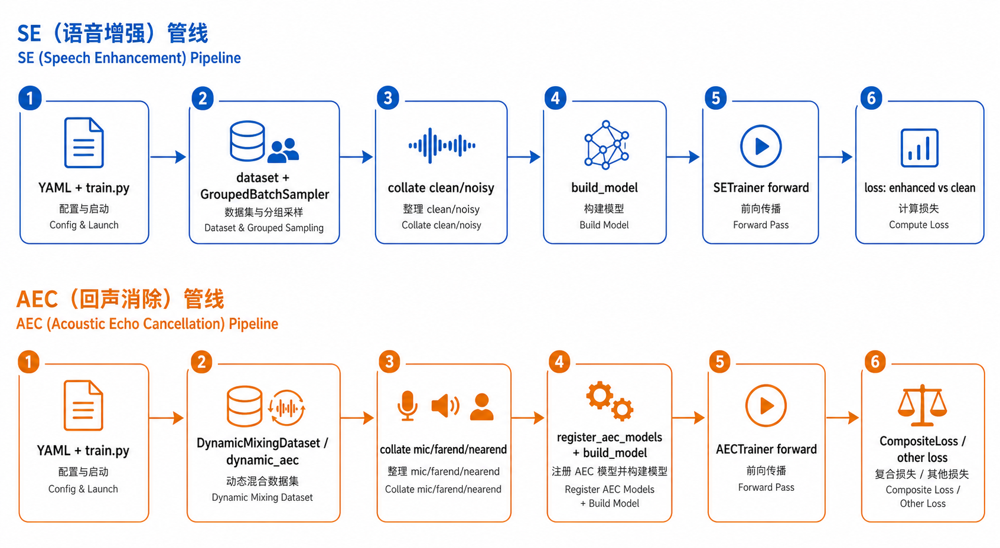
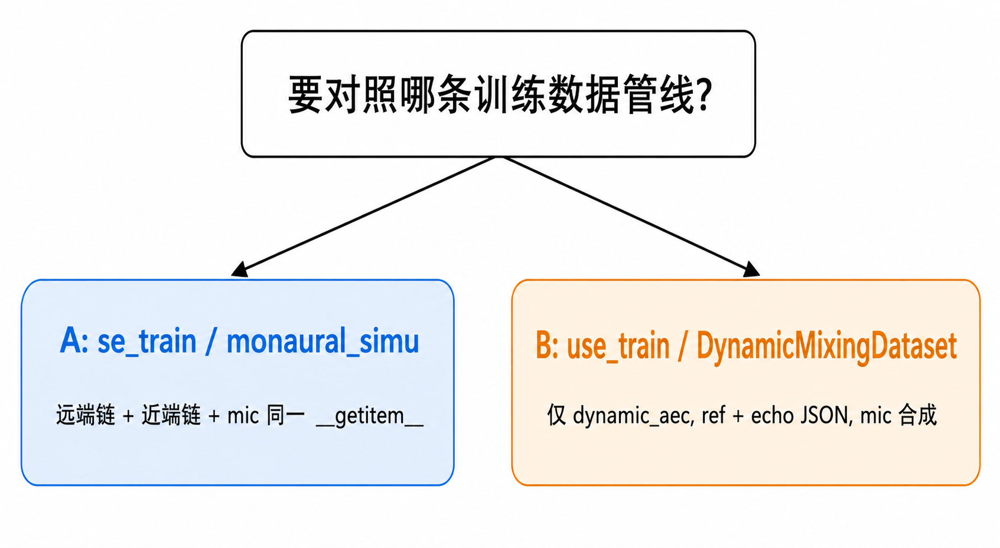
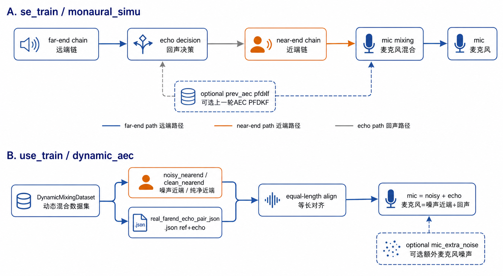
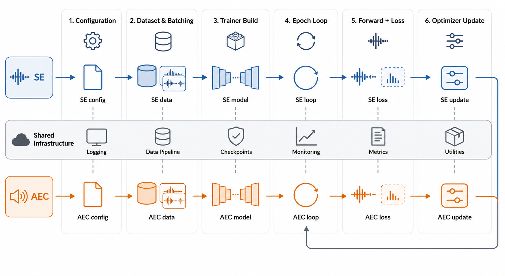
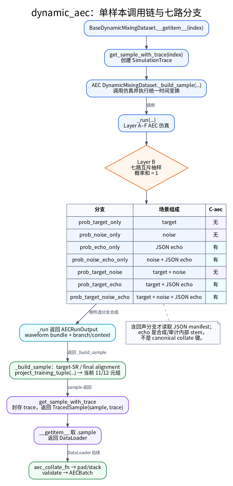
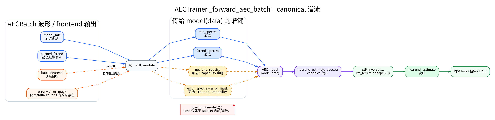

# 语音增强（SE）与回声消除（AEC）训练框架对比

本文对照 `use_train` 中 **SE**（Speech Enhancement，语音增强；代码在 `tasks/se/`）与 **AEC**
（Acoustic Echo Cancellation，回声消除；代码在 `tasks/aec/`）的完整训练链路：入口、数据、模型、
损失、训练循环和验证指标，并归纳两者的**相同点**与**差异点**。适合已经能跑通训练、想知道
「为什么这两个任务的代码看起来像、细节又不同」的读者。

`train.py` 是五个任务共用的分发器：它读配置里的 `data.mode`，把启动请求交给
`SETrainingEntry`、`AECTrainingEntry`、`TSETrainingEntry`、`SSTrainingEntry` 或
`SSLTrainingEntry`。真正共享的逻辑在 `core/trainer/entry.py` 的 `UnifiedTrainingEntry`，
各任务入口只覆盖差异部分。本文不展开 TSE/SS/SSL 的多源实现，见
[多源仿真指南](../simulation/Multi_Source_Simulation.md)；实现细节以代码为准，AEC 与 SE 的
对齐说明另见 `tasks/aec/README.md`。

**术语速查**（后文会直接使用这些缩写）：

- **DDP**：多卡数据并行训练；**AMP**：混合精度训练；**EMA**：训练中额外维护的平滑权重副本。
- **STFT / iSTFT**：把波形切成短时频谱、再从频谱还原波形；两个任务的模型大多工作在频谱域。
- **batch / collate**：一个 batch 装多条样本；collate 负责补齐长度并拼成张量，其字段顺序就是任务的数据合同。
- **`BaseTrainer` / `MetricsCapableTrainer`**：共享的训练循环、验证指标与 checkpoint 基类。
- **SI-SDR / PESQ / STOI / ESTOI**：带参考音频的客观指标（SI-SDR 衡量波形失真，PESQ 预测主观
  质量，STOI/ESTOI 衡量可懂度）；DNSMOS/NISQA/UTMOS/SCOREQ 是不需要参考的 MOS 预测，只在
  `evaluate/` 离线评估里算，不进 Trainer validation。

**相关导读**（经典 AEC 框图 ↔ `mic`/`farend`/loss）：[`AEC_Training_Primer.md`](../aec/AEC_Training_Primer.md)。

**训练逻辑图解（`dynamic_aec` + 一步前向）**：见 **[§8](#8-aec-训练逻辑图解)**（多幅概念图 + 张量示意；`offline_aec` 的 **cap-only** reader——只把各路音频裁到或补到公共有效长度、不做任何仿真的读盘逻辑——见 §4.2）。

## 结论摘要（重新梳理后的要点）

一句话结论：两任务的训练骨架、配置检查和验证指标全部共享，分叉集中在**数据解包、前向接口、
损失调用**三处。下面 7 条是展开后的要点。

1. **共享底座**：SE、AEC、TSE 都落在 **`BaseTrainer`**（DDP、AMP、EMA、累积、checkpoint、日志、调度）；验证客观指标共享逻辑（validation helpers、`_run_validation_metrics_from_pairs`、`_handle_epoch_tail_gradients`）已抽取到 **`core/trainer/metrics_trainer.py` 的 `MetricsCapableTrainer`**。Trainer 不再加载或计算 MOS，DNSMOS/NISQA/UTMOS/SCOREQ 统一经 `evaluate/` 离线评估。本文随后聚焦 `SETrainer` 与 `AECTrainer` 的对照。
2. **配置契约与 SE 对齐**：`UnifiedTrainingEntry._validate_config`（`core/trainer/entry.py`，两任务共用）要求 **`data.dataloader`**（含 `batch_size` / `num_workers`）及顶层 **`stft`**（除非 **`meta.allow_no_stft: true`**）。AEC 侧额外校验 dynamic_aec dataset 配置（simulation_cfg 场景概率、ref/echo 对齐、AEC 模型输入前端、state detector、linear_aec）：`AECTrainingEntry._validate_config` → `tasks.aec.data.dynamic_aec_build.validate_aec_dynamic_aec_config` → **`validate_aec_dataset_config`**，与 `DynamicMixingDataset.__init__` 调用**同一个函数**，保证“只做配置检查”和“真正构建 dataset”判定一致；AEC 前端子配置由 typed dataclass（`AECStreamAlignConfig` / `LinearAECConfig`）解析，未知键 fail-fast。
3. **STFT 构建**：`UnifiedTrainingEntry.build_stft_module`（`core/trainer/entry.py`）在 **`stft` 配置非空**时**始终** `core.stft.build_stft_istft` 并传入 trainer（**不再**按 `model.type` 白名单）；空配置仅在 `allow_no_stft` 时交给 trainer 用 `n_fft`/`hop_length` 默认模块。
4. **前向职责**：SE 用 **`_forward_model`**（内部 wav→STFT→model→iSTFT 或纯波形）；AEC 用 **`_forward_aec_batch`**（`mic`/`farend`，可选 `nearend`/`error` → STFT→`model(data)`→近端估计 iSTFT），与 SE 的「分析综合 STFT 与反变换」同一层次，**不是**与训练步割裂的「惰性零散算谱」。AEC 的 `echo` 仅是 Dataset C-aec/审计使用的内部 stem，不是 canonical 模型的第四路输入。
5. **数据层主要分叉**：两侧均使用 **`GroupedBatchSampler`** + **`BaseTrainer.train` 内 `set_epoch`**；**batch 形态**统一为实现 `BatchContract` 的 **SEBatch / AECBatch**：SE 动态 Dataset 固定返回 7 元组 `(clean, noisy, sr, length, is_pure_noise, is_pure_echo, is_pure_echo_noise)`，canonical collate 接受 4/7 元组；AEC 的 7 元组是无纯分支 flag 的 offline 样本格式，当前 dynamic 路径输出 11 元组或带可选 `state` 的 12 元组。`AECTrainingEntry` 同时接受 **`data.mode: dynamic_aec`** 与 **`data.mode: offline_aec`**；统一 `train.py` 按该 mode 路由到该 entry。**`data.max_duration`（秒）**参与 AEC collate 占位。
6. **与 se_train `monaural_simu_dataset` 的对照**：use_train AEC 的 **`dynamic_aec`** 路径中，**ref/echo** = **`real_farend_echo_pair_json` 的 `.json` 清单**，**`mic`** 代码合成；**`offline_aec`** 则直接读取预配对的 `mic`/`farend`/`nearend`（可选 `error`），不重放 Dynamic 仿真；**配置契约**见 **[§4.8](#dynamic-aec-config)**；两线对照见 **[§7](#aec-sim-compare-se-ut)**（**§7.4**：se_train 远端 echo 链与 **`dynamic_aec` 仅用磁盘 echo** 的概念对照）。
7. **入口一致性与任务边界**：**`seed_everything`**、**DataLoader / `data.dataloader` / `GroupedBatchSampler` / `TORCH_CPP_LOG_LEVEL`** 等均已统一为 `core/trainer/entry.py` 单一实现（两任务共用）。**SIGTERM 应急保存**见 **[§4.7](#47-其它工程差异补充)**、**[§9](#entry-task-boundaries)**。

---

## 1. 总览：两条流水线在仓库中的位置

| 维度 | SE | AEC |
|------|----|-----|
| 入口脚本 | `train.py`（**统一入口**：按 `data.mode` 分发到 `SETrainingEntry` / `AECTrainingEntry` / `TSETrainingEntry` / `SSTrainingEntry` / `SSLTrainingEntry`） | `train.py`（`data.mode: dynamic_aec` / `offline_aec`）→ `AECTrainingEntry` |
| 任务包 | `tasks/se/`（数据、模型、指标、STFT、优化器注册等） | `tasks/aec/`（数据、AEC 模型、AECTrainer）；**损失与 SE 共用 `core/losses/`** |
| 训练器 | `SETrainer` → `MetricsCapableTrainer` → `BaseTrainer` | `AECTrainer` → `MetricsCapableTrainer` → `BaseTrainer` |
| 典型配置 | `configs/se/...` | `configs/aec/...` |

**设计要点**：SE/AEC 训练器**共同继承** `core/trainer/metrics_trainer.py` 的 **`MetricsCapableTrainer`**，复用同一套 **带参考验证客观指标**（SI-SDR、PESQ、STOI/ESTOI）与日志/曲线/epoch-tail 逻辑；`BaseTrainer` 上的注释也明确 SE/AEC 在「数据解包、前向接口、损失」上刻意分叉。`_train_epoch` / `_validation_epoch` 骨架均在 core 基类（模板方法），任务差异经 hooks 注入：train 侧为 `_unpack_batch` / `_forward_and_compute_loss` 等，val 侧为 `_val_forward_loss`（SE/TSE/AEC 各自实现）与 AEC 的 extra hooks（state detector 统计、ERLE）。

---

## 2. 端到端训练流程（从启动到保存）

两条线的高层步骤一致，中间「数据形态 → 前向 → 损失」不同。



> 图中只展示两条训练主线的概念关系；具体配置键、tuple 字段与 loss 签名以本节正文为准。

1. **配置**：OmegaConf 读 YAML，`base_config` 弹出后得到 `dict`；校验 `data / model / optimizer / scheduler / trainer` 等顶层键。
2. **分布式**：可选 `torch.distributed`（NCCL）、`LOCAL_RANK` 绑 GPU；`SETrainingEntry` / `AECTrainingEntry` 通过共享入口基础设施完成初始化与端口设置，顶层 wrapper 只负责分发或兼容调用。
3. **随机种子**：`seed_everything(seed + rank, ...)`，与 rank 偏移避免各卡完全同序。
4. **严格模式**：`--strict` 时向 `trainer.strict_checks`、`val_metrics.strict`、`loss.strict` 注入，失败快路径一致。
5. **DataLoader**：`pin_memory`、`persistent_workers`、`dataloader_worker_init_fn` 等与 SE 共用工具。
6. **模型**：`tasks.se.models.build_model`；AEC 需在构建前 `tasks.aec.models.register_aec_models()`，把 `DeepVQE`、`CAGCRN` 等注册进**同一个** `MODEL_REGISTRY`。
7. **损失**：`core.losses.build.build_loss`（同一 `LOSS_REGISTRY`，具体 loss 类实现在 `core/losses/`）。**`loss.type: CompositeLoss`** 时，**`AECTrainer`** 直接调用 **`loss_fn(nearend_estimate, nearend, lengths[, 分支门控 / SS kwargs])`**，子项与 SE 相同（如 `SIL1WavSeTrainLoss` / MR 等）。
8. **优化器 / 调度器**：与 SE 相同——`torch.optim` 或 `adamp`，`SCHEDULER_REGISTRY.build` + `import core.optim` 注册表。启动 preflight 会拒绝 optimizer 遗漏任意可训练参数、重复参数或模型外参数。
9. **训练循环**：`BaseTrainer.train()` 驱动 epoch、验证间隔、checkpoint、TensorBoard/WandB、早停等；`_train_epoch` / `_validation_epoch` 骨架由 `MetricsCapableTrainer` 模板实现，任务差异经 hooks 注入。DataLoader 与模型构造均经过跨 rank 启动 preflight；checkpoint 保存各 rank 独立 RNG 状态，resume 要求相同 world size 并恢复当前 rank 的 RNG 流。非有限 validation loss 不会进入 scheduler、best 或 patience；整轮没有有限 loss 时也不提交 objective metric history。`val_metrics.strict=true` 要求每个已配置指标都有有限全局结果；`strict=false` 的混合有效/空结果轮次会提交对齐的 history 行，无结果指标使用 `NaN` hole，但 TensorBoard 不写该指标的 `NaN` scalar。SE/AEC 的 `lengths` 无论 `strict_checks` 是否开启都必须是 `[B]` 整数张量，且每项位于 `[1, T]`。

---

## 3. 相同点（可直接视为「共享基础设施」）

### 3.1 `BaseTrainer`（`core/trainer/base_trainer.py`）

- DDP 包装、`GradScaler` + `autocast`（FP16/BF16）、可选 **EMA**（`torch_ema`）、**梯度累积**、`torch.compile`、可选 **gradient checkpointing**。
- Checkpoint：定期保存、best、resume、步级 best-k 等与任务无关的逻辑。
- 学习率调度：`lr_schedule_per_step` 等由配置控制。
- 日志：TensorBoard；可选 WandB。

### 3.2 验证客观指标（继承关系带来的对齐）

- `AECTrainer` 与 `SETrainer` 同继承 `MetricsCapableTrainer`，在 `val_metrics.enabled` 时均走 **`_run_validation_metrics_from_pairs`** 一类流程：把成对波形送到 SI-SDR / PESQ / STOI 等带参考指标。DNSMOS/NISQA/UTMOS/SCOREQ 不进入 Trainer validation，由 `evaluate/` 离线计算。
- **配对语义不同**（见下文「差异」）：SE 是 `(clean, enhanced)`；AEC 是 `(nearend, nearend_estimate)`，即「近端参考 vs 网络估计的近端」。参考内容由 `data.task` 决定：`task=joint` 时为干净近端；`task=aec` 时为带噪近端（保留噪声/混响）。

### 3.3 STFT 与频域管线

- **与 SE 同一实现**：`core.stft.build_stft_istft`；`UnifiedTrainingEntry.build_stft_module` 在配置里 **`stft` 键存在且解析后非空**时即构建模块并传入 trainer（**所有**依赖谱进谱出的 AEC 模型共用该实例，**无**历史上的 `model.type` 白名单）。
- **`AECTrainer`** 在 **`_forward_aec_batch`** 内对 `mic`/`farend` 做 canonical 前端与 STFT，按模型能力可附加 `nearend`/`error` 谱，调用 `model(data)`，再对 `nearend_estimate_spectra` 做 iSTFT；与 **`SETrainer._forward_model`** 一样，把「分析综合 STFT」收束在单一前向辅助函数里。Dataset C-aec/审计使用的 `echo` stem 不作为 canonical 模型的第四路输入。
- `dynamic_aec` 的近端仿真与 SE 的 **`DynamicMixingDataset`** 共用 **同一套 `simulation_cfg` 语义与 `core.data.simulation` 实现**（`SimulationConfigs` / `engine` / `urgent_impl`）；**`tasks/aec/data/dynamic_dataset.py`** 内 **import `core.data.simulation.*`**（`tasks/se/data/simulation/` 已整体移除），不再维护 `tasks/aec/data/simulation/` 副本。Layer A 前处理与 Layer C 统一使用 **`core.data.augment` / `core.data.post_augment`**，不再保留 `tasks.aec.data` 旧 re-export 路径。总览见 **`tasks/aec/README.md`**。

### 3.4 其它共用模块

- Python 版本：`core.utils.python_version.check_python_version()`（入口一致）。
- 优化器注册：`core/optim/`。
- 部分工具：`core.utils.dataloader_worker.dataloader_worker_init_fn`、时长过滤 `tasks.se.data.apply_duration_filter_config`（AEC dynamic 构建时使用）等。

---

## 4. 差异点（任务-specific）

### 4.1 入口与配置校验

| 项目 | SE (`SETrainingEntry`) | AEC (`AECTrainingEntry`) |
|------|-----------------|----------------------|
| 顶层 **STFT** | 默认**强制**存在 `stft` 键（除非 `meta.allow_no_stft: true`；校验在 `UnifiedTrainingEntry._validate_config`，`core/trainer/entry.py`） | **相同校验**；`stft` 非空则 **`build_stft_istft` → trainer**（`build_stft_module`，两任务共用）；`allow_no_stft` 且无 `stft` 时由 trainer 内默认 FFT/hop 构建（与 SE 的 legacy 路径对称） |

### 4.2 数据层

| 项目 | SE | AEC |
|------|----|-----|
| 构建入口 | `SETrainingEntry` → `tasks.se.data.build_dataset`（`offline` / `dynamic` 等） | `AECTrainingEntry` 按 **`data.mode: dynamic_aec`** 构建 **`tasks.aec.data.dynamic_dataset.DynamicMixingDataset`**，按 **`data.mode: offline_aec`** 构建离线 `mic`/`farend`/`nearend`（可选 `error`）reader；其它取值由 entry 校验直接报错 |
| **采样器** | 训练：**`GroupedBatchSampler`**（`drop_last=True`） | **相同**：**`GroupedBatchSampler`**（`train.drop_last` 语义与 SE 一致；验证 `drop_last=False`；DDP 下为对齐各 rank 迭代数会在末尾复制 batch——forward 照跑以维持 `broadcast_buffers` 同步，但其 loss/指标贡献经 `_last_iter_real_len` 识别后剔除，验证集每样本只计一次） |
| **Collate** | 动态 Dataset 固定产出 7 元组 `(clean, noisy, sr, length, is_pure_noise, is_pure_echo, is_pure_echo_noise)`；collate 复用 `core.data.collate.collate_fn`（由 `tasks.se.data` 再导出），接受 4/7 元组样本，输出已校验的 `SEBatch` | `tasks.aec.data.collate.aec_collate_fn` 接受 7/11/12 元组（7=offline 无 flags，12 含帧级 `state` label），当前 dynamic 样本组包为 `(nearend, mic, farend, fs, lengths, error, error_mask, is_pure_noise, is_pure_echo, is_pure_echo_noise, has_echo[, state])`；5/6/8/9/10/13 及未知扩展显式拒绝 |
| **动态工业仿真** | `DynamicMixingDataset`：输出 `final_clean` / `final_noisy` | **`tasks.aec.data.dynamic_dataset.DynamicMixingDataset` 与 SE 的 `DynamicMixingDataset` 是平级类，共享 `BaseDynamicMixingDataset` 与 `core.data.simulation`**；AEC 由自身管线生成近端；**`farend`/`echo`** 来自 **`real_farend_echo_pair_json`**（**仅 `.json`**），其中 `echo` 是 Dataset C-aec/审计内部 stem；**`mic`** = `noisy_nearend + echo`（或纯远端分支下 `mic = echo`）；可选 **`aec_dynamic_pipeline.mic_extra_noise`** |
| **多数据源** | 由 `build_dataset` 与配置组织 | **`data.train.sources` 已禁止**（`ValueError`）；单一路径 **`data.train`** |
| **dynamic_aec 约束** | 不适用 | 必须提供 **`real_farend_echo_pair_json`**（train/val 各自或 val 继承 train） |
| **与 se_train monaural 仿真逐项对照** | 见 se_train `monaural_simu_dataset.py` | **[§7](#aec-sim-compare-se-ut)**：**A**（se_train）与 **B**（`dynamic_aec`）；**§7.4** 为 se_train echo 链与 **B 仅用磁盘 echo** 的对照 |

### 4.3 训练器与前向

| 项目 | `SETrainer` | `AECTrainer` |
|------|-------------|--------------|
| **Batch 形态** | `SEBatch` 按名读取 `clean` / `noisy` / `lengths` / `sr` | `AECBatch` 按名读取 `mic`、`farend`、`nearend`、`error`、`error_mask`、`lengths`、纯分支 flag；可选 `state` |
| **STFT 时机** | 多在 `_forward_model` 内与模型约定（波形或谱） | 在 `autocast` 内 **`_forward_aec_batch`**：与 SE 相同「STFT→模型→iSTFT」封装，非单独惰性步骤 |
| **模型调用** | `_forward_model(noisy, lengths, fs, ...)`，接口随模型是否吃 `fs` / `return_lsnr` 变化 | `self.model(data)`，约定读写 `mic_spectra` / `farend_spectra`，写出 `nearend_estimate_spectra` |
| **iSTFT** | 依模型与 STFT 模块在 `_forward_model` 中统一 | Trainer 内对 `nearend_estimate_spectra` 做 **`stft.inverse`** 得到 `nearend_estimate` 波形，供部分 loss / 指标使用 |
| **损失** | 典型：`loss_fn(enhanced, clean, lengths, ...)`，支持 `CompositeLoss`、`is_pure_noise`、`predicted_lsnr` 等 | **`CompositeLoss`**（与 SE 相同 YAML）：**`AECTrainer`** 映射为 **`(nearend_estimate, nearend, lengths[, …])`**；子项为 **`core/losses/`** 注册类。非 Composite 的 `build_loss` 仍可 **`loss_fn(data)`**（须在 `core/losses/` 注册） |

### 4.4 验证阶段

| 项目 | SE | AEC |
|------|----|-----|
| 主损失 | 与训练相同的 `enhanced` vs `clean` | **`CompositeLoss`**：与训练相同，调用 **`loss_fn(nearend_estimate, nearend, lengths[, SS kwargs / 分支门控])`** |
| **任务指标** | 客观指标基于 `(clean, enhanced)` | 额外记录 **ERLE**（Echo Return Loss Enhancement，回声抑制量，越高代表回声被压得越干净；由 `echo` 与 `mic - nearend_estimate` 等估计）；客观指标对 `(nearend, nearend_estimate)` |
| **配对含义** | 参考 = 干净语音 | 参考 = 近端干净标签（非麦克风混合波形） |

### 4.5 损失与仿真代码位置

- **SE**：损失实现在 `core/losses/`（频域/时域/复合/感知等）；仿真核心在 `core/data/simulation/`。
- **AEC**：损失与 SE 共用 **`core/losses/`**（典型 `CompositeLoss`）；**`dynamic_aec`** 下 **ref/echo** 仅磁盘 **JSON 清单**，近端退化仍由 **`core/data/simulation/`**（经 `DynamicMixingDataset` 的 `simulation_cfg`）提供。

### 4.6 已知「尚未对齐」点（来自 `tasks/aec/README.md` 与代码注释）

- ONNX 导出等部署路径在仓库中仍以 SE 流式为主；AEC 流式见 `onnx/` 与 `tasks/aec/README.md` 说明。

<a id="47-其它工程差异补充"></a>

### 4.7 其它工程差异（补充）

- **`data.dataloader`**：两任务相同，**必须**存在嵌套 **`data.dataloader`**（`batch_size`、`num_workers`；校验在 `UnifiedTrainingEntry._validate_config`）；可选 **`timeout`**、**`pin_memory`**、**`prefetch_factor`**，均由统一入口（`core/trainer/entry.py`）透传到 **`DataLoader`**（`batch_sampler=GroupedBatchSampler`，无 `batch_size`/`sampler` 双写）。
- **优雅停机（SIGTERM/SIGINT）**：两入口共用 `core/trainer/entry.py` 的 signal handler；首次信号只写本地 flag，禁止在异步 handler 内保存 checkpoint、销毁 process group 或 `sys.exit`。训练侧仅在 optimizer/epoch-tail boundary 通过固定 collective 同步各 rank，未提交的 accumulation window 整体丢弃；validation 在每次 forward 前及 terminal boundary 同步，停机轮次不写 partial loss/指标/history。主训练循环随后在安全边界保存带 `batch_cursor` 的 checkpoint 并退出；第二次信号才使用强制退出兜底。
- **DataLoader 细节**：两侧均支持 **`data.dataloader.timeout`**（>0 时）与 **`pin_memory`**（默认 true）。
- **日志环境变量**：`core/trainer/entry.py` 在 import `torch` 前若未设置则写入 **`TORCH_CPP_LOG_LEVEL=ERROR`**（两入口共用）。

<a id="dynamic-aec-config"></a>

### 4.8 `dynamic_aec` 当前配置契约（AEC 路由 + YAML）

以下描述 **`data.mode: dynamic_aec`**（AEC 动态路由；AEC 同时支持 **`offline_aec`** 离线路由，统一 `train.py` 按 mode 路由到 `AECTrainingEntry`）与 **SE 动态训练对齐** 的要点（实现以 **`tasks/aec/data/dynamic_aec_build.build_dynamic_aec_dataset`** → **`tasks.aec.data.dynamic_dataset.DynamicMixingDataset`** 为准）。

| 层级 | 键 / 行为 | 说明 |
|------|-----------|------|
| **模式** | `data.mode: dynamic_aec` | `AECTrainingEntry` 构建 **`tasks.aec.data.dynamic_dataset.DynamicMixingDataset`**；**禁止**与 **`data.train.sources`** 同开（`ValueError`）。 |
| **必填（`data.train`，`data.validation` 可 `inherit_train_simulation` 合并 train；旧 `data.val` 别名已退役）** | `real_farend_echo_pair_json` | **仅 `.json`**（见 `parse_real_farend_echo_pair_file`），根对象仅允许 `pairs` 与可选 `meta`，形如 `{"pairs": ["x.wav"]}`。每条必须是非空的同一立体声 WAV 路径；**ch0=回声，ch1=farend（参考）**。裸数组、list/dict pair、字段别名和双文件模式均拒绝；磁盘路径需可读，无有效对则 Dataset 构造失败。 |
| 同上 | `speech_scp` / `noise_scp` / `rir_scp` / `windnoise_scp` | 与 SE **`DynamicMixingDataset`** 相同四路清单。 |
| 同上 | `simulation_cfg` | 与 SE 同义的近端退化配置；AEC 侧 **Layer B 为七路互斥分支抽样**（见下两行）。 |
| **`data` 顶层（常用）** | ~~`aec_add_echo_prob`~~（**已移除**） | 旧键 **`aec_add_echo_prob` / `aec_echo_cancel_training_prob` 非空设置直接 `ValueError`**（`tasks/aec/data/dynamic_aec_build.py` `resolve_aec_dataset_kwargs()`）；是否走清单回声由 Layer B 场景概率决定，**不再存在独立的「加回声概率」开关**。 |
| 同上 | `simulation_cfg` Layer B 七分支概率 | **七路互斥抽样、概率和 = 1.0**：`prob_target_only` / `prob_noise_only` / `prob_echo_only` / `prob_noise_echo_only` / `prob_target_noise` / `prob_target_echo` / `prob_target_noise_echo`（`core/data/simulation_configs.py` `SimulationConfigs` 字段）。含回声场景（`prob_echo_only` / `prob_noise_echo_only` / `prob_target_echo` / `prob_target_noise_echo`）触发 C-aec 读 JSON 清单；`prob_echo_only` 时 `mic = echo`，无回声场景 `mic` 不含回声、`farend`/`echo` 全零。 |
| 同上 | `sample_rate`、`strict_load`、`placeholder_num_samples` | 传入 Dataset / collate；与 SE 动态习惯一致。 |
| 同上 | **`max_duration`** | **按「秒」** 换算 collate 占位长度（与 `train.max_duration_seconds` 搭配理解）。 |
| 同上 | **`data.dataloader`**（必填，与 `train.py` 一致） | 必须含 **`batch_size`** / **`num_workers`**；可选 **`timeout`**、**`pin_memory`**、**`prefetch_factor`**。 |
| **`data.train` 可选** | `aec_dynamic_pipeline` | 当前仅接受 **`mic_extra_noise`**，其下仅接受 `enabled` / `snr_range`；顶层或子层出现未知键时均立即抛 `ValueError`，禁止静默忽略。 |
| **构建时 fail-fast** | `farend_scp`、`real_echo_prob`、`use_real_farend_echo_pair_prob`、`real_mic_scp` / 三元 real / manifest 等 | 旧键**非空即抛 `ValueError`**（`tasks/aec/data/dynamic_aec_build.py` `_pop_legacy_aec_data_keys()`，与 simulation_cfg 废弃键同策略），**并非静默丢弃**。 |

**信号合成小结（`dynamic_aec`）**：近端 **`clean` / `noisy`** 由 AEC 子类 **`_run`（Layer A–F 仿真管线）按 Layer B 分支**生成；**`farend`/`echo`** 仅来自 **JSON 清单**；**`mic`** = 分支下的代码合成（双讲 `noisy + echo`、纯远端 `echo`、无回声分支不含 echo）→ 可选 **`mic_extra_noise`**。AEC 专属 `AECDeploymentFrontend` 在 Trainer/Inference 的 STFT 前处理模型输入，不属于仿真。

---

## 5. 小结表

| 类别 | 相同 | 不同 |
|------|------|------|
| 分布式 / AMP / EMA / 累积 / checkpoint / 日志 | `BaseTrainer` 全套 | — |
| 验证客观指标管线 | SE/AEC 共用 `MetricsCapableTrainer` 的 metrics 流程 | 配对波形语义与 AEC 专有 ERLE |
| 配置中的优化器、调度器、模型注册表 | 同一套 `build_*` + registry | AEC 需显式 `register_aec_models()`；损失走 `core.losses.build.build_loss`（具体类来自 `core/losses/`） |
| STFT 实现 | `core.stft` | `core.stft`；`AECTrainer._forward_aec_batch` 与 `_forward_model` 职责对齐 |
| 数据 | `dynamic_aec` 的近端 = 与 SE 相同的 Layer A/B/C + **`core.data.simulation`** | AEC 的 canonical batch 以 **`mic`/`farend`** 为主，按能力可带 `nearend`/`error`；`echo` 是 Dataset C-aec/审计内部 stem；**§4.8** 汇总 `dynamic_aec` 键与 **`max_duration`（秒）**，离线模式为 `offline_aec` cap-only reader；**采样器与 SE 同为 `GroupedBatchSampler`**；两侧 collate 分别输出已校验的 `SEBatch` / `AECBatch`，字段契约由任务定义 |
| epoch 训练骨架 | SE/AEC 共用 `MetricsCapableTrainer._train_epoch`；任务逻辑由 `_prepare_batch`、`_forward_and_compute_loss` 等 hooks 注入 | 数据键、前向、loss 签名 |
| 任务目标 | 提升可懂度/感知质量（降噪等） | 抑制回声并恢复近端语音 |

---

## 6. 相关文件索引（便于跳转）

- SE 入口：`train.py` 在 SE 的 `data.mode`（如 `dynamic`、`offline`）路由到 `tasks/se/trainer/entry.py`（`SETrainingEntry`）；训练器：`tasks/se/trainer/se_trainer.py`、`core/trainer/base_trainer.py`。
- AEC 入口：`train.py` 在 `data.mode: dynamic_aec` / `offline_aec` 路由到 `tasks/aec/trainer/entry.py`（`AECTrainingEntry`）；训练器：`tasks/aec/trainer/aec_trainer.py`。
- TSE 入口：`train.py` 在 `data.mode: dynamic_tse` / `offline_tse` 路由到 `tasks/tse/trainer/entry.py`（`TSETrainingEntry`）及 `TSETrainer`。TSE 细节见 `tasks/tse/README.md`，本文不展开。
- SE 动态数据：`tasks/se/data/dynamic_dataset.py`；AEC 动态：**`tasks/aec/data/dynamic_dataset.py`**（主实现），**`tasks/aec/data/dynamic_aec_build.py`**（从 YAML 组参）。
- AEC collate：`tasks/aec/data/collate.py`（`aec_collate_fn`）；推理/评测用 mic↔farend 路径配对：**`evaluate/aec_pairing.py`**（`inference.py`、`evaluate/eval_pipeline_aec.py`）。
- AEC 模块说明：`tasks/aec/README.md`；仿真流水线说明：[Simulation_Flow_Logic.md](../simulation/Simulation_Flow_Logic.md)（Layer A–F 架构与 **`tasks/se/data/dynamic_dataset.py`** / **`tasks/aec/data/dynamic_dataset.py`** 共用 **`core.data.simulation`** 的说明见页内注记）。
- 经典框图 ↔ `AECTrainer` / loss：[`../aec/AEC_Training_Primer.md`](../aec/AEC_Training_Primer.md)。
- se_train 单声道 AEC 仿真数据集（与 §7 对照）：`se_train/speech_enhancement/runners/aec/dataset/monaural_simu_dataset.py`。

如需把某一条实验配置从 SE 迁到 `dynamic_aec`：复制 SE 动态段的四条 SCP、`data.train`/`data.validation` 的 resource 与 lifecycle 字段，以及 `simulation_cfg` 的 A-F 字段；新增 `real_farend_echo_pair_json`（仅 `.json` 配对表），顶层设 `data.mode: dynamic_aec`。不要依赖已移除的 `farend_scp` 或整段 mic 三元组配置。再核对 `data.train.max_duration` 的单位、`loss.type`（典型 `CompositeLoss`）以及模型双路谱输入（`mic_spectra` / `farend_spectra`）。

---

<a id="aec-sim-compare-se-ut"></a>

## 7. se_train 与 use_train AEC 支路对照（mic、ref、echo）

下文 **ref** 与仓库 API 中的 **`farend`** 同义（远端参考 / loopback）。

**说明**：本节讨论统一 `train.py` 的 **`dynamic_aec`** AEC 路由，该路由使用 **`tasks.aec.data.dynamic_dataset.DynamicMixingDataset`**。历史 **`AECDataset` / `aec_files`** 已删除。下表 **两线**：**A = se_train**，**B = use_train**。

| 线 | 代码入口 | 一句话 |
|----|-----------|--------|
| **A** | se_train **`monaural_simu_dataset.py`** | 远端链 + 近端链在同一 **`__getitem__`** 内分支；echo 可 **整条仿真** 或由 **TSV 对表**替换 ref+echo 仿真输出；**`mic`** 在单 Dataset 内混合。 |
| **B** | use_train **`tasks.aec.data.dynamic_dataset.DynamicMixingDataset`**（**`data.mode: dynamic_aec`**，缺省同） | **近端** = **同类的 Layer A/B/C 管线**；**ref+echo** = **`real_farend_echo_pair_json`（仅 `.json`）**；**`mic`** = **代码合成**。 |

**读表约定**：下列 **「仿真 / 磁盘」** 两列描述 **A（se_train）**；**use_train** 列恒为 **B（`dynamic_aec`）**。

### 7.0 两线选型总览（流程图）

**B** 的单条样本门控见 **§8.2**。



### 7.1 总流程对照（信号图：A 与 B）



> 图中保留 A/B 两条数据管线的概念分叉；具体 manifest、分支门控和 `mic` 组成见下文表格。

**核心差异（A vs B）**：**A** 在同一 Dataset 内维护 **远端语料链 + 近端语料链** 并混合；**B** 把 **近端** 完全交给 **Layer A/B/C 动态管线**，把 **ref/echo** 固定为 **磁盘 JSON 清单**，**`mic`** 在 **`tasks.aec.data.dynamic_dataset.DynamicMixingDataset`** 内显式写出。

<a id="aec-echo-sources"></a>

### 7.2 ref（`farend`）与 echo：两路径对照

| 维度 | se_train **`monaural_simu`** | use_train **`dynamic_aec`** |
|------|------------------------------|------------------------------|
| **ref 主来源** | 对表未命中 → **`farend_data`**（仿真链）；命中 → **TSV 第一列** | **仅** **`real_farend_echo_pair_json`** 中每对的 **farend 路径** |
| **echo 主来源** | 对表未命中 → **`echo_data`**（由 `farend_data` 再加工）；命中 → **TSV 第二列** | **仅** **同一 manifest 条目的 echo 路径** |
| **与近端关系** | **`nearend_data`** 与 echo 在同一混合语义下设计 | **清单条目与当前 `noisy_nearend` 仅等长**，**无**会话级内容对齐 |

### 7.3 mic 支路：两路径对照

| 维度 | se_train **`monaural_simu`** | use_train **`dynamic_aec`** |
|------|------------------------------|------------------------------|
| **mic 如何得到** | **`nearend_data` 与 `echo_data`** 按单讲/双讲/SER 等 **在 Dataset 内混合**；可选 **`prev_aec`**、**`random_volume_mic`** | **双讲**：`noisy_nearend + echo`；**纯远端**：`prob_echo_only` → **`mic = echo`**；**噪+回声仿真**：`prob_noise_echo_only` → **`mic`** 为仿真近端（噪+回声经 Layer C）；**无回声分支**：`prob_target_only` / `prob_noise_only` / `prob_target_noise` → **`mic` 不含回声成分** 且 **farend/echo 置零**；再可选 **`mic_extra_noise`** |
| **整段 mic 仅从文件** | **无** | **无** |

### 7.4 echo 来源对照（**se_train vs `dynamic_aec`**）

**B（`dynamic_aec` AEC 路径）** 的 **`echo`** **仅为 JSON 清单中 echo 路径读盘**，与近端等长裁切；由统一 `train.py` 进入该路径，不在 Dataset 内从 **`farend`** 再仿真一条 echo。若需与 **A（se_train）** 同款的「远端链 → echo」逐项参数对齐，只能在 **se_train** 或自写 Dataset 中实现。

| 维度 | se_train `monaural_simu` | **`dynamic_aec`（B）** |
|------|--------------------------|------------------------|
| **echo 主来源** | 对表未命中 → **`echo_data`**（由 `farend_data` 再加工）；命中 → **TSV 第二列** | **仅** **manifest 的 echo 路径** |
| **SER / 双讲语义** | Dataset 内 **`add_noise`** 等与 echo 混合 | **echo 已含在录音对中**；**`mic`** = **`noisy_nearend + echo`**（或纯远端/SE-only 分支） |

### 7.5 近端与标签、音量（补充）

| 维度 | se_train `monaural_simu` | use_train **`dynamic_aec`（B）** |
|------|--------------------------|-----------------------------------|
| **进入网络的近端分量** | **`nearend_data`**（独立列表 + 混响/加噪/VAD） | **`noisy_nearend`** ← **`DynamicMixingDataset`** |
| **训练目标 `nearend` 列** | **`nearend_clean`** 等（与配置相关） | 默认 `task=joint` 时为 **`clean_nearend`**（与 SE `final_clean` 一致）；`task=aec` 时为带噪近端（保留噪声/混响，仅去除回声） |
| **整段 mic/三路的同尺度音量** | **`random_volume_mic`** | **无**与 se_train 同名的整块；近端 RMS 在 **SE 管线**内 |

### 7.6 小结（选型提示）

- **要对齐 SE 仓库的近端退化、且 ref/echo 为真实录音对**：**`dynamic_aec` + `real_farend_echo_pair_json`**；配置契约见 **[§4.8](#dynamic-aec-config)**，样本级分支见 **[§8.2](#sec-8-2-dynamic-aec-item)**。
- **要与 se_train 的整条 Echo 仿真链逐项对齐**：只能在 **se_train** 或自写 Dataset 中复刻。
- **符号（B）**：**ref / echo** = **JSON 清单**；**mic** = **代码合成**；**`farend`** 供网络参考谱。

---

<a id="8-aec-训练逻辑图解"></a>

## 8. AEC 训练逻辑图解（`dynamic_aec`）

本节用 **概念流程图 + 张量关系示意** 把「配置 → 数据 batch → 一步训练」串起来；**频域模型**路径与仓库 **`AECTrainer._forward_aec_batch`**（`tasks/aec/trainer/aec_trainer.py`）一致。统一 `train.py` 在 `data.mode: dynamic_aec` 进入该路径。

<a id="aec-train-e2e-flow"></a>

### 8.0 use_train AEC 训练主路径（端到端）

推荐从 **`python train.py -C …`**（`data.mode: dynamic_aec`）启动。**Dataset 只出波形**；**STFT / 模型 / iSTFT** 在 **`AECTrainer._forward_aec_batch`**；**`trainer.train()`** 内按 epoch 调共享的 **`MetricsCapableTrainer._train_epoch`**，再经 AEC hooks 完成 batch 解包、前向与损失。梯度累积、AMP、DDP **`no_sync`** 等细节见代码注释。



> 图中概括入口、构建、训练循环与单 batch 前向；DDP、AMP、梯度累积和 loss 调用细节以正文及代码为准。

**读图要点**：**§8.2** 只展开 **B 线 Dataset** 的 **`__getitem__`**；**§8.4** 只展开 **`_forward_aec_batch`** 的张量走向；本图把二者接到同一训练闭环上。

### 8.1 总览：从 YAML 到一次 `optimizer.step`

§8.0 的总体图已经覆盖从配置加载到 `optimizer.step` 的主路径；本小节不再重复绘制同一流程。

**读图要点**：**STFT 不在 Dataset 里做**；canonical 前端先处理 **`mic`/`farend`**，再由 **`AECTrainer`** 对模型实际需要的观测/目标输入执行 **`stft()`**。Dataset C-aec/审计中的 **`echo`** 不作为 canonical 模型第四路输入。

---

<a id="sec-8-2-dynamic-aec-item"></a>

### 8.2 `dynamic_aec`：单条样本在 Dataset 里怎么走

单条样本的调用链为 **`__getitem__ → get_sample_with_trace → _build_sample → _run`**（`__getitem__` 最后取 `TracedSample.sample`；实现位于 `core/data/dynamic_dataset_base.py` 与 `tasks/aec/data/dynamic_dataset.py`）；**Layer B 七路互斥分支抽样**（`prob_target_only` / `prob_noise_only` / `prob_echo_only` / `prob_noise_echo_only` / `prob_target_noise` / `prob_target_echo` / `prob_target_noise_echo`，概率和 = 1.0）决定样本走哪条分支，细节见源码注释。



[Graphviz 源文件](assets/SE_vs_AEC_Training_Framework/05_dataset_branching_mechanism.dot)

> 图中从 `__getitem__` 开始呈现真实调用链，再展开 `_run` 内的样本级分支与 `_build_sample` 后续组包；当前 dynamic 输出 11/12 元组，样本输入范围以 `aec_collate_fn` 为准，collate 之后统一为 `AECBatch`。

**与上图并列的「Dataset 波形语义」（双讲主路径）**：

| 符号（Dataset 内部或 batch 字段） | 含义（`dynamic_aec`） |
|------------------------------|------------------------|
| **`nearend`** | 训练目标：由 `data.task` 决定。<br>`task=joint`（默认）：`final_clean`（去回声+降噪+去混响，与 SE 一致）。<br>`task=aec`：带噪近端（仅去回声，保留噪声/混响；无回声分支 pass-through）。 |
| **`mic`** | 观测：**`noisy_nearend + echo`**（经 Phase2/3 分支与 `_finalize` 可能改写） |
| **`farend`** | 参考：**清单 farend 路径**，与近端等长裁切 |
| **`echo`** | **Dataset C-aec/审计内部 stem**：清单 echo 路径，供数据合成/审计使用；不属于 canonical 模型的第四路输入，也不是 collate 的 canonical batch 键。 |

---

### 8.3 Collate 之后：一个 batch 在内存里长什么样（示意）

Collate 把变长波形 **pad** 到 batch 内最大有效长度，并带上 **`lengths`**（**ASCII 示意**，非 API 字面量）：

```
  batch keys:   mic, farend, nearend, error, lengths, fs(或等价)
  典型 shape:   (B, T_pad)  波形字段按 collate 对齐到 T_pad；lengths[b] ≤ T_pad 为有效样本长
  note:         echo 仅为 Dataset C-aec/审计内部 stem，不是 canonical 模型输入
```

**损失与指标**：谱域 loss 多用 **`lengths`** 做 mask；客观指标把 **`(nearend, nearend_estimate)`** 当作 **`(ref, enhanced)`** 送入 SI-SDR / PESQ 等（见 **`AECTrainer`** 注释）。

---

### 8.4 一步前向：`AECTrainer._forward_aec_batch`（wav → 谱 → 模型 → 波形）



[Graphviz 源文件](assets/SE_vs_AEC_Training_Framework/06_aec_forward_spectral_flow.dot)

> 图中展示统一 `stft_module`、必选 `mic_spectra` / `farend_spectra`，以及由 `aec_input_capabilities` 与 routing 决定的可选 `nearend_spectra` / `error_spectra`；精确 shape 与 `ref_len` 语义见本节正文。`echo` 只参与 Dataset 合成/审计，不存在 `echo → model` 边。

**读图要点**：canonical 判别式模型吃 **谱**；`nearend_spectra` 是按 capability 附加的目标谱，`error_spectra` 还要求有效 residual routing 与 `error_mask`，二者都不是无条件模型输入。**`nearend_estimate`** 由 **`stft.inverse(nearend_estimate_spectra, ref_len=mic.shape[-1])`** 得到，用于部分 **时域项 / 指标** 与 **ERLE** 相关计算。

---

### 8.5 `dynamic_aec` / `offline_aec` 数据路径

AEC 通过统一 `train.py` 按 `data.mode` 路由：`dynamic_aec` 使用 `DynamicMixingDataset`，近端由 `speech_scp` / `noise_scp` / `rir_scp` / `windnoise_scp` 与 `simulation_cfg` 生成，`ref + echo` 来自 **`real_farend_echo_pair_json`**（**仅 `.json`**），`mic` 在 Dataset 内代码合成（见 **§8.2**）；`offline_aec` 直接读取预配对的 `mic` / `farend` / `nearend`（可选 `error`），不执行 C-aec 或部署 frontend。

---

### 8.6 和本文其它章节怎么对照

| 你想查… | 跳转 |
|---------|------|
| **从命令行到 `optimizer.step` 一条总线** | **[§8.0](#aec-train-e2e-flow)** |
| **`dynamic_aec` 键与 `max_duration` 秒** | **[§4.8](#dynamic-aec-config)** |
| **与 se_train 的 ref/echo/mic 对照** | **[§7](#aec-sim-compare-se-ut)** |
| **经典 loss 与 AEC 波形符号** | **[`../aec/AEC_Training_Primer.md`](../aec/AEC_Training_Primer.md)** |

---

<a id="entry-task-boundaries"></a>

## 9. 入口与任务边界

SE/AEC 共用 `core/trainer/entry.py` 的 `UnifiedTrainingEntry.load_and_setup`，统一
DDP 初始化、配置日志、随机种子及 DataLoader 参数。异常由入口传播，`finally` 执行
best-effort 的 process-group cleanup；signal 保存由训练安全边界完成，异步 handler
和异常清理路径不执行 collective。

任务侧保留以下生命周期差异：

- **采样器**：两侧均为 **`GroupedBatchSampler`**（**§4.2**）。
- **Collate**：SE/AEC 分别输出已校验的 `SEBatch`/`AECBatch`，统一实现锁页、设备搬运和主样本数接口；**`set_epoch`** 由 **`BaseTrainer.train`** 驱动 **`train_sampler` 与 `train_dataset`**（与 SE 相同）。
- **验证集 epoch**：`AECTrainingEntry` 在构建后显式 **`val_ds.set_epoch(0, ...)`**；`SETrainingEntry` 依赖 val 默认未在每 epoch 改写。该差异归属于 entry 实现，不归因于顶层入口脚本。
