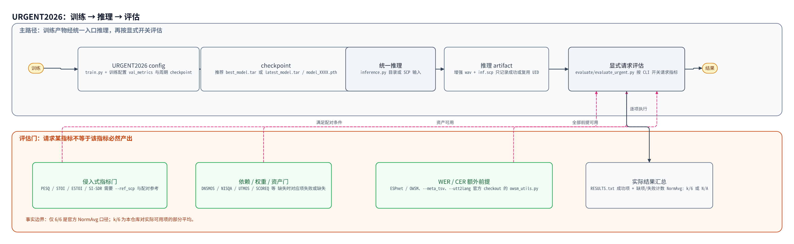

# URGENT2026 指南：训练 → 推理 → 评估

**URGENT2026** 是一个语音增强（SE）比赛。本指南讲比赛工作流里最常用的两件事：训练完模型
怎么用 `inference.py` 批量生成增强音频，以及怎么用 `evaluate/evaluate_urgent.py` 算出比赛
口径的指标。示例以带干净参考音频的「非盲测」集合为主。

fenced bash 示例以 `/path/to/...` 或先定义的 shell 变量表示本机路径。

与官方 `eval_all.sh` 的可比性取决于相同的数据、模型、依赖版本与官方侧口径，最终应以官方
评测结果为准。

---

## 1. 推理

`inference.py` 已支持：目录和 SCP 两种输入方式；自动处理 DDP checkpoint
（DDP = 多卡数据并行训练，这类 checkpoint 的键名带 `module.` 前缀，脚本会自动去掉）；
仅在 EMA（Exponential Moving Average，训练中维护的平滑权重副本）依赖可用且 checkpoint
里存在对应 state 时才应用 EMA 权重；自动生成 `inf.scp`（增强结果清单，可直接喂给评估脚本）。

以下示例统一令 `CKPT_DIR=/path/to/experiment/checkpoints/run_id`。

### 1.1 基础推理（目录输入）

```bash
CKPT_DIR=/path/to/experiment/checkpoints/run_id
DATA_ROOT=/path/to/urgent-data
python inference.py \
    -C configs/se/urgent2026/usr_bsrnn_noncausal_urgent26_offline_multires_l1_spec.yaml \
    --checkpoint "$CKPT_DIR/best_model.tar" \
    --input_dir "$DATA_ROOT/test/noisy" \
    --output_dir results/bsrnn_enhanced
```

### 1.2 SCP 输入（更灵活，支持多路径）

```bash
CKPT_DIR=/path/to/experiment/checkpoints/run_id
# 非盲测集的 noisy 清单；该路径是本仓库已生成的清单，见 configs/se/urgent2026/README_CN.md
INPUT_SCP=data/shared/urgent26_track1_se_dataset/urgent26_nonblind_with_label/urgent26_noisy_nonblind.scp
python inference.py \
    -C configs/se/urgent2026/usr_bsrnn_noncausal_urgent26_offline_multires_l1_spec.yaml \
    --checkpoint "$CKPT_DIR/best_model.tar" \
    --input_scp "$INPUT_SCP" \
    --output_dir results/bsrnn_enhanced_validation
```

### 1.3 指定 checkpoint / GPU

```bash
# 指定 epoch
CONFIG=/path/to/config.yaml
CKPT_DIR=/path/to/experiment/checkpoints/run_id
INPUT_SCP=/path/to/input.scp
python inference.py -C "$CONFIG" \
    --checkpoint "$CKPT_DIR/model_0040.pth" \
    --input_scp "$INPUT_SCP" --output_dir results/epoch40_enhanced

# 指定 GPU（--device 是相对于 CUDA_VISIBLE_DEVICES 的索引）
DATA_ROOT=/path/to/urgent-data
CUDA_VISIBLE_DEVICES=1 python inference.py -C "$CONFIG" \
    --checkpoint "$CKPT_DIR/best_model.tar" \
    --input_dir "$DATA_ROOT/test/noisy" --output_dir results/enhanced \
    --device cuda:0
```

### 1.4 输出文件

```
results/bsrnn_enhanced/
├── utt001.wav              # 增强后的音频
├── utt002.wav
├── ...
├── inf.scp                 # 自动生成（uid + 路径），直接用于评估
└── run_manifest.json       # 本轮输入身份与产物记录，--skip-existing 依它判断能否复用
```

---

## 2. 评估

### 2.1 本仓库可请求的指标清单（15 个）

**A. 音频质量指标**

- 侵入式（需要干净参考音频才能算）：**PESQ、STOI、ESTOI、SI-SDR**——PESQ 预测主观质量，STOI/ESTOI 衡量可懂度，SI-SDR 衡量波形失真。
- 非侵入式（只看增强后的音频）：**DNSMOS、NISQA、UTMOS、SCOREQ**——四个用神经网络预测主观 MOS 评分的模型。

**B. 下游任务影响指标**（把增强后的音频送进下游模型，看下游任务变好还是变差）

- ASR（语音识别）：**WER / CER**（词/字错误率，用 OWSM v3.1 识别后与文本比对）
- 说话人：**SpeakerSimilarity**（说话人嵌入的余弦相似度，反映音色有没有被改掉）
- 情感：**EmotionSimilarity**
- 音素：**PhonemeSimilarity**（音素序列的编辑距离）
- 语义：**SpeechBERTScore**
- 语言识别：**LAcc**（语言分类准确率）

**C. 归一化平均分（NormAvg）**：6 个核心指标（DNSMOS/NISQA/UTMOS/SCOREQ/PESQ/ESTOI）
各自归一化到 [0,1] 后取均值；只有 6/6 全部算出时才是官方 URGENT2026 的排名口径。缺项时本
仓库会显示 `k/6`（可用项的部分平均），仅供跨实验参考比较；0/6 显示 N/A。

上述项目是可请求范围，不保证每次运行都全部产出。模型权重、Python 依赖或外部官方资产缺失时，对应指标会失败或缺失；资产不齐时不得声称全部指标已产出。其中 WER/CER 除 OWSM/ESPnet 依赖外，还要求官方 `owsm_utils.py` 可用：优先读取仓库根目录外部 checkout `urgent2026_challenge_track1-main/evaluation_metrics/owsm_utils.py`，缺失时回退到仓库内置的 `evaluate/owsm_utils.py`。

### 2.2 与官方 `eval_all.sh` 的对比

| 项目 | 官方 `eval_all.sh` | `evaluate_urgent.py` |
|------|-------------------|---------------------|
| 评估指标 | 15 个（4 侵入式 + 4 非侵入式 + 7 下游） | 可请求 15 个对应类别；实际产出取决于资产、模型与依赖是否齐全 |
| 脚本形式 | 分散式（9 个独立脚本） | 统一入口（命令行开关选择指标） |
| 默认测试集 | `validation_leaderboard` | 灵活（任意 SCP） |
| 输出格式 | 分散在多个目录 | 统一输出目录；缺失指标不会伪装成完整输出 |
| 归一化分数 | 需手动计算 | 按实际可用项计算并显示 `k/6`；0/6 为 N/A |
| 并行支持 | `--nj` | `--nsplits`/`--job` |
| 依赖检查 | — | 部分缺失依赖会给出安装提示；外部资产仍需自行准备 |

### 2.3 评估命令（本文唯一一份，其余场景引用此处）

```bash
DATA_ROOT=/path/to/urgent-data
# 请求全部指标；仅当所需依赖、模型和外部官方资产齐全时才会完整输出
# WER/CER 的 owsm_utils.py 优先使用仓库根目录外部 checkout；
# 缺失时自动回退到 evaluate/owsm_utils.py（仓库内置 vendored 版本）
python evaluate/evaluate_urgent.py \
    --ref_scp "$DATA_ROOT/nonblind/clean.scp" \
    --inf_scp results/nonblind_enhanced/inf.scp \
    --dnsmos --nisqa --utmos --scoreq \
    --wer --meta_tsv "$DATA_ROOT/nonblind/text" \
    --utt2lang "$DATA_ROOT/nonblind/utt2lang" \
    --speaker_similarity --emotion_similarity \
    --phoneme_similarity --speechbert --lid \
    --output_dir results/nonblind_eval_full

# 快速评估（仅请求日常迭代使用的音频质量指标）
python evaluate/evaluate_urgent.py \
    --ref_scp "$DATA_ROOT/nonblind/clean.scp" \
    --inf_scp results/nonblind_enhanced/inf.scp \
    --dnsmos --nisqa \
    --output_dir results/nonblind_eval_quick
```

### 2.4 典型场景

| 场景 | 做法 |
|------|------|
| 排行榜提交前验证 | 请求全部指标并先核对依赖与外部资产；最终以官方评测结果为准 |
| 日常快速验证 | 快速评估命令（§2.3 下），只看 DNSMOS/NISQA |
| 训练中验证集监控 | trainer 按配置的验证周期运行 `val_metrics`；实际指标集合以配置为准 |

---

## 3. 完整工作流：训练 → 推理 → 评估

### 仓库工作流图



> **图注与溯源（generated-method，仓库工作流图）**：后端为 ArchScope，固定来源 `HaozheZhang6/archscope@04bae8488aa30fb694c9c14abc35e6f4d8900328`；PNG 由 `.kimi-code/tools/resvg` 以 `Noto Sans CJK SC`、`zh-CN`、`zoom=2` 从 SVG 渲染。evidence mode 为 `repository-code`。训练配置的验证指标与周期 checkpoint 见 `configs/se/urgent2026/usr_bsrnn_noncausal_urgent26_offline_multires_l1_spec.yaml:140-155`；`inference.py:570-630, 1237-1319` 记录成功/复用 UID 的 SCP 条目并完成推理 artifact；`evaluate/evaluate_urgent.py:500-567, 580-655, 808-930` 说明指标由 CLI 显式请求、输入和元数据前提、逐项成功/失败与实际可用项汇总；`evaluate/evaluate_urgent.py:165-210` 给出 WER/CER 对 ESPnet/OWSM 及根目录外部官方 checkout `urgent2026_challenge_track1-main/evaluation_metrics/owsm_utils.py` 的依赖；`tests/test_experiment_report_metrics.py:184-218` 覆盖 6/6、部分 k/6 与 0/6 N/A。
> 仓库中未发现本指南对应或其明确引用的本地 PDF，故不提供 PDF 页码。本图是解释图，非论文原图。可复现 [SVG](figures/generated/urgent2026_repository_workflow.svg) 与 [Python 渲染源](figures/generated/urgent2026_repository_workflow.py) 同目录交付；源脚本会执行 `check()`、`check_arrows()`、`check_edges_through_boxes()`，并以 `on_overlap="raise"` 写 SVG。


```bash
# 步骤 1: 训练（多卡）
CUDA_VISIBLE_DEVICES=0,1,2,3 torchrun --nproc_per_node=4 train.py \
    -C configs/se/urgent2026/usr_bsrnn_noncausal_urgent26_offline_multires_l1_spec.yaml
# 产物: /path/to/experiment/checkpoints/run_id/{best_model.tar（全局最优）、latest_model.tar、model_XXXX.pth}

# 步骤 2: 推理（非盲测集）
CKPT_DIR=/path/to/experiment/checkpoints/run_id
DATA_ROOT=/path/to/urgent-data
python inference.py \
    -C configs/se/urgent2026/usr_bsrnn_noncausal_urgent26_offline_multires_l1_spec.yaml \
    --checkpoint "$CKPT_DIR/best_model.tar" \
    --input_dir "$DATA_ROOT/nonblind/noisy" \
    --output_dir results/nonblind_enhanced

# 步骤 3: 评估 → 见 §2.3
```

### 批量推理（多个 epoch 对比）

```bash
#!/bin/bash
CKPT_DIR="/path/to/experiment/checkpoints/run_id"
# 输入用非盲测 noisy 清单，参考用非盲测 clean 清单（两份清单仓库内已生成）
TEST_SCP="data/shared/urgent26_track1_se_dataset/urgent26_nonblind_with_label/urgent26_noisy_nonblind.scp"
REF_SCP="data/shared/urgent26_track1_se_dataset/urgent26_nonblind_with_label/urgent26_clean_nonblind.scp"
OUTPUT_BASE="results/batch_inference"

for epoch in 10 20 30 40 50 60 70 80; do
    echo "=== epoch ${epoch} ==="
    python inference.py \
        -C configs/se/urgent2026/usr_bsrnn_noncausal_urgent26_offline_multires_l1_spec.yaml \
        --checkpoint ${CKPT_DIR}/model_$(printf '%04d' ${epoch}).pth \
        --input_scp ${TEST_SCP} \
        --output_dir ${OUTPUT_BASE}/epoch_${epoch}

    python evaluate/evaluate_urgent.py \
        --ref_scp "$REF_SCP" \
        --inf_scp ${OUTPUT_BASE}/epoch_${epoch}/inf.scp \
        --dnsmos --nisqa \
        --output_dir ${OUTPUT_BASE}/eval_epoch_${epoch}
done
```

---

## 4. 注意事项

### 4.1 Sample Rate 处理

BSRNN 配置中的 `data.sample_rate` 影响推理行为：

- **情况 A：配置中写了 `sample_rate: 48000`（固定采样率）**——推理时把输入统一**重采样**到
  `data.sample_rate`（可用 `--sr` 覆盖）后再送模型，不会跳过文件。
- **情况 B：配置中不写 `sample_rate`（推荐）**——自动检测每个文件的采样率，
  BSRNN 内部重采样到 48kHz 处理，输出保持原始采样率。

本仓库提供的两份 BSRNN 配置都注释掉了 `sample_rate`，即默认走情况 B；只有为了统一采样率、
牺牲多采样率灵活性时，才显式打开 `sample_rate`。

### 4.2 Checkpoint 路径

```text
/path/to/experiment/
└── checkpoints/run_id/
    ├── best_model.tar          # 验证集全局最优（推荐）
    ├── latest_model.tar        # 最新 epoch
    └── model_XXXX.pth          # 每个 epoch 的周期存盘（如 model_0040.pth）
```

### 4.3 EMA 与 DDP checkpoint

- **EMA**：仅当 EMA 依赖可用且 checkpoint 中存在对应 EMA state 时才会应用；成功时日志含 `Applied EMA weights`。仅配置 `meta.use_ema: true` 不足以保证推理侧可应用。
- **DDP**：多卡 checkpoint 含 `module.` 前缀，推理脚本自动去除。

### 4.4 因果模型全句推理对照

离线 BSRNN（非因果）如需做因果模型的**全句推理对照**，可使用因果配置。以下命令仍由 `inference.py` 一次处理完整输入，不是在线 chunk streaming 或实时系统验证：

```bash
CKPT_DIR=/path/to/experiment/checkpoints/run_id
DATA_ROOT=/path/to/urgent-data
python inference.py \
    -C configs/se/urgent2026/usr_bsrnn_causal_urgent26_offline_hybrid.yaml \
    --checkpoint "$CKPT_DIR/best_model.tar" \
    --input_dir "$DATA_ROOT/test/noisy" \
    --output_dir results/causal_full_utterance_enhanced
```

---

## 5. 常见问题

| 问题 | 原因与解决 |
|------|-----------|
| 需要临时换推理采样率 | `--sr` 可覆盖配置中的固定采样率 `data.sample_rate`（§4.1） |
| 推理很慢 | 换更快的 GPU（`--device cuda:0`）；确认配置启用 `meta.cudnn_benchmark: true`、`allow_tf32: true` |
| 内存不足 | 通过 SCP 只推理部分文件（`--input_scp test_small.scp`） |

---

## 6. 参考

| 项 | 路径 |
|----|------|
| 推理脚本 | `inference.py` |
| 评估脚本 | `evaluate/evaluate_urgent.py` |
| 非因果离线 BSRNN 基线配置 | `configs/se/urgent2026/usr_bsrnn_noncausal_urgent26_offline_multires_l1_spec.yaml` |
| 因果 BSRNN 配置 | `configs/se/urgent2026/usr_bsrnn_causal_urgent26_offline_hybrid.yaml` |
| URGENT2026 配置目录说明 | `configs/se/urgent2026/README.md` / `README_CN.md` |
