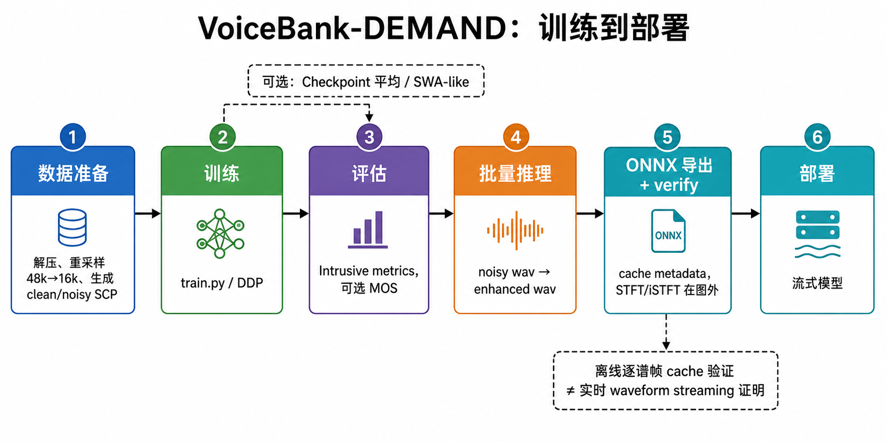

# Voicebank-DEMAND GTCRN 部署快速指南

这份文档带你从零走完一遍 **SE（Speech Enhancement，语音增强）** 流程：用公开数据集
VoiceBank-DEMAND 训练一个轻量降噪模型 **GTCRN**，评估它、批量为音频降噪，最后导出 ONNX
用于部署。每一步都给出可直接复制的命令和「跑完应该看到什么」。

开始前需要：VoiceBank-DEMAND 的四个压缩包（clean/noisy × train/test）、一块可用的 GPU、
已经装好运行环境的本仓库。数据集与训练超参的细节见
[`configs/se/voicebank_demand/README_CN.md`](../../../configs/se/voicebank_demand/README_CN.md)。

> 训练产物写在配置里的 `trainer.exp_path` 下，本例是
> `exp/se/gtcrn_causal_offline/checkpoints/<run-id>/`。下文把 checkpoint 路径统一写作
> `$CKPT`，请替换成自己的实际路径。

## 📋 完整工作流程



> 这是项目流程的解释性总览；离线逐谱帧 cache 验证不等同于实时 waveform streaming 证明，具体命令与边界以本文正文为准。

### 0️⃣ 数据准备

VoiceBank-DEMAND 的官方 train 使用 0/5/10/15 dB，官方 test 使用 2.5/7.5/12.5/17.5 dB，且 test 含训练阶段未见的 5 种噪声条件。先把四个压缩包解压到数据目录，再用通用 `prepare_scp.py` 生成当前 YAML 需要的清单文件。

> SCP（script）在本仓库指音频清单：每行一条音频记录，四列依次是 `uid 采样率 采样点数 音频路径`。训练脚本读这种清单找音频，不遍历目录。

```bash
unzip clean_trainset_wav.zip -d data/se/voicebank_demand
unzip noisy_trainset_wav.zip -d data/se/voicebank_demand
unzip clean_testset_wav.zip -d data/se/voicebank_demand
unzip noisy_testset_wav.zip -d data/se/voicebank_demand

python tools/prepare_data_tools/scp/prepare_scp.py \
    data/se/voicebank_demand/clean_trainset_wav \
    -o data/se/voicebank_demand/voicebank_clean_train
python tools/prepare_data_tools/scp/prepare_scp.py \
    data/se/voicebank_demand/noisy_trainset_wav \
    -o data/se/voicebank_demand/voicebank_noisy_train
python tools/prepare_data_tools/scp/prepare_scp.py \
    data/se/voicebank_demand/clean_testset_wav/clean_testset_wav \
    -o data/se/voicebank_demand/voicebank_clean_val
python tools/prepare_data_tools/scp/prepare_scp.py \
    data/se/voicebank_demand/noisy_testset_wav/noisy_testset_wav \
    -o data/se/voicebank_demand/voicebank_noisy_val
```

生成的 `voicebank_clean_train.scp`、`voicebank_noisy_train.scp`、`voicebank_clean_val.scp` 和 `voicebank_noisy_val.scp` 就是配置里 `data.train` / `data.validation` 直接读取的四个清单，缺任意一个都会在训练启动、构建数据集时直接报错（不会静默跳过）；旧 `prepare_voicebank.py` 的 `train/clean.scp`、`val/clean.scp` 等目录式产物不能直接满足当前 YAML。

> **评估协议警告：**上述快速复现流程把完整官方 test 集作为 validation。若用其选择 checkpoint、early stopping 或调超参数，会造成最终测试数据泄漏。严格实验必须从官方 train 的 clean/noisy 配对中另划独立 validation，将 YAML 指向该 validation，并保留官方 test 只用于最终一次评估。

### 1️⃣ 训练

```bash
# 单卡训练
CUDA_VISIBLE_DEVICES=0 python train.py -C configs/se/voicebank_demand/gtcrn_causal_offline.yaml

# 多卡 DDP 训练（DDP = 数据并行：多卡各跑一部分数据，每步同步梯度）
CUDA_VISIBLE_DEVICES=0,1,2,3 torchrun --nproc_per_node=4 train.py \
    -C configs/se/voicebank_demand/gtcrn_causal_offline.yaml
```

跑完后能看到两个目录：

- `exp/se/gtcrn_causal_offline/checkpoints/<run-id>/`：`best_model.tar`（验证集最优，评估和推理都用它）、`latest_model.tar`（最新 epoch）、`model_XXXX.pth`（按配置周期存盘）。
- `exp/se/gtcrn_causal_offline/logs/<run-id>/`：`train.log` 控制台日志、TensorBoard 曲线与 `train_val_loss.png`。

把 `best_model.tar` 的完整路径记下来，下文用 `CKPT` 表示，例如
`CKPT=exp/se/gtcrn_causal_offline/checkpoints/<run-id>/best_model.tar`。

---

### 2️⃣ 评估

```bash
# 方式 1: 通过实验目录自动发现 config + checkpoint（推荐，不必手写 checkpoint 路径）
python evaluate/eval_pipeline_se.py \
    --exp_dir exp/se/gtcrn_causal_offline \
    --datasets voicebank \
    --voicebank_clean_scp data/se/voicebank_demand/voicebank_clean_val.scp \
    --voicebank_noisy_scp data/se/voicebank_demand/voicebank_noisy_val.scp \
    --step all

# 方式 2: 手动指定 config + checkpoint，并开启 MOS 指标
CKPT=exp/se/gtcrn_causal_offline/checkpoints/<run-id>/best_model.tar
python evaluate/eval_pipeline_se.py \
    -C configs/se/voicebank_demand/gtcrn_causal_offline.yaml \
    --checkpoint "$CKPT" \
    --datasets voicebank \
    --voicebank_clean_scp data/se/voicebank_demand/voicebank_clean_val.scp \
    --voicebank_noisy_scp data/se/voicebank_demand/voicebank_noisy_val.scp \
    --step all \
    --audio_quality
```

`--step all` 表示推理和评估都跑（也可只跑 `inference` 或 `evaluate`）；`--audio_quality` 打开 MOS 类指标，不加时只算侵入式指标、更快。结果写在评估输出目录下的 `RESULTS.txt`。

**输出指标**（共 14 个）：

- **Intrusive（4）**：SI-SDR、PESQ、STOI、ESTOI。Intrusive 指需要干净参考音频才能算：SI-SDR 衡量波形失真，PESQ/STOI/ESTOI 衡量主观质量与可懂度。
- **MOS 主指标（4）**：DNSMOS_OVRL、NISQA、UTMOS、SCOREQ。MOS 指用模型预测的主观评分，只看增强后的音频就能打分。
- **MOS 子维度（6）**：DNSMOS_SIG、DNSMOS_BAK、NISQA_NOI、NISQA_COL、NISQA_DIS、NISQA_LOUD

---

### 2.5 （可选）Checkpoint 平均（SWA-like）

训练会留下很多中间 checkpoint，把它们求平均（SWA 类做法，SWA = Stochastic Weight
Averaging，平均多个时刻的权重，常能小幅提升泛化）有时比只用单个 best 更稳。
工具 `tools/model_tools/average_checkpoints.py` 对 SE/AEC/TSE 三任务通用：

```bash
CKPT_DIR=exp/se/gtcrn_causal_offline/checkpoints/<run-id>
AVG_OUT=$(dirname "$CKPT_DIR")

# best 模式：按文件名 val_loss 升序取 top 5 个 best_step=*.tar 平均
python tools/model_tools/average_checkpoints.py \
    --ckpt_dir "$CKPT_DIR" \
    --mode best --num 5 \
    --output "$AVG_OUT/avg_best5.tar"

# final 模式：取最后 3 个 model_XXXX.pth（按 epoch/batch 序号）平均
python tools/model_tools/average_checkpoints.py \
    --ckpt_dir "$CKPT_DIR" \
    --mode final --num 3 \
    --output "$AVG_OUT/avg_final3.tar"
```

- 平均规则：float 权重逐键求均值；int/buffer（如 `num_batches_tracked`）取第一个 ckpt 的值；
  所有入选 ckpt 含 EMA（Exponential Moving Average，训练中维护的一份平滑权重副本）时，
  `ema.shadow_params` 也逐元素平均（加载时 EMA 权重自动优先生效）。
- 输出与 BaseTrainer ckpt 同构（含 `config`/`resolved_config`），可直接作为
  `--checkpoint` 传给评估/推理/ONNX 导出；已剔除 optimizer/scheduler 等优化状态，
  不可用于 resume 训练。
- 平均后建议重新跑一遍第 2 步评估，与 `best_model.tar` 对比后再选用。

---

### 3️⃣ 批量推理

```bash
# 对一批 noisy 音频进行增强（$CKPT 见第 1 步）
python inference.py \
    -C configs/se/voicebank_demand/gtcrn_causal_offline.yaml \
    --checkpoint "$CKPT" \
    --input_dir path/to/noisy/wavs \
    --output_dir results/enhanced
```

输出目录中每个输入对应一个增强后的 `.wav`，另有 `inf.scp`（结果清单）与
`run_manifest.json`（本轮输入身份记录；配合 `--skip-existing` 可跳过已验证的输出）。

---

### 4️⃣ ONNX 调试导出（非正式发布）

ONNX 是跨平台推理格式：导出后可以不装 PyTorch，直接用 ONNX Runtime 跑模型。
下面两条命令只产出仓库内的调试文件，不是可发布的部署资产。

```bash
# GTCRN direct mode；--smoke 仅做一次 PyTorch/ONNX Runtime 冒烟比对
python onnx/export.py \
    --model streaming_gtcrn \
    --checkpoint "$CKPT" \
    --output runs/onnx_debug/gtcrn_streaming.onnx \
    --smoke

# 可选：简化 debug artifact 后，再执行同一 smoke 检查
python onnx/export.py \
    --model streaming_gtcrn \
    --checkpoint "$CKPT" \
    --output runs/onnx_debug/gtcrn_streaming_simplified.onnx \
    --simplify --smoke
```

`streaming_gtcrn` direct mode 从标准 GTCRN checkpoint 构建并转换 `StreamingGTCRN`。
"流式"指模型逐帧处理、把跨帧需要的历史状态存成 cache：导出时 cache 形状由
`init_cache()` 推导，并写入版本化 `streaming_runtime_spec` 与 `gtcrn_cache_cfg`；
部署端在首帧前严格校验 metadata、I/O 顺序和 cache shape。STFT/iSTFT 不在 ONNX 图内，
需要部署端按训练配置自行实现（见文末示例）。
这里的 `--output` 只能锚定到仓库内 `runs/onnx_debug/`，生成的只是 debug artifact；`--smoke`
不是正式发布 gate，`--no-verify` 只表示跳过 smoke，generic exporter 的 `--save-onnx` 会直接拒绝。
`onnx/models/streaming_gtcrn.py` 自带 demo 也只允许在该 debug 根下创建新文件，并通过 owned
临时文件与安全 debug publisher 写入主图/简化图。正式发布必须运行现有专属三路 gate
（三路 = 离线 PyTorch / 流式 PyTorch / 流式 ONNX Runtime 结果互相对齐）；
该 verifier 固定 GTCRN `n_fft=512`，不接受 `-C/--config`：

```bash
python onnx/verify/verify_3way_gtcrn.py \
    --checkpoint "$CKPT" \
    --save-onnx onnx/onnx_model/gtcrn_streaming.onnx
```

只有离线 PT / 流式 PT / 流式 ORT 全部通过时才会写入正式产物，不能将 generic debug artifact
直接升级为发布资产。正式发布绑定 verifier 验证过的 snapshot，并由共享 publisher 通过 target CAS
和 commit 前身份校验 rollback 保护既有或并发写入的目标。

---

## 🚀 离线波形逐谱帧验证示例

ONNX 图和 `StreamingGTCRN` 都只吃单帧频谱（STFT/iSTFT 在模型外），所以想自己验证流式
数值时，需要按训练配置的 STFT 参数手动逐帧喂入。下面两段代码就是把这件事做一遍：
先一次性读完整波形、算出完整 STFT，再逐帧调用模型并重建波形。

它们仅用于离线数值与 cache 递推验证，**不是**在线 waveform streaming、实时音频回调或
端到端系统时延的证明。

### Python (PyTorch)

```python
from pathlib import Path

import torch
import soundfile as sf
from core.stft import build_stft_istft
from core.utils.safe_load import safe_torch_load
from onnx.models.streaming_gtcrn import StreamingGTCRN, convert_gtcrn_to_streaming

device = torch.device("cpu")

# 训练侧 GTCRN 是谱进谱出模型，无流式接口；流式推理使用 StreamingGTCRN
ckpt = safe_torch_load(Path("exp/se/gtcrn_causal_offline/checkpoints/<run-id>/best_model.tar"))
sd = ckpt.get("model_state_dict") or ckpt.get("model") or ckpt.get("state_dict") or ckpt
if any(k.startswith("module.") for k in sd):
    sd = {k[len("module."):]: v for k, v in sd.items()}

# 先将 checkpoint 加载到标准训练模型，再交给转换函数；不要手工改写 state_dict 键名。
from tasks.se.models.discriminative.gtcrn import GTCRN

train_model = GTCRN().eval()
train_model.load_state_dict(sd, strict=True)
model = StreamingGTCRN(n_fft=512, hop_length=256, win_length=512).eval()
convert_gtcrn_to_streaming(model, train_model)  # 训练权重 → 流式权重（含 ConvTranspose 翻转）

# STFT 在模型外；参数与训练 YAML 顶层 stft 块一致
# （configs/se/voicebank_demand/gtcrn_causal_offline.yaml: n_fft=512, hop=256, hann）
stft = build_stft_istft({
    "n_fft": 512, "hop_length": 256, "win_length": 512, "window": "hann",
}).eval()

# 初始化三路流式缓存（形状由 init_cache 推导）
cache = model.init_cache(batch_size=1, device=device, dtype=torch.float32)

# 逐帧处理（谱进谱出）
noisy, sr = sf.read("noisy.wav")
wav = torch.from_numpy(noisy).float().unsqueeze(0).to(device)

with torch.inference_mode():
    spec = stft(wav)  # (1, 257, T, 2)
    outs = []
    for t in range(spec.shape[2]):
        enh, cache["conv_cache"], cache["tra_cache"], cache["inter_cache"] = model(
            spec[:, :, t:t+1, :],
            cache["conv_cache"], cache["tra_cache"], cache["inter_cache"],
        )
        outs.append(enh)
    enhanced = stft.inverse(torch.cat(outs, dim=2), wav.shape[1])

sf.write("enhanced.wav", enhanced.squeeze(0).cpu().numpy(), sr)
```

### Python (ONNX Runtime)

```python
import onnxruntime as ort
import soundfile as sf
import torch
from core.stft import build_stft_istft
from onnx.infer.streaming_ort_runner import StreamingORTFrameRunner

# ONNX 为谱进谱出；STFT/iSTFT 在图外，参数必须与训练 YAML 顶层 stft 块一致。
stft = build_stft_istft({
    "n_fft": 512, "hop_length": 256, "win_length": 512, "window": "hann",
}).eval()

sess = ort.InferenceSession("runs/onnx_debug/gtcrn_streaming.onnx")
# 构造时严格校验 streaming_runtime_spec、gtcrn_cache_cfg、I/O 顺序与 cache shape。
runner = StreamingORTFrameRunner(sess, "gtcrn", batch_size=1)

# 逐帧处理
noisy, sr = sf.read("noisy.wav")
wav = torch.from_numpy(noisy).float().unsqueeze(0)

with torch.inference_mode():
    spec = stft(wav)  # (1, 257, T, 2)

outs = []
for t in range(spec.shape[2]):
    enh, _elapsed = runner.run_frame(spec[:, :, t:t+1, :])
    outs.append(torch.from_numpy(enh))

with torch.inference_mode():
    enhanced = stft.inverse(torch.cat(outs, dim=2), wav.shape[1])

sf.write("enhanced.wav", enhanced.squeeze(0).numpy(), sr)
```

---

## 📊 部署模式对比

| 模式 | 用途 | 延迟 | 适用场景 |
|------|-----|------|---------|
| **全序列推理**（`inference.py`） | 一次喂入整段音频 | N/A（不追求实时） | 离线增强、数据集预处理 |
| **PyTorch 流式**（`StreamingGTCRN`） | 逐帧喂入，自行管理 cache | 由训练 STFT 与缓冲策略决定 | 开发、测试、原型验证 |
| **ONNX FP32** | 逐帧喂入 ONNX Runtime 会话 | 由训练 STFT 与缓冲策略决定 | 服务器、PC、嵌入式 Linux |

<!-- 用户决策：语音信号算法不支持 int8 精度，部署仅考虑 fp32/fp16。 -->

---

## 🎯 关键参数

| 参数 | 训练 | 部署 |
|------|-----|------|
| STFT 参数 | YAML 顶层 `stft` 块 | 与训练配置严格一致，且在 ONNX 图外实现 |
| `batch_size` | 训练配置决定 | 推荐从 `batch_size=1` 开始；cache 的 batch 维须同步 |
| 模型格式 | `.tar` | `.onnx` |

**⚠️ 重要**：本仓库无法从 GTCRN ONNX 图本身推导或替换 `center` 语义；部署 STFT/iSTFT 必须复用训练配置的实际约定，不能将 `center=False` 作为通用实时规则。

---

## 📁 文件结构

```
use_train/
├── configs/se/voicebank_demand/
│   ├── gtcrn_causal_offline.yaml
│   ├── zipenhancer_s.yaml
│   ├── README.md          # 英文完整文档
│   └── README_CN.md       # 中文完整文档
├── data/se/voicebank_demand/
│   ├── voicebank_clean_train.scp
│   ├── voicebank_noisy_train.scp
│   ├── voicebank_clean_val.scp
│   └── voicebank_noisy_val.scp
├── tools/
│   └── prepare_data_tools/scp/prepare_scp.py  # 通用 SCP 准备脚本
├── onnx/
│   └── export.py          # ONNX 导出工具
├── evaluate/
│   └── eval_pipeline_se.py    # SE 统一评估管线（含 VoiceBank 等数据集）
├── inference.py           # 批量推理
├── exp/se/gtcrn_causal_offline/   # 训练产物（由 trainer.exp_path 决定）
│   ├── checkpoints/<run-id>/      # best_model.tar / latest_model.tar / model_XXXX.pth
│   └── logs/<run-id>/             # train.log / TensorBoard 曲线
└── runs/onnx_debug/       # 用户创建的 debug/general 产物（非正式发布）
    └── gtcrn_streaming.onnx
```

---

## 📚 详细文档

- **英文**: `configs/se/voicebank_demand/README.md`
- **中文**: `configs/se/voicebank_demand/README_CN.md`

包含：
- ✅ 数据准备详细步骤
- ✅ 训练超参数说明
- ✅ 14 个评估指标详解
- ✅ 部署各平台完整示例
- ✅ FAQ 和故障排除

---

**快速开始**: 
1. 准备数据 → 2. 训练模型 → 3. 评估性能 → 4. 导出 ONNX → 5. 集成部署 ✅
