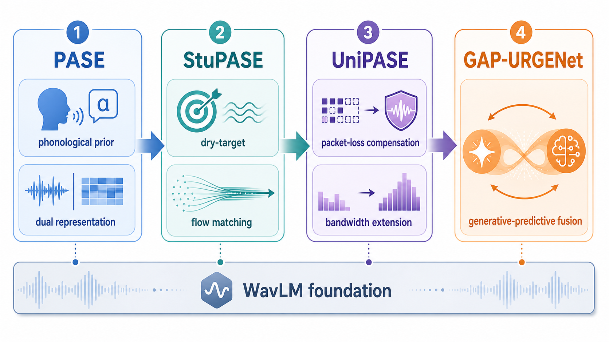
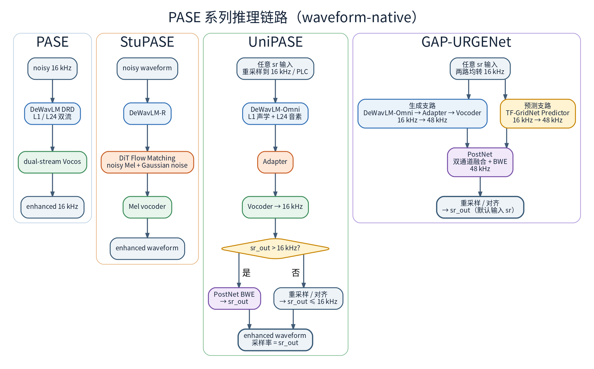
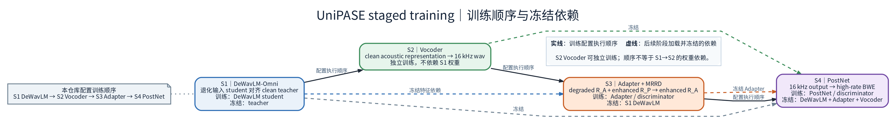
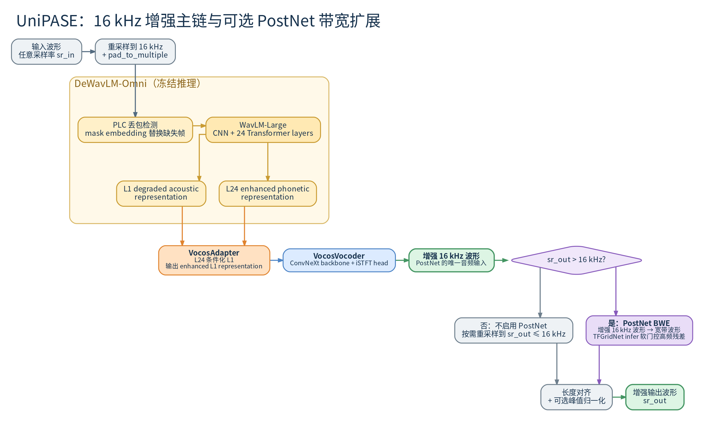
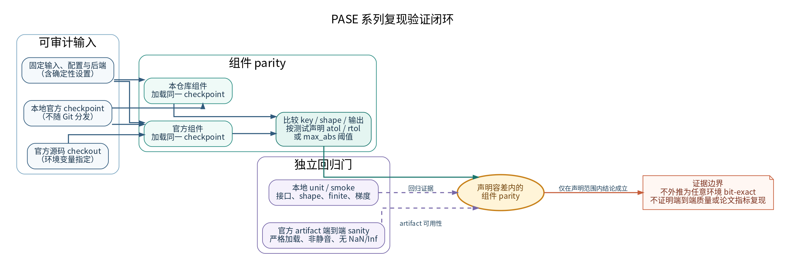

# PASE 系列（PASE / StuPASE / UniPASE / GAP-URGENet）模型原理与复现学习指南

> **读者定位**：初学者的完整学习文档。从"这些模型是什么、解决什么问题"讲起，
> 到结构对比、训练异同、流式可行性，最后落到本框架（`tasks/se/models/pase_family/`）的
> 复现与使用。
>
> **怎么读**：§1~§3 建立整体认识（建议依次读）；§4~§7 是训练阶段、上手命令与学习路径
> （准备训练时读）；§8~§10 说明实现差异、数据仿真与调试方法；§11 是已知限制；
> §12 是 released 权重复现、三阶段分工、数据尺寸与训练配置对齐的关键结论（2026-10）。
> 只想先把模型跑起来，看 §1 的速览表 + §6.4。
>
> **术语速查**（正文第一次出现处也会给出解释）：
>
> | 缩写 | 一句话解释 |
> |---|---|
> | **SE** | Speech Enhancement，语音增强：去掉录音里的噪声、混响或设备失真 |
> | **SSL 模型 / WavLM** | Self-Supervised Learning 预训练语音模型；本系列统一用微软 WavLM-Large 当特征前端 |
> | **表征（representation）** | 模型内部对语音的抽象特征向量，既不是波形也不是频谱 |
> | **幻觉（hallucination）** | 生成模型编造出原音频里没有的语音内容，是生成式增强的核心风险 |
> | **mel 谱** | 按人耳感知缩放的频谱表示，声码器常用的中间格式 |
> | **Flow Matching / CFM / ODE** | 用连续流（微分方程数值积分）从噪声逐步生成目标的方法，步数固定且该过程不可微 |
> | **CFG** | Classifier-Free Guidance：推理时放大条件作用的权重 |
> | **DiT** | Diffusion Transformer，用 Transformer 担当生成主干 |
> | **PLC** | Packet Loss Concealment，丢包补偿：补回传输中丢失的音频片段 |
> | **BWE** | Bandwidth Extension，带宽扩展：把 16 kHz 窄带还原成 48 kHz 宽带 |
> | **判别式 / 生成式** | 判别式直接预测目标（如掩码）；生成式从分布中采样/生成目标 |
> | **MPD / MBD / MSD** | 多周期 / 多频带 / 多尺度判别器，GAN 中负责判断音频真假 |
> | **DDP / AMP / EMA** | 多卡数据并行 / 混合精度 / 训练中维护的平滑权重副本 |
> | **UTMOS / DNSMOS / PESQ** | 自动预测主观听感的评分模型；PESQ 需要干净参考音频 |
> | **WER / dWER / SpkSim** | 词错误率 / 用伪参考转写算的 WER / 说话人相似度 |
> | **SI-SNR / SI-SDR** | 尺度不变的信噪比：衡量重建波形与参考波形的距离，越高越好 |
> | **SBS / LPS** | SpeechBERTScore（语义相似度）/ 音素编辑距离相似度 |
> | **URGENT** | 一个语音增强比赛系列；本系列论文多以它的数据与指标为评测口径 |
>
> 架构缩写（`DeWavLM`、`DeWavLM-R`、`DeWavLM-Omni`、`Vocos`、`Adapter`、`PostNet`、`Predictor`）
> 在 §2 各模型小节里逐个解释；前文出现即用的 `UTMOS 3.09` 一类数字是论文报告值。
>
> 官方源码基线：
> - PASE / StuPASE：[cisco-open/pase](https://github.com/cisco-open/pase)（本文核对基线为 commit `7f94833`，Apache-2.0）
> - UniPASE：[Xiaobin-Rong/unipase](https://github.com/Xiaobin-Rong/unipase)（Apache-2.0）
> - GAP-URGENet：[Xiaobin-Rong/gap-urgenet](https://github.com/Xiaobin-Rong/gap-urgenet)
>
> 外部 parity 测试需自行提供相应官方 checkout 与权重；路径通过
> `PASE_SOURCE_REPO`、`UNIPASE_SOURCE_REPO`、`GAP_URGENET_SOURCE_REPO` 等环境变量配置。
>
> 配套文档：
> - [`paper/se/Nanjing/`](../../paper/se/Nanjing/) — 四篇论文精读笔记（PASE / StuPASE / UniPASE / GAP-URGENet，
>   2026-08-05 精读）。统一模板：TL;DR → 基本信息 → 核心思想与解决的问题 →
>   方法架构（节首为官方结构图）→ 训练细节 → 推理细节 → 实验与指标 → 复现要点 →
>   局限与备注，含论文全部表格数值与复现要点。官方结构图集中在
>   [`figures/`](../../paper/se/Nanjing/figures/)，本指南 §2 各模型小节直接引用；
>   本指南 §8.4 的差异核对即基于它们。
> - `docs/diagrams/se_models/` — PASE family 架构与数据流图；精确拓扑图以相邻 Graphviz `.dot` 为事实源，未提供 DOT 的历史 PNG 仅作概念辅助，模块、公式和张量细节以本文正文为准。
> - [Rong_Model_Family_Analysis.md](../../architecture/analysis/Rong_Model_Family_Analysis.md) —
>   Xiaobin-Rong 作者线六模型（GTCRN → UL-UNAS → PASE → StuPASE → UniPASE → GAP-URGENet）
>   机制级深度分析报告。
> - [Simulation_Flow_Logic.md](../simulation/Simulation_Flow_Logic.md) — 本框架统一 A–F 仿真管线完整逻辑。
> - `configs/se/urgent2026/pase/README.md`、`configs/se/urgent2026/pase/unipase/README.md`、`configs/se/urgent2026/pase/gap_urgenet/README.md` — 配置级说明。

---

## 1. 系列概览

**系列演进速览**（30 秒建立全局认识）：

| 模型 | 发表 | 一句话定位 | 核心增量 |
|---|---|---|---|
| PASE | AAAI 2026 | 双流表征一步生成波形（WavLM 特征 → Vocos 直接出波形） | —（系列开山之作，确立"生成式 + 表征空间"路线） |
| StuPASE | Interspeech 2026 | dry target + mel 域 Flow Matching 两阶段生成 | 把"生成"职责交给专门生成模型（DiT-CFM），声码器只做自编码，主打 studio-quality |
| UniPASE | IEEE TASLP | 表征域 Adapter + PLC + BWE，任意采样率通吃 | 增强前移到 WavLM 浅层 L1；新增丢包补偿与 48k 带宽扩展 |
| GAP-URGENet | ICASSP 2026 | 生成-预测双支路融合 | 叠加判别式 TFGridNetV3 Predictor 支路 + 双通道 PostNet 融合（URGENT 2026 客观评测第 1） |



> 系列演进概念图：四代方法共享 WavLM 底座，依次引入 dry-target Flow Matching、PLC/BWE 与生成-预测融合；它用于建立谱系直觉，精确模块连接仍以各模型正文和可维护 DOT 图为准。

PASE 系列出自同一批作者（南京大学现代声学重点实验室，分别与 Cisco、地平线合作），核心思想
一脉相承：**不直接在波形或频谱上做映射，而是借助预训练 SSL 模型（WavLM-Large）的表征空间，
用生成式方法（GAN 声码器 / Flow Matching）"重新生成"干净的语音**，从而压低传统判别式增强
常见的"幻听"（hallucination，即模型编造出不存在的语音内容）。PASE / StuPASE 发布于
`cisco-open/pase`，UniPASE / GAP-URGENet 发布于 `Xiaobin-Rong/*`。

框架侧还有一条重要约定：这些模型的推理入口都走 **waveform-native** 路径（吃波形、出波形），
框架不替它们做 STFT/iSTFT；各模型内部仍可按自己的架构使用 mel、ISTFT 或其他时频处理。

| 模型 | 论文 | 发表 | 官方仓库 | 开源权重（HF） |
|---|---|---|---|---|
| PASE | *Leveraging the Phonological Prior of WavLM for Low-Hallucination Generative SE*（arXiv 2511.13300） | AAAI 2026 | `cisco-open/pase` | `cisco-ai/pase` |
| StuPASE | *Towards Low-Hallucination Studio-Quality Generative SE*（arXiv 2603.09234） | Interspeech 2026 | `cisco-open/pase` | `cisco-ai/stupase` |
| UniPASE | *A Generative Model for Universal SE with High Fidelity and Low Hallucinations*（arXiv 2604.14606） | IEEE TASLP | `Xiaobin-Rong/unipase` | `Xiaobin-Rong/unipase` |
| GAP-URGENet | *GAP-URGENet: A Generative-Predictive Fusion Framework for Universal SE*（arXiv 2604.01832） | ICASSP 2026 | `Xiaobin-Rong/gap-urgenet` | 随官方仓库发布 |

### 共同技术底座

模型组件级别的复用度极高，先理解这四块，PASE/StuPASE/UniPASE 就是它们的组合，
GAP-URGENet 则是在 UniPASE 组合之上再叠加 TFGridNet 支路：

1. **WavLM-Large 编码器（约 315M 参数）**：微软的 SSL 语音模型。7 层 CNN 把 16kHz 波形
   下采样 320 倍（→ 50 fps 帧率，hop=320），再接 24 层 Transformer（1024 维、16 头、
   门控相对位置编码）。各模型都以它为前端，且**每层输出都可抽取**——PASE/UniPASE
   用第 1 层（声学细节丰富）和第 24 层（音位/语义抽象）两个表征。
2. **Vocos 范式解码器**：`ConvNeXt backbone + ISTFT head`。backbone 是 12 个
   ConvNeXtBlock（深度可分离卷积 k=7 → LayerNorm → 升维 3 倍 → GELU → 降回），
   head 把每帧映射到 `n_fft+2 = 1282` 个数，一半出 log-magnitude、一半出相位
   （cos/sin 直出），拼成复谱后做自定义 ISTFT（n_fft=win=1280, hop=320）还原 16kHz 波形。
3. **GAN 训练框架**：生成器 + 判别器对抗。波形域判别器是 **MPD**（多周期，periods
   [2,3,5,7,11]）+ **MBD**（多频带，fft [2048,1024,512]）的 LS-GAN；特征域（UniPASE
   Adapter）换成 **MultiScaleDiscriminator**（6 个 1D 卷积判别器，宽度 32→1024）。
   重建损失统一用**多尺度 mel L1**（7 个窗长 32~2048，log-mel 距离，权重 ×15）。
4. **URGENT 数据仿真**：训练对（noisy, clean）由干净语音现场合成。当前统一管线按配置执行 Layer A–F；PASE-family 配置保留官方增强子集，是否启用信道退化、峰值归一化和风噪必须以具体 YAML 为准，不能把某一套配置概括为所有 family 的固定顺序。UniPASE 的丢包增广（20 ms 包、5%~25% 丢包率、最多连续 10 包）与其 PLC 机制配套。

---

## 2. 模型原理逐个讲


> 图 1：PASE / StuPASE / UniPASE / GAP-URGENet 四个模型的推理数据流总览，按编码器、生成/增强模块、声码器以及融合/预测后处理分区展示从输入到输出的关系；张量形状、公式和模块细节见正文。
> 图中颜色用于区分不同功能分区：蓝色为 WavLM 编码器系，橙色为生成/增强模块，绿色为声码器，紫色为融合/带宽扩展后处理，黄色为 GAP-URGENet 特有的判别式预测支路。

各模型小节按统一结构组织：**官方结构图 → 一句话定位 → 关键机制要点**；
训练步数、指标数值等细节见各小节末尾链接的精读笔记。

读之前先握住三个词：**声码器（vocoder）** = 把频谱或特征还原成波形的模块；**蒸馏
（distillation）** = 让一个可训练模型（student）去模仿一个冻结模型（teacher）的输出，
把 teacher 的能力搬过来；**teacher / student** 就是这两个角色（通常 teacher 处理干净
语音，student 处理带噪输入）。后文的 **L1 / L24** 指 WavLM 的第 1 / 第 24 层输出。

### 2.1 PASE —— 直接映射（WavLM 特征 → 波形）


> 图 2：(a) PASE 整体框架——带噪波形 → DeWavLM → 取出 L1 声学表征与 L24 音系表征 →
> 相加融合 → Vocos 重建增强波形；(b) DRD 去噪表征蒸馏——冻结的 WavLM teacher 对干净
> 语音输出表征，可训练的 DeWavLM student 对带噪语音输出表征，两者做 MSE 蒸馏。

**一句话定位**：直接法——整个模型就是"编码器 + 声码器"两段，在 WavLM 特征空间
一步直接生成 16k 波形，中间不经过任何谱表示。

- **DeWavLM：表征蒸馏（DRD, Denoising Representation Distillation）**：可训练的
  WavLM 吃带噪输入，冻结的原始 WavLM 吃 clean 语音产出第 24 层特征作 teacher，用 MSE
  让 student 的第 24 层特征逼近——编码器因此学会"从带噪输入中提取干净音位表征"。
  论文消融的三个关键结论：**(a) 纯 KD 优于 KD+SSL 掩码联合**（WER 7.62% vs
  8.78%，不要加 masked prediction 损失）；**(b) 蒸馏层用 L24→L24**（student/teacher
  都取最后一层，跨层蒸馏有表征错配瓶颈）；**(c) 必须用官方 WavLM-Large 预训练权重
  初始化**（从零初始化 WER 38.62% vs 7.62%，预训练先验是低幻听的根本来源）。
- **双流解码**：第 24 层（phonetic，语义主线）+ 第 1 层（acoustic，声学细节）经一个
  Linear 投影后**逐元素相加**，再进 Vocos——语义由 L24 保证、声学细节由 L1 补充，
  这是 PASE 低幻听的关键。声学条件的代价与收益（论文消融）：UTMOS 3.42→3.09（浅层
  表征残留噪声）但 SpkSim 0.57→**0.80**（声学幻觉被显著抑制），必须双流同用。
  L1 与 L24 表征余弦相似度均值 0.060（≈86° 夹角，几乎正交），加法融合无损。
- **Vocos 声码器**：`Linear(1024→768)` 投影 → WavTokenizer 式 attention 模块 →
  **12 个 ConvNeXt block（隐藏维 768、中间维 2304）** → iSTFT head（n_fft=1280,
  hop=320）直接出波形。损失 = 多尺度 mel ×15 + MPD/MBMSD 对抗 ×2 + feature matching
  ×1（15:2:1，官方 cfg `coeff recons 15 / adv 2 / feat 1`）。

详细数值与复现要点见 [PASE 精读笔记](../../paper/se/Nanjing/PASE.md)。

### 2.2 StuPASE —— 两阶段生成（Flow Matching 在 mel 空间生成）


> 图 3：StuPASE 整体数据流——Noisy Speech 经 DeWavLM-R 产出 Enhanced Phonetic Rep.，
> 经 Linear 投影后与 Mel 条件、Gaussian Noise 一起送入 DiT-based Flow Matching 生成
> 干净 Mel，再由 Mel Vocoder 重建 Enhanced Speech。

**一句话定位**：两阶段生成（Stu = Studio）——先在 **mel 谱空间用 Flow Matching（DiT）
生成干净 mel**，再用声码器转波形，目标是比 PASE 更高保真（studio-quality）。

- **为什么两阶段**：PASE 一步直出波形，声码器既要学声学又要"脑补"损伤内容，容易幻听。
  StuPASE 把"生成"交给专门的生成模型（Flow Matching，F5-TTS 同款框架），声码器只做
  纯 mel→波形自编码，职责单一、保真更高。
- **CFM 训练方式**（条件流匹配/infilling）：在 clean mel `x1` 与噪声 `x0` 之间插值
  `φ_t = (1−t)x0 + t·x1`，训练 DiT 预测速度场 `x1−x0`，**只在被随机掩蔽的时间段上算
  MSE**（clean mel 掩蔽比例 U[0.7, 1.0]、noisy mel U[0.5, 1.0]，两个掩蔽区域独立采样）。
- **推理与 CFG**：从噪声出发走 **8 步 Euler ODE** 采样（论文未给 CFG 权重，0.5 为官方
  推理脚本默认）。CFG 条件丢弃存在本地/官方两版差异——本框架实现音频 0.5 / noisy 0.3 /
  text 0.3 / 联合无条件 0.2，官方源码把 noisy/text 丢弃**注释掉了**（见 §8.2 第 6 条）。
- **DiT 配置**（论文第 3 节 + 官方 `cfg_train_flow.yaml`）：depth=12、heads=16、
  dim=1024、FFN=2048（ff_mult=2）、mel_dim=100；WavLM 语义表征先经 `TextEmbedding`
  线性投影 **1024→512** 再与（噪声 mel + 被掩蔽的干净 mel）沿特征维拼接。
- **DeWavLM-R**：在 PASE 的 DeWavLM 之上，用 **dry target**（去除早反射的干信号）二次
  蒸馏（学习率降到 2e-5），让表征更"干净"。论文核心发现：去混响目标必须用 dry 而非
  early-RIR（early-RIR 指只保留早期反射的版本，听感上仍带混响残留）——PASE 的 early-RIR
  target 在感知上仍带混响感，生成模型学习 target 的完整分布，target 失真会被学进模型。

> 注意与 PASE 的本质区别：**增强发生在 mel 谱空间**。CFM 的 ODE 采样不可微，推理级联
> 不可端到端训练。

详细数值与复现要点见 [StuPASE 精读笔记](../../paper/se/Nanjing/StuPASE.md)。

### 2.3 UniPASE —— 表征空间适配器 + 通用损伤处理


> 图 4：任意采样率输入 → 重采样到 16 kHz → PLC 丢包检测给出二进制 mask →
> DeWavLM-Omni → Adapter → Vocoder → 16 kHz 波形 → PostNet（仅当原始采样率 > 16 kHz
> 时启用）→ 48 kHz → 重采样回原始采样率。

**一句话定位**：通用增强（"Universal"）——增强前移到 **WavLM 浅层（L1）声学表征空间**
（Adapter 模块），并加上**丢包补偿（PLC）**与 **48kHz 带宽扩展（PostNet）**，一个模型
通吃去噪/去混响/削波/编解码损伤/丢包/带宽扩展，且支持任意输入采样率。

- **双表征设计与 PASE 相反的角色分配**：PASE 让 L24 当主线；UniPASE 让 **L1（浅层声学）
  当增强目标**，L24 只做条件。直觉：浅层保留更多声学细节，在其空间做增强保真度更高；
  深层语义用来"指导"浅层该变成什么样。融合方式与 PASE 双流相同
  （`proj(L24) + L1`），但输出仍停留在特征空间，由独立声码器出波形。
- **PLC（丢包补偿）**：不在波形域修补，而是检测 20ms 全零包（`zero_ratio ≥ 0.99`，
  幅度阈值 1e-7，**论文写 1e-4、官方源码与本地实现均为 1e-7，以源码为准**），
  把对应帧的 CNN 特征替换为**可学习的 mask_emb 向量**（wav2vec2 预训练掩码同构），
  让 24 层 Transformer 自己"补全"上下文。与训练数据里的丢包增广配套
  （20ms 包、丢包率 U[0.05, 0.25]、最多连续 10 包）。
- **PostNet 带宽扩展**：ESPnet TFGridNetV3 改的轻量模型（2.8M），16k→48k，
  STFT 域（n_fft=1536, hop=768）+ 5 个 GridNetBlock（帧内/帧间 BiLSTM + 多头注意力）。
  **训练与推理行为有意不同**：训练是全时域残差 `(output + x_ref) * std`；推理用
  **软门控残差**——8kHz 以下（含 800Hz 线性过渡带）完全保留输入谱，只把模型预测的
  高频残差叠上去，避免改动低频内容引入失真。
- **损失权重（与 PASE 系不同）**：Adapter 阶段 = **MSE×200 + LSGAN + feat×1**
  （特征域，官方 cfg `coeff recons 200 / adv 1 / feat 1`）；Vocoder/PostNet 阶段 =
  多尺度 mel **×15 + adv×0.5 + feat×0.5**（论文写作 30/1/1，×2 后数值等价，见 §8.4
  P-05）。PASE 的 Vocoder 是 adv×2/feat×1——同族不同代，**不要混用**。

详细数值与复现要点见 [UniPASE 精读笔记](../../paper/se/Nanjing/UniPASE.md)。

### 2.4 GAP-URGENet —— 生成-预测双支路融合


> 图 5：双支路并行——生成支路（DeWavLM-Omni → Adapter → Vocoder）与预测支路
> （Predictor）均工作于 16 kHz，两路输出拼接送入 PostNet，在其内部完成特征融合与
> 带宽扩展（BWE），直接生成 48-kHz 增强波形。

**一句话定位**：生成-预测融合——生成支路完整复用 UniPASE 三模块（DeWavLM-Omni →
VocosAdapter → VocosVocoder），另加一条判别式 **TFGridNetV3 Predictor** 预测支路，
双路 16k 上采样 48k 后由**双通道 PostNet** 融合输出。URGENT 2026 客观评测第 1
（team WR）；**总参数量 567.76M、472.84 GMACs/s**（论文 Table；本框架发布配置实测
568.6M，差 0.8M 是论文 Adapter 参数口径偏小，见 §8.4）。

- **为什么融合**：生成支路低幻听但可能过平滑，判别式 Predictor 保真度高但重度损伤下
  易引入人工痕迹；PostNet 把两路 48k 波形 stack 成 (B,2,L) 当"双通道输入"做融合，
  取两者之长。
- **与 UniPASE PostNet 的区别**：GAP 的 PostNet 是**无残差、无软门控**的纯融合网络
  （UniPASE PostNet 训练用全时域残差、推理用 8kHz 软门控残差），职责从"带宽扩展"
  变为"双支路融合"。
- **Predictor 具体配置**（官方 `cfg_train_predictor.yaml`）：单通道 TFGridNetV3，
  **10 层、LSTM 隐藏 200、8 头注意力、emb_dim 96、emb_ks 4 / emb_hs 1**（22.09M），
  STFT 按秒参数化：16k 下 n_fft=512 / hop=256；无 BandSplit、无 mask 无压缩，
  直接回归复数谱，逐 utterance 归一化后 istft 乘回 std。
- **PostNet 具体配置**（官方 `cfg_train_postnet.yaml`）：**双通道**（n_imics=2）
  TFGridNetV3 + BandSplit，**5 层、LSTM 隐藏 100、4 头注意力、emb_dim 96**
  （4.78M），48k 下 STFT n_fft=1536 / hop=768（0.032s 硬编码），输入为两路
  48k 波形 stack 的 (B,2,L)。
- **损失设计**：Predictor 用 `GAPHybridLoss`（压缩复数谱 RI×30 + 压缩幅度×70 +
  符号 SDR 变体×1，`core/losses/pase_family.py` 与官方 `loss_factory.py` diff=0.0）；
  PostNet 用系列统一的 `15×mel + 1×adv + 1×feat` GAN 配方（官方 cfg coeff
  15/1/1；论文称含 PESQ-/UTMOS-aware 项，发布配置并无，见 §8.4 P-07）。


> 图 6：URGENT 2026 Challenge 官方最终榜单——GAP-URGENet 在客观评测中排名第 1
> （1st place in the objective evaluation）。

详细数值与复现要点见 [GAP-URGENet 精读笔记](../../paper/se/Nanjing/GAP_URGENet.md)；
机制级深度分析（含参数量实测、与 UL-UNAS/GTCRN 的作者线定位）见
[Rong_Model_Family_Analysis.md](../../architecture/analysis/Rong_Model_Family_Analysis.md) §五。

---

## 3. 模型结构对比

| 维度 | PASE | StuPASE | UniPASE | GAP-URGENet |
|---|---|---|---|---|
| 增强发生域 | WavLM 特征 → 波形（一步） | **mel 谱**（CFM 生成） | **WavLM L1 特征**（Adapter） | 生成支路同 UniPASE + 预测支路 STFT 域 |
| 生成范式 | 直接映射（非迭代） | Flow Matching（8 步 ODE 迭代） | 直接映射（非迭代） | 直接映射（生成-预测融合） |
| 编码器 | DeWavLM（L24 蒸馏） | DeWavLM-R（dry 二次蒸馏） | DeWavLM-Omni（PLC 掩码蒸馏） | DeWavLM-Omni（复用 UniPASE 产物） |
| 关键模块 | 双流 Vocos decoder | DiT-CFM + mel vocoder | VocosAdapter + VocosVocoder + PostNet | UniPASE 生成支路 + TFGridNet Predictor + 双通道 PostNet |
| 主干参数量 | encoder 315.45M + decoder 66.69M（**= 论文 382.14M**） | encoder 315M + CFM 189.5M + vocoder ~60M | encoder 315.45M + adapter 114.52M + vocoder 113.73M + postnet 2.77M | 生成支路 + predictor 22.09M + postnet 4.78M（**总计 ~568M，论文 567.76M**） |
| 输入采样率 | 16k 固定 | 16k 固定 | **任意**（模型内部重采样；官方训练 default_fs 16k） | Phase 1 16k / Phase 2 48k（官方 default_fs） |
| 输出采样率 | 16k | 16k | 16k / 48k（PostNet BWE） | 48k |
| 丢包处理 | 无 | 无 | **PLC（特征级掩码补全）** | PLC（继承 UniPASE 生成支路） |
| 判别器 | MPD + MBD | MPD + MBD | 波形 MPD+MBD（vocoder/postnet）+ **特征域 MSD**（adapter） | MPD + MBD（PostNet 阶段） |
| 推理可否端到端微分 | 可以（但推理时不训） | **不可**（ODE 采样） | 可以（但推理时不训） | 可以（但推理时不训） |

四个模型共享的"基因"：16kHz 主干、50 fps 帧率（hop=320）、Vocos/ConvNeXt 结构、
MPD+MBD LS-GAN、多尺度 mel 损失、URGENT 仿真、AdamW(betas 0.8/0.99) +
LinearWarmupCosineAnnealing + grad clip 3.0 的训练骨架。

---

## 4. 训练管线对比

各模型都是**多阶段独立训练**（前一阶段冻结作为后一阶段的组件），阶段数不同：


> 图 7：PASE / StuPASE / UniPASE 的训练阶段、冻结产物与依赖关系总览，按模型分列展示各阶段之间的连接；阶段超参数、损失和产物细节见正文。
> 虚线表示上一阶段产物冻结后参与本阶段，棕色虚线表示 StuPASE P0 从 PASE P2 热启动。

### 4.1 阶段对照

| 阶段 | PASE（3 阶段） | StuPASE（3 阶段） | UniPASE（4 阶段） | GAP-URGENet（2 阶段） |
|---|---|---|---|---|
| 表征蒸馏 | P2: DeWavLM，L24 MSE，lr 1e-4 | P0: DeWavLM-R，dry target，lr 2e-5（从 PASE DeWavLM 热启动） | S1: DeWavLM-Omni，**student 带 PLC 掩码**，lr 1e-4 | 复用 UniPASE S1–S3 产物 |
| 声码器 | P1: 单流 Vocos（clean-only 自编码 GAN，lr 2e-4）→ P3: 双流 GAN | P1: mel Vocos（clean-only GAN，1s 切片，bs 40） | S2: L1 Vocos（clean-only GAN，1s，bs 40，lr 2e-4） | 复用 UniPASE S2 产物 |
| 核心增强 | （P3 的双流即完整模型） | P2: CFM 训练（lr 1e-4，bs 20，UTMOS>4 筛选语音） | S3: **Adapter 特征域 GAN**（MSE×200 + LSGAN，bs 64，lr 2e-4） | Phase 1: Predictor（GAPHybridLoss，16k，bs 1，lr 1e-4） |
| 带宽扩展 / 融合 | — | — | S4: PostNet 48k GAN（前端全冻结，lr 2e-5，bs 3） | Phase 2: PostNet GAN 融合（48k，bs 1，lr 4e-6，mel×15+adv+feat） |

### 4.2 训练上的关键异同

**相同点**：
- 优化器/调度统一：AdamW(betas=(0.8,0.99), wd=0.01) + LinearWarmupCosineAnnealingLR
  （warmup 5k~20k → cosine 衰减）+ grad clip 3.0 + DDP(NCCL)。
- GAN 配方统一：多尺度 mel（×15）+ LSGAN 对抗 + feature matching；vocoder 类阶段
  adv/feat 权重 0.5（PASE 用 2.0/1.0 是例外）。
- 声码器阶段都用 **clean-only** 数据（先学会"干净的语音长什么样"），增强阶段才用
  noisy/clean 对。
- 数据仿真同一套 URGENT2 框架（`sample_data_per_epoch()` 每 epoch 重采样）。

**不同点**：
- **target 语义**：PASE 用 early-RIR target（与 noisy"对齐"的早反射版本），StuPASE
  明确改用 **dry target**（去早反射）；UniPASE 同样使用 **dry target**（官方
  `loaders/dataloader.py:203-205` 把 early-RIR 两行注释掉），并额外叠加丢包与 5% 风噪增广。
- **蒸馏掩码**：只有 UniPASE 的 student 在蒸馏时就带 PLC 掩码（mask=True），
  teacher 始终是干净无掩码的——让编码器在表征层就学会补全。
- **损失作用域**：PASE/StuPASE 的所有损失都在波形/mel 域；UniPASE Stage 3 是**特征域**
  GAN（MSE×200 主导 + MSD 对抗），这是本系列唯一的非波形域对抗训练。GAP-URGENet
  Phase 1 则是纯判别式训练（`GAPHybridLoss`，无 GAN），GAN 只出现在 Phase 2 融合阶段。
- **验证口径**：各阶段训练脚本的 validation 主要复用对应训练目标，并可保存样音；这类 loss / smoke / parity 检查不等同于论文指标复现。DNSMOS、UTMOS、PESQ、STOI/ESTOI 等论文评测需在固定测试集与指标实现上另行运行。

### 4.2.1 各模型训练数据细节（论文级）

| 模型 | 干净语音语料 | 过滤/清洗 | 时长 | 噪声 | RIR | 特有增广 |
|---|---|---|---|---|---|---|
| PASE | LibriVox（DNS5 子集）、LibriTTS、VCTK、CommonVoice 19.0 | 无 | ~2,000h | DNS5、WHAM!、FSD50K、FMA | openSLR26/28 | 无（仅 RIR 50% + 加噪） |
| StuPASE | PASE 同款（微调阶段）；CFM/MelVocoder 阶段换成 LibriSpeech（DPCRN 去噪）、**排除 CommonVoice** | **UTMOS ≥ 4.0** | ~1,000h | 同上 | 同上 | 无 |
| UniPASE | LibriVox（DNS5）、LibriTTS、VCTK、EARS、MLS、CommonVoice 19.0 | **DNSMOS 四维均 ≥ 3.0**（EARS 豁免：含耳语/极端音高，DNSMOS 不可靠） | ~2,360h | DNS5、WHAM!、FSD50K、FMA + 模拟风噪 | openSLR26/28 | 风噪 0.05 概率（非线性混合模拟器）；失真增广 0/1/2/3 个概率 0.25/0.40/0.20/0.15（削波/带宽限制 4kHz/mp3+ogg 编解码/丢包等概率）；**丢包：20ms 包、Rate∈U[0.05,0.25]、最大连续 10 包** |
| GAP-URGENet | LibriVox、LibriTTS、VCTK、MLS、CommonVoice 19.0（URGENT 2025 Track 1 原版） | DNSMOS P.835(OVRL/SIG/BAK)+P.808 阈值均 3（EARS 豁免）；**NNCES/SeniorTalk 用 URGENT 2025 预训练 DPCRN 清洗**；**FreeMusicArchive 用 SC-Net 去人声**（防污染） | ~2,473h | 同上 | openSLR26/28 + **10,000 条模拟 RIR（RT60 ∈ U[0.6, 1.6]s）** | 生成支路全栈失真（含丢包，配 PLC） |

> GAP 官方代码的 `selected_fs` 只用于 source 过滤（`fs >= default_fs`），仿真固定
> `default_fs`（Phase 1 16k、Phase 2 48k）；论文的任意采样率声明不等于 released
> recipe 的训练口径。框架本身支持原生多采样率（省略 `data.sample_rate`、按 SR 分桶、
> loss 接收 batch `fs`），但本目录按官方 released 配置保持单阶段固定采样率。

### 4.3 本框架中的训练配置

| 阶段 | 配置文件 | 模型 wrapper | Trainer |
|---|---|---|---|
| UniPASE S1 | `configs/se/urgent2026/pase/unipase/unipase_phase1_dewavlm_omni.yaml` | `DeWavLMDistillModel`(`use_plc_frontend: true`) | `DualInputLossTrainer` |
| UniPASE S2 | `unipase_phase2_vocoder_gan.yaml` | `UniPASEVocoderGenerator` | `PASEGANTrainer` |
| UniPASE S3 | `unipase_phase3_adapter_gan.yaml` | `UniPASEAdapterGenerator` | `UniPASEAdapterGANTrainer`（特征域 GAN） |
| UniPASE S4 | `unipase_phase4_postnet_gan.yaml` | `UniPASEPostNetGenerator` | `PASEGANTrainer`（48k） |
| PASE P1~P3 | `configs/se/urgent2026/pase/phase{1,2,3}_*.yaml` | `PASE` / `DeWavLMDistillModel` | `PASEGANTrainer` / `DualInputLossTrainer` |
| StuPASE P0~P2 | `configs/se/urgent2026/pase/stupase_phase{0,1,2}_*.yaml` | `StuPASE* wrapper` | 同上 |
| GAP Phase 1 | `configs/se/urgent2026/pase/gap_urgenet/gap_urgenet_phase1_predictor.yaml` | `GAPURGENetPredictor` | `SETrainer` |
| GAP Phase 2 | `configs/se/urgent2026/pase/gap_urgenet/gap_urgenet_phase2_postnet_gan.yaml` | `GAPURGENetPostNetGenerator` | `PASEGANTrainer`（直接复用） |
| GAP Phase 2 续训 | `configs/se/urgent2026/pase/gap_urgenet/gap_urgenet_phase2_postnet_finetune.yaml` | 同 Phase 2（`base_config` 继承） | `PASEGANTrainer`（`--resume-from` 续训） |

超参数已与官方 yaml 逐项核对（lr、warmup/decay、batch、损失权重、切片时长）。
GAP-URGENet 的超参对照与已知偏差详见 `configs/se/urgent2026/pase/gap_urgenet/README.md`。
GAP Phase 2 的 `gap_urgenet_phase2_postnet_finetune.yaml` 只承载官方
`cfg_train_postnet.yaml` 的 50+10 resume 续训段（本框架绝对 `epochs=60`）；从零训练仍用
`gap_urgenet_phase2_postnet_gan.yaml`（本机 120 epoch 口径），两者不要混用。

### 4.4 论文级训练步数汇总（复现时按此核对 epoch 换算）

各论文报告的 steps / per-GPU batch / 切片 / 峰值 lr。将官方 cfg 的
`num_per_epoch`×`epochs` 换算为本框架总 optimizer steps 时，必须先取
`K = min(num_per_epoch, 过滤后数据集大小)`，再取 `GroupedBatchSampler` 的实际每 epoch
batch 数（含多采样率分桶、DDP 分片与 train `drop_last`），按梯度累积边界折算并跨 epoch
求和；不能把 `num_per_epoch` 当作一定补足的固定配额。详见 §8.2 第 5 条：

| 模型 | 阶段 | steps | per-GPU bs（切片） | peak lr | 硬件 |
|---|---|---|---|---|---|
| PASE | DRD 蒸馏 | 100k | 4（4s） | 1e-4 | 4×RTX 4090 |
| PASE | Vocoder（单流→双流） | 200k | 12（4s） | 2e-4 | 4×RTX 4090 |
| StuPASE | DeWavLM-R（dry 二次蒸馏） | 50k | 20（4s） | 2e-5 | 2×RTX 4090 |
| StuPASE | DualVocoder-R（论文有，**本框架未复现**，见下） | 50k | 24（2s） | 2e-5 | 2×RTX 4090 |
| StuPASE | Mel Vocoder（clean-only GAN） | 200k | 40（1s，官方 cfg；论文写 60） | 2e-4 | **3×RTX 4090**（官方 cfg 隐含；2 卡会变 300k） |
| StuPASE | CFM（flow matching） | 100k | 20（4s，官方 cfg；论文写 60） | 1e-4 | **6×RTX 4090**（官方 cfg 隐含；2 卡会变 300k） |
| UniPASE | DWO 蒸馏（S1） | 100k | 20（4s） | 1e-4 | 4×RTX 4090 |
| UniPASE | Vocoder（S2，clean-only） | 200k | 40（1s） | 2e-4 | 4×RTX 4090 |
| UniPASE | Adapter 特征域 GAN（S3） | 100k | 64（4s） | 2e-4 | 4×RTX 4090 |
| UniPASE | PostNet 48k GAN（S4） | 100k | 3（2s） | 2e-5（**论文写 2e-4，官方 cfg 为 2e-5，以 cfg 为准**） | 4×RTX 4090 |
| GAP | Predictor（Phase 1） | 官方 cfg：epochs×num_per_epoch 换算（见 GAP README） | 1 | 1e-4 | 未提供 |
| GAP | PostNet 融合（Phase 2） | 同上 | 1 | 4e-6 | 未提供 |

> StuPASE P1/P2 采用**官方 cfg** 的 batch 40/20：按 `bs × num_gpus × 500`，P1 需
> **3 卡**、P2 需 **6 卡**才分别等于 200k/100k；2 卡会得到 300k。论文写 2 卡 +
> batch 60，与官方 cfg 不一致，复现时必须在实验记录中固定卡数。

统一训练骨架：AdamW + 线性 warmup + cosine decay 至 1e-6；配置中的
`warmup_steps`/`decay_until_step` 是按官方目标步数写入的绝对 step。只有实际 sampler
optimizer-step 总量与该目标一致时，warmup 才约占前 10%；数据不足时须按上述口径复核。

表中的 **peak lr 是 `scheduler.max_lr`**；各配置另按官方 `optimizer.lr` 写入第一步
初始值（PASE Phase-1/3 `1e-4`、Phase-2 `1e-3`；StuPASE P0/P2 `1e-3`、P1 `1e-4`；
UniPASE S1/S2/S3 `2e-6`、S4 `1e-6`；GAP Phase 1 `1e-3`、Phase 2 `1e-6`），
训练开始后由 scheduler 接管，两者不是同一个字段。

> **StuPASE 论文的阶段比本框架多一个**：论文的 dry-target 微调同时作用于
> DeWavLM-R 与 DualVocoder-R 两个组件（后者用于生成中间产物 PASE-R，只服务于
> 消融对比，不进 StuPASE 主链）；本框架 3 阶段（P0/P1/P2）覆盖主链全部产物。
> 同样，UniPASE 论文 Table III 把 Vocoder 编号为 S1、DWO 为 S2，与官方 README
> 和本框架的阶段编号（S1=DWO、S2=Vocoder）不同——Vocoder 在干净语音上独立
> 训练、无前置依赖，编号顺序不影响复现。

### 4.5 全变量对照总表（one-stop 对比）

把散落在 §2/§3/§4.2.1/§4.4/§8.4 的变量汇总成一张总表。**"实测"= 本框架加载
官方发布配置的实测值；"论文"= 论文报告值；二者冲突时见 §8.4 对应编号。**

| 维度 | PASE | StuPASE | UniPASE | GAP-URGENet |
|---|---|---|---|---|
| 论文 / 发表 | arXiv 2511.13300，AAAI 2026 | arXiv 2603.09234，Interspeech 2026 | arXiv 2604.14606，IEEE TASLP | arXiv 2604.01832，ICASSP 2026 |
| 一句话定位 | 双流表征一步生成波形 | dry target + mel 域 Flow Matching | 表征域 Adapter + PLC + BWE 通吃 | 生成-预测双支路融合 |
| 增强发生域 | WavLM 特征 → 波形 | mel 谱（CFM 生成） | WavLM L1 特征（Adapter 输出） | 特征域（生成支）+ STFT 域（预测支） |
| 总参数量（实测 / 论文） | 382.14M / 382.14M | ~565M（315+189.5+60.7）/ 未报告 | ~546.5M（315.45+114.52+113.73+2.77）/ 545.7M | 568.6M / 567.76M（P-08） |
| 编码器（蒸馏方式） | DeWavLM：L24→L24 MSE，纯 KD | DeWavLM-R：dry target 二次蒸馏（lr 2e-5） | DeWavLM-Omni：student 带 PLC 掩码 | 复用 UniPASE |
| 生成/增强模块 | 双流 Vocos decoder（768/2304/12 + attn） | DiT（12 层/16 头/1024/FFN 2048）+ TextEmbedding 1024→512 | Adapter（1024/3072/12，114.52M，L24 proj + L1 相加） | 生成支路同 UniPASE；Predictor TFGridNetV3（10 层/96/200/8 头，22.09M） |
| 声码器 | 即双流 decoder 本身（66.69M） | Mel VocosVocoder（100 维 mel → 波形，60.67M） | L1 VocosVocoder（1024/3072/12，113.73M，mag_clip="log"） | 复用 UniPASE |
| 后处理（BWE/融合） | — | — | PostNet（5 层/48/100/4 头，2.77M，软门控 Y=X+α(f)H） | PostNet（5 层/96/100/4 头/2 通道，4.78M，纯融合无残差） |
| mel / STFT 参数 | iSTFT 1280/320 | mel 100 维，win/fft 1280，hop 320（50fps） | iSTFT 1280/320；PostNet STFT 1536/768 @48k | vocoder 1280/320；Predictor 512/256 @16k；PostNet 1536/768 @48k |
| 损失配方（rec/adv/feat） | mel×15 + adv×2 + feat×1 | vocoder 同款 adv/feat=1；CFM 为掩蔽区 velocity MSE | DWO 纯 MSE；Adapter **200/1/1**（特征域 MSD）；vocoder/postnet 15/0.5/0.5（=论文 30/1/1，P-05） | Predictor 用 GAPHybridLoss（RI×30+mag×70+SDR×1）；PostNet **15/1/1**（P-07） |
| 训练阶段 | P1→P2→P3（3 阶段） | P0→P1→P2（3 阶段；论文另有 DualVocoder-R 子阶段未复现） | S1→S4（4 阶段，DWO 先训） | Ph1→Ph2（2 阶段，前置 UniPASE 产物） |
| steps / per-GPU bs / 切片 / peak lr | 100k / 4 / 4s / 1e-4；200k / 12 / 4s / 2e-4 | 50k / 20 / 4s / 2e-5；200k / 40 / 1s / 2e-4；100k / 20 / 4s / 1e-4 | 100k / 20 / 4s / 1e-4；200k / 40 / 1s / 2e-4；100k / 64 / 4s / 2e-4；100k / 3 / 2s / **2e-5**（P-04） | Ph1 bs 1 / 1e-4；Ph2 bs 1 / 4e-6 |
| 优化器/调度 | AdamW + 前 10% warmup + cosine→1e-6（全系列统一） | 同 | 同 | 同 |
| 训练数据 | ~2,000h，无过滤 | 微调阶段同 PASE；CFM/vocoder 阶段 UTMOS≥4.0 → ~1,000h | ~2,360h，DNSMOS 四维≥3.0（EARS 豁免） | ~2,473h，DNSMOS P.835+P.808≥3 + DPCRN/SC-Net 清洗 |
| 增强链 | RIR 50% + SNR∈[-5,15] | 论文 RIR **80%**（源码/本地 50%，P-01） | + 风噪 5% + 0~3 个退化（25/40/20/15%）+ 丢包 20ms/U[5%,25%]/≤10 包 | 全栈失真（含丢包配 PLC）+ 10,000 模拟 RIR（RT60 0.6–1.6s） |
| 特殊机制 | 双流相加（L1 声学 + L24 语义，正交 86°） | infilling 掩蔽 U[0.7,1]/U[0.5,1] 独立采样；CFG drop（本地 0.5/0.3/0.3/0.2，P-02） | PLC：mask_emb 替换丢包帧（阈值 1e-7，P-03）；PostNet 软门控 | 双支路 stack 融合；Predictor 逐 utterance 归一化 |
| 推理 | 单次前向，16k | 8 步 Euler ODE + CFG 0.5，16k | 任意采样率；>16k 走 PostNet→48k 再重采样；离线 44ms/s·3.2GB（48k） | 任意采样率；恒输出 48k 再重采样；单次前向 >60s 直接报错（`max_forward_seconds`），长音频必须分块 |
| 评估口径 | OWSM v3.1（WER）+ RawNet3（SpkSim） | Whisper-Large-v3（dWER）+ WavLM-ECAPA-TDNN（**与前作不可比**） | 分数据集：URGENT 集用 OWSM v3.1，其余 Whisper | URGENT 2026 官方 9 指标（DNSMOS/NISQA/UTMOS/SCOREQ/PESQ/ESTOI/SBS/LPS/SpkSim） |
| 论文代表结果 | 模拟 LibriTTS：UTMOS 3.09、WER 7.49% | 模拟集：UTMOS 4.08、WER 11.57%、Q-MOS 4.19 | DNS2020 no-reverb：UTMOS 4.06、dWER 2.17% | 官方验证集：PESQ 2.89、SpkSim 0.82（9 项中 8 项最佳） |
| §8.4 差异编号 | P-12 | P-01/02/09/10 | P-03/04/05/06 | P-07/08/11 |

> 用法建议：总表回答"四者差在哪"，§2 回答"每者为什么这样设计"，§8.4 回答
> "论文数字与代码哪个可信"。三处配合阅读，即可从"看得懂"到"能复现"。

---

## 5. 逐模块流式（streaming）可行性分析

**结论先行：四个模型都是离线（offline）模型，没有任何一个是流式/因果设计；
本框架也未为它们提供流式推理（ONNX 导出同样不适用）。** 逐模块原因：

| 模块 | 流式可行性 | 原因 |
|---|---|---|
| WavLM-Large 编码器 | ✗ | 24 层 Transformer 是**全局自注意力**（整句可见），非因果；CNN 前端虽局部，但全局 attention 决定它必须整段输入。理论可分块+重叠，但表征会随分块位置漂移，官方未做任何支持 |
| Vocos backbone（PASE/UniPASE vocoder、Adapter） | ✗ | 12 个 ConvNeXtBlock 的深度卷积（k=7）本身是局部的，但 **pos_net 内含全局 self-attention（AttnBlock）**，已足以使整体非因果。各 `LayerNorm` 只在每个时间步的通道维上归一化，并不沿序列统计，因此不是非流式根因 |
| ISTFT head | 部分可 | 逐帧线性 + ISTFT 是局部的（中心对齐窗），理论上可流式，但只解决 head 一层 |
| CFM（StuPASE） | ✗✗ | DiT 全局注意力 + ODE 迭代采样要求**完整 mel 序列**；flow matching 本质上是整段生成 |
| TFGridNet PostNet / Predictor | ✗ | **双向 LSTM**（帧内 + 帧间都是 BiLSTM），强离线依赖；GAP-URGENet 的 Predictor/PostNet 同为 TFGridNetV3 结构，结论相同 |
| PLC 丢包检测 | 可流式 | 20ms 包级检测本身因果，但只服务于非流式的 WavLM |

实时性参考：WavLM-Large 本身 315M 参数、50fps 下每帧要过 24 层 1024 维 Transformer，
单编码器就远超实时预算；StuPASE 还要再加 8 步 ODE 迭代。**这些模型的定位是离线
高质量增强**（后处理、数据清洗、录音棚修复、竞赛提交），不要用于实时通信场景。实时需求请看
本框架的 GTCRN/DeepVQE 等因果模型（`onnx/` 目录支持流式导出）。

**UniPASE 实测性能参考**（论文 §5）：RTX 4090 上 48kHz 输入 1 秒约 **44ms、3.2GB
显存**；4 秒约 75ms、4.6GB——耗时与显存随时长近似线性增长（WavLM 帧率固定，
瓶颈在 Transformer 序列长度）。GAP-URGENet 另有双支路 + PostNet，预算更紧。

**长音频推理（非流式，但可分块）**：UniPASE 与 GAP-URGENet 官方提供
`inference/inference_long.py`，按 seg=8s / hop=4s 切块、相邻块各取中点拼接、
拼接后全局峰值归一到输入峰值——这是长音频的官方推荐路径（整条送模型时
TFGridNetV3 的 T×T 注意力在 48k 下每分钟约 225MB/层显存，180s 整条约需 35GB+；
本框架的 `GAP_URGENet` 对单次前向超过 `max_forward_seconds`（默认 60s）的输入
直接报错，不再只告警）。
本框架入口为 `inference.py --chunk_seconds 8`（`_chunked_waveform_forward`，
同语义且修复了官方尾块 end_tmp bug），验证脚本
`tools/verify/infer_official_ckpts.py` 亦按此语义分块。PASE / StuPASE 官方
inference 脚本没有分块逻辑，但官方短音频路径同样会把输出峰值归一到输入峰值；
本框架按需求统一对齐 inference_long 配方（8s/4s 中点拼接 + 全局峰值归一）。
入口同为 `inference.py --chunk_seconds 8` / 验证脚本：`StuPASE.forward` 已支持
`normalize_output`，分块时传 `False`，由外层拼接后统一归一；PASE 仍由脚本/外层
做全局归一。

---

## 6. 本框架的复现（`tasks/se/models/pase_family/`）

先给一张本框架实现视角的模块总览（与 §2.3 的论文级官方图互补）：



[查看可编辑 Graphviz 源码](../../diagrams/se_models/unipase_architecture.dot)

> 图 8：UniPASE 四模块连接（本框架实现视角，**非论文原图**）。任意采样率输入先重采样至 16 kHz，依次经 DeWavLM-Omni、Adapter 与 Vocoder 得到**增强 16 kHz 波形**；仅当 `sr_out > 16000` 且提供有效 `postnet_ckpt_path` 时，该增强波形才进入 PostNet 做带宽扩展，最后按 `sr_out` 对齐长度。48 kHz 输出必须同时设置 `sr_out: 48000` 与有效 `postnet_ckpt_path`。
> 配色按功能区分：米黄为 DeWavLM-Omni 编码器，橙色为 Adapter，蓝色为 Vocoder，紫色为 PostNet；精确拓扑以链接的 `unipase_architecture.dot` 为事实源。

### 6.1 包结构

```
tasks/se/models/pase_family/
├── common/                   # 共享底座（pase/stupase/unipase/gap_urgenet 复用）
│   ├── wavlm/                # WavLM-Large 完整移植（与官方逐字节同源，含 mask_emb/apply_mask）
│   ├── wavlm_frontend.py     # WavLM_feat：ckpt 加载、重采样、多层抽取（PASE/StuPASE 用）
│   ├── vocoder_backend.py    # WavLMDec：PASE 单/双流解码器
│   ├── vocos/                # 共享 VocosBackbone（num_res/num_attn 已参数化）+ ISTFTHead（mag_clip 可切换）
│   ├── discriminator.py      # CombinedDiscriminator = MPD + MBD
│   ├── dewavlm_distill.py    # DeWavLMDistillModel（PASE P2 / StuPASE P0 / UniPASE S1 共用）
│   └── utils.py              # align_waveform_length / load_artifact_module
├── pase/
│   ├── model.py              # PASE 推理模型 + PASEDiscriminator（原 pase.py；__init__.py re-export 保持旧 import 兼容）
│   └── open_model_checkpoint/
├── stupase/                  # StuPASE：CFM/DiT、mel vocoder、训练 wrapper
├── unipase/                  # UniPASE
│   ├── wavlm_frontend_plc.py # WavLM_feat_PLC：丢包检测 + PLC 掩码
│   ├── adapter.py            # VocosAdapter（114.5M）
│   ├── adapter_discriminators.py  # MultiScaleDiscriminator（特征域，35.6M）
│   ├── vocoder.py            # VocosVocoder（113.7M，mag_clip="log"）
│   ├── postnet/tfgrid_cws_res.py  # TFGridNet（2.8M，训练 forward / 推理 infer 双路径）
│   ├── gan_wrappers.py       # Stage 2/3/4 训练 wrapper
│   ├── unipase_model.py      # UniPASE 推理级联（注册名 "UniPASE"）
│   └── open_model_checkpoint/    # 官方权重（HF Xiaobin-Rong/unipase，5 个 .pt）
└── gap_urgenet/              # GAP-URGENet：生成-预测融合
    ├── predictor/tfgridnet.py    # Predictor（单通道 TFGridNetV3，state_dict key 与官方逐字一致）
    ├── postnet/tfgrid_cws.py     # PostNet（双通道 TFGridNetV3 + BandSplit，无残差无软门控）
    ├── gap_urgenet_model.py      # GAP_URGENet 五模块推理级联（注册名 "GAP_URGENet"）
    ├── gan_wrappers.py           # GAPURGENetPredictor / GAPURGENetPostNetGenerator 训练 wrapper
    └── open_model_checkpoint/    # 官方权重（DeWavLM-Omni/Adapter/Vocoder/Predictor/PostNet 5 个 .pt）
```

GAP-URGENet 的生成支路三模块（DeWavLM-Omni / VocosAdapter / VocosVocoder）**不重复
实现**，直接复用 `unipase/` 的代码与产物；判别器复用 `PASEDiscriminator`（MPD+MBD）。

### 6.2 复现策略：共享还是 vendor

移植前对官方仓库做了逐文件 diff，原则是**数值相同的共享、数值不同的 vendor**：

- **直接共享**：WavLM（两官方仓库逐字节相同）、MPD/MBD 判别器（逐字节相同）、
  GAN/mel 损失、`vocos/conv.py`。
- **小改共享**：`VocosBackbone` 增加 `num_res/num_attn` 参数（默认值下 key 名不变，
  向后兼容）；`ISTFTHead` 增加 `mag_clip` 开关（UniPASE 是 log 域先 clip(-20,5) 再 exp，
  PASE 是 exp 后 clip 1e2）。
- **vendor 新增**：PLC 前端、Adapter、特征域 MSD、PostNet——均为 UniPASE 独有；
  GAP-URGENet 的 Predictor/PostNet 各自独立成文件（与 UniPASE PostNet 数值路径不同）。

### 6.3 验证入口与运行条件

（[DOT source](assets/pase_family_learning_guide/02_reproduction_validation_loop.dot)）

> 图 9：实现、官方权重、受控输入与测试输出之间的验证闭环概念图。它不扩展验证范围；具体边界以 §8.1、对应测试命令、外部 checkout、权重和实际运行环境为准。

1. **UniPASE 数值 parity**：`tests/test_unipase_official_parity.py` 只有在
   `UNIPASE_SOURCE_REPO` 指向官方 checkout 且 `UNIPASE_CKPT_DIR` 含所需权重时才运行；
   测试会关闭 `cudnn.benchmark` 与 TF32，使用相同权重与受控输入做组件级比较。
   `tools/verify/verify_unipase_official_weights.py` 的端到端判定阈值为 SI-SNR > 60 dB。
2. **GAP-URGENet 数值 parity**：
   `tests/test_gap_urgenet_official_parity.py` 同样要求官方 checkout 与 `Predictor.pt`、
   `PostNet.pt`；其组件断言在 CPU 上要求 diff=0，在 CUDA 上允许 diff < 1e-6。
3. **回归测试边界**：仓库提供 UniPASE 外部 parity、4 个 stage 的训练 smoke 与 PASE WavLM parity。外部 parity 只有在 checkout 和权重齐备时才执行；smoke 通过只证明构造与训练接线可运行，不证明论文指标已复现。PASE WavLM parity 要求 `PASE_SOURCE_REPO=/path/to/pase`，并使用 `atol=1e-5`、`rtol=1e-4`；PASE/StuPASE 的组件对照方式见 §8.1。

> 注意：与官方仓库**存档的** `audio/enh/` 文件对比会有 27~56 dB 的"偏差"——那是
> 官方发布时生成的旧文件（长音频可能走了分块脚本），不是移植误差；以"官方代码
> 现场输出"为判定基准。

### 6.4 快速上手

**先准备权重**：这些配置都是「免传训练 `--checkpoint`」，但**不免权重**——配置里的
`*_ckpt_path` 必须指向实际存在的官方 artifact（默认指向仓库内
`tasks/se/models/pase_family/unipase/open_model_checkpoint/` 与
`tasks/se/models/pase_family/gap_urgenet/open_model_checkpoint/`）。缺任一 artifact
会严格加载失败，不会静默降级。

```bash
# ── UniPASE ─────────────────────────────────────────────
# 推理（官方权重，免 --checkpoint；跑完在 --output_dir 下得到增强 wav 与 inf.scp）
PYTHONPATH=. python inference.py \
    -C configs/se/urgent2026/pase/unipase/unipase_infer.yaml \
    --input_dir /path/to/noisy --output_dir /path/to/output
# 48k 输出：直接使用 48k 推理配置（已设置 sr_out=48000 + PostNet）
PYTHONPATH=. python inference.py \
    -C configs/se/urgent2026/pase/unipase/unipase_48k_infer.yaml \
    --input_dir /path/to/noisy --output_dir /path/to/output
# 长音频（> 20 s）建议加 --chunk_seconds 8（分块中点拼接，等价官方 inference_long）

# 训练（四阶段，按依赖顺序）
python train.py -C configs/se/urgent2026/pase/unipase/unipase_phase1_dewavlm_omni.yaml
python train.py -C configs/se/urgent2026/pase/unipase/unipase_phase2_vocoder_gan.yaml
python train.py -C configs/se/urgent2026/pase/unipase/unipase_phase3_adapter_gan.yaml
python train.py -C configs/se/urgent2026/pase/unipase/unipase_phase4_postnet_gan.yaml

# 训练产物导出为下阶段/推理可用 artifact
python tools/model_tools/export_pase_artifacts.py \
    --stage unipase_adapter --train-ckpt exp/.../best_model.tar \
    --output ... --verify

# ── StuPASE ─────────────────────────────────────────────
# 推理（官方权重 / 自训练产物）；CFM 为 8-step ODE，长音频不要分块
PYTHONPATH=. python inference.py \
    -C configs/se/urgent2026/pase/stupase_infer.yaml \
    --input_dir /path/to/noisy --output_dir /path/to/output
PYTHONPATH=. python inference.py \
    -C configs/se/urgent2026/pase/stupase_repro_infer.yaml \
    --input_dir /path/to/noisy --output_dir /path/to/output

# ── GAP-URGENet ─────────────────────────────────────────
# 推理（官方发布权重，五模块级联，输出 48k）
PYTHONPATH=. python inference.py \
    -C configs/se/urgent2026/pase/gap_urgenet/gap_urgenet_infer.yaml \
    --input_dir /path/to/noisy --output_dir /path/to/output

# 训练（两阶段；前置依赖 UniPASE Stage 1-3 的生成支路产物，默认配置先指向官方权重）
python train.py -C configs/se/urgent2026/pase/gap_urgenet/gap_urgenet_phase1_predictor.yaml
python train.py -C configs/se/urgent2026/pase/gap_urgenet/gap_urgenet_phase2_postnet_gan.yaml
# 官方 50+10 续训段：必须 resume 前序 Phase 2 checkpoint；本框架 epochs 是绝对结束
# epoch，配置已写 60（等价官方相对 10），详见 gap_urgenet/README.md「Phase 2 续训入口」
python train.py -C configs/se/urgent2026/pase/gap_urgenet/gap_urgenet_phase2_postnet_finetune.yaml \
    --resume-from exp/se/gap_urgenet_phase2_postnet_gan/checkpoints/latest_model.tar
# Phase 2 冻结 encoder/adapter/vocoder/predictor 四链，只训 PostNet；
# 自训全流程时按依赖顺序把 *_ckpt_path 替换为 exp/gap_urgenet_phase*/ 产物
# （详见 configs/se/urgent2026/pase/gap_urgenet/README.md「权重衔接」）

# GAP 自训产物导出（Predictor / PostNet）
python tools/model_tools/export_pase_artifacts.py \
    --stage gap_predictor --train-ckpt exp/.../best_model.tar --output .../Predictor.pt --verify
python tools/model_tools/export_pase_artifacts.py \
    --stage gap_postnet --train-ckpt exp/.../latest_model.tar --output .../PostNet.pt --verify
```

---

## 7. 给初学者的学习路径建议

1. **先读论文**（每篇 30~60 分钟）：从 §1 列出的论文与官方仓库获取资料。论文给"设计意图"，代码给"发布事实"，
   两者不一致处已汇总在 §8.4。初学者先读 PASE（范式源头），再读 UniPASE（通用化），
   最后 StuPASE（Flow Matching 背景需先补）与 GAP（3 页短文，依赖前作）。
2. **再读 Vocos 范式**（30 分钟）：`tasks/se/models/pase_family/common/vocos/backbone.py` +
   `head.py`——各模型共用的解码器，行数少、结构清晰，理解"特征 → 复谱 → ISTFT → 波形"。
3. **然后读 WavLM 前端**：`common/wavlm_frontend.py`（多层抽取、50fps 对齐），不必深入
   `common/wavlm/WavLM.py` 内部（标准 fairseq WavLM）。
4. **按 PASE → UniPASE → StuPASE 的顺序读模型**：PASE 最简单（编码器+声码器）；
   UniPASE 多了 Adapter 和 PostNet（角色反转的巧妙设计）；StuPASE 的 CFM/DiT 最复杂，
   需要先补 Flow Matching 背景（官方 cfm.py 移植自 F5-TTS/SenSE，注释完整）。
   GAP-URGENet 放在最后：它的难点不在新模块（Predictor/PostNet 都是 TFGridNetV3），
   而在"复用 UniPASE 产物 + 双支路融合"的组装方式，配套读
   `configs/se/urgent2026/pase/gap_urgenet/README.md`。
5. **训练侧**：先看 `dewavlm_distill.py`（最简训练 wrapper，理解"双输入标量损失"契约），
   再看 `pase_gan_trainer.py`（GAN 训练骨架），最后看
   `unipase_adapter_gan_trainer.py`（如何最小覆写把 GAN 搬到特征域）。
6. **动手**：先跑 6.4 的推理（官方权重，5 分钟见效），再跑一个 stage 的 smoke 测试
   （`pytest tests/test_unipase_vocoder_gan_smoke.py -v`），最后才考虑真实训练。
7. **想理解作者线的整体技术演进**（GTCRN/UL-UNAS 端侧线与 PASE 系列大模型线如何在
   GAP-URGENet 合流）：读
   [Rong_Model_Family_Analysis.md](../../architecture/analysis/Rong_Model_Family_Analysis.md)。

---

## 8. 实现合同与官方差异（PASE / StuPASE）

本节说明组件对照方式、checkpoint 转换和训练循环差异。组件数值比较需要相同权重、
输入与外部源码；它与训练系统、数据语义及效果评估分别检查。

### 8.1 组件对照与 checkpoint 转换

逐组件比较时固定随机种子、权重和输入，并提供对应官方源码 checkout。
PASE WavLM 测试使用 `atol=1e-5`、`rtol=1e-4`；其他组件的容差以相应测试/脚本为准：

| 组件 | 验证方式 |
|---|---|
| `WavLM`（encoder） | `tests/test_pase_wavlm_parity.py`，key 集合 + forward 输出比对 |
| `VocosBackbone`（PASE） | key 集合 + forward 输出比对 |
| `ISTFTHead`（PASE） | key 集合 + forward 输出比对 |
| `WavLMDec`（双流解码器，`input_channels=1024`） | key 集合 + forward 输出比对 |
| `CombinedDiscriminator`（MPD+MBD） | key 重映射（`discrimiantor.0/1 → mpd/mbd`）+ forward 分数输出比对 |
| `PaseMultiScaleMelLoss` / `feature_loss` / `discriminator_loss` / `generator_loss` | 直接数值比对 |
| `Mel_feat`（StuPASE） | forward 输出比对 |
| `VocosVocoder`（StuPASE，含 `num_res`/`num_attn`） | key 集合 + forward 输出比对 |
| `CFM`/`DiT`（完整流匹配训练 loss + ODE 采样） | key 集合 + `forward()` loss/pred 比对 + `sample()` 输出比对（相同随机种子） |

移植实现细节（防御性改动，均不改变数值行为）：

- `PASE.__init__` 在 `use_dual_stream=True` 但 `output_layer` 非 2 元素 list 时主动
  `raise ValueError`（源码无此校验，防止静默退化为单流）。
- `WavLM_feat.forward` 新增可选 `sr` 参数（`sr != 16000` 时自动重采样），对齐 StuPASE
  官方行为；不传 `sr` 时行为不变。
- 官方 `WavLMDec.proj` 硬编码 `nn.Linear(1024, 1024)`（忽略构造函数参数，源码自身的
  潜在 bug）；移植版改为 `nn.Linear(input_channels, input_channels)`。所有生产配置都用
  `input_channels=1024`，已数值验证两者输出完全一致。
- Checkpoint key 转换：判别器 key 必须重映射 `discrimiantor.0.* → mpd.*`、
  `discrimiantor.1.* → mbd.*`（源码原始拼写错误 `discrimiantor`），转换器在
  `tools/model_tools/convert_checkpoint.py` 的 `pase_official` 系列。

### 8.2 训练循环层面有意保留的差异

以下差异**不是 bug**，而是复用框架通用基础设施（`GANTrainer`/`_build_single_optimizer`）
带来的、与源码具体训练脚本不完全一致之处。除非追求逐比特复现论文数字，否则不需要
修复；如训练效果与论文有系统性差距，应优先检查这里。

1. **GAN 判别器/生成器更新顺序**：源码每 iteration 先
   `optimizer_g.step()` 再 `optimizer_d.step()`；框架 `GANTrainer._train_epoch` 反过来。
   但两种实现里 G/D 的 loss 用的都是**同一次生成器前向输出**和**同一份未更新的判别器
   权重**，两个 optimizer 更新的参数集合不相交，谁先 step 不影响最终参数。
2. **AdamW 权重衰减分组**：框架 `_build_single_optimizer` 自动把
   bias/Norm 参数排除在 weight decay 之外；源码对所有参数一视同仁（wd=0.01）。判别器
   GroupNorm/LayerNorm 较多，该差异会改变正则化强度；配置对照时需记录实际分组。
3. **LR warmup 首步偏移**：框架用 `(step+1)/warmup_steps`，源码用 `step/warmup_steps`
   （step 0 时框架 lr 非零、源码为 0）。warmup_steps=5000~20000 量级下可忽略。
4. **精度（fp32）**：官方 PASE/StuPASE/UniPASE/GAP 训练脚本均为 fp32、没有 autocast；
   全部 12 个训练配置统一 `meta.use_amp: false`，`meta.amp_dtype: bfloat16` 仅保留作参考
   （GAP Phase 2 续训配置继承同一设置）。PASE 三份配置原先为 bf16/seed 42，现已改为官方
   fp32、seed 43（Phase-2 为 34）与 `optimizer.lr` 初始值口径；§12.6 的既有指标仍来自
   旧配置，重跑后才可按新口径逐项对比。若确实要手动开启 AMP，必须保持 `bfloat16`：
   `ISTFTHead` 的复数 FFT（`torch.fft.irfft`）在 `float16` autocast 下会走 PyTorch
   实验性 ComplexHalf 路径。
5. **`num_per_epoch` 是无放回上限，而非固定配额**：现役配置已由
   `GroupedBatchSampler` 消费 `data.train.num_per_epoch`。每个 epoch 从全量 SCP 索引中
   至多无放回抽取该数量；若 `num_per_epoch >= N`（`N` 为过滤后的数据集大小），则退化为
   全量遍历，不会有放回补足到配置值。因此有效全局样本数为
   `K = min(num_per_epoch, N)`，配置继续采用源码字面 `epochs`，但只有 `N` 不小于上限时
   才能保持与官方虚拟 epoch 相同的样本数口径。
   **step / scheduler 估算**：先按每个 epoch 的实际 sampler batch 数估算 optimizer steps；
   单采样率且可整除时约为 `K / (world_size × per_gpu_batch)`，多采样率分桶、DDP 分片及
   train `drop_last=true` 会使精确值以 `GroupedBatchSampler.batch_count_for_epoch(epoch)`
   为准。总 steps 为各 epoch batch 数之和（若启用梯度累积，还需按 accumulation boundary
   折算 optimizer steps）。`warmup_steps`/`decay_until_step` 是绝对 step 参数：当
   `N < num_per_epoch` 时，不能再用配置上限直接推算，必须按上述实际 batch 数核对并按需
   调整 scheduler 或 `epochs`，否则调度阶段会相对训练进度后移。
6. **StuPASE CFM 条件丢弃（审计 S-02，已按 released 权重对齐）**：官方
   `stupase/models/flow/cfm.py:308-316` 把 `drop_noisy_audio_cond` 与 `drop_text`
   两行**注释掉**——实际只有 `audio_drop_prob=0.5` 独立生效，noisy/text 条件只在
   `cond_drop_prob=0.2` 的"全无条件"分支被 drop。本框架代码仍支持 noisy/text 独立
   drop（见 `stupase/flow/cfm.py` 审计 S-02 注释），但
   `stupase_phase2_flow.yaml` 已把 `noisy_audio_drop_prob` / `text_drop_prob` 显式设为
   `0.0`，使训练条件分布与官方 released 权重一致。若要让二者独立生效，把配置调回
   非零值即可；此时相同 `cfg_strength` 的 guidance 会更"激进"，是否更接近论文无法
   从官方代码判定。

**已对齐项（2026-10 配置口径，不再属于保留差异）**：

- **精度**：官方训练脚本为 fp32、无 autocast；12 个训练配置 `meta.use_amp: false`
  （含 GAP Phase 2 续训配置，继承同一设置），`meta.amp_dtype: bfloat16` 仅保留作参考
  （见第 4 条）。
- **seed**：PASE Phase-1 `43`、Phase-2 `34`、Phase-3 `43`；StuPASE P0 `34`、P1 `43`、
  P2 `34`；UniPASE S1 `34`、S2 `43`、S3 `0`、S4 `43`；GAP Phase 1 `0`、Phase 2 `43`，
  均取官方训练脚本 seed。
- **optimizer 初始 lr**：`optimizer.args.lr` 写官方第一步初始值（PASE Phase-1/3 `1e-4`、
  Phase-2 `1e-3`；GAP Phase 1 `1e-3`、Phase 2 `1e-6`；StuPASE P0/P2 `1e-3`、P1 `1e-4`；
  UniPASE S1/S2/S3 `2e-6`、S4 `1e-6`），训练开始后仍由 `scheduler.*.args.max_lr` 接管
  峰值调度，两者不要混写。
- **PASE validation 口径**：三阶段均 `trainer.validation_epoch_interval: 1`、
  `data.dataloader.val_batch_size: 1`，并在 validation 显式覆盖
  `simulation_cfg.speech.random_start: false`（train 为 `true`），对齐官方 validation
  数据集/loader 设置。
- **WavLM 特征归一化**：PASE/StuPASE 官方使用 `F.layer_norm(feat, feat.shape)`
  （整批共享统计量），配置显式 `feature_norm: batch`；UniPASE/GAP 官方使用
  `feat.shape[1:]`，配置保持 `feature_norm: per_sample`。
- **输出 clamp**：官方 PASE 家族训练不做 `[-1,1]` 截断；12 个训练配置显式
  `trainer.output_clamp: false`，仅保留非有限值清零。
- **验证音频 epoch**：官方与本地统一 1-based；`trainer.val_audio` 默认在 fresh
  start 前跑一次 `_validation_epoch(0)`，写出 `epoch000` 参考音频。
- **UniPASE Stage 2 初始化**：generator 从 released `Vocoder_WavLM-L24.pt`
  warm start；官方同时恢复的 discriminator/两个 optimizer 状态来自未发布的
  `model_350.tar`。本仓库提供 `trainer.official_warm_start_ckpt`，提供该文件时
  恢复 `model/discriminator/optimizer_g/optimizer_d`；默认 `null` 时只恢复 generator。
- **scheduler 首步**：PASE 家族配置显式 `zero_based_warmup: true`，与官方
  `LinearWarmupCosineAnnealingLR` 一致（step 0 lr=0）；其他任务保持框架历史行为。
- **推理输出采样率**：固定 16k 模型遇到非 16k 输入时，输出重采样回原文件采样率，
  保持文件头与时长一致（官方 `inference.py` 按输入 fs 写出的语义）。
- **source 采样率过滤**：官方 `loaders/dataloader.py:71` 的 `fs >= default_fs` 已通过
  split 级 `speech_min_sample_rate` 接入（UniPASE S1/S2/S3 与 GAP Phase 1 为 `16000`，
  UniPASE S4 与 GAP Phase 2 为 `48000`，train/validation 同口径）；PASE/StuPASE 官方
  未做该过滤，配置也不加。官方同处的 `selected_set` 语料过滤经 split 级
  `speech_selected_sets` 建模，现役配置保持默认 `[]`，原因见 §9.3。
- **UniPASE Stage 2 wind（语义提醒）**：本地 `prob_wind_noise_sidechain: 0.05` 是
  sidechain 注入概率；官方 `prob_wind_noise: 0.05` 只用于排除 clipping 增广，实际 wind
  由 noise set 选择决定并**替换**加性噪声，二者不是同一语义。现役配置保留本框架的
  sidechain 行为，不能宣称与官方 5% wind 完全等价。

### 8.3 数据增强管线保真度要点

`DynamicMixingDataset` 是通用 Layer A–F 仿真管线，其中 Layer D
统一表示 post-mix amplitude conditioning，内部固定执行 `D-normalize → D-guard`：前者按配置
执行 peak normalization，后者执行 deterministic peak guard。**部分开关默认值与源码
`URGENT2Dataset`/`dataloader_clean.py` 的极简增强方案不一致**。PASE/StuPASE 的 6 个配置
保留官方增强子集；12 个 PASE-family 动态配置的 RIR scaling 则统一保持官方 raw-RIR 语义：

| 字段 | 框架默认值 | 源码行为 | 配置处理 |
|---|---|---|---|
| `prob_channel_enabled`（Layer E：带宽限制/削波/编解码/丢包） | `true` | 从不使用（源码有实现但 dataloader 里从未调用） | PASE/StuPASE 6 个配置均显式设为 `false`；UniPASE Stage 1/3/4 与 GAP 两阶段按官方打开 |
| `use_high_pass`（70Hz 高通） | `true` | 从不使用 | PASE/StuPASE 6 个配置均显式设为 `false` |
| `prob_wind_noise_sidechain` | `0.0` | 官方 UniPASE / GAP `simulation_train.yaml:24` 为 5% wind noise | PASE/StuPASE 6 个配置保持 `0.0`；UniPASE 四阶段与 GAP 两阶段设为 `0.05`（Stage 2 为 target-only，observation=clean，不改变 clean target） |
| `rir_normalize` | 由配置决定 | 使用 raw RIR gain | 12 个 PASE-family 动态配置均设为 `false`，保留跨 RIR 资产 raw gain |
| 音量/峰值归一化 | 默认关闭（仅 `>0.99` 峰值保护） | PASE 强制联合峰值归一化；UniPASE / GAP 在增广后对 noisy/clean 分别归一化 | PASE 用 `joint`；StuPASE 用 `pase_preprocess` 的 `separate`/`single`；UniPASE / GAP 用 `pase_preprocess` separate + `apply_after_channel: true`，见 §9 与 §10.1 第 0 项 |

**这是刻意的、与仓库其他生产配置不一致的选择**：`configs/se/urgent2026/` 的生产配置
对 Layer E、高通、风噪等开关使用相反取值（完整 Layer E 信道退化 + 高通 + 风噪 + RMS
音量归一化）。PASE/StuPASE 保留论文/源码的极简增强子集，以优先保证主要增强分布的
可比性；12 个 PASE-family 动态配置同时保持 `rir_normalize: false`，不执行 runtime
full-peak 归一化，因而保留跨 RIR 资产 raw gain，与官方 raw-RIR scaling 对齐。

**什么是官方的"联合峰值归一化"**（PASE 训练对每条样本强制执行）：

```python
peak = rng.uniform(0.5, 0.95)                     # 每条样本随机抽一个目标峰值
scale = peak / (max(
    np.max(np.abs(noisy_speech)),                 # 带噪语音峰值
    np.max(np.abs(speech_sample)),                # 干净语音（监督目标）峰值
    np.max(np.abs(noise_sample)),                 # 纯噪声分量峰值
) + 1e-12)
noisy_speech = noisy_speech * scale
speech_sample = speech_sample * scale             # noisy 和 clean 用同一个 scale
```

"联合"指缩放系数由 `noisy`/`clean`/`noise` 三者最大绝对值一起算出**一个数**，
`noisy` 和 `clean` 乘**同一个**系数。若两者各自独立归一化，会把由 SNR 决定的相对
响度关系打乱，模型看到的"输入能量→输出能量"映射就与真实场景不一致。这对训练效果
有实质影响：PASE/StuPASE 的解码器要重建**具体幅度**的波形（非 SNR-invariant mask），
训练时音量分布不受控会导致生成音频响度/动态范围与论文不一致、训练/验证振幅分布
失配。三种归一化模式的对照与本框架的现状/修复见 §9。

### 8.4 论文 vs 官方源码差异记录（2026-08-05 论文精读核对）

论文是"设计意图"，官方仓库是"发布事实"。四篇论文与各自官方源码/本框架配置
存在以下**数字不一致**（本框架一律以官方源码 + 发布配置为准，此处留档便于
复现时解释偏差）：

| # | 论文表述 | 官方源码 / 本框架配置 | 影响与处置 |
|---|---|---|---|
| P-01 | StuPASE 数据仿真：**80%** 概率卷积随机 RIR | URGENT2Dataset / 本地配置均为 **50%**（PASE 论文也是 50%） | 论文与源码矛盾。本地保持 50%（与 PASE 源码一致）；若追论文需改 `prob_reverberation: 0.8` |
| P-02 | StuPASE CFM 条件丢弃（论文未提 CFG，未涉及） | 官方源码注释掉 noisy/text drop；本地配置已把两项设为 `0.0` 对齐 released 权重（§8.2 第 6 条） | 复现 CFG 行为时以 §8.2 第 6 条为准 |
| P-03 | UniPASE PLC 检测阈值 **ε=1e-4** | 官方 `feature_extractor_plc.py` 与本地均为 **1e-7** | 论文笔误。1e-7 更敏感（接近全零才判丢包），改阈值会改变丢包检出率 |
| P-04 | UniPASE PostNet 训练 lr **2e-4** | 官方 `cfg_train_postnet.yaml` `max_lr: 2e-5`，本地一致 | 论文 Table III 与 cfg 矛盾；本地 2e-5 正确 |
| P-05 | UniPASE Vocoder/PostNet 损失 **30/1/1** | 官方 `coeff: recons 15 / adv 0.5 / feat 0.5`（×2 后即 30/1/1），本地一致 | **数值等价**，仅表述不同；本地 ×15/0.5/0.5 正确 |
| P-06 | UniPASE 阶段编号：Table III 把 Vocoder 列为 **S1** | 官方 README 顺序 DWO→Vocoder→Adapter→PostNet；本地 S1=DWO | 仅编号不同，Vocoder 无前置依赖，不影响复现 |
| P-07 | GAP-URGENet PostNet 损失"含 PESQ-/UTMOS-aware 项" | 官方发布 `cfg_train_postnet.yaml` 为 15/1/1，无 PESQ/UTMOS 项 | 论文沿用 TS-URGENet 描述，发布配置不含；本地按 cfg |
| P-08 | GAP-URGENet 总参数 **567.76M** | 本框架发布配置实测 **568.6M**（差 0.8M 在 Adapter 口径） | 0.2% 量级，视为一致 |
| P-09 | StuPASE 论文未提供官方仓库/权重链接 | 实际发布在 `cisco-open/pase`、`cisco-ai/stupase`（HF） | 论文遗漏，以 §1 表格为准 |
| P-10 | StuPASE MelVocoder/CFM batch 论文写 **60** | 官方 cfg per-GPU 为 **40 / 20**（60 = 多卡合计或理想值） | 本地 per-GPU 值正确；多卡训练时全局 batch 随卡数变化 |
| P-11 | GAP 论文称 Predictor/PostNet 语境 iSTFT **FFT 1280 / hop 320** | 官方 Predictor cfg 按秒参数化（16k 下 n_fft=512/hop=256），PostNet 48k 下 1536/768 | 论文表述含糊（1280/320 实为生成支路 vocoder 的 iSTFT）；以官方 cfg 为准 |
| P-12 | PASE 判别器称 **MBMSD**（multi-band multi-scale STFT） | 官方/本地命名 MBD（fft 2048/1024/512 多频带多尺度 STFT） | 同一判别器的两种叫法，无差异 |

> 另外两点已由测试直接背书、无需改动：PASE 论文损失 15:2:1 与官方 cfg
> `coeff recons 15 / adv 2 / feat 1` 一致；UniPASE 论文 Adapter 损失 200/1/1 与
> 官方 `cfg_train_adapter.yaml` 一致。

---

## 9. 数据仿真：官方实现 vs 本框架实现

本节说明官方数据配方与共享 Layer A–F 的语义边界。官方基线为
`cisco-open/pase@7f94833`；本地实际参数以对应阶段 YAML 和严格配置解析结果为准。

### 9.1 背景要点

1. **官方 PASE 与 StuPASE 用两份独立的 `URGENT2Dataset`**（`pase/loaders/dataloader.py`
   与 `stupase/loaders/dataloader.py`），构造/混音/SNR/虚拟 epoch 逻辑完全相同，
   只有两处关键语义不同：
   - **target**：PASE = early-RIR（早反射目标，与带噪输入"对齐"）；StuPASE = **dry**
     （干信号，官方代码里早反射两行被显式注释）。
   - **峰值归一化**：PASE = **联合**（`noisy`/`clean`/`noise` 取一个 max，noisy/clean
     共用同一 scale）；StuPASE = **分离**（noisy 与 clean 各自除以各自 max 再乘 scale，
     相对能量关系被改变，且不含 noise）。
2. **本框架用一套通用的 `DynamicMixingDataset`（Layer A–F 仿真管线）服务所有
   SE/AEC 模型**，并非官方实现的逐项移植；PASE/StuPASE 配置刻意选取了对齐官方
   "极简增强"的子集（关闭 Layer E/高通/风噪，见 §8.3）。历史差异包括 target 语义、
   峰值归一化、SNR 标定、虚拟 epoch 等；现役配置保持 `rir_normalize: false`，保留
   官方 raw RIR 的跨资产 gain。
3. UniPASE 的数据仿真与 PASE 同框架（URGENT2），但 target 是 **dry**（官方
   `loaders/dataloader.py:203-205` 注释掉 early-RIR），峰值归一化是 **per-signal separate**
   且在增广之后执行（`loaders/dataloader.py:327-330`，不是 PASE 的 joint），另外启用
   packet loss（与 PLC 机制配套）和 5% wind noise；本框架经 Layer E `packet_loss`、
   `prob_wind_noise_sidechain: 0.05` 与 `se.pase_preprocess`（`separate` +
   `apply_after_channel: true`）表达，见
   `configs/se/urgent2026/pase/unipase/unipase_phase1_dewavlm_omni.yaml`。

### 9.2 配置时需要核对的语义

| 项目 | 本地配置与运行时语义 |
|---|---|
| 监督目标 | 按训练阶段选择 `early` / `dry`：PASE 与 GAP 为 `early`，StuPASE 与 UniPASE 为 `dry`；具体值见对应 YAML。 |
| 峰值归一化 | 核对阶段配置的联合、分离或单轨归一化及执行顺序：PASE 为 `joint`；StuPASE/UniPASE/GAP 走 `pase_preprocess` 的 `separate`/`single`，UniPASE/GAP 用 `apply_after_channel: true` 放到 Layer E 之后。source volume 与 post-mix Layer D 分别承担源电平和混合后电平处理。 |
| SNR | 核对连续/整数抽样、full-RIR/early-reference 能量基准和 active-region 定义；三者都会影响实际噪声分布。 |
| RIR 增益 | 现役 PASE-family 配置保持 `rir_normalize: false`，保留跨 RIR 资产的 raw gain。 |
| 补齐与裁剪 | `repeat_to_max_duration` 控制短音频 tile 补齐；裁剪起点与时长按 train/validation 各自配置执行。 |
| train/validation | 分别核对 speech/noise/RIR 清单、batch、裁剪起点和验证频率。 |
| 虚拟 epoch | `GroupedBatchSampler` 按 `(seed, epoch)` 全局无放回抽样，再按 rank 分片；实际全局样本数为 `min(num_per_epoch, N)`，数据不足时不补足。 |

SNR 的数值必须连同能量参考一起解释。例如 full-RIR active energy 若为 early target 的
16 倍，同一个 SNR 数值对应的 noise RMS 会相差 4 倍。总 optimizer steps、warmup 与
衰减时长则按实际 sampler batch 数和梯度累积计算，见 §8.2 第 5 条。

### 9.3 官方数据选择与死配置审计（selected_set / meta_tsv / HighRev）

官方 GAP/UniPASE 的 `selected_set` 是真实生效的语料过滤：

- `gap-urgenet/loaders/dataloader.py:25` 定义
  `DEFAULT_SPEECH_SET = ['dns5_fullband', 'vctk', 'libritts', 'commonvoice', 'mls_segments', 'ears']`；
  `:59-60` 把 `selected_set == 'all'` 展开为该六集合；`:72-77` 对每行 `audio_path`
  执行 `s in audio_path` 子串匹配（大小写敏感），命中任一标签才进入
  `speech_database[s_set]`，随后再叠加 `:75` 的 `int(fs) >= default_fs`。
- UniPASE `configs/cfg_train_{dewavlm,vocoder,adapter,postnet}.yaml` 与 GAP
  `configs/cfg_train_{predictor,postnet}.yaml` 都传 `selected_set: all`。

本框架把该语义建模为 split 级 `speech_selected_sets`（`list[str]`，`None`/`[]`
表示不过滤）：对 speech 路径做同样的子串匹配，保留任一标签命中的 UID，可与
`speech_min_sample_rate` 组合；过滤后为空在 Dataset 构造期 fail-fast 并列出配置。
实现位于 `core/data/dynamic_dataset_base.py` 的 `_normalize_speech_selected_sets`
与 `_filter_speech_by_selected_sets`，SE 数据集经
`tasks/se/data/dynamic_dataset.py` 的 `speech_selected_sets` 形参接入，
validation 的继承覆盖已登记在 `core/data/dataset_build.py` 的
`VALIDATION_DYNAMIC_DATA_SOURCE_KEYS`。

PASE/StuPASE/UniPASE/GAP 的现役配置全部保持默认 `[]`：本仓库使用
`data/shared/urgent26_track1_se_dataset/.../urgent26_clean_{train,val}.scp` 通用清单，
路径里不含 `dns5_fullband`/`vctk`/`libritts` 之类的语料标签，直接套用官方标签列表
（包括 `all`）会把语音全部过滤掉并触发上面的 fail-fast。因此 `configs/` 不新增该键；
`speech_selected_sets: all` 已按官方语义展开为六个默认语料集合，只有清单路径确实带
这些标签时才应使用。

另外两处官方配置是死代码，本仓库不实现其语义：

- **`meta_tsv` 是死配置**：`gap-urgenet/loaders/dataloader.py:33-43` 的
  `URGENT3Dataset.__init__` 没有 `meta_tsv` 形参，而
  `configs/cfg_train_postnet.yaml:70,88` 仍传 `meta_tsv: meta_lite_new.tsv` / `meta.tsv`；
  `train/train_postnet.py:69,77` 用 `Dataset(**config['train_dataset'])` 构造，
  运行到该配置会直接 `TypeError`。不要据此实现任何 TSV 过滤语义。
- **`HighRev` 是死分支**：`dataloader.py:220` 的
  `if num_aug == 0 or (rir != "none" and rkey == 'HighRev')` 永远无法命中——
  `:172` 的 `rkey` 取自 `self.rir_dic.keys()`，而 `:99-108` 只按
  `DEFAULT_RIR_SET = ['dns5_fullband']`（`:29`）构建 RIR 池，`rkey` 只能是
  `dns5_fullband`。本仓库不为该条件增加任何增广分支。

---

## 10. 调试与论文指标参考

### 10.1 指标不达标时的调试清单

先按 §6.3 和 §8.1 核对当前权重与实现，再按以下顺序检查数据与训练参数。

0. **数据增强峰值归一化**：PASE 官方对每条样本强制 `noisy`/`clean`/`noise` 联合取
   最大值缩放到 `peak~Uniform(0.5,0.95)`；StuPASE/UniPASE/GAP 则在增广之后对
   noisy/clean 分别归一化（模式与执行顺序见 §8.3 与 §9）。若生成音频响度/动态范围
   和论文样例明显不同，先检查实际归一化配置与测量点。
1. WavLM 输出是否经过 `F.layer_norm(..., eps=1e-6)`（`wavlm_frontend.py::WavLM_feat.forward`）。
2. 波形 pad 是否满足 `length % 320 == 80`（`WavLM_feat.pad_to_multiple`）。
3. Mel 频谱参数是否为 `n_fft=1280, hop_length=320, win_length=1280, n_mels=100`。
4. AdamW `betas=(0.8,0.99)`、`weight_decay=0.01` 是否在 YAML `optimizer.args` 中生效。
5. 调度器是否为 step-level `LinearWarmupCosineAnnealing`（`trainer.lr_schedule_per_step: true`），而非 epoch-level。
6. `DynamicMixingDataset` 的 SNR 范围（`snr_low/snr_high`）、`prob_reverberation`、
   `prob_target_only` 是否与对应阶段的源码配置一致（见各 YAML 内联注释标注的源码原始值）。
7. 各阶段 `lamda_adv`/`lamda_feat`（及重建权重）是否与官方 `coeff` 一致：
   **PASE Vocoder adv/feat = 2/1、StuPASE = 1/1、UniPASE Adapter rec/adv/feat =
   200/1/1、UniPASE Vocoder/PostNet = 15/0.5/0.5、GAP PostNet = 15/1/1**，
   不要混用（汇总见 §2.1/§2.3/§2.4 与 §8.4 P-05）。
8. 若从官方 checkpoint 初始化：`tools/model_tools/convert_checkpoint.py` 转换后用
   `--dry-run` 校验 key 匹配率是否为 100%（判别器需 `discrimiantor.0/1 → mpd/mbd`
   重映射，见 §8.1）。
9. 若手动开启 AMP，`meta.amp_dtype` 必须是 `bfloat16`，不要改回 `float16`（见 §8.2 第 4 条）。
10. `weight_decay` 分组方式：框架默认排除 bias/Norm 参数，源码对所有参数一视同仁
    （见 §8.2 第 2 条）。判断判别器正则化强度时，记录实际参数分组。
11. `epochs` 采用源码字面值，但 `num_per_epoch` 只是无放回上限：先确认过滤后数据量
    `N`，以 `K = min(num_per_epoch, N)` 为有效全局样本数；若 `N` 不足，sampler 只做
    全量遍历而不补足。总 optimizer steps 与 `warmup_steps`/`decay_until_step` 应按每个
    epoch 的实际 sampler batch 数（再考虑梯度累积）核对，不能直接按配置上限推算
    （见 §8.2 第 5 条）。

### 10.2 论文指标参考

> 下表仅保留论文参考数值，已于 2026-08-05 论文精读时整理（来源为
> `../../paper/se/Nanjing/` 精读笔记所摘的论文原文表格），**注明评估集与评估器口径**。
> 这些数值不代表本项目实测。后续若有独立效果评估需求，可使用
> `python -m tools.ops.evaluation.compare_pase_metrics` 整理实际结果。
>
> **评估口径差异警告（重要）**：PASE 与 StuPASE 的数值**不能直接互相比较**——
> PASE 用 **OWSM v3.1** 算 WER、**RawNet3** 算 SpkSim；StuPASE 用 **Whisper-Large-v3**
> 算 WER/dWER（伪参考）、**WavLM-Large-based ECAPA-TDNN** 算 SpkSim（论文明确声明
> 与前作不可直接比）。复现时须按各自论文口径选择评估器，并保留测试集信息。

#### PASE

论文数值来源：模拟 LibriTTS 测试集（1,000 条，噪声取 URGENT2 validation），
PASE 论文 Table 6；DNSMOS 取 OVRL 列。

| 指标 | 论文报告（arXiv 2511.13300，模拟 LibriTTS） |
|---|---|
| DNSMOS (OVRL) | 3.12 |
| UTMOS | 3.09 |
| SBS (SpeechBERTScore) | 0.90 |
| LPS | 0.93 |
| SpkSim (RawNet3) | 0.80 |
| WER (OWSM v3.1, %) | 7.49 |

#### StuPASE

论文数值来源：模拟测试集（1,000 条 = LibriSpeech test-clean + 未见噪声/RIR），
StuPASE 论文 Table 3。

| 指标 | 论文报告（arXiv 2603.09234，模拟测试集） |
|---|---|
| DNSMOS (OVRL) | 3.37 |
| UTMOS | 4.08 |
| SBS (SpeechBERTScore) | 0.85 |
| LPS | 0.90 |
| SpkSim (WavLM-ECAPA-TDNN) | 0.68 |
| WER (Whisper-Large-v3, %) | 11.57 |

> 补充参考（论文另有测试集）：PASE DNS1 without-reverb UTMOS 3.95 / with-reverb
> UTMOS 1.61（混响不匹配 + UTMOS 对干声偏置，见 PASE 论文 §6）；StuPASE DNS1
> no-reverb UTMOS 3.99 / with-reverb UTMOS 4.01、主观 Q-MOS 4.19 / S-MOS 3.98。

---

## 11. 已知限制与注意事项

- **不支持流式/ONNX**：见第 5 节，不要往实时链路里塞。
- **精度（fp32）**：官方训练脚本为 fp32，12 个训练配置统一 `meta.use_amp: false`
  （含 GAP Phase 2 续训配置）；`meta.amp_dtype: bfloat16` 仅保留作参考。若手动开启 AMP，
  ISTFT 的复数运算在 fp16 会走 PyTorch 的实验性 ComplexHalf 路径，必须保持 `bfloat16`
  （见 §8.2 第 4 条）。
- **训练数据清单**：现役配置直接引用 `data/shared/urgent26_track1_se_dataset/urgent26_track1_universal_se/urgent26_clean_{train,val}.scp`、`data/shared/noise/filter/v2/{train,val}_noise_sources.scp`、同目录 `{train,val}_wind_noise_sources.scp`，以及 `data/shared/rirs/gpurir_static/gpurir/fs16000/{train,val}_rirs.scp`；这些路径按仓库根目录解析，运行前需确保对应 manifest 与音频资产可用。
- **显存**：Stage 1 蒸馏是双 WavLM-Large（frozen teacher + trainable student），
  单卡至少 40GB（bs 20, 4s）；UniPASE Stage 4 在 48k 下训练，注意 batch=3 是官方
  显存权衡的结果。
- **GAP-URGENet 的已知偏差**：官方 `selected_fs` 是 source 过滤而非目标多采样率，
  仿真固定 `default_fs`（Phase 1 16k、Phase 2 48k）；该过滤已通过 split 级
  `speech_min_sample_rate` 接入，官方 `selected_set` 语料过滤经 split 级
  `speech_selected_sets` 建模（现役配置保持默认不过滤，见 §9.3）。框架若要启用原生
  多采样率，可省略 `data.sample_rate` 并依赖 per-SR batching 与
  `GAPHybridLoss.REQUIRES_SAMPLE_RATE`；此外 Layer E 增广链参数分布与官方
  URGENT3Dataset 不完全一致、epoch 语义同 §8.2 第 5 条——详见
  `configs/se/urgent2026/pase/gap_urgenet/README.md`「与官方的有意偏差」。
- **论文与源码冲突时以源码为准**：四篇论文与官方发布代码共有 12 处数字差异
  （RIR 概率、PLC 阈值、损失权重表述、lr、阶段编号等），全部汇总在 §8.4，
  复现时遇到"论文数字"与"仓库行为"矛盾先查该表。
- **权重许可**：WavLM-Large 需自行从微软 unilm 获取；UniPASE 权重的 HF 仓库自带
  `README.md`/`config.json`；各模型 `open_model_checkpoint/` 下的权重文件按本仓库
  .gitignore 约定不入版本管理。

---

## 12. released PASE 复现：三阶段分工、数据与对齐结论（2026-10）

本节记录对 `cisco-ai/pase` released checkpoint 的推理/评测结果，以及按官方配方重训时需要对齐的数据与配置。**released checkpoint 与论文原始模型不是同一套权重**：model card 明确说明 released 版是在更小的数据组合（DNS5 + LibriTTS + VCTK）上重训的，只发布模拟测试集指标。

### 12.1 已完成结果

测试集：官方 `URGENT2Dataset` 代码重建的 1,000 条模拟 LibriTTS（LibriTTS test-clean + DNS5 validation noise + OpenSLR26/28 RIR，全句长，SNR -5~15 dB，50% RIR，seed=0）。

| 指标 | 本次 released 复现 | released model card | 论文 |
|---|---:|---:|---:|
| DNSMOS ↑ | 3.0155 | 3.08 | 3.12 |
| UTMOS ↑ | 3.2796 | 3.21 | 3.09 |
| SBS ↑ | 0.9247 | 0.91 | 0.90 |
| LPS ↑ | 0.9407 | 0.94 | 0.93 |
| SpkSim ↑ | 0.7856 | 0.80 | 0.80 |
| WER ↓ | 7.25% | 6.76% | 7.49% |

DNS1（Interspeech 2020 synthetic test set）：

| 子集 | DNSMOS | UTMOS | SBS | LPS | SpkSim |
|---|---:|---:|---:|---:|---:|
| no-reverb 本次 | 3.3801 | 4.0087 | 0.9443 | 0.9790 | 0.6337 |
| no-reverb 论文 | 3.39 | 3.95 | 0.93 | 0.97 | 0.94 |
| with-reverb 本次 | 2.6981 | 1.6361 | 0.8873 | 0.8904 | 0.8017 |
| with-reverb 论文 | 2.75 | 1.61 | 0.82 | 0.85 | 0.82 |

DNS1 no-reverb 的 SpkSim 是唯一明显偏差。已用官方 `cisco-open/pase` 的 `pase/inference/inference.py` + 官方权重复核：官方输出 SpkSim 0.6328，本仓库 0.6337；官方 `calculate_speaker_similarity.py` 评本仓库输出也是 0.6337。VAD 后拼接、VAD 共享段、固定 3 s 裁剪均仍在 0.62~0.63。结论：**不是本仓库推理或指标实现问题**；论文 DNS1 表格对应原始模型，released checkpoint 未发布 DNS1 指标。

评测注意事项（自训练复评时踩过）：

- `--wer` 的 `--utt2lang` 必须给 ISO 639-2 代码（如 `eng`；OWSM token list 只有 `<eng>`，没有 `<en>`），测试集目录里的 `utt2lang_eng` 才是正确文件；
- `--phoneme_similarity` 加载 `facebook/wav2vec2-lv-60-espeak-cv-ft`，若 HF 缓存解析失败（仓库默认分支变动导致重下大文件）可用环境变量
  `PHONEME_MODEL_DIR=<本地模型目录>` 指向含 `config.json`/`vocab.json`/`model.safetensors` 的目录；
- WER 用 `--nsplits 8 --job N` 分 8 片并行，合并时对各片 `WER.N.scp`/`CER.N.scp` 的 delete/insert/replace/equal 计数求和后计算
  `(del+ins+rep)/(del+rep+equal)`。

### 12.2 三阶段分工与“三行实验”

| 阶段 | 训练内容 | 产物 | 进入最终 PASE？ |
|---|---|---|---|
| Phase-1 | 冻结 WavLM-Large；只用第 24 层特征训练单流 Vocos decoder；clean DNS5/LibriTTS/VCTK；MPD/MBD + 多尺度 mel | `Vocoder_L24.pt` | 否 |
| Phase-2 | teacher 冻结 WavLM 输入 clean（early-RIR）；student WavLM 输入 noisy；L24 特征 MSE（DRD） | `DeWavLM.pt` | 是（encoder） |
| Phase-3 | 冻结 DeWavLM；L24 + `proj(L1)` 双流 Vocos decoder；MPD/MBD + mel 15:2:1 | `Vocoder_Dual.pt` | 是（decoder） |

最终推理链只有：

```text
noisy waveform -> DeWavLM（Phase-2） -> dual-stream Vocoder（Phase-3） -> enhanced waveform
```

`Vocoder_L24.pt` 不在最终链路上。它用于三行实验中的前两行：

| 行 | 输入 | encoder | decoder | 回答的问题 |
|---|---|---|---|---|
| Vocoder-L24 | clean | 原 WavLM L24 | `Vocoder_L24` | 只看 L24，最多能还原到什么程度？ |
| DeWavLM | noisy | DeWavLM L24 | `Vocoder_L24` | Phase-2 encoder 提取的 L24 有多好？ |
| PASE | noisy | DeWavLM L1+L24 | `Vocoder_Dual` | 加 L1 和双流 decoder 的最终效果？ |

对应的 SpkSim 分别为 0.59 / 0.52 / 0.80。L24-only decoder 内容指标高但音色丢失，正是 Phase-3 增加 L1 acoustic 分支的动机。`Vocoder_L24` 也是官方 `train_dewavlm.py` 的验证音频 decoder，但不参与 DRD loss。

Phase-1 不是 Phase-3 的 warm start：单流 decoder 没有 `proj` 分支，双流 decoder 需要 `L24 + proj(L1)`；官方 Phase-3 从随机初始化训练，配置中没有 `vocoder_ckpt_path`。只复现最终 PASE 时可跳过 Phase-1；要复现 model card 的 `Vocoder-L24`/`DeWavLM` 行或需要 Phase-2 验证音频时才必须跑。

### 12.3 数据与目录

released 模型 card 的训练数据：

- clean：DNS5 LibriVox、LibriTTS、VCTK；
- noise：DNS5 noise；
- RIR：OpenSLR26/28。

官方仓库没有发布作者本地的 `meta_speech_resampled_filtered_train.scp` / `meta_noise_resampled_train.scp` / `meta_rir.scp`。因此只能下载相同公开语料，再用 VAD/DNSMOS 过滤重建，**无法保证与 released 权重逐样本一致**。

数据尺寸与本地复用：

| 数据集 | 本地状态 | 大小 |
|---|---|---|
| DNS5 read_speech（LibriVox clean） | 需下载 | 约 109GB 压缩 / 299GB 解压 |
| LibriTTS train-clean-100 + 360 + dev-clean | 需下载 | 约 36.5GB 压缩 / 45GB 解压 |
| VCTK | 本地 16kHz 全量副本（110 speaker dirs / 43,335 文件）可复用 | 4.4GB |
| DNS5 noise | 本地可复用 | 58GB |
| OpenSLR26/28 RIR | 本地可复用 | 5.9GB |
| LibriTTS-R / URGENT26 clean | 只能作 proxy | 63GB / 259GB |

推荐目录：

```text
data/shared/{LibriTTS,DNS5,VCTK,...}   # 跨任务语料；VCTK/噪声/RIR 可用软链，避免复制
data/se/pase/manifests/                 # PASE 专属 3 列 scp 与合并后的 train/val scp
data/se/pase/testsets/                  # 模拟 LibriTTS / DNS1 测试集
exp/se/phase1_vocoder_single/           # checkpoint、日志
exp/se/phase2_dewavlm_distill/
exp/se/phase3_vocoder_dual_gan/
```

PASE 官方 dataset 用 3 列 `uid fs path`；framework 每个 split 只接一个 `speech_scp`，所以要把 DNS5/LibriTTS/VCTK 合并为 `pase_clean_{train,val}.scp`，noise/RIR 各自单独 scp。`data/` 已被 `.gitignore` 覆盖，语料和清单都不入 Git。

### 12.4 配置对齐（已修正）

对照 official `train_vocoder.py` / `train_dewavlm.py` / `train_vocoder_dual.py`，本仓库 PASE 配置已修正：

- **Phase-1**：official 使用 `dataloader_clean.py`，纯 clean、无 RIR/noise；配置改为 `reverberation_prob: 0.0`、`speech.random_start: true`、`repeat_to_max_duration: false`；论文/官方 cfg 为 400 epochs / 200k steps（4 卡 × batch 12）；本仓库配置已按论文口径改为 400 epochs。已发布的 `Vocoder_L24` 旧产物按 60 epochs 训练，仅作权重对照。
- **Phase-2**：official teacher 的 clean 是 early-RIR（RIR 前 50 ms 反射）；`target_type` 由 `dry` 改为 `early`；`speech.random_start: true`；`repeat_to_max_duration: false`；RIR 只保留 SLR26/28。
- **Phase-3**：`speech.random_start: true`；`repeat_to_max_duration: false`；RIR 只保留 SLR26/28；dual-stream decoder 从随机初始化训练。
- **三阶段统一口径**：`meta.use_amp: false`（官方 fp32、无 autocast）；`meta.seed`
  Phase-1 `43`、Phase-2 `34`、Phase-3 `43`；`optimizer.*.args.lr` 写官方初始值
  Phase-1/3 `1e-4`、Phase-2 `1e-3`（`scheduler.max_lr` 仍为 `2e-4`/`1e-4` 峰值）；
  validation 逐 epoch（`validation_epoch_interval: 1`、`val_batch_size: 1`，并显式覆盖
  `simulation_cfg.speech.random_start: false`）。
- **既有 §12.6 结果的配置口径**：§12.6 的 Phase-2/Phase-3 checkpoint 是在旧配置
  （bf16、seed 42、初始 lr `2e-4`/`1e-4`、`validation_epoch_interval: 5`）下训练的；
  六项指标已于 2026-10-30 在新推理口径（官方 output peak normalization）下重跑，但
  checkpoint 训练口径仍是旧的。当前 YAML 已切到官方训练口径，二者不可混写，按新配置
  重训后才可按官方训练口径对比。

对应过滤后的 RIR 清单：

```text
data/shared/rirs/gpurir_static/gpurir/fs16000/train_rirs_slr2628.scp
data/shared/rirs/gpurir_static/gpurir/fs16000/val_rirs_slr2628.scp
```

配置门禁：`python -m pytest -m unit tests/test_configs.py -q` 83 passed / 1243 subtests；`check_config_comments.py` 0 violations。

### 12.5 WavLM-Large 的语言与可用性

WavLM-Large 预训练约 94k 小时：

- Libri-Light 60k 小时（英语）；
- GigaSpeech 10k 小时（英语）；
- VoxPopuli 24k 小时（多语言）。

因此它不是严格英语-only，但**主体是英语**。PASE 把它当连续表征前端，而不是 ASR 分类器：

- 第 1 层保留声学细节（说话人、音色、韵律）；
- 第 24 层保留更抽象的音系/语言内容；
- Phase-2 的 DRD 再把通用 SSL 表征适配成去噪表征；
- Phase-3 的 vocoder 从这些特征反演波形，不需要语言标签。

PASE 的训练/评测语料是英语，所以英语音系先验匹配；model card 明确标注主要在英语上训练，其他语言性能可能下降。跨语言场景不能假设 WavLM 的 L24 先验仍然可靠。

### 12.6 复现总结（已完成）

2026-10-28 ~ 2026-10-30 完成 PASE released 权重的完整重训复现。**整条链路完全在本仓库
use_train 框架内运行**，未执行官方 `cisco-open/pase` 的任何训练/推理代码；官方仓库仅以
只读方式提供三类参考：YAML 超参数值（batch/steps/lr，用于对齐配置）、urgent2025 预处理
资产（bandwidth/DNSMOS 过滤清单，用于重建训练 scp）、released 权重（仅作对照基线）。

**复现方式（框架设施映射）**

| 环节 | 框架设施 |
|---|---|
| 数据仿真 | `core/data` SE dynamic 管线（Layer A–F：RIR/噪声/SNR/4 s 画布），官方配方清单 `data/se/pase/manifests/` |
| 模型 | `tasks/se/models/pase_family/`（`DeWavLMDistillModel`、`PASE`、`PASEDiscriminator`，WavLM 前端为仓库 vendor 实现） |
| 训练 | 统一入口 `train.py` + `DualInputLossTrainer`（Phase-2）/ `PASEGANTrainer`（Phase-3），4 卡 DDP |
| 产物导出 | `tools/model_tools/export_pase_artifacts.py --verify`（训练 wrapper → 独立 artifact，strict reload 零缺失） |
| 推理 | `core.inference`：`inference.py -C configs/se/urgent2026/pase/pase_repro_infer.yaml` |
| 评测 | 仓库自带 `evaluate/evaluate_urgent.py`（指标模型 DNSMOS/UTMOS/OWSM/RawNet3 等为第三方权重，属评测器） |

**训练规模与产物**

- Phase-2 DeWavLM 蒸馏：100k steps（4 卡 DDP，~7 h），配置 `phase2_dewavlm_distill.yaml`；
- Phase-3 dual-stream Vocoder GAN：200k steps（4 卡 DDP，~20 h），配置 `phase3_vocoder_dual_gan.yaml`；
- 产物：`exp/se/phase2_dewavlm_distill/checkpoints/DeWavLM.pt`、
  `exp/se/phase3_vocoder_dual_gan/checkpoints/Vocoder_Dual.pt`；
- WavLM-Large 依赖：`~/use_train_checkpoints/pase/WavLM-Large.pt`（实测 315.45M/副本）。
- **配置口径提醒**：上述 100k/200k steps 的训练与本节六项指标均产自旧配置
  （`meta.use_amp: true`/bf16、`seed: 42`、optimizer 初始 lr `2e-4`/`1e-4`、
  `validation_epoch_interval: 5`）；仓库 YAML 现已对齐官方（fp32、seed `43`/`34`、
  初始 lr `1e-4`/`1e-3`、逐 epoch validation），复现这些数字前需按新配置重跑。

**六项指标对照**（§12.1 同一模拟 LibriTTS 1000 条测试集、同一评测脚本；官方权重与自训练
产物走完全相同的推理与评测路径。2026-10-30 已按启用官方 output peak normalization 的
推理路径重跑；checkpoint 仍为旧训练配置产物）：

| 指标 | 自训练复现（重跑） | 官方 released 权重（本地重评） | 模型卡目标 |
|---|---|---|---|
| DNSMOS (OVRL) | 3.016 | 3.016 | 3.08 |
| UTMOS | 3.315 | 3.280 | 3.21 |
| SBS (SpeechBERTScore) | 0.928 | 0.925 | 0.91 |
| LPS (PhonemeSimilarity) | 0.947 | 0.941 | 0.94 |
| SpkSim | 0.775 | 0.786 | 0.80 |
| WER (OWSM v3.1, %) | 7.53 | 7.30 | 6.76 |

结论：与官方 released 权重本地复评相比，DNSMOS 持平，SBS/LPS 高 0.003/0.006，UTMOS
高 0.035，SpkSim 低 0.011，WER 高 0.23pp；与模型卡目标的偏差方向和官方权重一致（本测试
集与作者内部协议不完全逐条一致），视为 released 权重的有效复现。

**真实端到端验证（2026-10-30/31）**：用仓库内 released checkpoint 与真实
urgent26/PASE 数据，对 PASE P1/P2/P3、StuPASE P0/P1/P2、UniPASE S1–S4、
GAP Phase 1/2 全部 12 个阶段各跑 1 个真实训练 epoch + validation（每阶段 2 个
样本、每步 1 条），验证音频按官方 1-based epoch 文件名、采样率与数量落盘；
StuPASE P0 与 GAP Phase 2 另跑 2-rank DDP；UniPASE S4 另以 target 16 kHz、
generator 固定 48 kHz 的多采样率 case 验证 `noisy/clean/lengths` 在 loss context
与验证音频中的对齐。过程中发现并修复
`WavLM_feat_PLC` 对 int32 lengths 的 48 kHz→16 kHz 换算溢出：48 kHz×4 s 的
192000 samples 乘以 16000 超过 int32 上限，会使 GAP Phase 2 的 4 s 真实训练在
validation/训练前向直接报错；同类 `StuPASEFlowTrainModel` 换算一并改为 int64。

**已知近似（影响有限，均已在上文登记）**

- DNS5 训练过滤清单是官方阈值近似（bandwidth/DNSMOS 预计算资产 + 官方脚本），非作者
  私有清单，不保证逐样本一致；
- 测试集为官方 `URGENT2Dataset` 协议在本框架的重建；
- 短音频路径由 `SEInferenceAdapter._waveform_output` 向 `PASE.forward` 传
  `normalize_output=True`，与官方 `inference.py` 的峰值归一一致；2026-10-30 已用该口径
  重跑自训练与官方 released 两套 1000 条推理及全部六项指标，上表为新结果（旧未归一值
  3.027 / 3.316 / 0.928 / 0.947 / 0.775 / 7.53%）。

**下一步（可选）**：Phase-1 400 epochs（200k steps）导出 `Vocoder_L24.pt`，补齐 `Vocoder-L24` /
`DeWavLM` 基线行。
