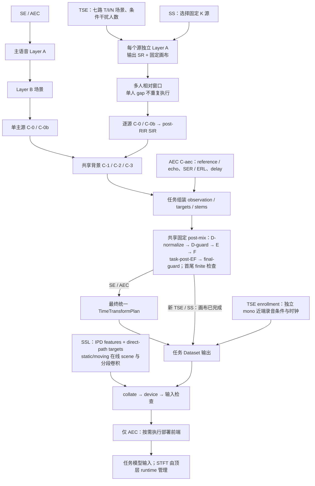

# use_train 仿真流程逻辑（完整版）

本文描述 SE、AEC、TSE、SS、SSL 五个任务的动态与离线数据合同。SE/AEC/TSE/SS 的共享语音预处理、背景混合与 post-mix 阶段由 `core/data/` 提供，任务侧决定场景、监督目标和附加输入；SSL 复用同一套共享空间 seam（static 与 moving），但监督目标是空间特征而不是波形。当前 TSE 动态模板与 SS dynamic 使用共享多源渲染；SE/AEC 仍由各自任务 Adapter 编排，TSE 旧路径已删除。

本文维护五任务总览及 SE/AEC/SSL 的边界；[Multi_Source_Simulation.md](Multi_Source_Simulation.md) 维护 TSE/SS/SSL 多源参数、注册音近端资源、迁移与实现边界，并记录 SE 的 mc_sim 评估集生成/评估入口。发生冲突时以当前源码、配置校验和 unit tests 为准，并同步修订这两份正文。

## 本文怎么读

本文是仿真语义的主文档（SSOT，single source of truth）：其他文档只补充各自独有的细节，不再重复这里的合同。按需求查表：

- 五个任务各有哪几种 `data.mode`、每种模式读什么资源、监督什么 → 第 0 节。
- 一段干净语音经过哪些处理步骤、每步对应哪些配置键 → 0.2～0.7 节。
- AEC 的七路场景与回声链（C-aec）细节 → 0.3、0.4 节。
- 离线（offline）数据怎么读 → 1.2 节。
- SE/AEC 每一步会不会改动监督目标 → 第 2 节。

术语表（正文对应章节有更完整的说明）：

| 术语 | 含义 |
|---|---|
| `data.mode` | 配置里声明数据来源的模式名。`dynamic*` 是训练时现场合成受损音频，`offline*` 是读取事先配好的音频；五个任务共九种，见第 0 节 |
| Layer A–F | 一段干净语音变成训练样本的六个处理阶段：A 读语音并做时长对齐、B 抽场景、C 加混响/噪声/回声、D 整理幅度、E 加信道退化、F 加设备退化 |
| observation | 模型实际看到的输入信号（带噪、带混响，可能是多通道） |
| target / clean | 希望模型输出的监督信号（干净语音或只含早期反射的语音） |
| mono / `[C,T]` | mono 是单通道波形 `[T]`；`[C,T]` 是 C 个麦克风通道、每通道 T 个样点 |
| RIR | room impulse response，房间冲激响应；把它和语音卷积就得到带该房间混响的录音 |
| SCP / JSONL | 两种清单格式：SCP 每行空格分隔四列，JSONL 每行一个 JSON 对象 |
| tuple / batch 合同 | Dataset 交给 Trainer 的固定字段顺序（如 SE 7 元组）；长度不符即报错，不做截断 |
| STFT / iSTFT | 把波形变成频谱的短时傅里叶变换，及其逆变换；AEC 模型在谱域工作 |
| enrollment | TSE 用来指定「要提取谁」的一小段该说话人录音 |
| PIT | permutation invariant training，分离任务不知道哪一路输出对应哪个源，用配对方式算 loss |
| trace | 每个样本附带的仿真审计记录，说明这段样本用了哪个场景、RIR 和电平 |
| fail-fast | 遇到非法配置或数据立刻报错，不静默降级 |

**空间 Scene Seam**：`core.data.simulation.spatial_scene.SpatialSceneRenderer` 是统一
的 full/direct/early/static/moving 空间场景 Module；moving IPC、trajectory timebase、
分段 overlap-add、background 和 waveform rendering 由该 Module 隐藏。Dataset owner
通过 `core.data.simulation.rir_provider.build_spatial_rir_provider()` 取得 supplied 或
online provider；该 factory 是 provider 的正式入口，统一 `source_uids`、`track_kind`、
normalize、geometry、hash 与 provenance 合同。显式 provider 仅是 debug seam，仍必须
经过相同的 normalize/source-order/track 校验；普通 mono `rir_scp` 不得作为空间 provider
静默回退。`core.data.simulation.observation_post_mix.ObservationPostMixRenderer` 统一组合
observation-only 的 Layer D/E/F。SSL Dataset 已通过任务 Adapter 使用两个 Seam；TSE/SS
的 spatial RIR 请求已进入 SpatialSceneRenderer，并通过 `SpatialSceneExecutor` 提供稳定执行
seam；任务仍保留各自的 SIR、enrollment、PIT
 和输出编排。`finish_speech_scene` 已通过同一 `ObservationPostMixRenderer` 收敛 SE
 与多源 waveform 场景的 D/E/F 执行；AEC 的 farend/echo/noise 耦合仍由任务 Adapter
 保持。AEC Adapter 同时生成 `PostMixRoleContract`，在每个 stage 校验五路角色的
可变范围，并将合同写入 scene trace。

名称边界固定如下：`SpatialSceneRenderer` 是 core 的具体渲染实现，
`SpatialSceneRendererLike` 是 `SpatialSceneExecutor` 的 Protocol；SSL 任务侧适配器使用
`SSLSpatialSceneAdapter` 和 `SSLObservationPostMixAdapter`，旧的同名导出仅保留兼容别名。
因此任务适配器不能被误读为第二套 RIR 或 D/E/F 实现。

仿真调用应通过 `core.data.simulation.rng.SimulationRNG` 使用命名随机流；它保留既有
`scene_rng` stream id 映射，并把任务、stream 名称写入 facts，避免 Dataset 内散落数字
stream。空间 scene 的 geometry 可通过 `render_speech_scene(observation_geometry=...)`
显式传入，调用方不应临时改写共享 `SimulationConfigs`。`ObservationPostMixRequest`
在边界规范化为 `PostMixRoleContract`，由 contract 区分 observation、protected 和
derived roles，并校验 role shape 与 `mutable_stages`；后续 D/E/F 只能按该合同修改
observation，超出声明的 stage 变更会直接报错。

TSE 的 scene projection 通过 `infer_post_mix_role_contract` 从 bundle 轨道推导 role 集合，
避免任务 Dataset 重复维护 target/direct/source 的前缀筛选规则。SE、SS、TSE、SSL 的
spatial render 调用均已接入 `SpatialSceneExecutor`；各任务仍保留自己的 request/feature projection。

`render_speech_scene` 的 mono background 已通过 `_render_mono_background` 收敛有源和纯噪声
场景的 shape、默认策略和 SNR 抽样编排，空间 background 继续由独立的 spatial seam 处理。
scene track map 与 facts 投影分别由纯 helper 构建；这些 helper 不读取配置之外的运行状态，
也不消费 RNG，主 renderer 仍保持 actor、SIR、background 和 target 的原有顺序。
`finish_speech_scene` 进一步将 post-mix role 集合、请求和 facts 合并拆成纯 helper；AEC
则用 `_build_aec_delivery_bundle` 统一 capture-stems 交付轨道，避免 Dataset 主流程重复组装。

`BaseDynamicMixingDataset` 的共享 Layer A/C seam 已拆到
`core.data.simulation.speech_preparation.SpeechPreparation`、
`core.data.simulation.scenario_sampler.ScenarioSampler`、
`core.data.simulation.resource_store.ResourceStore` 和
`core.data.simulation.acoustic_renderer.AcousticRenderer`。基类保留任务 hook、worker
生命周期、当前 trace/snapshot 发布；资源读取、speech preparation、通用 branch 抽样和
bundle 投影不再由一个方法直接承担，也不再保留旧模块 reader 扩展入口。scene/background
renderer 的 Dataset runtime 访问已收敛到显式 context/port；任务侧仍可通过边界适配器传入
旧 Dataset，但 core renderer 不再读取其私有字段。

**Geometry typed view**：`project_simulation_view(cfg, task).shared.geometry` 提供跨任务只读
的解析后阵列拓扑。它复用 `SimulationConfigs` 已完成的 `ArrayTopology` 校验，暴露
`positions_m`、`channels`、`reference_channel`、`spacing_m`、`coordinate_system`、
`geometry_kind` 和 provenance；mono 配置明确返回 `channels=1`、`positions_m=None`。
现有 `shared.spatial` 平铺字段保持兼容，新的 renderer/provider 可以先读取
`shared.geometry`，再逐步迁移调用方。

`project_simulation_view(cfg, task).shared.background` 提供背景策略的只读 typed view，
集中承载点源概率、diffuse coherence、noise mix、wind 和 colored-noise 配置；背景 resolver
已消费该 view 的点源门控概率，后续可继续移除对平铺配置对象的直接读取。

**Task semantic view**：`project_simulation_view(cfg, task).semantic` 提供任务场景的最小只读
语义投影。它统一暴露已校验的 `branch_probabilities`、`target_presence_probabilities`、
`target_type`、`target_roles`、`fixed_source_count` 和 `spatial_supervision`。其中 role 是
任务语义类别，不是 bundle 的具体 role key；SS/SSL 不虚构通用 branch 概率，返回空映射，
其中 SS 仍按 target/noise 场景概率计算 target presence，SSL 显式固定为 present。旧的 `scenario` 字段和直接构造 task view
仍然有效，`semantic` 以默认 `None` 追加，便于消费者逐步迁移。
SE/SS 当前的场景概率读取已切换到 task view 的 `scenario`，保持校验结果与运行时消费
使用同一份投影。

**声学角色与 RIR policy**：`core.data.simulation.role_policy` 只登记物理声源的
`AcousticRole`、每路 `RIRPolicy` 以及背景的 `BackgroundPolicy`，不把模型能力从
mono 自动提升为 multichannel。`render_speech_scene` 只接受显式 `AcousticActor`，并做 UID、
角色、策略和 mono/spatial mode 校验。mono additive background 不需要额外 RIR，
空间 background 默认使用 diffuse coherence；静态点源 RIR 通过
`PointSourceRIRProvider` 渲染，moving 点源 RIR 通过按共享 `TrajectoryTimebase`
逐帧对齐的 `MovingPointSourceRIRProvider` 渲染。两者都要求 provider 几何与当前
observation scene 一致，缺 provider 或 timebase/几何不一致时直接 fail-fast。进入 speech
renderer 的 actor 不能使用 `RIRPolicy.NONE`；该策略只保留给
不进入 mixture scene 的 enrollment / digital reference。

**背景点源生产门**：`prob_point_source_background` 把空间背景从 diffuse coherence
按概率升级为同 room 点源 RIR。`background_resolver.resolve_background_spec` 在门打开时
于同一 room 内采样噪声 actor（位置接受条件复用 `sample_rir_scene` 的
margin/height/min_separation 约定，moving 时共享 scene timebase），构造只含噪声
actor 的派生 noise scene plan，经 `from_scene_plan` 解析 provider 注入
`build_background_spec`；门关闭或样本无噪声时零随机数消耗、行为与默认策略完全一致。
该门要求 `spatial_enabled=true` 且 `rir_backend=online`。SE/AEC/SS 的 spatial
background 调用点已接入；SE/SS/AEC 通过 `resolve_and_mix_background` 复用解析与混合
seam，SSL/TSE 在 scene renderer 前显式解析后注入；手动 provider 注入保留为测试/调试 seam。

**执行所有权**：A–F 表示 waveform 仿真的职责分层，不保证各 waveform 任务都先 A 再 B。SE/AEC 先准备主语音再抽场景；新 TSE 先抽七路 T/I/N 场景及条件干扰人数，SS 先抽固定 K 源，再各自执行 Layer A。新 TSE/SS 在 Layer A 就完成输出采样率与固定画布，之后只做多源相对窗口，不在 F 后再次随机裁切。SE/AEC 保留 post-mix 后的 scene-wide `TimeTransformPlan`。SSL 进入共享 spatial Layer A/C/D/E/F seam（static 与 moving），并在 Dataset 后投影 direct-path IPD/DOA/VAD。在线 moving scene 由 scene-level provider capability 控制：需要 `spatial_enabled=true`、`rir_backend=online` 和可用的 moving provider，不再按“非 SSL”统一拒绝。

所有 Dynamic waveform 路径的 Dataset post-mix 顺序均为 `pre-finite → D-normalize → D-guard → E → F → task-post-EF → final-guard → post-finite`。Layer F 是 Dataset 内 CPU-only 的 observation/device degradation，由 `noisy_post_mix_degradations_enabled` 总开关控制，关闭时整层跳过；不得写成训练侧 GPU F。AEC 专属 `AECDeploymentFrontend` 在 STFT 前按配置处理 mic/farend；它不属于仿真，全部禁用时直通。

AEC 模型输入前端有两个入口边界，禁止与 A–F 仿真混称：

| 层级 | 入口 | 算法/所有权 |
|------|------|-------------|
| canonical typed | 顶层 `aec_frontend` → `AECFrontendConfig` → `AECDeploymentFrontend` | 始终解析 `aec_frontend.delay_alignment`（固定 `gcc_phat`）与可选 `aec_frontend.linear_aec`；仅 delay alignment 启用或配置 LinearAEC 时执行，训练、validation 与逐文件 `inference.py` 复用同一前端 |
| generic / standalone | `create_delay_estimator()`、独立 `StreamingAECFrontend` | standalone estimator 可选 `gcc_phat` / `matched_filter`；直接 estimator 调用方必须先对完整 ref/mic pair 分别执行 `preflight_input`，两路均通过后再 `push_ref → push_mic`，而 `StreamingAECFrontend` 已内部落实该合同 |

`aec_frontend.linear_aec.bulk_delay` 当前仅接受 `0`；需要延迟补偿时，在 LinearAEC 前启用 `aec_frontend.delay_alignment`。当前生产矩阵覆盖四个模型 family、十份 YAML（DBGNet 五份、DeepVQE 三份、CAGCRN 与 LocalVQE 各一份）；生产配置均关闭外部 delay alignment、使用 `input_routing: mic_farend`，且均未配置 LinearAEC；因此 canonical frontend 解析后直通 mic/farend。DBGNet 的时延鲁棒性来自随机 delay 增强与 FTG 软跟踪/对齐，而非外部 GCC。

---

## 0. 数据模式总览（九种 `data.mode`）

| data.mode | 任务 | 资源与执行 | 监督目标 |
|---|---|---|---|
| `dynamic` | SE | speech + noise/RIR；共享 A–F，任务侧编排 | 一路 early/dry clean；noise-only 为零 |
| `offline` | SE | 已配对 clean/noisy；不重新执行 Dynamic A–F；支持显式声明的 spatial noisy observation | 读取 mono clean |
| `dynamic_aec` | AEC | 共享 A–F + C-aec reference/echo 配对、SER/ERL、delay；可选 spatial mic observation | `task=joint` 为 mono early/dry clean；`task=aec` 保留 mono 近端噪声和混响 |
| `offline_aec` | AEC | 已有 mic/farend/nearend[/error]，cap-only；不重新执行 Dynamic A–F；mic 可为 spatial `[C,T]` | 读取 mono nearend |
| `dynamic_tse` | TSE | strict speaker JSONL + enrollment；逐源 C，post-RIR SIR；可选 spatial mixture observation | mono 指定身份 early/dry target；缺席为零 |
| `offline_tse` | TSE | samples.jsonl + cues，独立读取 enrollment；可保留 spatial mixture observation | 读取 mono target |
| `dynamic_ss` | SS | source pool、每源 Layer A、逐源 C、共享 D–F；可选 spatial mixture observation | 固定 K 路 mono early/dry targets |
| `offline_ss` | SS | 严格 separation JSONL；默认读取并同步裁切，spatial opt-in 时以 supplied `[K,C,L]` RIR 重建 observation | 固定 K 路 mono sources |
| `dynamic_ssl` | SSL | 复用共享静态/移动 Layer A/C/D/E/F seam；正式配置要求 speech/noise，online 不需 RIR SCP，offline RIR 必须提供 typed scene manifest | `features [T,F,2(C-1)]`、`targets [T,F,K,2]`、DOA/VAD |


`spatial_enabled` 是 SE/AEC/TSE/SS 的 observation-only opt-in；SSL 的空间 observation
是必选输入：只有主 microphone observation 可以是 `[C,T]`（`C=1` 保持 legacy 行为），而
SE/SS/AEC/TSE 的 `target`/`output` 始终是 `[T]`，SSL 则在 shared seam 后投影为
feature/DOA/VAD；AEC `farend` 始终是 mono `[T]`，TSE `enrollment` 始终是 mono `[T]`。
Layer A 的 source 选择、Layer B 的 scene/角色
存在性和概率语义不因 microphone 数改变。Layer C 才把每个 source 通过
source×microphone RIR 渲染为 `[K,C,L]`，Layer D–F 只作用于 observation，不得把
多通道 target、farend 或 enrollment 扩展成多通道。

这里的“原生多通道”仅指模型显式声明并消费 `[C,T]` / `[B,C,F,T,2]` observation；当前 SE `SpatialNetSE` / `OnlineSpatialNetSE` 属于这一类，并输出 mono reference-channel 谱。AEC/TSE 的 `reference` adapter 则是另一条边界：它把多通道 observation 投影为指定通道后交给 mono-only 模型，不能表述为模型原生多通道能力。SSL 的 IPD projection 直接消费多通道观测，但当前 `FixedArrayIPDNet` 是项目原生实现，不等同于上游 FN-SSL 模型复现。

Spatial geometry 使用物理阵列 profile，而不是任务或模型名称。`array_profile`
解析为共享的 `MicrophoneArrayProfile` / `ArrayTopology`，其中只保存通道数、相对
positions、相邻 spacing 和 coordinate system；`reference_channel` 是独立的配置合同。
当前 canonical profile 为 `linear_2ch_80mm`、`linear_4ch_40mm`、`linear_6ch_40mm`
和 `circular_8ch_r80mm`（8 mic 圆阵、半径 80 mm）；这些名称描述物理拓扑，不暗示
SE、AEC、TSE、SS 或 SSL 的模型归属。也可以不选 profile，改用显式 `custom_geometry`，提供 finite 的
`[C,3]` positions、坐标系和
`reference_channel`；profile 与 custom geometry 不能同时指定。解析出的 positions
才是 provider 的唯一几何输入。

FN-SSL 与 NBSS 只能作为 geometry/model provenance 或 validation recipe 记录在
RIR、scene 和 manifest metadata 中（可包含 `external_repository`、`external_path`、
`external_commit`）；
它们不是 array profile 名称，也不改变物理 topology 的身份。

### 0.0.1 命名空间边界

Layer B 统一的是 canonical scene ID，不是把所有物理信号、监督目标和 batch 字段
改成同一个名字。以下五个命名空间必须分开：

| 命名空间 | 回答的问题 | 示例 |
|---|---|---|
| canonical scene ID | 本次场景包含哪些角色 | `prob_target_noise`、`prob_target_interference_noise` |
| task-neutral role | 轨道在公共仿真中的职责 | `speech_source`、`observation`、`supervision_target`、`background`、`reference` |
| physical role | 信号在任务中的声学含义 | AEC `nearend/echo/farend`、TSE `target/interference/enrollment`、SS `source_speech` |
| rendered track | 公共 waveform bundle 中的阶段性轨道 | `source_full_rir/N`、`target/N`、`background`、`mixture` |
| delivery contract | Dataset 如何交付 Trainer | SE tuple、AEC 11/12 tuple、TSE canonical dict item → validated `TSEBatch`、`SSBatch`、`SSLBatch` |

因此，`prob_target_noise` 在不同任务中复用同一个 scene ID，只表示“任务定义的
target 存在且 additive background 存在”；它不会抹掉 AEC near-end、TSE 注册目标
或 SS K 路监督集合之间的物理差异。SSL 使用固定 K 的同房间 scene seam：static 是静态 scene，moving 是线性移动轨迹。

### 0.0.2 公共 Layer A-F 链路

Layer A-F 之前还有两个外部 ownership 平面（ownership 这里指「这些配置该写在哪里、由谁负责」）：`data.train` / `data.validation` 的 resource 路径与 Dataset lifecycle。`speech_scp`、`noise_scp`、`music_scp`、`windnoise_scp`、`rir_scp`、AEC echo pair 和 TSE `spk2enroll_json` 属于 resource；`filter_*`、`sampling`、`max_duration_seconds`、`repeat_*`、`strict_load` 属于 lifecycle。它们不属于 Layer A-F，也不应写入 `simulation_cfg`。`simulation_cfg` 只承载 Layer A-F 及明确的 task-local branch 参数；TSE enrollment 与 AEC Deployment Frontend 是主仿真链路之外的任务分支。

Dynamic validation 默认 `inherit_simulation: true`：`speech_scp`、`noise_scp`、`music_scp`、
`rir_scp`、`windnoise_scp` 以及 TSE `spk2enroll_json` 都可以在
`data.validation` 以 split-local resource 覆盖，未写出的资源从 `data.train` 继承。
TSE 在 `inherit_simulation: false` 时仍可继承缺失的 `speech_scp`，但必须在
`data.validation.spk2enroll_json` 显式提供 enrollment resource；`music_scp` 等其他
split-level resource 按各自显式值或 train 继承值解析。

| Layer | task-neutral 输入/输出 | 公共职责 | 任务侧只负责 |
|---|---|---|---|
| A | `speech_source[*]` | 读取、splice、扰动、固定画布、高通 | SE/AEC/TSE/SS 决定 source 集合和身份；SSL 固定 K 个 source，同样逐 source 走本层 |
| B | `SceneSpec` | canonical scene ID 与角色存在性合同 | SE/AEC/TSE/SS 选择本任务允许的场景；SSL 有固定 K 静态/移动 scene seam |
| C | rendered sources + references | source×microphone RIR（spatial 时为 `[K,C,L]`）、source level、background、能量比标定 | AEC echo/SER/ERL、TSE enrollment 等专属物理链；`array_profile`/`custom_geometry` 解析出的 topology 与 room/source geometry 必须由 provider/manifest 显式绑定 |
| D | `observation`（spatial）或 legacy bundle（`C=1`） | `D-normalize → D-guard`；spatial 路径只改变 observation，保持 target/farend/enrollment 不变 | 声明 observation 的 shared/per-channel policy |
| E | `observation` | channel degradation；仅改变 observation/noisy | 将 observation 投影为 noisy/mic/mixture，不修改监督轨道 |
| F（Dataset CPU-only） | `observation` | CPU-only device/post-mix degradation + final guard；仅改变 observation/noisy | 同上，不修改监督轨道 |

spatial RIR provider 必须返回 finite、非空的 `[K,C,L]`，并在 manifest/provenance
中绑定 room、source、`ArrayTopology`/microphone positions、spacing、coordinate system
和 reference channel；不能把普通 mono `rir_scp` 或随机谱当作 source×microphone RIR。
metadata 同时记录 geometry provenance 和可选 validation recipe；外部来源只使用
`external_repository`/`external_path`/`external_commit` 三个 canonical 键（短键
`repository`/`path`/`commit` 会被拒绝），它们只作为来源证据，不参与 profile identity。缺少 supplied provider、CUDA/gpuRIR 或必需
geometry 时，运行时应显式 fail-fast。`C=1` 继续走原有 mono 路径，不因 spatial 文档合同改变。

### 0.0.3 任务角色投影

| neutral role | SE | AEC | TSE | SS | SSL |
|---|---|---|---|---|---|
| `speech_source` | 1 路 clean source | 1 路 near-end source | 注册目标 source + 0..N 路 interference source | K 路 source | SSL 复用 Layer A source |
| `designated_target_source` | clean source | near-end source | enrollment 指定身份 | 无唯一指定目标；K 路都是监督 source | SSL 使用 direct-path/DOA/VAD scene |
| `background` | additive noise/music/wind/colored | additive noise/music/wind；echo 不属于 background | additive noise/music/wind；interference 不属于 background | additive noise/music/wind；其他 source 不属于 background | 不适用；当前不执行 waveform 混合 |
| `reference` | 无 | farend reference（mono） | enrollment（mono） | 无 | microphone 0 仅作为 IPD reference |
| `extra_physical_track` | additive/residual | echo/noise/farend | `source_full_rir/N` | `source_full_rir/N` | SSL 的 direct-path/DOA/VAD projection 轨道 |
| `observation` | noisy `[C,T]`（spatial）或 `[T]` | mic `[C,T]` 或 `[T]` | mixture `[C,T]` 或 `[T]` | mixture `[C,T]` 或 `[T]` | IPD features `[T,F,2(C-1)]` |
| `supervision_target` | mono early/dry clean 或零 | mono `joint` early/dry near-end；`aec` 保留 mono near-end path，仅把 echo 作为待消除成分 | mono 注册目标 early/dry 或 absent zero | K 路 mono early/dry target 或 K 路零 target | 当前 synthetic `targets [T,F,K,2]`，不等价于真实 direct-path DOA/VAD target |

`source_full_rir/N` 表示 source 经 full RIR 和相对电平标定后实际进入线性 mixture 的
波形；`target/N` 表示同一 source 的 early/dry 监督轨道。二者不是同义词，且
`target_type=early` 时不能用 `sum(target/N)` 代替 `sum(source_full_rir/N)` 验证 mixture。

### 0.0.4 Dataset-to-Trainer 输出投影

| 任务 | observation | additional model input | supervision 形状 | delivery contract |
|---|---|---|---|---|
| SE | noisy `[C,T]`（spatial）或 `[T]` | 无 | clean `[T]` | SE 7 元组 |
| AEC | mic `[C,T]`（spatial）或 `[T]` | farend `[T]`，可选 mono error/state | nearend `[T]` | AEC 11/12 元组 |
| TSE | mixture `[C,T]`（spatial）或 `[T]` | speaker/spatial cue | target `[T]`；多目标按 speaker axis 展开 | canonical dict item → `TSEBatch` |
| SS | mixture `[C,T]`（spatial）或 `[T]` | 无 | sources `[K,T]` | `SSBatch` |
| SSL | IPD features `[T,F,2(C-1)]` | 无 | direct-path spatial tracks `[T,F,K,2]`、DOA/VAD | `SSLBatch` |

tuple/dict/`SSBatch`/`SSLBatch` 属于 Dataset 边界，不属于 Layer A-F 的额外仿真步骤。
对 SE/AEC/TSE/SS，`C` 只出现在主 observation；target/output、AEC farend 和 TSE
enrollment 均保持 mono。SSL 的 `C` 只进入 IPD feature contract，不应据此声称已有
真实空间 waveform 训练。

### 0.0.5 Loss reference 与 residual 命名

SE/AEC/TSE/SS 四个 waveform 任务不共享一个叫“非目标说话人 residual”的物理目标；SSL
是空间辅助任务，也不进入该 waveform residual 合同。共享 trainer 只在活动 loss
明确需要时构造相对监督目标的 complement：

```text
undesired_ref      = observation - supervision_target
undesired_enhanced = observation - estimate
```

投影为 SE `noisy-clean`、AEC `mic-nearend`、TSE `mixture-target`。TSE 的该差值
包含所有未由 early/dry target 表达的内容，不等价于纯 interference speech；若某个
新 loss 只需要干扰说话人，应显式消费干扰人的 `source_full_rir/N` 之和，而不能从
`mixture-target-background` 猜测。SS 当前 PIT 路径直接监督 K 路 target，没有自动
构造单一 undesired residual。

### 0.0.6 五任务 Dynamic / Offline 链路摘要

- **SE**：Dynamic 使用 `data.mode: dynamic`，任务入口进入 SE Dataset，执行共享 Layer A（`_prepare_clean_speech`）→ Layer B 的 `prob_target_only` / `prob_noise_only` / `prob_target_noise` → Layer C 及固定 post-mix 顺序 `pre-finite → D-normalize → D-guard → E → F → task-post-EF → final-guard → post-finite`；随后 scene-wide `TimeTransformPlan` 同步 target-SR 与 crop/tile/gap/canvas，输出 7 元组 `(clean,noisy,sr,length,is_pure_noise,is_pure_echo,is_pure_echo_noise)`。Spatial opt-in 只把 noisy 交付为 `[C,T]`，clean 仍为 `[T]`。SE 还可配置 `ComplexIdealRatioMaskLoss` 使用 cIRM MSE objective；它只增加 loss，不表示接入 NBC/NBC2 模型。Offline 使用 `data.mode: offline` 的 clean/noisy paired reader，不重新执行 Dynamic A–F；默认配置可读取 mono 信号。显式启用 spatial 时，clean 保持 mono、noisy 为 channel-first `[C,T]`，split 必须声明 `spatial_enabled`、`array_profile` 或 `custom_geometry`、`reference_channel` 与 `channel_order`；reader 校验 noisy WAV 的通道数，不重排通道，也不把 mono noisy 广播为阵列信号。trainer 仅在 Dataset 声明 spatial 后启用对应 collate 合同。
- **AEC**：Dynamic 使用 `data.mode: dynamic_aec`，任务入口进入 AEC Dataset，执行共享 A→B→C，并在 C-aec 读取 stereo pair（ch0 echo、ch1 farend/reference），按配置完成可选磁盘 pair GCC 预对齐、设备 EQ/clipping、SER/ERL 耦合、随机 delay/jitter 后组装 near-end。Spatial opt-in 只扩展 mic 为 `[C,T]`，nearend、farend 和 error/state-facing outputs 仍为 mono。Layer F 由 Dataset 在总开关开启时完整执行，随后执行 `task-post-EF → Dataset final guard → post-finite → TimeTransformPlan`。AEC frontend 始终解析；仅 delay alignment 启用或配置 LinearAEC 时在 STFT 前处理模型输入，否则 `mic_farend` 直通，再进入 `STFT → dict model → iSTFT`，模型输入至少为 `mic_spectra` / `farend_spectra`，可选 `error_spectra` / `error_mask`。Dynamic 输出普通 11 元组或带 state 的 12 元组。Offline 使用 `data.mode: offline_aec` 的 cap-only reader：mic 可为预配对 spatial `[C,T]`，nearend/farend/error 保持 mono；不执行 C-aec 或 Dynamic 仿真，batch 仍在 collate 后进入同一 AEC 模型输入前端。
- **TSE**：动态路径先抽七路 T/I/N 场景，仅在 I 存在时抽 1..N 干扰人数；每个不同 identity 分别执行 A，随后规划相对窗口、逐源 source×microphone RIR、post-RIR SIR、背景混合和共享 D–F。Spatial opt-in 只扩展 mixture observation 为 `[C,T]`；target 和每个 speaker waveform cue 始终为 `[T]`。固定画布在 A 完成；speaker waveform cue 使用近端静态 RIR、独立随机子流和一次完整增强。单目标与多目标输出同一个 canonical dict item，由 `tse_collate_fn` 构造成 validated `TSEBatch`。TSE 旧 shared-RIR/pre-RIR 编排已删除。Offline 读取已物化 mixture/target 与独立 mono enrollment；spatial mixture 仅按 reader 的显式 supplied-RIR/observation contract 使用。
- **SS**：`dynamic_ss` 的 Layer B 在“语音源集合”“语音源集合+背景”“纯背景”三种场景之间抽样，由 `prob_target_only + prob_target_noise + prob_noise_only = 1` 约束；随后选择 K 个不同身份（无身份时为不同 source），有语音场景每路执行共享 A，使用 source×microphone RIR、SIR 和 D–F；spatial opt-in 只扩展 mixture 为 `[C,T]`，K 路 target 始终为 `[K,T]`。纯背景场景保持 K 路零 target。输出 dict 经 `ss_collate_fn` 构成 `SSBatch`，source 数由 `ss.num_sources` 与模型/PIT 合同共同约束。`offline_ss` 读取已配对 K 路 mono sources，spatial opt-in 时用显式 supplied `[K,C,L]` RIR 重建 `[C,T]` observation；仍不执行 Dynamic A–F。
- **SSL**：`dynamic_ssl` 要求 train/validation 的 `speech_scp`、`noise_scp` 和 split-level `simulation_cfg`；online 不读取 RIR SCP（offline backend 需 typed spatial scene manifest），复用共享静态/移动 Layer A/C/D/E/F seam 后生成 feature、direct-path IPD、DOA、VAD。moving 由 split 的 trajectory_points/max_displacement_m 描述轨迹，simulation_cfg.prob_moving_rir 控制概率。

- **进入仿真前对 clean 的处理（SE/AEC/TSE/SS/SSL Dynamic Dataset，入口 `core/data/dynamic_dataset_base.py` `_prepare_clean_speech_result()`；旧三元组 Interface 为 `_prepare_clean_speech()`）**：五个 Dynamic Dataset 共用 fixed silence canvas 契约且不设任务级开关（SSL 的画布长度来自配置的 `segment_seconds`）。先抽取一次 `silence_pad_prob`：模式 B（命中）在 splice 前把 A-1 切换为 `single_utterance`（禁用 extra splice），不受 splice target 或 `speech_random_start` 控制；A-2 增强后，A-3 将短语音只放置一次到固定 `max_duration` 画布，超出画布的语音则随机连续 crop 一次。最终对齐若发现长度 invariant 失效会 fail-fast，禁止 tile。模式 A（未命中）执行 splice，A-2 后按标准路径随机 crop，并在短于上限时按 `repeat_to_max_duration` 选择 tile（可选 tile gap）或 zero-pad。随后执行 A-4 高通；目标音量不在本入口处理，而是在 C-0 RIR 之后的 C-0b 完成。
- **helper 行为**：`core/data/simulation_utils.py` 的 `align_speech_with_silence_pad(..., fixed_silence_canvas=False)` / `apply_silence_position(..., fixed_canvas=False)` 提供 adaptive padding；生产 SE/AEC/TSE/SS/SSL Dynamic Dataset 都走 fixed 画布路径，不使用该 adaptive 路径（SSL 经 `_prepare_clean_speech_result` 传入画布长度）。
- **Offline 由各任务 reader 定义，五任务不能泛化为同一齐长策略**：Offline Dataset 不继承共享动态基类，也不继承 Dynamic fixed canvas。SE `offline` 默认读取 mono clean/noisy；spatial split 必须显式声明 `spatial_enabled`、geometry、`reference_channel` 与 `channel_order`，clean 仍为 mono、noisy 为 `[C,T]`，并校验 WAV 通道数，不重排通道；TSE `offline_tse` 读取 mixture/target 与独立 mono enrollment，可按 reader contract 保留 spatial mixture；AEC `offline_aec` 是 **cap-only**，mic 可为 `[C,T]`，nearend/farend/error 仍按公共有效长度裁切、补零并保持 mono；SS `offline_ss` 在显式 spatial 配置下从 mono source stems 与 `[K,C,L]` supplied RIR 重建 observation。上述 Offline 路径均不自动运行 Dynamic A–F；Dataset 本身也不运行 AEC 部署前端，但 AEC batch 仍进入 Trainer canonical frontend。

---



上图是当前五任务编排摘要；SSL 已接入共享静态/移动 Layer A/C/D/E/F seam 与 shared moving IPC/waveform renderer。
配套的 [五任务分层图](../../diagrams/se_aec_tse_simulation_layers_current.png) 与
[DOT source](../../diagrams/se_aec_tse_simulation_layers_current.dot) 现已同步覆盖 SE/AEC/TSE/SS/SSL；
图只表达流程拓扑，具体 batch、模型 I/O 与 capability 仍以源码和契约测试为准。AEC 专属分支图仍用于说明其回声/前端合同。

## 0.1 六层职责总览（Layer A–F，SE/AEC/TSE/SS 为 waveform path；SSL 复用其中 A/C/D/E/F 的 observation 部分）

| 层 | 代码位置 | 配置/说明 |
|----|---------|-----------|
| **Layer A** | `_prepare_clean_speech_result`（`_get_clean_speech` / `apply_speech_augmentations` / `align_speech_with_silence_pad`） | 干净语音预处理（A-1 splice → A-2 增强 → A-3 时长对齐 → A-4 高通）；SE/AEC 在 B 前执行；新 TSE/SS 在场景与源选择之后逐路执行；SSL 同样逐 source 执行 |
| **Layer B** | 场景角色抽样 | trace 的 `scene_name` 统一使用 `prob_` 前缀：SE 三路、AEC 七路、TSE 七路、SS 三路。SS 的 `prob_noise_only` 保持固定 K 路零 target 输出合同 |
| **Layer C** | `_mix_acoustic` / `render_speech_scene` / `_load_farend_echo_pair_aligned` | 声学混合：C-0 RIR、C-0b post-RIR early-target 音量标定、C-1 加性噪声、C-2 sidechain 风噪、C-3 彩色噪声、**C-aec farend/echo 读盘及资产预对齐回声链**（AEC only；不属于模型输入前端） |
| **Layer D** | post-mix amplitude conditioning | 内部固定顺序为 `D-normalize → D-guard`。公共 `D-normalize` 只支持 `off/joint`，不属于 Layer C-0b 音量标定；`D-guard` 无配置并固定执行 deterministic peak guard。Spatial 路径只处理主 microphone observation，target/output、AEC mono farend、TSE mono enrollment 不变；`C=1` 保留既有 legacy bundle 语义。 |
| **Layer E** | `_apply_channel_degradation_result` | URGENT2026 信道退化（带宽/**channel clipping**/编解码/丢包）；仅作用于 observation/noisy。这里保留的是信道退化配方内的 clipping，不是设备 ADC 权威边界。 |
| **Layer F（Dataset CPU-only）** | `apply_post_augmentations` | `noisy_post_mix_degradations_enabled=true` 时执行完整 Layer F；关闭时整层跳过。Dataset 随后继续执行 final guard 与 `TimeTransformPlan`。 |
| **AEC 模型输入前端（非仿真层）** | runtime：`AECTrainer._run_aec_frontend` / `inference.py`；Dataset 不执行 | 仅 AEC 的 `AECDeploymentFrontend` 始终解析 `aec_frontend.delay_alignment` 与 `aec_frontend.linear_aec`；仅前者启用或后者已配置时在 STFT 前执行。二者皆否时 `mic_farend` 直通，不产生 runtime error。delay estimator 固定 `gcc_phat`；`inference.py` 保持逐文件调用。当前生产配置均关闭外部 delay alignment、使用 `aec_frontend.input_routing: mic_farend`，且未配置 LinearAEC；DBGNet 依靠 delay 增强 + FTG 软跟踪/对齐 |

任务 capability（即「这个任务支持哪一类仿真配置」）在 Dataset builder seam 统一 fail-fast，不允许“字段合法但 runtime 未消费”静默通过：

| 配置族 | SE | AEC | TSE | SS | SSL |
|---|---|---|---|---|---|
| AEC scenario / SER / ERL / `aec_ref_echo_*` | 禁止 | 支持 | 禁止 | 禁止 | 禁止 |
| 目标身份 / 干扰人数 / enrollment | 禁止 | 禁止 | 支持 | 无 enrollment；`ss.num_sources` 控制 K | 不适用；SSL 无身份/enrollment 概念 |
| 单人 gap / silence canvas | 共享 A | 共享 A | 每源共享 A | 每源共享 A | 不适用 |
| `prob_timeline` / `overlap_ratio_range` 多语音源关系 | 单源不执行 | 不用于移动 ref/echo | 新多源路径支持 | 支持 | Dynamic SSL 支持 |
| `music_ratio` / `music_scp` | 支持 | 支持 | 支持 | 支持 | 不适用 |
| SIR | 无独立语音干扰分支 | 回声使用 SER | `simulation_cfg.sir_range` | `ss.sir_range` | 无独立 SIR 配置（`sir_mode="none"`）；DP-IPD target 已由逐源 direct-path 谱生成 |
| D-normalize | `off` / `joint`；PASE-family 的 `separate/single` 仅在 `tasks.se.data.pase_preprocess` 专用路径消费 | `off` / `joint` | `off` / `joint` | `off` / `joint` | 不适用（SSL 无波形监督目标）；observation 仍经共享 observation post-mix 的 D-normalize |
| Layer E/F observation 退化 | 支持 | 支持 | 支持 | 支持 | observation 同样经共享 Layer E/F；监督目标另由投影层计算 |

ownership 按 raw 显式键判断，`0` / `false` / `null` / 默认值也会拒绝；unknown key 一律 fail-fast，旧宽容开关 `simulation_cfg_strict` 已退役并在配置边界被拒绝。动态 validation 在 merge 前保留 `train inherited` 与 `validation-local` 原始路径。训练 `simulation_cfg` 使用单一当前 strict contract，不配置版本字段；旧 `schema_version` 键会 fail-fast。

多源 relative timeline 的开放清单以 `core/data/simulation/capabilities.py` 的
`TEMPORAL_FEATURE_CAPABILITIES` 为单一事实源；`core.data.simulation_views`
将 `prob_timeline`、`overlap_ratio_range` 和 `timeline_mode_weights` 投影到
独立的 `SharedSimulationView.temporal`，不再把 scene layout 字段混入 Layer A
speech preparation view。SSL 已接入同一条 source-window 与 provenance 链；AEC
ref/echo delay 和 moving RIR trajectory 仍是独立时间合同。

### 0.1.1 噪声清单能力、训练投影与角色分流

`noise_scp` 的训练输入格式与 Noise Filter 的发布合同相互独立：

- dynamic source 仅接受严格四列 SCP `uid fs length path` 或逐行 JSON object 的 JSONL；分类 metadata 仅可随 JSONL 记录携带。分类能力取决于 ordinary pool 中 metadata 是否完整，**不由 strict v6 发布合同决定**。
- strict JSONL schema v6 是 Noise Filter 当前发布/审计合同，不是训练 runtime 的唯一合法格式。发布链固定校验 admission policy v4、AudioTag evidence v5 与 noise source parser v10，并使用 generator `6.1` 和 promotion marker v4；Noise Filter Pipeline 负责噪声准入，训练信任配置交付的合法数据。
- C2 仅持久化固定 `audioset_top5`：恰 5 项，每项严格包含 `index` / `mid` / `label` / `prob`，evidence v5。C3 无阈值、无 calibration：top-5 任一 speech MID 即 `reject`，否则按 C1 Noise/Babble 分支分别 `accept_noise` / `accept_babble`；babble MID 不参与决策；类别取 top-5 首个 noise MID，无则使用 `/m/096m7z` / `Noise`。
- 读入 JSONL 后，Dataset 只投影 `uid` / `fs` / `length` / `path` / `category_id` / `balance_category` / `category_name` / `roles` 八个字段。完整的 admission / policy / evidence / verification / fingerprints 只服务发布审计，不进入 Dataset 状态。
- 发布 adapter 从显式给出的 `<noise_root>/final/manifests/<dataset_id>.jsonl` 读取 strict v6 记录，不扫描目录补输入；其中 `balance_category_mid` / `balance_category` / `balance_category_source` 必须来自 passed C3。adapter 生成训练清单时以 `ROUND_HALF_UP(Decimal(str(duration)) × sr)` 计算 `length`。训练 JSONL parser 要求该值为正整数并原样读入，不重新估算或舍入；对 noise runtime，该值仅进入 `_noise_lengths`（数据摘要）和轻量 metadata，随机选段/裁切仍依据解码后的实际波形与 `max_duration`，不会把 manifest `length` 复用为仿真长度。

`roles` 的判定规则是：仅当字段值为 list 时才具有权威性；字段缺失或值不是 list 时，才按 `balance_category` 推导，缺少 `balance_category` 时按 `category_name` 推导。因而空 list 或不完整 list 都不会被类别名补判。Wind / Music 拆池是训练路由，不是新的准入过滤：

```text
noise_scp JSONL
  ├─ wind role
  │    └─ SE/AEC/TSE/SS 共享：从 ordinary pool 路由至 side-chain wind pool
  ├─ music role
  │    └─ TSE 总是拆池；SE/AEC/SS 显式启用 Music 路由后拆池
  └─ 其他 role/category
       └─ ordinary noise pool
```

- **SE/AEC/TSE/SS Wind**：内嵌 wind role 与显式 `windnoise_scp` 合并扩池；需要 side-chain 但内嵌池和显式池均为空时 fail-fast。SSL 读取显式 `noise_scp`。
- **共享 Music**：TSE 总是将内嵌 music role 与显式 `music_scp` 合并到 music pool；SE/AEC/SS 在 `music_scp is not None` 或 `music_ratio > 0` 时启用同一路由。未启用时保留原 ordinary pool。共享路由的双源选择禁止 Music+Music。
- **双噪声异类规则**：ordinary pool 分类 metadata 完整时，第二段必须排除第一段 category；找不到异类候选时退化为单噪声。Natural 模式仅在 metadata 缺失、部分缺失或类别映射不一致时回退普通 UID 二次读取；启用 `sampling.noise.balance_categories` 后 metadata 不完整或映射不一致直接 fail-fast。

采样 tier 与概率语义（Category / Temperature 的配置入口现已对 SE/AEC/TSE/SS dynamic 开放）：

- **Natural 第一段**：未启用 controller 时使用 Natural UID pool，顺序为 `exact → 首个可用 higher SR → all`；其中 higher SR 按采样率升序逐档寻找，命中首档即停止。
- **classified Natural 第二段**：排除第一段 category 后按 `exact → 所有 higher SR 聚合 → all`，在候选 UID 中均匀选择。
- **Category / Temperature（SE/AEC/TSE/SS）**：同样按 `exact → 所有 higher SR 聚合 → all` 选择首个非空 tier；Category 先类间等权、再类内 UID 均匀，Temperature 在 tier 内按 `P(c) ∝ n_c^alpha × difficulty(c)` 选类，再在类内均匀选 UID。SS 仍只改变 source-pool 曝光，不改变固定 K。
- Temperature 为有放回抽样，不设置 epoch 级 UID 重复硬上限。代码默认 `alpha=0.5`，但仅在显式启用 Temperature 时生效；当前 DeepVQE meeting 配置未启用 `sampling.noise`，走 Natural UID pool，不消费 `alpha` 或 difficulty。
- Category/Temperature 派生候选与 classified Natural 异类候选各有一套双预算 LRU；每套最多 16 entries、合计 65,536 个 UID references。超大 classified Natural 候选 entry 使用零复制 view 而不入缓存。该预算不是 UID 数量或抽样次数 hard cap，cache 命中、逐出与零复制路径均不消耗或改变 RNG。

Noise Filter 的 Stage D 与上述训练输入解耦，其最终子阶段精确为三种：`skip_d1=true` 时 `C3 → 独立 D2`；启用 D1 且未配置 `d1.post_normalize` 时 `C3 → D1 → 独立 D2`；启用 `d1.post_normalize` 时 D2 归一化/质检合并进 D1，最终子阶段为 D1。

---

## 0.2 Layer A 细节（A-1~A-4，编号与代码注释一致）

Layer A 负责把挑中的干净语音变成「长度固定、带轻微扰动、已高通」的干净语音，作为后续加混响和噪声的输入。四个子步骤如下：

| 步骤 | 项 | 配置键 | 参数/说明 |
|-----|----|--------|-----------|
| A-1 | **speech_splice / single utterance** | speech_splice, speech_splice_seconds, speech_splice_seconds_range（随机 splice 目标时长区间；None=用 speech_splice_seconds 固定值）, speech_splice_gap_range, speech_splice_equal_volume(_range), speech_splice_max_repeat_times, speech_random_start | 模式 A 保留既有多段 splice，并由 splice target 与 `speech_random_start` 控制；模式 B 在 splice 前已预判，只读当前 single utterance，不加载 extra，也不在 A-1 裁切，不受这两项控制。 |
| A-2 | **speed_perturb** 语速/音高扰动 | prob_speed_perturb, speed_rate_range | 以 prob 做变速，rate 范围由配置给出（常见为 [0.8, 1.2]），改变语音时长/音高；这是 Layer A 的语音增强，不是声源在房间中的物理运动速度。 |
| A-2 | **pitch_shift** 音调扰动 | prob_pitch_shift, semitone_range | 以 prob 做移调，半音范围 [-1.5, 1.5]。 |
| A-2 | **eq_perturb** EQ 扰动 | prob_eq_perturb, eq_db_range | 以 prob 做多段 EQ，dB 范围 [-5, 5]。 |
| A-2 | **add_extra_space** 静音间隙 | prob_add_extra_space；skip_extra_space=speech_splice | 以 prob 在首/尾加静音段；若已 speech_splice 可跳过避免过长。 |
| A-3 | **模式 A 普通对齐 / 模式 B fixed silence canvas** | max_duration / repeat_to_max_duration / repeat_tile_silence_gap / repeat_tile_silence_gap_range（Dataset 构造参数）；silence_pad_* 9 键（见下节） | 模式 A：speech>max 随机连续 crop；speech<max 时按 `repeat_to_max_duration` tile（可选段间静音）或 zero-pad。模式 B：输出固定 `max_duration` 画布；短语音只放一次，超出画布时在 A-3 随机连续 crop 一次，不受 repeat/tile 参数控制。**在 A-2 增强之后执行**。 |
| A-4 | **high_pass** 高通（~70Hz） | **use_high_pass**（`simulation_cfg`，默认 true） | `get_highpass_taps` + `filtfilt`；接在时长对齐之后。 |

执行顺序（`core/data/dynamic_dataset_base.py` `_prepare_clean_speech_result()`）：提前 Bernoulli 模式预判 → A-1 `_get_clean_speech`（模式 A 可 splice，模式 B 强制 single utterance）→ A-2 增强（`apply_speech_augmentations` **始终**执行）→ A-3 普通对齐或 fixed silence canvas → A-4 高通（`use_high_pass` 为真时）；然后更新 `actual_len` 并返回任务编排器：SE/AEC 此后选择 B，新 TSE/SS 此前已选场景/源；后续均进入声学混合。`source_volume_*` 字段不再表示本入口内的 source-waveform 处理，而由 C-0b 消费。模式 B 的 final `_apply_final_time_plan()` 只接受已经等于 `max_duration` 的同步轨道；短于目标或轨道长度不一致即 fail-fast，绝不降级为 tile。

### A-3 silence_pad fixed canvas 机制

生产 SE/AEC/TSE/SS/SSL Dynamic Dataset 先以 `silence_pad_prob` 预判模式。命中模式 B 时，`align_speech_with_silence_pad(..., fixed_silence_canvas=True)` 构造固定画布：A-2 后短语音只出现一次，其余全部为静音；超出画布的语音在 A-3 随机连续 crop 一次到 `max_dur_sr`。`silence_pad_position` 及 Beta 参数控制前后静音如何分配。bimodal/uniform duration range 仍执行配置抽样并消费相同 RNG，但 fixed canvas 下**不控制最终静音总量**；最终静音总量恒为 `max_dur_sr - speech_len_after_crop`。未命中模式 A 时执行 crop/tile/zero-pad。直接调用 helper 且设置 `fixed_silence_canvas=False` 时使用 adaptive padding。

| 配置键 | 默认值 | 生产 Dynamic Dataset fixed canvas 语义 |
|--------|--------|--------------------------------------|
| `silence_pad_prob` | 0.0 | splice 前的模式 B 触发概率；命中后不再重复抽样 |
| `silence_pad_total_range` | [1.0, 4.0] | uniform 模式仍执行配置抽样；不控制 fixed canvas 最终静音总量 |
| `silence_pad_position` | "random" | 静音位置：random / front / back / center / turn_boundary / scene_aware；控制前后静音分配 |
| `silence_pad_mode` | "uniform" | uniform / bimodal；fixed canvas 下只影响配置抽样分支 |
| `silence_pad_short_range` | None | bimodal 短分支抽样范围；不控制最终静音总量 |
| `silence_pad_long_range` | None | bimodal 长分支抽样范围；不控制最终静音总量 |
| `silence_pad_short_ratio` | 0.5 | bimodal 抽样时 P(短分支) |
| `silence_pad_beta_a` | 0.4 | scene_aware 位置分布的 Beta α |
| `silence_pad_beta_b` | 0.4 | scene_aware 位置分布的 Beta β |

---

## 0.3 Layer B 细节（场景分支）

Layer B 只决定「这次样本里有哪些角色」（有没有目标语音、有没有噪声/回声），不改变波形。AEC 走**一次均匀抽样**（非嵌套条件），七路概率之和须严格 = 1.0（AEC）:

| 分支 | 概率键 | `need_c12` | `need_c3` | noisy 构成 | clean（监督目标）`task=joint` | clean（监督目标）`task=aec` |
|------|--------|-----------|-----------|-----------|---------------------------|---------------------------|
| `prob_target_only` | `prob_target_only` | False | False | `clean_target`（early RIR 后） | `clean_target` | `clean_target` |
| `prob_noise_only` | `prob_noise_only` | True | False | `noise_additive_1d`（纯噪声） | zeros | `noise_additive_1d` |
| `prob_echo_only` | `prob_echo_only` | False | **True** | `echo_after_ser_1d`（纯回声） | zeros | zeros |
| `prob_noise_echo_only` | `prob_noise_echo_only` | True | **True** | `noise_additive_1d + echo` | zeros | `noise_additive_1d` |
| `prob_target_noise` | `prob_target_noise` | True | False | `noisy_speech`（full RIR + 噪声） | `clean_target` | `noisy_speech` |
| `prob_target_echo` | `prob_target_echo` | False | **True** | `noisy_speech + echo` | `clean_target` | `noisy_speech` |
| `prob_target_noise_echo` | `prob_target_noise_echo` | True | **True** | `noisy_speech + echo` | `clean_target` | `noisy_speech` |

> **`task` 字段**：在 `data.task` 设置，`"joint"`（默认，AEC+SE）或 `"aec"`（仅回声消除）。

- `need_c12=True`：触发 C-1（加性噪声）+ C-2（sidechain 风噪）+ C-3（彩色噪声）
- `need_c3=True`：触发 **C-aec（farend/echo 磁盘加载+对齐+SER）**

> **命名注意**：文档层的 **C-3（彩色噪声）** 与代码/元数据里的 `need_c3` /
> `c3_ser_*`（均指 **C-aec**）属于两个命名域；阅读 `_layer_c_subflags` 与导出元数据时以 `need_c3 ≡ C-aec` 为准。

---

在线 `rir_backend=online` 已接入共享 C-0；一组共享 room/mic/beta、多 source position，执行与资源合同见 [在线 gpuRIR](Online_gpuRIR.md)。`rir_backend=offline` 使用当前 split 的统一 `rir_scp` RIR 资源。

## 0.4 Layer C 细节（声学混合 C-0~C-3 + C-aec）

本节单主源 `_mix_acoustic` 的背景 SNR 使用 early reference；新 TSE/SS 则在每路 C-0 后以 full-RIR tracks 标定 SIR，并显式选择 primary/all_speech 作为背景 reference，见多源指南。

### C-0: RIR 混响

| 项 | 配置键 | 说明 |
|----|--------|------|
| **full RIR** | `prob_reverberation`, `early_rir_sec` | `noisy_speech = speech * full RIR` |
| **early RIR** | `early_rir_sec`（默认 0.05s） | `clean_target = speech * early RIR`（仅早反射，无晚期混响） |
| **RIR 增益模式** | `rir_normalize`（默认 `true`） | `true` = static full/early 共享 full-RIR peak，moving full/early 共享完整 full sequence peak；`false` = static/moving 均保留资产 raw gain（未经 runtime 归一化） |

**统一配置合同**：默认现役、非 `inference_only`、非 `evaluation_only` 且 storage 为 `dynamic` 的训练配置，在 `base_config` 合并后应得到 `data.train.simulation_cfg.rir_normalize: true`；TSE 薄变体允许继承该值。PASE/StuPASE/UniPASE/GAP-URGENet 的封闭复现配置是明确例外，保留 `false` 以维持其既有数据语义，禁止机械改值。offline 与纯推理配置不要求出现该键；其他 dynamic 配置不得把 `false` 当作常规口径。

**关键语义**：`clean_target` 含早反射但不含晚期混响，是 AEC 的监督目标；`noisy_speech` 含完整混响，是训练输入的一部分。两种 runtime 模式都使用 full 侧的共同 peak（或完全不归一化），不会让 full/early 各自独立 peak normalize，因此保留二者相对增益。`rir_normalize: false` 表示 runtime 保留资产 raw gain；是否代表物理距离取决于资产合同。scene-level provider 已提供显式 full/direct/early 资产时，provider scene 是 C-0 的权威输入，不再重复抽样 `prob_reverberation`；需要 dry spatial scene 必须使用独立的 dry-scene contract。

### C-0b: post-RIR early-target 音量标定

`source_volume_normalization_enabled` 启用时，runtime 在 RIR 卷积完成后以 early target 作为唯一测量参考，并按 `source_volume_db_range`、`source_volume_use_rms` 与 uniform/beta 参数抽取目标 dBFS。由该参考得到的**同一个 gain**同时施加到 full、early 和最终 target；即使 `target_type: dry`，gain 仍由 early target 推导，再同步施加到 dry target。noise、colored noise、wind 与 AEC echo 均在该标定之后混入。`source_volume` 字段表示 post-RIR early-target 标定，不表示 RIR 前 source waveform 归一化。

### C-1: 加性噪声 + C-2: 风噪

| 项 | 配置键 | 说明 |
|----|--------|------|
| **加性噪声** | `noise_mix_prob`, `noise_mix_ratio_range`, `snr_low`, `snr_high`, `reuse_noise` | 按 SNR 混合；`noise_mix_prob` 触发第二段，blend 比例取自 `noise_mix_ratio_range`（默认 [0.1, 1.0]）。JSONL ordinary pool 分类 metadata 完整时，第二段必须来自不同类别；没有异类候选时退化为单噪声。无分类或部分分类 source 保留普通 UID 双读取。 |
| **风噪侧链** | `prob_wind_noise_sidechain`, `wind_noise_config` | 保持 URGENT `wind_noise()` waveform 语义：按 active power 缩放风噪，经 sidechain compressor 后按 `(compressed_nearend + wind)/2` 混合；空间 SSL/DOA 先用 `BackgroundSpec` 的 diffuse 或 point-source 链生成严格 `[C,T]` control image，再进入同一 compressor；返回 noise stem 是实际混入的半幅 wind 分量，但最终 observation 标记为不可分解。风噪池来自显式 `windnoise_scp`，或 `noise_scp` JSONL 中按权威 `roles` / 类别推导规则路由的 Wind 条目，两者合并扩池。命中风噪时，`noise_mix_prob` 未命中则风噪替代普通噪声，命中则再叠加一条普通噪声。SE/AEC/TSE/SS spatial 暂不开放。 |
| **空间加性风噪** | `prob_wind_noise_background`（要求 `spatial_enabled=true`） | wind 资产先通过 `BackgroundSpec` 的 diffuse / point-source 链生成严格 `[C,T]` image，再按完整 spatial image 能量标定并加入 `background` role；不调用 `wind_noise()`，不改变 target/direct，保留 source + background decomposition。 |

仅在 `need_c12=True` 分支执行。URGENT wind waveform 生成与混入路径不变；AEC export 仅对 joint near-end 分支比较实际 waveform：near-end 无变化时不添加 reason；仅存在单一比例变化时添加 `sidechain_wind_gain_mismatch`；只有实际非线性形变才添加 `sidechain_wind_nonlinear`。仅当产生相应 reason 时才令 `decomposable=False`，此时 final SNR/SER 与 reconstruction residual 为 N/A；physical noise stem 仍直接记录实际混入的 wind，不能用 `mic-clean` 反推。纯 echo/noise_echo 分支不使用该 near-end 声学链，不应被此原因误判。

### C-3: 彩色噪声

> 命名注意：本小节 **C-3** 指彩色噪声；代码 `need_c3` 与元数据 `c3_ser_*` 键中的 "c3" 指 **C-aec**（见 0.3 命名注意），两者不同。

| 项 | 配置键 | 说明 |
|----|--------|------|
| **colored_noise** 彩色噪声 | `prob_colored_noise`, `colored_noise_snr_range`, `colored_noise_types` | 声学环境加性噪声（white/pink/brown/equalized）；SNR 基准 = `clean_target` 功率（同 C-1/C-2 的 `snr_reference` 惯例）；从产生起归入 noise stem |

仅在 `need_c12=True` 分支执行（与 C-1/C-2 同一门控）。`prob_target_only` / `prob_echo_only` / `prob_target_echo` 不添加彩色噪声；彩色噪声从产生起归入 noise stem，保持 `mic = clean + echo + noise` 线性分解；SNR 基准为 `clean_target` 功率。Pink/Brown 使用实际 `sample_rate` 构造物理 Hz 频率轴，并分别按 `PSD ∝ 1/f`、`PSD ∝ 1/f²` 塑形；因此 16/32 kHz 在公共物理频带保持同一目标谱斜率，而不是复用归一化数字 cutoff 或逐样点累积过程。

### C-aec: farend/echo 磁盘加载与对齐（AEC only）

C-aec 是 AEC 数据管道的核心差异化能力，负责从磁盘加载真实的 farend/echo 对，并按配置执行资产对齐与延迟增强。当前十份动态配置均消费离线预对齐 manifest，并设置 `aec_ref_echo_fine_gcc_align: false`，因此 Dataset 在线 GCC 关闭；仅 AEC 的 `AECDeploymentFrontend` 模型输入前端也默认关闭 Streaming GCC。

#### C-aec 完整处理链

```
1. 随机抽取 JSON manifest 中的一行 (fi)
   └─ 独立 RNG: _aec_rng_b3(index)，与主 RNG 隔离
2. 读盘：canonical 单文件 stereo (ch0=echo, ch1=farend)
3. 裁到 min(两路长度)
4. 静默检测：max(abs) < 1e-6 则重试（最多 5 次）
5. （仅当 `aec_ref_echo_fine_gcc_align: true`）执行 GCC-PHAT 精对齐（windowed）：head+tail 双 1s 窗 @4k 降采样估计，能量门+质量门过滤；
   双窗分歧或全灭时升级全量 1s 窗扫描，可识别时变延迟并按 crop 位置局部对齐
   （估计内核：`tasks/aec/inference/gcc_phat_core.py` `estimate_gcc_tau_windowed()`，与离线推理对齐共用）
6. farend pad：GCC 开启时统一执行 `apply`；关闭磁盘 pair 对齐必须设置
   `aec_ref_echo_fine_gcc_align: false`；当前十份动态配置均跳过第 5 步，直接消费离线预对齐 manifest
7. 随机起点裁切 或 尾部补零到 target_len
   （1~7 在 `_load_farend_echo_pair_aligned()` 内完成；8~14 在 `_run()` 的 need_c3 分支内）
8. echo device EQ（`aec_echo_device_eq`，可选；仅作用于 echo）：echo-only 语义要求数字 farend/reference tap 位于播放着色之前。`bass_boost` 保留低频并衰减 cutoff 以上成分，形成相对 bass emphasis。真实低频强调可来自扬声器/麦克风频响、device EQ、箱体/桌面耦合或 proximity effect，但都属于 spectral coloration，不是 observation/device clipping；这里只作为低概率压力桶，不代表普遍设备假设
9. echo clipping 路径抽签（`aec_echo_clipping.path_probs`；本步只选路径，施加在 11/14）
10. SER+ERL 耦合缩放（可选）：clean_db = clean_target 的 dBFS RMS（下限 -60）
    → SER 在可行窗口 [max(ser_lo, clean_db), min(ser_hi, clean_db+60)] 内抽取；钉死区间或空窗口使用全域抽取并钳位
    → echo_db = clamp(clean_db − SER, -60, 0)
    → ERL 在 far_db_range 物理可行域 ∩ erl_range 内按 uniform / beta(1.5,1.5) 抽取
    → far_db = echo_db + ERL，echo 与 farend 各自 scale_signal_to_dBfs_rms
11. pre_ser_overload 截幅路径：该路径跳过第 10 步 SER 抽取，以 boost 增益 + 固定 dBFS 阈值截幅
12. 随机 echo 延迟：echo_only 仅在 echo 前补零，sync 对两路同补；延迟量按 uniform 或 beta 分布抽取
13. time_delay_jitter（`aec_time_delay_jitter`，可选）：对 echo 做分数延迟重采样（echo_path）
14. post_ser_distortion / synced_ref_clip 截幅路径；`synced_ref_clip` 先抽一组共享
    `rail_dbfs + variant`，echo/farend 复用同一个绝对 rail 与 variant，不按各自 peak 生成阈值
```

> `synced_ref_clip` 的“同步”是**共享绝对 `rail_dbfs` 与 variant**，不是共享 peak-relative fraction，也不是两路各自独立抽样；导出审计字段为 `rail_dbfs` / `rail` / `shared_variant`。
>
> echo-only EQ 的 reference tap 限定是必要条件：若真实设备在播放着色之后采集 reference，着色必须同步出现在 reference 中。房间与摆位造成的传播、反射和主要空间频响效应由 RIR（或真实录制 pair 已固化的声学路径）承担，不由 `bass_boost` 代替。

#### C-aec 时间延迟仿真设计

C-aec 处理磁盘 pair 的固有延迟、可选随机 echo 延迟及其样本内抖动；CAGCRN 的 CATA 是模型内部 cross-attention 搜索窗口，必须与数据波形上的物理/仿真延迟分开理解：

| 项 | 物理来源或模型语义 | 处理方法 | 默认行为 | 配置键 |
|----|------------------|---------|---------|--------|
| **延迟1：磁盘固有延迟** | 录音时 mic-echo 与 speaker-farend 的物理/系统延迟 | 窗式 GCC-PHAT 估计 echo 相对 farend 的滞后（时变对按 crop 位置取局部 tau） | GCC 开启时统一 `apply`：估计后对 farend 前补零抵消延迟；关闭时设置 `aec_ref_echo_fine_gcc_align: false` | `aec_ref_echo_fine_gcc_align`, `aec_ref_echo_gcc_max_tau_seconds`, `aec_ref_echo_gcc_farend_pad_policy` |
| **延迟2：随机 echo 延迟** | 网络抖动、AEC 算法缓冲延迟 | echo 前补零（echo_only）或两路同补（sync） | 默认关闭（prob=0）；当前十份动态配置均显式设为 `prob=1.0`，统一使用 0–80 ms 纯 Beta(2,4)（`uniform_prob=0`），是主体 delay 增强 | `aec_ref_echo_random_delay_prob`, `aec_ref_echo_delay_range_ms`, `mode` |
| **延迟2b：样本内延时抖动** | 通用能力可覆盖 buffer、route/path switch、SRO/PLL 等 | `apply_time_delay_jitter()` 对 echo 做分数延迟重采样；实现支持 sudden_jump / gradual_drift / periodic_jitter / mixed | 默认关闭；当前十份动态配置只使用极偶发纯 `sudden_jump` 作为 route/buffer sudden-jump 压力桶，不承担主体 delay，不启用 drift 或 periodic jitter | `aec_time_delay_jitter` |
| **CATA 搜索窗口（非延迟层）** | CAGCRN 模型内部 ref 回看候选集合 | 当前生产 recipe 以 `align_delay=6` 生成候选窗口；每个当前帧可关注当前帧与前 5 帧 | 16 ms hop 下最大回看跨度为 `5×16=80 ms` | `configs/aec/microsoft_challenge/cagcrn/cagcrn_16k_16ms_delay80ms_loss_mse_sisnr_l1.yaml` 的 `align_delay` |

`time_delay_jitter` 的限制分三层：`jitter_max_ms` 钳制 correlation smoothing 前的单次 raw event 幅度；`max_relative_jitter_ms` 钳制最终 trajectory 相对当前 `base_delay` 的偏移；可选 `max_total_delay_ms` 再把总 delay 限制到 `[0, max_total_delay_ms]`，且总 delay 始终非负。全部 clipping 后的 `delay_gt` 是 waveform retiming、valid mask、event mask 与 metadata 的唯一事实源；`event_mask[0]=false`，后续仅在最终相邻 delay 确实变化时标记。上述是通用实现能力；现役生产配置只启用极偶发纯 `sudden_jump`。

**数据延迟处理与模型搜索窗口的关系**（时间轴方向）：

```mermaid
flowchart LR
    PAIR["manifest farend/echo pair"] --> GCC{"aec_ref_echo_fine_gcc_align"}
    GCC -- true --> APPLY["windowed GCC-PHAT + farend pad apply"]
    GCC -- false --> RAW["保留 pair 原始相对时序"]
    APPLY --> CPROC["EQ → SER/ERL → clipping path"]
    RAW --> CPROC
    CPROC --> RD["可选 random echo delay"]
    RD --> JIT["可选 time_delay_jitter（含零基础延迟）"]
    JIT --> MIX["与 nearend/noise 组装 mic"]
    MIX --> PRE["pre-finite"]
    PRE --> DNORMALIZE["Layer D / D-normalize：observation-only spatial<br/>legacy C=1 保留既有语义"]
    DNORMALIZE --> DGUARD["Layer D / D-guard：observation-only spatial<br/>无配置，固定执行"]
    DGUARD --> E["Layer E：observation-only channel degradation<br/>含 channel clipping"]
    E --> FCPU["Dataset Layer F：CPU-only observation/device degradation<br/>when noisy_post_mix_degradations_enabled=true"]
    FCPU --> POSTEF["task-post-EF：AEC optional mic_extra_noise<br/>+ task fact summary"]
    POSTEF --> FINAL["Dataset final-guard：deterministic safety net"]
    FINAL --> POSTFINITE["post-finite"]
    POSTFINITE --> TIME["scene-wide TimeTransformPlan：<br/>target-SR + synchronized crop/tile/gap/canvas"]
    TIME --> COLLATE["AEC collate → device migration → input checks"]
    COLLATE --> FRONTEND["AECTrainer frontend before STFT：execute only if<br/>delay_alignment enabled or linear_aec configured"]
    FRONTEND --> MODEL["mic_farend passthrough or optional GCC-PHAT → optional LinearAEC → STFT → AEC model"]
    MODEL -. "仅 CAGCRN 当前生产 recipe：CATA 当前帧 + 前 5 帧<br/>16 ms hop 下最大回看跨度 80 ms" .-> CATA["模型内部搜索窗口，不是数据延迟"]
```



- **farend（参考信号）**：磁盘固有延迟由 GCC-PHAT 估计；开启时对 farend 前补零抵消延迟，关闭整体估计与补偿时设置 `aec_ref_echo_fine_gcc_align: false`。
- **echo（经 C-aec 加载后的回声信号）**：当前十份动态配置均使用 0–80 ms 纯 `Beta(2,4)` 随机延迟；`echo_only` 仅延迟 echo，`sync` 对两路同补。
- **mic（麦克风输入）**：由近端、噪声与 echo 按场景组装。当前生产 CAGCRN recipe 的 CATA 在模型特征域使用当前 ref 帧及前 5 帧作为候选，不对 mic 或 ref 波形施加固定延迟。

当前生产 CAGCRN recipe 的 6 个 CATA 候选包含当前帧，跨度按 5 个 hop 计算；不得与磁盘固有延迟、GCC 补偿、随机 echo 延迟或 jitter 相加为“总物理延迟”。

#### C-aec 配置速查

| 配置键 | 类型 | 默认值 | 说明 |
|--------|------|--------|------|
| `aec_ref_echo_fine_gcc_align` | bool | true | windowed GCC-PHAT 精对齐开关 |
| `aec_ref_echo_gcc_peak_threshold` | float | 0.05 | 质量门要求 `peak >= 0.05` |
| `aec_ref_echo_gcc_prominence_db` | float | 6.0 | 同时要求 `peak >= mean / 10^(-6.0/20)` |
| `aec_ref_echo_gcc_tv_iqr_ms` | float | 10.0 | 全量扫描时变判定 IQR 阈值（ms） |
| `aec_ref_echo_gcc_max_windows` | int | 8 | 全量扫描参与估计的活跃窗数上限 |
| `aec_ref_echo_gcc_downsample` | int/null | null | 自动选择最接近 4kHz 的整数降采样倍率，或使用显式整数 |
| `aec_ref_echo_gcc_max_tau_seconds` | float | 0.2 | GCC 估计延迟上限（秒） |
| `aec_ref_echo_gcc_farend_pad_policy` | str | "apply" | farend 补零策略，仅支持 `apply` |
| `aec_ref_echo_random_delay_prob` | float | 0.0 | 随机延迟触发概率 |
| `aec_ref_echo_random_delay_mode` | str | "echo_only" | echo_only（仅 echo 延迟）/ sync（两路同延迟） |
| `aec_ref_echo_delay_range_ms` | list[float] | — | 随机延迟范围 `[lo, hi]` ms；prob>0 时必须配置 |
| `aec_ref_echo_random_delay_distribution` | str | "uniform" | uniform / beta；beta 按 `(1-π)·Beta(a,b)+π·Uniform[min,max]` 采样 |
| `aec_ref_echo_random_delay_beta_a` | float | 1.0 | beta 分布 α |
| `aec_ref_echo_random_delay_beta_b` | float | 3.0 | beta 分布 β |
| `aec_ref_echo_random_delay_uniform_prob` | float | 0.25 | beta 混合中的 Uniform 权重 π，范围 [0,1] |
| `aec_time_delay_jitter` | dict | `{enabled: false}` | 支持类型、事件率、幅度/漂移、过渡、相关长度、`max_relative_jitter_ms` 与 `edge_mode`；当前仅支持 `echo_path` |
| `aec_echo_device_eq` | dict | null | SER 前仅作用于 echo 的设备 EQ |
| `aec_echo_clipping` | dict | null | pre_ser_overload / post_ser_distortion / synced_ref_clip 三条截幅路径 |
| `ser_range` | list[float] | null | SER 范围；在样本可行窗口内抽取，`echo_db = clean_db − SER` |
| `far_db_range` | list[float] | [-40, -12] | farend 参考电平物理边界（dBFS RMS） |
| `erl_range` | list[float] | [-20, 40] | ERL 范围（dB；ERL = far_db − echo_db） |
| `erl_distribution` | str | "beta" | uniform / beta |
| `erl_beta_a` | float | 1.5 | ERL beta 分布 α |
| `erl_beta_b` | float | 1.5 | ERL beta 分布 β |

---

## 0.5 Layer D 细节（post-mix amplitude conditioning）

Layer D 定义为 **post-mix amplitude conditioning**，固定按 `D-normalize → D-guard` 执行。SE/AEC 的公开 `simulation_by_layer['D']` / `layer_d_facts`（含 trace 中的同名事实）统一使用唯一 canonical 聚合：`{'stage_order': ('D-normalize', 'D-guard'), 'normalize': {...}, 'guard': ...}`。

在 `spatial_enabled=true` 时，Layer D 是 observation-only：`D-normalize` 的 scale 只作用于主 microphone observation 及其 spatial observation-side tracks，target/output、AEC mono farend、TSE mono enrollment 和其他监督轨道不随 microphone channel 扩展或改写。公共枚举仍只有 `off` / `joint`；`spatial_layer_d_policy` 只声明 observation 的 shared/per-channel 粒度。`C=1` 继续使用原有 legacy D 语义，不因空间投影而改变。PASE/StuPASE/UniPASE/GAP 的 `separate/single` 不进入公共 `SimulationConfigs`，只由 `tasks.se.data.pase_preprocess` 消费；`apply_after_channel: true` 时该预处理推迟到 `task-post-EF`，在 Layer E/F 之后执行。其 realized facts 只写入上述聚合的 `normalize`（推迟时另加 `pase_deferred`，并在 D 顶层加 `pase_post_e`），不另设顶层 result/runtime、`simulation_by_layer` 或 trace 旁路。

在 `spatial_enabled=true` 时，`D-guard` 无配置并固定执行 deterministic peak guard，只保护 observation，并保持其 `[C,T]` 形状；不得用 target、farend 或 enrollment 的峰值扩展/改写它们。`C=1` legacy 继续保留既有任务 bundle 的共同安全 scale。Layer D 的 geometry 与 source identity 来自 Layer C，不能把 D 的 channel scale 当作 RIR propagation gain。

Layer D 正式格式只接受该 `{stage_order, normalize, guard}` 聚合；`apply_after_channel: true` 时额外允许 `normalize.pase_deferred` 与顶层 `pase_post_e`。禁止顶层 normalize、独立 trace normalize、顶层 farend guard，也不存在任何独立旧槽、旁路、alias 或 fallback。旧 YAML `adc_hard_clip_prob` / `adc_peak_guard_trigger` 只允许在 schema/config 校验中 fail-fast，不映射到 runtime API 或 metadata。

`final-guard` 位于 Layer F 与可选 `mic_extra_noise` 之后，是独立、确定性的 observation-only 最后安全网：只保护最终 observation，不修改 stems 或 `farend`。它不代表设备分布，也不修复 Layer E/F clipping 等非线性造成的分解破坏。

---

## 0.6 Layer E 细节（信道退化）

URGENT2026 信道退化仅作用于 noisy：

| 项 | 配置键 | 说明 |
|----|--------|------|
| **总开关** | `prob_channel_enabled` | true=按 `num_augmentations` 分布执行；false=跳过整层 |
| **退化项** | `augmentations_name` | bandwidth_limitation / clipping / codec / packet_loss；`bandwidth_limitation.target_sr` 可固定有效带宽（官方 UniPASE/GAP 用 8000），缺省时随机低采样率 |
| **数量分布** | `num_augmentations` | 如 `{0: 0.25, 1: 0.40, 2: 0.20, 3: 0.15}` |

当 Layer E 在 PyTorch DataLoader worker 中命中 `codec` 时，runtime 使用独立的
ffmpeg 子进程完成编码和解码，不把 torchaudio 自带的 FFmpeg native 库加载到
worker。子进程失败或超时只使本次 codec 增强回退为原波形并记录 `codec_error`，
不会把 DataLoader worker 作为 SIGSEGV 根进程带走；非 worker 调用仍使用
torchaudio codec backend。

---

## 0.7 Layer F 细节（observation/device degradation）

Layer F 是 observation/device degradation 的权威位置，**仅作用于 observation/noisy**。其中 clipping 使用固定 rail，并先施加 pre-drive 决定撞 rail 的程度；rail 不随样本峰值移动，因此能表达设备饱和，而不是“按输入峰值选阈值”的归一化效果。SE export/legacy sidecar 的 `simulation_by_layer['F']['clipping_facts']` 与 scene metadata `layer_f['clipping_facts']`、TSE scene metadata `layer_f['clipping_facts']` 均使用五键 Layer F schema；AEC 的 `simulation_by_layer['F']['observation_clipping']`（以及 scene metadata `layer_f['observation_clipping']`）记录对应 facts。clipping facts 可记录 `clipped_sample_count` / `clipped_sample_ratio` / `clipped_frame_count` / `clipped_frame_ratio` / `longest_clipped_run_samples` 等 sample-level facts，用于审计真实 rail-hit。Dataset 在 `noisy_post_mix_degradations_enabled=true` 时完整执行 Layer F，接着执行 `task-post-EF → final-guard → post-finite → TimeTransformPlan`；关闭总开关时整层跳过。C-aec 的绝对 rail 路径另发布 echo/farend 两路 rail-hit、clipped/rail sample counts；echo clipping verifier 已聚合 C-aec 的这些事实并检查 `aec_disk` 一致性，见 [AEC 验证说明](../aec/AEC_Data_Simulation.md#75-验证)。该统计不覆盖 Layer F，也不能以 selector 命中率替代实测 rail-hit。其余 spectral/dynamic 后处理继续归本层。

| F-N | 项 | 配置键 |
|-----|----|--------|
| F-1 | **observation/device clip**：fixed rail + pre-drive | clipping 配置族（具体 schema 以 runtime/config 文档为准） |
| F-2 | **post_eq** 后处理 EQ | `prob_post_eq`, `post_eq_db_range` |
| F-3 | **lowpass** 低通 | `prob_lowpass`… |
| F-4 | **band_reject** 带阻/陷波 | `prob_band_reject`… |
| F-5 | **dc_offset** DC 偏移 | `prob_dc_offset`… |
| F-6 | **drc** 动态范围压缩 | `prob_drc`… |
| F-7 | **codecs** 编解码 | `prob_codecs`, `codecs_types` |
| F-8 | **bit_crush** 比特压缩 | `prob_bit_crush`… |
| F-9 | **spectral_holes** 频谱时频洞 | `prob_spectral_holes`… |
| F-10 | **webrtc_ns** WebRTC NS | `prob_webrtc_ns`… |
| F-11 | **webrtc_agc** WebRTC AGC | `prob_webrtc_agc`… |
| F-12 | **bass_boost** 相对低频强调（保留低频、衰减 cutoff 以上成分） | `prob_bass_boost`… |
| F-13 | **spectral_leakage** 频谱泄漏 | `prob_spectral_leakage`… |
| F-14 | **loudness_perturb** 响度扰动 | `prob_loudness_perturb`… |

---

## 0.8 各层对训练标签的作用机制

| 层 | 类别 | 操作 | 作用对象 | 说明 |
|---|---|---|---|---|
| **Layer D / D-normalize** | 可配置随机峰值归一化 | 公共仅 `off/joint`；PASE/StuPASE 专属路径另有 `separate/single` | spatial 路径可对 observation、source decomposition 和 target followers 使用保持分解的 shared/per-channel gain；E/F 之后不改 target | Layer D 第一步；默认 `off`；`C=1` 保留 legacy bundle 语义 |
| **Layer D / D-guard** | 确定性线性缩放 | deterministic peak guard | spatial 路径可同步保护 observation/decomposition/target followers，并记录 decomposition facts | Layer D 第二步；无配置、固定执行 |
| **Layer E** | 非线性 | 带宽/channel clipping/编解码/丢包 | **只改 observation/noisy** | clean/target 不经过；clipping 属信道退化配方 |
| **Layer F** | 非线性 | observation/device clipping（fixed rail + pre-drive）及其他设备/后混合着色 | **只改 observation/noisy** | 设备 clipping 的权威位置；colored noise 位于 Layer C-3；Dataset CPU-only |
| **AEC `mic_extra_noise`（可选）** | 线性加性 | 额外 mic 噪声 | spatial 路径只加入 mic observation；farend/nearend 仍 mono | 位于 Layer E/F 后、final-guard 前 |
| **final-guard** | 确定性线性缩放 | 最终安全网 | **只改 observation/noisy** | 不修改 target/stems/farend，不表示设备分布，也不修复前序非线性 |

在 spatial 路径中，Layer D 可同步缩放主 microphone observation、source decomposition
和 target followers，以保持线性分解；Layer E/F/final-guard 才严格只作用于主 observation，
不改写 mono target/output、AEC farend、TSE enrollment。AEC 的 C-aec echo/farend 物理耦合仍在
Layer C 处理；AEC 模型输入的 `AECDeploymentFrontend` 仍在 collate 后、STFT 前执行，不属于 A–F。
`C=1` 保留既有 legacy D 与 AEC `task=aec` 语义，不能把空间 observation-only 规则反向套到旧 mono 训练。
trace 分别记录 `target_invariant_after_d`、`target_invariant_after_observation_stages` 和
`decomposition_preserved`；只有 observation 与 stems 实际保持一致的样本才可用 stems 做严格分量闭合验证，
Layer E/F 非线性发生后不得用差值伪造 component audit。

### 0.8.1 AEC 声学审计与指标适用性

- Layer A-3 记录 `a3_alignment_mode`、`a3_mode`、`a3_fixed_canvas_applied`、`a3_tile_applied`、`a3_repeat_to_max_duration_enabled`、`repeat_to_max_duration_applied` 与 `a3_silence_duration_policy`；`repeat_to_max_duration_applied` 仅在真实 `tile_to_max` 时为 `true`。未记录精确 crop 起点时，`a3_crop_start_samples=null`。
- `acoustic_audit.candidate` 记录候选 draw；`acoustic_audit.nominal` 记录选中的混合目标；`acoustic_audit.calibration` 记录 active-region power 标定。
- `realized` 是 A–F post-mix 完成后、最终裁剪前的波形重测，`realized_final` 是最终裁剪/重采样后的重测；二者分别输出 applicability 与 reason code。
- `echo_only` / `noise_echo_only` 可保留 latent `c3_ser_db_drawn`，但 realized SER 为 N/A，reason 为 `scenario_has_no_nearend`。不可分解时，final SNR/SER 与 reconstruction residual 也为 N/A；ERL 仅依赖 farend/echo stem，仍可计算。

### 0.8.2 `EnergyRatioScaler` 与 `LevelAudit`

`EnergyRatioScaler` 提供能量比例数学；任务 Adapter 负责 active mask、分子/分母语义、floor/cap、waveform 乘加、cast 顺序与 RNG 时序。ordinary/dual/colored noise 使用 active mean power，wind 保留 scalar dtype、sidechain compressor 与 `/2` 顺序，TSE SIR 使用 full sum energy，AEC final SNR/SER/ERL 使用 full mean power。

`LevelAudit` 记录 `candidate_drawn_db`、`selected_nominal_db`、`calibration_realized_db` 和 `final_realized_db`，并声明 numerator、denominator、policy 与 measure point。无法从最终波形可靠分解时，`final_realized_db=null`、`applicable=false`，并给出 `reason`。

### 0.8.3 样本级 `SimulationTrace` 合同

`DynamicMixingDataset.get_sample_with_trace(index, *, force_branch=None, capture_stems=None)` 原子返回 `TracedSample(sample, trace)`（`capture_stems` 省略时跟随 Dataset 的 `export_simulation_stems`）。`SimulationTrace` 按 source role 分 namespace；metadata 只保存可序列化审计，waveform/ndarray 只能进入 `stems`。

`__getitem__` 与 `_getitem_simulation_verify` 返回原 sample；`_last_simulation_trace`、`_last_simulation_stems`、`_last_run_branch`、AEC 分解审计和 TSE `_last_level_audits` 仅发布最近一次成功样本，失败样本不得泄漏 partial trace。verifier/generator 使用原子返回值。多 worker 使用 Dataset 进程副本；并发绑定直接传递 `TracedSample`。

`tools/verify/simulation_audit_contract.py` 的 envelope 使用 `schema_version=1`、`contract_version="1.4"`；`1.4` 将多源 rendered track 从含混的 `source_image/N` 收敛为 `source_full_rir/N`，并将 source-scene audit format 升级为 `source-scene-stems-v2`。旧 source-scene key 不兼容读取。capture-off reason 为 `capture_not_requested`；capture-on JSON 只含 metadata、allowlist descriptor、measure point、sample rate、`num_samples`、`shape`、`float32`、`nbytes` 与 waveform SHA-256，禁止嵌入 waveform、array 或 bytes；字段、hash、类型与几何不一致均 fail-closed。

### 0.8.4 共享 post-mix facade

新 TSE/SS 使用 `SourceScenePostMixAdapter` 和同一固定阶段模板；D/E/F facts 位于 `trace.metadata_dict()["scene"]` 下的 `layer_d_facts` / `layer_e` / `layer_f`。目前 `capture_stems=true` 记录最终场景轨道及任务侧 source facts，不保留每个中间 D/E/F waveform state。下文关于最终 `TimeTransformPlan` 与完整中间 state 的描述适用于 SE/AEC Adapter。

`PreparedSpeech` 携带 Layer A 波形、长度与 fixed-canvas 事实；`_mix_acoustic_bundle()` 组织 `WaveformBundle`；`_build_final_time_plan()` 在固定位置抽样，`_apply_final_time_plan()` 无 RNG 地同步应用 final crop/tile/canvas。SE/AEC/TSE/SS 四个 Dynamic waveform Dataset 的 task adapter 都按 `pre-finite → D-normalize → D-guard → E → F → task-post-EF → final-guard → post-finite` 执行；Layer F 由 Dataset 根据 `noisy_post_mix_degradations_enabled` 总开关完整执行。SSL 经过共享 post-mix seam 后再投影 feature/target。

普通训练的 `capture_stems=False` 只保留 initial/final waveform state 与每阶段 `applied` 事实，所有 compact trace result 共享 final state，不在 DataLoader 热路径长期持有每个 stage 的完整波形副本。`capture_stems=True` 的审计/生成路径继续保留完整中间 state。两种模式的 stage 顺序、facts 和最终波形相同。

AEC Adapter 映射 `nearend` / `mic` / `farend` / `echo` / `noise`。Dataset 只执行 Layer A–F 的 Dataset 阶段，不执行 Streaming GCC-PHAT / LinearAEC；`AECDeploymentFrontend` 在 collate 后、STFT 前始终解析，但仅 delay alignment 启用或配置 LinearAEC 时由 `AECTrainer._run_aec_frontend()` 执行，否则 `mic_farend` 直通且不报 runtime error。state label 与 mask 在最终时间窗投影；`aec_collate_fn` 接受 `7/11/12` 元组，其余长度显式拒绝；collate 输出已校验的 `AECBatch`，Trainer 拒绝 tuple/list 批。state 只接受 `(T,) int64` 互斥类别索引，当前 softmax/CE 路径不接受 `(T,3)` multi-label 属性。

#### AEC 模型输入前端 NCC 统计门与流式安全合同

生产 canonical `AECDeploymentFrontend` 固定 `algorithm="gcc_phat"`；`matched_filter` 只属于通用 factory 与独立 `StreamingAECFrontend`。`aec_frontend.delay_alignment.false_accept_prob=1e-4` 经 canonical config 原样映射到 Python/C++ estimator。

GCC 在最终选中的 `selected_lag = floor(tau + 0.5)` 整数绝对 lag 上，对 mic/ref 重叠段分别做一阶差分、去均值和 `abs NCC`。令 `M = max_lag - min_lag + 1`，`N = n - abs(selected_lag) - 1`，则 `threshold = sqrt(2 * ln(2M / false_accept_prob) / N)`；只有 `abs(NCC) >= threshold` 才可提交 delay。`M/N` 非法、重叠不足、相对低方差、非 finite 或 `threshold >= 1` 均 fail-closed。benchmark 固定 `false_accept_prob=1e-4`，候选和 stage grid 不搜索该值。

共享默认（`AECStreamAlignConfig` / `StreamingDelayEstimatorConfig` / C++ pybind）为：

`buffer/coarse/residual/update/alpha/acps_alpha/ref_thresh/min_obs/peak/prominence/false_accept_prob/frame = 500/50/50/100/0.15/0.8/-50/200/0.05/6/1e-4/160`

默认搜索范围为 `[0, 100]ms`。质量门同时要求 `peak >= 0.05` 与 `peak >= mean / 10^(-6.0/20)`；ACPS 使用 `alpha=0.8`，观测权重为 `0.2`，且 `0 <= alpha < 1`。

benchmark 命令与 hard gate：

```bash
python -m pytest -m unit tests/test_streaming_gcc_benchmark.py -q
python -m pytest -m integration tests/test_gcc_phat_cpp_python_parity.py -q
```

每个 dev/holdout oracle 非 jump 场景、每个 nearend-only seed、每个 jump 场景必须分别过门；`--backend both` 要求 Python/C++ 各自通过 dev/holdout/CPU 门并通过 parity，任一门失败即整体失败。

matched-filter 的幅度、pending-skew 与以下 `StreamingAECFrontend` 安全合同只属于 standalone/direct 边界。直接调用 generic estimator 时，必须先对完整 ref/mic pair 两路执行 estimator-specific `preflight_input`，两路均通过后才按 `push_ref → push_mic` 提交。`StreamingAECFrontend.process_pair()` / `push_chunk()` 已执行完整 pair 预检。

matched-filter 的 Python/C++ 输入均要求 finite 一维 normalized audio，绝对幅度边界为 `[-16,16]`；ref/mic 单边 pending skew 追加后最多 16384 samples。`StreamingAECFrontend` 对模型输出、cache、iSTFT/OLA 的 schema/shape/dtype/finite 任一失败均毒化当前流，后续只能 `reset()`；cache 只复制容器，不深 clone tensor storage。centered 与 noncenter 流的 `flush()` 都只作最终调用；新流必须先 `reset()`。

### 0.8.8 `AcousticScenePlan` 与 asset-forced replay

`core.data.acoustic_scene_plan.AcousticScenePlan` 是 Layer C 公共声学决策的冻结、JSON-safe 最小 Interface，记录 sample rate/长度、RIR identity 与 cache 命中、post-RIR source gain、ordinary/music/wind source identity/category/crop、dual ratio 和 colored noise 决策。waveform 不得进入 plan；同次 runtime 已解析的 RIR/noise 数组只存在于不可序列化的 `ResolvedAssets`。`MixAcousticOutput` 严格保持 12 个 positional 字段，plan/assets 只通过非 positional sidecar 携带。

record-only 接入不前置、不删除也不重排任何 RNG draw；crop recorder/forced seam 在 crop draw 位置消费等价 draw，并在 I/O 前校验资源 identity。SE、TSE 和 AEC 的 `scene.acoustic_scene_plan` 均记录公共 nearend 场景；AEC 的独立 `rng_b3`、SER/ERL、echo delay 与 clipping 留在 `aec_context`/审计中，不合并进公共 plan。TSE enrollment 各自记录 `identity.independent_from_mixture=true` 的独立 plan，不复用 mixture 场景。

TSE 干扰场景先完成 formal mixture，冻结唯一的 `AcousticScenePlan` 与同次解析得到的 `ResolvedAssets`；C-0 replay helper 只消费这份已解析资产和目标 waveform，不含 RNG、I/O 或 cache。主目标和备选目标通过 asset-forced C-0 replay 重放，不读盘、不访问 cache、不消费 RNG；role-local `shared_acoustic_replay` 记录 `asset_forced=true`、scope、asset role、采样率、长度与 plan。enrollment 从 formal mixture completion 独立继续抽样。

#### AEC generator 字段映射与强制分支入口

`tools/prepare_data_tools/generators/aec/generate_simulated_testset.py` 输出的样本 `meta.json` 使用以下精确口径：

| 字段 | 精确语义 |
|------|----------|
| `snr_db_primary_candidate` | 普通主噪声候选 SNR，优先取 `acoustic_audit.candidate.primary_snr_db` |
| `snr_db_wind_candidate` | wind sidechain 候选 SNR；未选择/未施加 wind 时也可存在 |
| `snr_db_selected_nominal` | 实际选中的 primary nominal SNR；wind 实际施加时选 wind candidate，否则选普通 candidate；它不是波形实测值 |
| `snr_db_realized` | `realized_final.snr_db` 的顶层副本，即最终裁剪/重采样后实测值；不适用或非有限时为 `null` |

在 Dataset direct/generator trace 中，A–F post-mix 完成后、最终裁剪前的实测 SNR 位于顶层 `realized.snr_db`；该字段不表示 Trainer `AECDeploymentFrontend` 的输出。最终值同时位于顶层 `realized_final.snr_db` 与 `snr_db_realized`。generator 不改写 Layer-B 的七个 `prob_*`：`main()` 按配置解析 kwargs 并只构造一个可复用 Dataset，各场景通过 `dataset.get_sample_with_trace(index, force_branch=scenario, capture_stems=True)` 原子获取 sample、branch 与 stems。普通 `__getitem__` 不参与生成，因为它会按训练概率抽样 Layer B。`simulation_by_layer.B.force_branch` 因而记录显式请求的 canonical 场景，`simulation_by_layer.B.branch` / 顶层 `branch` 记录实际采用的分支；三者应一致，非 `null` 的 `force_branch` 不表示概率覆盖。

该消费路径不改音频内容、落盘 schema 或 generator version，Layer-B 概率保持训练配置。URGENT wind waveform 按 active power 标定、sidechain compressor 与 `(compressed_nearend + wind) / 2` 的路径生成和混入。

---

## 1. 数据与入口

本节说明每种 `data.mode` 需要准备哪些清单文件，以及 Dataset 读盘时做了什么；配置键、校验与生成器版本以 [`configs/README.md`](../../../configs/README.md) 为准。

### 1.1 Dynamic 模式

- **模式**：`data.mode: dynamic`（SE）、`dynamic_aec`（AEC）、`dynamic_tse`（TSE）、`dynamic_ss`（SS）或 `dynamic_ssl`（SSL）。SE/AEC/TSE/SS 进入 waveform Layer A–F；SSL 进入共享静态/移动 Layer A/C/D/E/F seam 与 shared moving IPC/waveform renderer。SS 必须显式给出正整数 `data.sample_rate`；其他任务按各自 entry/reader 的采样率合同处理。
- **Source manifest**：SE/AEC/TSE/SS 的 `speech_scp` / `noise_scp` / `rir_scp` / `windnoise_scp` 仅接受严格四列 `uid fs length path` SCP 或 JSONL。speech 的显式 `length` 可免除 `soundfile.info()` 探测并用于构造期时长过滤/长度摘要；noise / wind / RIR 的 `length` 只用于数据摘要，不控制实际仿真裁切。噪声分类 metadata 仅随 JSONL 记录传递，能力见 0.1.1，不与 strict v6 发布合同绑定。Spatial source×microphone RIR 另需显式 supplied bank/provider，不能复用 mono `rir_scp`。
- **AEC 额外**：`real_farend_echo_pair_json`，必须为 `{"pairs": ["stereo.wav"], "meta": {...}}`；每项是非空 stereo 路径，固定 ch0=echo、ch1=farend。
- **SSL 额外**：dynamic adapter 要求 speech/noise 与 `simulation_cfg`，生成真实 scene projection 的 feature/direct-path IPD/DOA/VAD；static 与 moving 由 `prob_moving_rir` 和 split 的 `trajectory_points`/`max_displacement_m` 控制。
- **进入仿真前对 clean/target**（均在各任务后续声学混合之前；SE/AEC/TSE/SS 四个 waveform 任务与 SSL 共用 `core/data/dynamic_dataset_base.py` 的语音准备实现，SSL 逐 source 调用）：
  - **filter_min_duration / filter_max_duration**：Dataset 初始化时按 speech `source_length / fs` 过滤条目；strict 模式要求完整 length 元数据或合法 speech_length_file，不会静默探测替代；被滤掉的 uid 不参与 primary anchor 采样。
  - **模式预判 + A-1/A-2**：先抽 `silence_pad_prob`；模式 A 执行既有 `_get_clean_speech` splice，模式 B 传 `single_utterance=True` 禁止加载 extra，且不受 splice target 或 `speech_random_start` 控制；之后统一执行 `apply_speech_augmentations`（speed/pitch/EQ/extra_space）。
  - **A-3 时长对齐**（增强**之后**）：模式 B 直接构造 fixed silence canvas，短语音单次放置，超出画布时随机连续 crop 一次；模式 A 则按当前 sr 计算 `max_dur_sr`，长于上限随机连续 crop，短于上限按 `repeat_to_max_duration` tile（可选 tile gap）或 zero-pad。
  - **A-4**：可选 70Hz 高通；本入口不执行音量标定。
- **post-RIR 目标音量**：Layer C-0 RIR 之后，C-0b 以 early target 标定并对 full、early、最终 target 施加同一 gain，随后才混入 noise / echo。
- **统一长度入口**：所有路径先执行 `_prepare_clean_speech(speech_uid, sr, ...)`，得到 `speech_1d`，`L = actual_len = len(speech_1d)`；noise_only 路径也用该 L 裁/垫噪声。TSE enrollment 保持自身定长逻辑，是独立说话人条件，不投影到 mixture/target fixed canvas timeline；多目标限制也不因本契约改变。

### 1.2 Offline 模式

- **模式**：SE 使用 `data.mode: offline`；AEC 使用 `offline_aec`；TSE 使用 `offline_tse`；SS 使用 `offline_ss`。各任务读取各自 reader/manifest，且不自动进入共享 Dynamic fixed canvas 或重跑 Dynamic A–F；spatial observation 是否支持由任务 reader 的显式 contract 决定。
- **SE `offline`**：按 `core/data/offline_dataset.py` 处理配对 clean/noisy；clean 为 mono，spatial noisy 可为 channel-first `[C,T]`。spatial split 必须显式声明 `spatial_enabled: true`、`array_profile` 或 `custom_geometry`、`reference_channel` 与 `channel_order`；Dataset 按 noisy WAV header 校验通道数，保持所给通道顺序，拒绝把 mono noisy 静默广播为阵列信号。训练入口仅对 spatial Dataset 启用 `allow_spatial_noisy=True`。数据可重采样和按 cap 同段裁切；短样本默认原长返回、由 collate padding；仅当该模式自身启用 `repeat_to_max_duration` 时才 tile。
- **TSE `offline_tse`**：按 `tasks/tse/data/offline_dataset.py` 处理 mixture/target 与独立 enrollment；mixture/target 取公共长度并按 cap 同段裁切，enrollment 遵循独立 cue、选取与可选截断逻辑，不继承 SE 的 repeat/tile 语义。Spatial opt-in 只保留 mixture `[C,T]`，target 和 enrollment 仍为 `[T]`。
- **AEC `offline_aec`**：按 `tasks/aec/data/offline_dataset.py` 的 **cap-only** 逻辑处理。mic 可读取预配对 spatial `[C,T]`；nearend 先与 mic 取公共有效长度且保持 mono，farend/error 按这一公共长度取同段、裁齐或补零并保持 `[T]`。短样本不 repeat/tile，由 collate 负责批内 padding。Offline Dataset 不执行 delay alignment 或 LinearAEC，但 batch 仍由 `AECTrainer` 根据顶层 `aec_frontend` 在 STFT 前运行同一 canonical frontend。
- **SS `offline_ss`**：严格读取 mixture 与固定 K 路 mono source；同一条样本同步裁切。训练 crop 使用局部 RNG，验证取固定窗口；不执行 Dynamic A–F。Spatial opt-in 必须提供 supplied source×microphone RIR bank，以 source×mic C-0 重建 `[C,T]` mixture，K 路监督 source 仍投影为 `[K,T]`。
- **MC simulation 评估数据**：`tools/prepare_data_tools/generators/se/generate_mc_sim_testset.py` 从 target/interference 两份四列 SCP 生成双源、多麦克风静态场景，要求两份 SCP 的 utterance UID 不重叠；输出 mixture/noisy、mono clean、target image 及带校验摘要的 manifest。`evaluate/eval_pipeline_se.py` 校验 manifest、SCP 与音频文件，并可对 target image 运行 oracle MVDR。该生成器制作的是 WSJ0-mix 风格评估集，不代表当前已准备真实 WSJ0 语料或已完成真实 WSJ0 评估；SCP UID 去重/互斥不验证说话人身份，speaker-disjoint 需由数据准备者保证。
- **训练目标边界**：Offline 信号不会被动态加噪或经过 Layer A fixed canvas；是否裁切、tile、独立截断或补零必须按上述各任务实现解释。部署前端属于 Trainer / inference runtime seam，不属于 Offline Dataset。

---

## 2. SE/AEC 的执行顺序 — 每步标明 clean 是否改动

下表按实际执行顺序列出 SE/AEC 路径上的每一步；第三列说明这一步会不会改动监督目标（clean），可用来判断某个增强是否只影响模型输入。第 5～11 步与具体场景有关，场景定义见 0.3。

| 顺序 | 步骤 | clean（训练目标）是否改动 | 早退/说明 |
|------|------|---------------------------|-----------|
| 0 | **模式预判**：按 `silence_pad_prob` 选择 A/B | 不改 | B=single utterance fixed canvas；A=原 splice/crop/tile/zero-pad |
| 1 | **A-1 `_get_clean_speech`** | **改**（A 可拼接/裁到 splice target；B 只读当前 single utterance，不在 A-1 裁切） | B 禁止加载 extra，且不受 splice target / `speech_random_start` 控制 |
| 2 | **A-2**：speed_perturb / pitch_shift / eq_perturb / add_extra_space（`apply_speech_augmentations` 始终执行） | **改**：变速/变调/EQ/静音间隙（仍是干净语音，无噪声；会改变时长） | — |
| 3 | **A-3 时长对齐**：A 走普通 crop/tile/zero-pad；B 构造固定 `max_dur_sr` 画布，短语音单次放置，超出画布时随机连续 crop 一次 | **改**（裁长/齐长/补静音） | B 不受 repeat/tile 参数控制；final 不 tile |
| 4 | **A-4**：**use_high_pass** 时执行 70Hz 高通；`actual_len` 更新 | **改**：可选高通 | 0 长度置 1；不执行音量标定 |
| 5 | **Layer B**：AEC 七路、SE 三路、TSE 七路或 SS 三路互斥抽样 | 不改（仅决定后续路径） | — |
| 6 | **Layer C-0**：RIR；spatial 时每个 source 通过由 `array_profile`/`custom_geometry` 解析的 source×microphone bank `[K,C,L]` 渲染 observation；noisy=full RIR，**clean=early RIR** | **改**：clean 由干声变为早期反射卷积结果；spatial target 只取 `reference_channel` | spatial bank 必须 finite、shape-valid，且绑定 room/source、`ArrayTopology`、positions、spacing、coordinate system 与 geometry provenance |
| 7 | **Layer C-0b**：以 early target 标定 post-RIR dBFS，对 full、early 与最终 target 施加同一 gain | `C=1` legacy 按既有 bundle 同比例缩放；spatial target/output 保持 mono contract | `target_type: dry` 时仍由 early 推导 gain；noise / echo 尚未混入 |
| 8 | **Layer C-1/C-2/C-3**：加性噪声/sidechain 风噪/彩色噪声（仅 need_c12 分支；C-3 归入 noise stem） | **不改**：clean 不参与加噪 | — |
| 9 | 公共声学输出长度对齐：`_align_mix_acoustic_outputs` / `_align_with_window` | 不改（仅裁/垫到 `actual_len`） | 对 C-0~C-3 输出执行 |
| 10 | **Layer C-aec**：farend/echo 读盘+可选 GCC-PHAT `apply` → device EQ → 截幅路径抽签 → SER+ERL 耦合（`pre_ser_overload` 跳过）→ pre-SER overload（若选）→ 随机延迟 → time_delay_jitter → post-SER/synced clipping（若选） | **不改**：clean 是近端目标，echo 是独立分量 | 仅 AEC echo 分支；pair loader 内自行对齐/裁补；当前生产读取预对齐 manifest 且关闭 Dataset 在线 GCC；完整链见 0.4 |
| 11 | **分支覆盖**：按 Layer B 结果组装 noisy/clean | 见 0.3 分支表 | — |
| 12 | **pre-finite**：固定 post-mix 前置 finite 阶段 | 不改 | 固定顺序起点 |
| 13 | **Layer D / D-normalize**：可配置随机峰值归一化 | spatial 只改主 observation，target/farend/enrollment 不变；`C=1` legacy 按既有语义 | 公共仅 `off/joint`；PASE 专属预处理不属于公共 Layer D；不是 Layer C-0b dBFS 标定 |
| 14 | **Layer D / D-guard**：deterministic peak guard | spatial 只保护 observation 并保持 `[C,T]`；`C=1` legacy 保持既有 bundle 合同 | Layer D 第二步；无配置、固定执行，只做线性数值保护，不执行目标电平标定 |
| 15 | **Layer E**：信道退化（仅 observation；`prob_channel_enabled=false` 跳过） | **不改** clean/target/farend/enrollment | 保留 bandwidth/channel clipping/codec/packet-loss 配方 |
| 16 | **Dataset Layer F（CPU-only）**：observation/device degradation（仅 observation；总开关关闭时跳过） | **不改** clean/target/farend/enrollment | 总开关开启时由 Dataset 完整执行 Layer F；device clipping 以 fixed rail + pre-drive 建模；无训练侧 GPU F |
| 17 | **task-post-EF**：任务后处理与事实汇总 | spatial AEC 只对 mic observation 加入可选 `mic_extra_noise`；nearend/farend/enrollment 不变 | 位于 Dataset Layer F 后、Dataset final guard 前；`C=1` legacy `task=aec` 语义保持兼容 |
| 18 | **Dataset final-guard**：确定性最终安全网 | **只改 observation/noisy** | 不修改 target/stems/farend/enrollment，不表达设备分布，不修复前序非线性分解破坏 |
| 19 | **post-finite**：固定 post-mix 后置 finite 阶段 | 不改 | Dataset 固定顺序终点 |
| 20 | **scene-wide `TimeTransformPlan`**：target-SR 与同步 crop/tile/gap/canvas | 不改 | 在 Dataset 固定 post-mix 顺序后无 RNG 地应用于整个 scene bundle；随后 Dataset 才投影 sample/tuple，并由 collate 组 batch |
| 21 | **AEC 模型输入前端（非仿真层）** | **不改** clean | 仅 AEC；Dynamic/Offline batch 均解析 `AECDeploymentFrontend`，仅 `delay_alignment` 启用或配置 `linear_aec` 时在 STFT 前执行；否则 `mic_farend` 直通且不报 runtime error。启用时顺序为可选 `gcc_phat` delay alignment → 可选 LinearAEC（生成 runtime error）→ STFT（得到 `error_spectra`）。`inference.py` 仍逐文件在整文件 STFT 前调用同一前端 |

`__getitem__` 中 `_run` 返回后执行 `_apply_target_sr` 与统一最终对齐。模式 A 保留 `repeat_to_max_duration` crop/tile 行为；模式 B 必须已经是固定画布，长度相等且等于输出采样率对应的 `max_duration` 时直接通过，否则抛出 invariant 错误并拒绝 tile。失败占位长度优先为当前 sr 的 `max_duration`。

---

## 3. 特殊场景与分支汇总

**AEC 七路分支**（Layer B 之后覆盖，不跳过 Layer D/E/F）：

| 场景 | 触发条件 | noisy | clean (`task=joint`) | clean (`task=aec`) | need_c3 |
|------|----------|-------|---------------------|--------------------|---------|
| `prob_target_only` | `u < p_target` | `clean_target` 副本 | `clean_target` | `clean_target` | ❌ |
| `prob_noise_only` | `p_target <= u < p_target+p_noise` | `noise_additive_1d` | **全零** | `noise_additive_1d` | ❌ |
| `prob_echo_only` | `p_target+p_noise <= u < ...+p_echo` | `echo_after_ser_1d`（经 Layer D 缩放） | **全零** | **全零** | ✅ |
| `prob_noise_echo_only` | `...+p_echo <= u < ...+p_noise_echo` | `noise + echo`（经 Layer D 缩放） | **全零** | `noise_additive_1d` | ✅ |
| `prob_target_noise` | `...+p_noise_echo <= u < ...+p_target_noise` | `noisy_speech`（full RIR + 噪声） | `clean_target` | `noisy_speech` | ❌ |
| `prob_target_echo` | `...+p_target_noise <= u < ...+p_target_echo` | `noisy_speech + echo` | `clean_target` | `noisy_speech` | ✅ |
| `prob_target_noise_echo` | `u >= ...+p_target_echo` | `noisy_speech + echo` | `clean_target` | `noisy_speech` | ✅ |

> `task` 在 `data.task` 设置：`"joint"` = AEC+SE（默认），`"aec"` = 仅去除回声（无回声时 pass-through）。

---

## 4. simulation_cfg 与 Layer 对应

下面列出通用层、spatial observation 与 AEC 字段；新 TSE/SS/SSL 的人数、post-RIR SIR、共享 timeline、近端 enrollment 资源与参数互斥规则见 [Multi_Source_Simulation.md](Multi_Source_Simulation.md)。SSL 的 static/moving 边界见第 0 节。

- **Layer A（A-1~A-4）**：speech_splice、speech_splice_seconds、speech_splice_seconds_range、speech_splice_gap_range、speech_splice_equal_volume(_range)、speech_splice_max_repeat_times、speech_random_start；prob_speed_perturb、speed_rate_range、prob_pitch_shift、semitone_range、prob_eq_perturb、eq_db_range、prob_add_extra_space；silence_pad_prob、silence_pad_total_range、silence_pad_position、silence_pad_mode、silence_pad_short_range、silence_pad_long_range、silence_pad_short_ratio、silence_pad_beta_a、silence_pad_beta_b（max_duration、repeat_to_max_duration、repeat_tile_silence_gap(_range) 为 Dataset 构造参数）；use_high_pass
- **Layer B（分支）**：prob_target_only、prob_noise_only、prob_echo_only、prob_noise_echo_only、prob_target_noise、prob_target_echo、prob_target_noise_echo
- **Layer C-0**：rir_backend、prob_reverberation、prob_moving_rir、early_rir_sec、reuse_rir、rir_normalize、gpurir_room_dim_range_m 及其在线房间/声源参数；`moving_source_speed_range_mps` 是房间内声源物理速度，仅用于 moving RIR/轨迹，不等同于 Layer A 的 `prob_speed_perturb` / `speed_rate_range`；SE 轨迹采样（`core/data/simulation/trajectory.py`）带自适应缩速：速度×时长位移放不进房间时，重试按 0.9^n 缩小速度区间并把越界端点投影回房间内，实际速度可能低于配置下限，首尝试成功的样本保持严格抽样语义。online moving 需要 `spatial_enabled=true`、`rir_backend=online` 和 scene-level moving provider capability，SE/AEC/TSE/SS/SSL 均按各自 task capability 使用。SSL spatial online 支持 static/moving full/direct group。Spatial observation 由 `spatial_enabled`、`array_profile`、`reference_channel` 与显式 `custom_geometry`/provider 控制；canonical profile 包括 `linear_2ch_80mm`、`linear_4ch_40mm`、`linear_6ch_40mm` 与 `circular_8ch_r80mm`。解析后的 `ArrayTopology` positions 形成 source×microphone RIR `[K,C,L]`，普通 mono `rir_scp` 不可替代；room/source/microphone geometry、profile/custom identity 与 provenance 必须随 provider/manifest 绑定。Spatial diffuse background 使用 `spatial_diffuse_coherence_model: habets_spherical`；阵列旋转与麦克风位置 jitter 由 `prob_array_rotation` / `array_rotation_z_deg_range`（配置侧单位 degree，0–360 为整圈；runtime 在 RIR 边界转为 rad，旧 rad 键已退役拒绝）和 `prob_microphone_position_jitter` / `microphone_position_jitter_m_range` 控制。`target_type` 支持 `early`、`dry`、`rts`；`rts` 仅由 SE spatial path 消费，并要求 `spatial_enabled=true`。
- **Layer C-0b**：source_volume_normalization_enabled、source_volume_db_range、source_volume_use_rms、source_volume_distribution、source_volume_beta_a、source_volume_beta_b，用于 post-RIR early-target 标定
- **Layer C-1/C-2/C-3**：snr_low、snr_high、noise_mix_prob、noise_mix_ratio_range、prob_wind_noise_sidechain、prob_wind_noise_background（空间多通道）、wind_noise_config、prob_colored_noise、colored_noise_snr_range、colored_noise_types
- **Layer C-aec（AEC）**：real_farend_echo_pair_json、aec_ref_echo_fine_gcc_align、aec_ref_echo_gcc_max_tau_seconds、aec_ref_echo_gcc_farend_pad_policy、aec_ref_echo_random_delay_prob/mode/delay_range_ms、aec_ref_echo_random_delay_distribution/beta_a/beta_b（Dataset 构造参数）、ser_range、far_db_range、erl_range、erl_distribution、erl_beta_a/b、aec_echo_device_eq、aec_echo_clipping（Dataset 构造参数）、aec_time_delay_jitter
- **Layer D（post-mix amplitude conditioning）**：内部固定顺序为 `D-normalize → D-guard`
  - **D-normalize（可配置，默认 `off`）**：`peak_normalization_mode`、`peak_normalization_scale_range`；公共仅支持 `joint` / `off`。PASE/StuPASE/UniPASE/GAP 的 `separate` / `single` 位于 `pase_preprocess` 专属预处理；`apply_after_channel: true` 时推迟到 `task-post-EF`。Spatial 路径只对 observation-side `mixture`/microphone tracks 使用 shared 或 per-channel gain，不改 mono targets；`C=1` legacy 继续使用既有多源 bundle 语义
  - **D-guard（无配置，固定执行）**：deterministic peak guard；spatial 路径只保护主 microphone observation，`C=1` legacy 保留既有 bundle 语义
- **Spatial observation contract**：`array_profile` 与 `reference_channel` 是跨任务统一的物理配置；显式 `custom_geometry` 只在不选 profile 时使用。`spatial_layer_d_policy`、`spatial_layer_e_policy`、`spatial_layer_f_policy` 仅控制 observation 的 shared/per-channel 粒度；所有 D–F 输出仍为 observation `[C,T]`，target/output、AEC farend、TSE enrollment 均保持 mono。DatasetContract 将 noisy/mic/mixture 声明为可选 microphone-axis fields，mono 与 `[B,C,T]` 是两个显式合法 variant。
- **Spatial background capability**：当前 spatial task adapter 只保证 additive noise/image 的统一 SNR、geometry 和 provenance；不能保持 C-2 side-chain wind 或 C-3 colored-noise 语义的组合在 config/view projection 阶段 fail-fast，不允许生成 observation 后静默丢弃这些分支。
- **AEC Layer E/F 后附加阶段**：配置嵌套路径为 `aec_dynamic_pipeline.mic_extra_noise.enabled` 与 `aec_dynamic_pipeline.mic_extra_noise.snr_range`；parser 将其投影为 Dataset 内部的 `mic_extra_noise_enabled` / `mic_extra_noise_snr_range`。Dataset 随后固定执行 observation-only deterministic final safety guard，不修改 target/stems/farend/enrollment
- **AEC 模型输入前端（仅 AEC，非仿真）**：解析顶层 `aec_frontend.delay_alignment` 与 `aec_frontend.linear_aec`。Dynamic/Offline 训练与 validation 在 collate 后、STFT 前仅当 delay alignment 启用或已配置 LinearAEC 时执行 `AECDeploymentFrontend`；二者均否时 `mic_farend` 直通且不报 runtime error。`inference.py` 仍逐文件在整文件 STFT 前调用同一前端。启用时顺序为可选 Streaming GCC-PHAT → 可选 LinearAEC。该前端不属于 Dataset 仿真；仅 standalone factory 可选 `matched_filter`。`--aec_stream_align` / `--aec_no_stream_align` 只覆盖 canonical `enabled`，其他前端设置保持解析值。LinearAEC 后端只有 `speex`、`pfdkf`、`pfdkf_torch`。四个模型 family、十份 YAML（DBGNet 五份、DeepVQE 三份、CAGCRN 与 LocalVQE 各一份）均关闭外部 delay alignment、使用 `aec_frontend.input_routing: mic_farend`，且未配置 LinearAEC；DBGNet 依靠 delay 增强 + FTG 软跟踪/对齐
- **Layer E**：prob_channel_enabled、augmentations_name、num_augmentations、augmentations；其中 clipping 保留为 channel degradation
- **Layer F**：observation/device clipping 的权威层，采用 fixed rail + pre-drive，由 Dataset 在 `noisy_post_mix_degradations_enabled=true` 时完整执行。facts 的存储路径按任务不同：SE export/legacy 的 `simulation_by_layer['F']` 及 scene `layer_f` 使用 `clipping_facts`；TSE 仅在 scene `layer_f` 发布该 schema；AEC 的 `simulation_by_layer['F']` 与 scene `layer_f` 使用 `observation_clipping`。具体字段以配置 schema/runtime 为准
- **训练配置版本字段已退休**：`SimulationConfigs` 不再暴露 `schema_version`；旧键在解析期 fail-fast。GenerationManifest、推理 manifest 和 simulation audit envelope 的 `schema_version` 属于持久化 artifact 协议，继续保留且不受此变更影响。

---

## 5. 相关文件

- **配置示例**：`configs/se/urgent2026/`（SE）、`configs/aec/microsoft_challenge/`（AEC）、`configs/ssl/`（SSL synthetic/registered modes）
- **SE 实现**：`tasks/se/data/dynamic_dataset.py`（`_run`）；声学混合 `_mix_acoustic()` 在共享基类 `core/data/dynamic_dataset_base.py`，后混合失真 `apply_post_augmentations()` 在 `core/data/post_augment.py`
- **AEC 实现**：`tasks/aec/data/dynamic_dataset.py`（`_run`、`_load_farend_echo_pair_aligned`、`_apply_random_echo_delay`）；GCC 估计内核 `tasks/aec/inference/gcc_phat_core.py`（`estimate_gcc_tau_windowed`、`gcc_phat_tau_seconds`）
- **Spatial 基础合同**：`core/data/spatial.py`（`SpatialChannelLayout`、`load_offline_rir_bank`、`render_spatial_scene`）；SE/AEC/TSE/SS 的 runtime 只允许原生声明 microphone 轴的模型消费多通道 observation，mono 模型收到 `C>1` 时 fail-fast；SSL 的 runtime 进一步要求 `C>=2` 并将 `[C,T]` observation 投影为 `features/targets/DOA/VAD`，不提供 waveform root inference
- **SSL 实现**：`tasks/ssl/data/dynamic_dataset.py`（动态 scene adapter，static 与 moving）、`tasks/ssl/data/projection.py`（`prepare_ssl_scene` 场景入口与 feature/direct-path IPD/DOA/VAD projection）、`tasks/ssl/models/ipdnet.py`（IPD feature contract、FixedArrayIPDNet、DPIPD）
- **配置解析**：`core/data/simulation_configs.py`（SimulationConfigs）
- **模型**：`tasks/aec/models/discriminative/cagcrn.py`（CATA cross-attention 回看窗口由 recipe 的 `align_delay` 决定；当前生产值为 `6`）
- **五任务数据流**：Dynamic waveform 入口见 `tasks/se/data/dynamic_dataset.py`、`tasks/aec/data/dynamic_dataset.py`、`tasks/tse/data/dynamic_dataset.py` / `tasks/tse/data/scene_dataset.py`、`tasks/ss/data/dynamic_dataset.py`；SSL 入口为 `tasks/ssl/trainer/entry.py`。Offline reader 分别位于 `core/data/offline_dataset.py`（SE）、`tasks/aec/data/offline_dataset.py`、`tasks/tse/data/offline_dataset.py`、`tasks/ss/data/offline_dataset.py`。
- **离线仿真生成器版本与发布契约**：SE `tools/prepare_data_tools/generators/se/generate_offline_dataset.py` 当前 version 为 **2.11**；TSE `tools/prepare_data_tools/generators/tse/generate_realtse_pseudo_targets.py` 当前 version 为 **2.0**。离线资产仅以 **GenerationManifest v2** 作为发布与读取契约，当前 production reload adapter 支持 SE 与 TSE；AEC `tools/prepare_data_tools/generators/aec/generate_simulated_testset.py` 当前 version 为 **2.18**，其七场景目录仍使用 `adapter=none`，不发布 AEC OfflineDataset。AEC `2.13` 将 Layer D normalize 与 mic-related/farend guard 收敛到单一 `{stage_order, normalize, guard}` 聚合，`2.14` 固化 Pink/Brown colored noise 的物理 Hz 功率律 PSD，`2.15` 将仿真分层收敛为 Layer A–F 并把 post-F realized 提升为顶层审计节点。当前不提供顶层旁路、任何独立旧槽、alias 或 fallback；manifest 必须严格匹配，不匹配时按 CLI 提示用 `--force` 重建。
