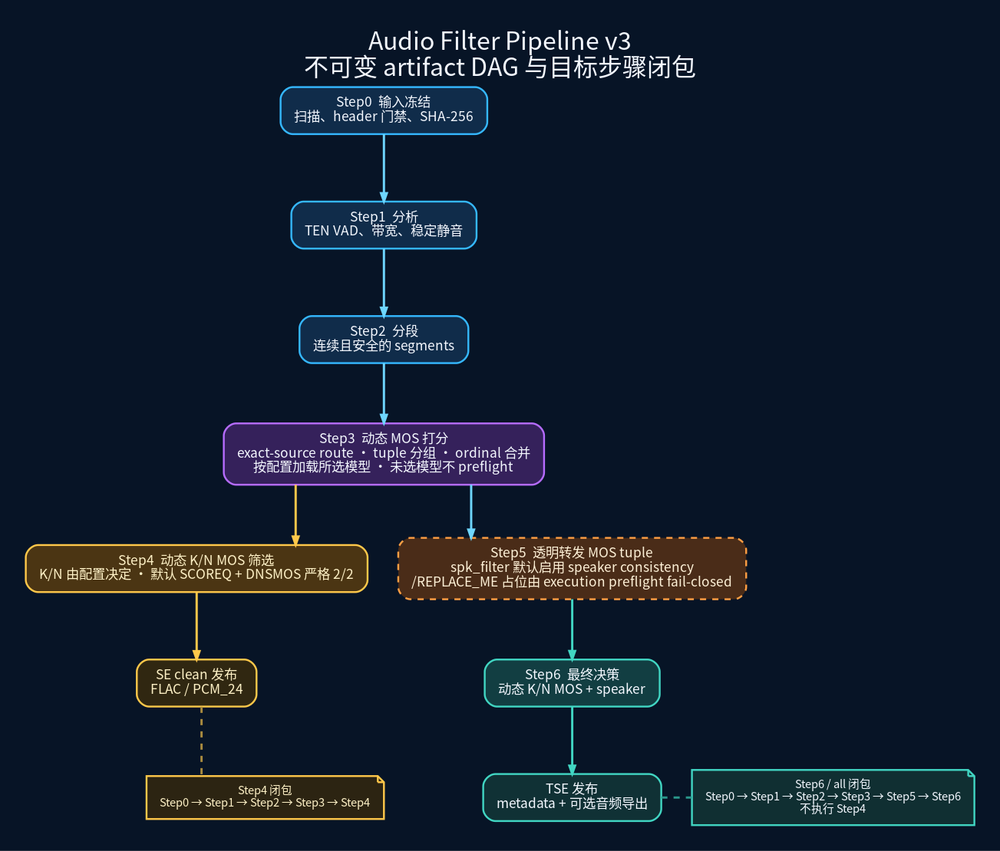

# Audio Filter Pipeline

目录职责与迁移边界见 [`ARCHITECTURE.md`](ARCHITECTURE.md)。

Audio Filter Pipeline 是一条**大规模语音筛选流水线**：扫描体量很大的原始语音目录，输出两批干净片段——给 SE 当训练数据的“通过 MOS 门槛”片段，以及给 TSE 当训练数据的“MOS + 声纹双决策通过”片段。它把链路拆成 Step0–Step6，每一步产出一份**不可变 artifact**（含输入身份、结果与摘要），因此保留完整审计链，并支持中断后续跑。

- 适合读者：要跑筛选、要确认产物落在哪里、要改阈值或改配置的人。
- 不在本文范围：MOS 模型的训练本身，以及 SE/TSE 模型训练配置（见 `configs/`）。

## 术语表

- **artifact**：某一步的不可变产出，目录形如 `stepN/<dataset_id>/{index.json, rows.jsonl, _SUCCESS}`。已发布的 artifact 不会被原地改写：配置或代码语义一变，它就会因 digest 不匹配而 fail-closed，必须重建。
- **digest**：内容指纹。artifact 身份由 producer identity、config digest、lineage digest 与 row contract 四项共同决定，四者必须精确匹配才允许 resume 复用。
- **DAG**：有向无环图，这里指 Step 之间的依赖关系；请求某个 target step 时 runner 会补齐其上游闭包。
- **fail-closed**：异常就报错停止，绝不静默降级（GPU 失败不会悄悄改跑 CPU，模型加载失败不会改用伪分数）。
- **MOS**：Mean Opinion Score，自动语音质量打分；本管线用 SCOREQ、DNSMOS 等模型。
- **VAD**：语音活动检测，用来定位语音与非语音的时间边界。
- **quorum / K/N**：N 个打分模型中必须有 K 个判定合格才算 keep；shipped 默认是 SCOREQ + DNSMOS 严格 2/2。
- **resume**：复用身份完全匹配的已发布 artifact，跳过重复计算。
- **speaker consistency**：声纹一致性，用 embedding 余弦相似度判断片段是否属于同一说话人（Step5/Step6）。
- **Step4 / Step6 解耦**：Step4 只做 MOS 筛选（SE 用），Step5 只做声纹打分，Step6 重新应用 MOS 策略并叠加声纹决策（TSE 用）；改 MOS 阈值只会重建 Step4/Step6。
- **v3 / generation-3**：当前唯一的管线生成代（v2 已移除），配置里写作 `pipeline_generation: 3`；输出目录不再带 `v3` 后缀。

## 快速开始

命令行实现位于 `cli/` 子包，统一从仓库根目录以模块方式运行。

```bash
# Step4：选一份 active inventory 非空的 Step4 配置（zh_16k 当前为空，不可执行）
PYTHONPATH=tools python -m audio_filter_pipeline.cli \
  --config tools/audio_filter_pipeline/config/audio_filter_en_16k.yaml \
  --step step4
```

预期现象：每个 Step 先打印 `Step <N> dataset=<id> start input_rows=<上游行数>`，结束时打印 `done rows=<输出行数> elapsed=<秒>`；命中已有产物时改为打印 `hit output cache, skip (resume)`。产物为 `<output_root>/` 下的 `step0..step4` artifact，以及 `step4_mode: filter` 时导出到 `<output_root>/audio_exports/step4/` 的 FLAC 片段（详见[输出目录与进度反馈](#输出目录与进度反馈)）。

## 文档地图

- 想尽快跑通：本节的「快速开始」与[运行目标步骤](#运行目标步骤)。
- 想知道每一步做什么：下面的「七步职责」表。
- 想改阈值：看「调整 MOS 阈值（Step4 dry_run + --drop-steps）」。
- 想知道哪份配置可执行、各自覆盖哪些数据集：看[采样率/语言配置](#采样率语言配置)。
- 维护者：其余章节是逐步契约细节（artifact 身份、导出事务、锁与并发、worker 协议），首次阅读可跳过。

---

当前 shipped 六份配置包括五个按源采样率和语言划分的 Step4 语音增强筛选配置，以及一个排除 clean/filter 已有结果的 `_spk` 逻辑条目并执行到 Step6 的 `spk_filter.yaml`。`audio_filter_mixed_16k.yaml` 不再 shipped，也不能由生成器重建；五份 Step4 配置中四份有 active inventory、可进入各自 Step4 preflight，`audio_filter_zh_16k.yaml` 当前 active inventory 为空（四个数据集全部转为注释），执行时会被 config 校验直接拒绝。`spk_filter.yaml` 虽默认启用 speaker consistency，但随附的是明确的 `/REPLACE_ME/...`、`replace-me` 与全零 digest 占位，必须替换真实 WeSpeaker/enrollment 资产后才可运行，未替换时会 fail-closed。详见下方[采样率/语言配置](#采样率语言配置)。

## v3 流程



> 当前图的 Graphviz 图源为 [`audio_filter_v3_overview.dot`](assets/figures/audio_filter_v3_overview.dot)，可从仓库根目录执行 `dot -Gdpi=150 -Tpng tools/audio_filter_pipeline/assets/figures/audio_filter_v3_overview.dot -o tools/audio_filter_pipeline/assets/figures/audio_filter_v3_overview.png` 重现。Step3 在此分叉：Step4 面向 SE clean 发布，完整闭包是 `Step0 → Step1 → Step2 → Step3 → Step4`；Step5 直接消费 Step3 并绕过 Step4，完整 Step6 / `all` 闭包是 `Step0 → Step1 → Step2 → Step3 → Step5 → Step6`。五份 `audio_filter_*.yaml` 的 speaker consistency 关闭；唯一 Step6 shipped 配置 `spk_filter.yaml` 默认启用，但占位资产必须替换后才能通过 preflight。Step6 始终执行 MOS 最终决策，并在该配置中叠加 speaker 决策。
>
> 发布语义按目标 Step 区分：Step4 `dry_run` 只基于 Step3 统计、不发布 artifact，也不导出音频；Step4 `filter` 先发布 Step4 artifact，再导出 keep-only SE 音频。Step6 的 `dry_run` 与 `filter` 都先发布 metadata artifact，只有 `filter` 随后导出 `export_eligible` TSE 音频。

## 七步职责

| Step | 操作 | 产物与边界 |
|---|---|---|
| Step0 | 扫描每个数据集的绝对输入根；配置 `source_selector.include_speaker_ids` 且没有采样率门禁时先解析并筛选 speaker；配置 `min_source_sample_rate_hz` 或 `source_selector.sample_rates_hz` 时在完整 SHA-256 前读取 descriptor-bound header 并应用采样率门禁；`source_selector.exclude_relative_paths` 对 input root 下的规范化相对路径执行精确排除，随后完成 speaker selector 或普通 speaker 标注。regular-file scanner 为 `regular3`，aggregate scanner 为 `aggregate4`；二者均将全局 source 结果写入临时 SQLite，并按路径作有界磁盘排序，不累积全量 source list。`_walk_directory` 仍会物化并排序单个目录的 `scandir` entries，因此内存仍会随最大单目录 entries 数增长，并非整个扫描的绝对有界内存。 | 输入快照；三个 `audio_filter_*_32k.yaml` 的 floor 为 32 kHz，两个 `audio_filter_*_16k.yaml` 与 `spk_filter.yaml` 的 floor 为 16 kHz。`source_selector` 与 canonical speaker metadata 均进入 Step0 config digest，声明的采样率、speaker ID 或排除路径均属于配置身份。筛选不移动、不复制原目录或源文件；源文件替换或路径逃逸同样 fail-closed。 |
| Step1 | 使用 decoded 音频的第一通道（channel 1，Python 索引 0）由 native CPU TEN VAD 分析语音时间线、带宽和有效采样率，并在源采样域检测稳定静音；Step0 仍保留完整通道元数据。`source_decode.v5` 对 regular source 将已验证原始字节一次写入强制落盘的 spool（raw cap 512 MiB），由 hash 与 decode 共享；解码按固定 262,144 帧分块读取，每块 transient 解出全部通道后只驻留 channel 0 mono float32（decoded cap 512 MiB 绑定该驻留 mono），因此多通道长会议源不会触发资源护栏；aggregate 不使用该 raw spool，整源解码 transiently 物化全部成员通道后提取 channel 0。 | 分析 artifact；只记录事实，不裁剪或拼接音频。每 source 建立并销毁一个 TEN handler；非空但短于 FFT 窗口的带宽分析补零到窗口长度。CPU pool 对 raw、decoded、VAD、FFT、signal 与 stable-silence 工作集作 reservation，总 inflight 上限 4 GiB。 |
| Step2 | 仅在 VAD silence 与独立声学静音的安全交集中选择切点，生成连续 segment；超过 `step2_max_segment_duration_sec`（默认 60 秒）仍无安全切点的连续段标记为 `skipped_overlong`，不产生输出行。 | 不可变 segment artifact；无安全点时不执行 hard cut；超长段跳过、不参与下游打分与导出。 |
| Step3 | 按每行真实 route 解析有序 `mos_models` tuple，并只执行配置策略实际选中的 runtime；所有 MOS runtime 统一只接收第一通道（channel 1，Python 索引 0）的连续 mono waveform，保留 row 的完整 `channels` 与 source identity；registry 支持 SCOREQ、DNSMOS、NISQA、UTMOS、URGENT-PK，同 tuple 分组，同 artifact 可混用不同 tuple，并按全局 ordinal 恢复输入顺序。`scoring_execution_policy.v1` 规定队列只传无 padding 的 float32 mono waveform；同 tuple 可跨 source 聚合，最多 32 行或 64 MiB float32，source 切换时 close、reverify、再 open。 | threshold-free MOS score artifact 与模型/资产/执行 provenance；threshold、quorum、`mos_fusion` 不进入 Step3 digest。dataset-local scoring binding 仅经 CLI factories 显式传入 `dataset_id` 的生产路径启用：只投影本数据集可达 route，策略不相关的数据集变更不重算 Step3；共享 scorer runtime 与实际 selected asset 的身份仍被绑定。direct 构造不指定 `dataset_id` 时保持全局 digest、可跨 dataset 复用；direct 构造指定 `dataset_id` 则使用 local binding，并在运行时校验 context。shipped 默认 route 只选择 SCOREQ + DNSMOS。 |
| Step4 | 对 Step3 分数按当前策略执行动态 K/N quorum，写入 `keep` 或 `reject`；shipped 默认 route 为 SCOREQ + DNSMOS **严格 2/2**。 | MOS 筛选决策；这是筛选，不是再次打分。`filter` 模式把 keep 段导出为 SE 干净数据集。dataset-local Step4/Step6 decision binding 同样仅在 CLI factories 显式传入 `dataset_id` 的生产路径绑定本数据集决策策略；direct 构造不指定 `dataset_id` 保持全局 digest、可跨 dataset 复用，指定时使用 local binding 并校验 context。K/N 只对成功生成的真实分数作决策，不容忍 selected 模型的 asset、loader 或 inference 失败。 |
| Step5 | 对全部具备有效 speaker 身份的 segment，使用 `wespeaker` backend 计算 embedding，并与同一 identity 冻结 enrollment embedding 计算 L2-normalized cosine；enrollment bundle 与 exclusion manifest 均以 SHA-256 绑定，exclusion manifest 再绑定 Step3 artifact digest。 | `speaker_shadow.v9` score artifact；只打分，不直接删除样本，并透明转发 Step3 的模型 tuple、policy hash 与分数。多 GPU 时按 speaker group 总帧数 LPT 分片到物理 GPU；每个非空 GPU shard 只发一个有界请求、启动一个 child。child 在整个 shard 内常驻同一个受限 inner model/session，按最多 32 段惰性微分批，且对每条 source 仍在其 descriptor-bound 解码边界内读取和复验。 |
| Step6 | 消费 Step5 行，基于其中的 Step3 `mos_scores` 重新执行动态 K/N MOS quorum，并联合声纹结果作最终决策和目标采样率路由。 | 保留 Step5 的 speaker score 行，并追加 `final_selection`、`export_routing` 等最终决策字段的 metadata artifact；`dry_run` 读取其统计，`filter` 在 artifact 发布后才导出首通道 mono FLAC/PCM_24（TSE 数据集）。Step6 不依赖 Step4 artifact。 |

### `streaming_flac_aggregate` 输入布局

`source_layout: streaming_flac_aggregate` 只用于 `smoothconv`；其他数据集默认保持 `regular_file`，不会根据普通目录名或文件名猜测 aggregate。配置的 `input_root` 下，名称以 `_active` 结尾的目录是一个 terminal source，Step0 将整个目录视为一行，不再递归扫描其 child。目录中的成员必须严格命名为 `<dirname>_<0000..NNNN>.flac`，索引从 `0000` 连续；成员必须是 regular file、不能是 symlink 或其他特殊文件，也不能存在未知目录成员。所有 child 必须是 FLAC，且 sample rate、channels、format、subtype 完全一致。

aggregate 仍遵守 Step0 exact 19 字段契约，不增加 `chunk`、`source_layout` 等 row 字段。该行的 `source_relative_path` 与 `original_path` 指向 aggregate 目录；`source_size_bytes` 是所有 child FLAC 字节数之和；`source_sha256` 是绑定 canonical input root、source 相对路径、目录与成员顺序、成员 inode/snapshot、原始字节 digest、header 和实际解码 frame 数的 canonical manifest digest，不是 child 字节简单拼接后的 hash。streaming FLAC 的 STREAMINFO `total_samples` 可能是整个 aggregate 的声明值，不能作为单个 child 的帧数；扫描器必须以实际分块解码计数。full decode 会按成员顺序拼接为一个 waveform，verified session 的半开 interval decode 也支持跨成员边界读取。

已确认的 metadata-only member（有 FLAC metadata、但实际解码为零帧）不会被当作零长度 child，也不会删除单个 child 后继续拼接：Step0 记录包含 dataset、aggregate 相对路径和 member 的 warning，并排除整个 `_active` aggregate，避免发布不连续时间轴。该数据质量排除策略和 scanner/policy 版本属于 Step0 config identity；除这一明确异常外，格式、header、短读、成员/目录/root binding 等错误仍 fail-closed。Step1 只分析冻结源事实，不修改、移动、复制或重写原始 aggregate 目录及其 child。

Step0、Step1 与 Step3 的 descriptor boundary 会在使用前后复验 aggregate manifest。成员内容（包括同大小替换）、目录或成员 pathname、inode、header、实际 frame 数、成员顺序以及 root/path binding 任一变化都会 fail-closed。

### exact-source MOS 策略路由

派生配置可在既有 `global → category → quality_profile → language → dataset` 合并之后，以 Step2 冻结的 `(dataset_id, source_relative_path)` 做最后一层 exact override：

```yaml
selection_policies:
  global:
    mos_models: [scoreq]
    min_mos_models: 1
  sources:
    alpha:
      speaker/example.wav:
        mos_models: [utmos, nisqa]
        min_mos_models: 1
```

`sources` 只做 exact match，不支持 glob。route 必须是 dataset root 下的 POSIX 相对路径；空路径、绝对路径、反斜杠、NUL 和任意 `..` segment 均被拒绝。`.` 与重复 `/` 会 canonicalize，因此规范化后重复的 key 也会在配置构造阶段 fail-closed。命中 override 时，`route_identity` 只进入 Step3 scoring projection/hash，**不写入 artifact row**；未命中行沿用 baseline projection。shipped YAML 未配置 `sources`，默认保持 SCOREQ + DNSMOS 严格 2/2。

Step3 config payload 对所有 baseline 与 exact-source projection 建 registry。dataset-local scoring binding 仅在 CLI factories 显式传入 `dataset_id` 的生产路径启用：它只投影本数据集可达 route，保持 threshold-free，因此不相关数据集策略不触发该数据集 Step3 重算；共享 scorer runtime 与实际 selected asset 仍被绑定。Step4/Step6 的 dataset-local decision binding 同样仅由该生产 factory 路径启用。direct 构造不指定 `dataset_id` 时保持全局 digest、可跨 dataset 复用；direct 构造指定 `dataset_id` 时使用 local binding，并在运行时校验 context。canonical execution path 先从实际可达 policy（baseline 加全部 exact-source route）求五模型 selected 并集，再构造不可变 `MosExecutionPlan`；`verify_mos_assets()` 只验证并 canonicalize 该并集中的资产，生成不可伪造的 `VerifiedMosExecutionPlan`，CPU single-process 与 GPU pool 都消费同一 verified capability，不再各自重建另一套 scorer 身份。配置可以声明五种模型资产，但未被任何实际可达 policy 选择的模型不会在 Step3 preflight 中访问；任一 selected 模型的 asset 验证、loader 构造或推理失败都会使该执行 fail-closed，K/N quorum 不能把执行失败当作缺一票继续筛选。

SCOREQ/DNSMOS runtime options 的字段必须精确为 `model_dir` 与 `verified_model_tree_sha256`。首次资产验证仍从 canonical origin 完整扫描并绑定 tree digest，随后 estimator 为整个生命周期持有一次私有只读 owned snapshot；loader 只经 snapshot root descriptor 和扫描生成的内容 entry manifest/digest 访问资产。session reset 会重新验证并复用同一 snapshot descriptor，**不会回读或重新哈希 origin**；snapshot、descriptor、内容或只读权限异常仍会 fail-closed。CPU 与 GPU scorer provenance 都写入精确的 `asset_load_binding: {"version": 3}`；GPU scorer identity 为 `step3_mos_pool.v6`，worker request/attestation protocol 为 `audio_filter_pipeline.step3_mos_worker.v6`，并精确绑定 `scoring_execution_policy.v1`。该 policy 使同一 tuple 的队列可跨 source 聚合，但只在 tuple 变化、32 行、64 MiB float32 或 EOF 时 flush；同源 session 可跨 batch 复用，切换 source 必须 close、reverify、再 open。队列层 waveform 不 padding；UTMOS/SCOREQ 的模型内预处理 padding 不改变该执行边界。每个 sparse ordinal subshard 额外严格绑定 `ordinal_sidecar_path`、`ordinal_sidecar_sha256`、`ordinal_sidecar_size_bytes`。Step3 tuple spool 通过 SQLite 去重 `segment_id`；每个逻辑 tuple 按 512 MiB physical JSONL part 自动 rollover，CPU/GPU scorer 按 tuple discovery order 与 part index 链式消费；compact index 单文件下限 512 MiB 并随 row_count 按 512 B/行伸缩，tuple parts、compact index 与 SQLite logical `page_count * page_size`、固定 cache、已保留的 key 与当前 key reservation 的 aggregate 预算下限 4 GiB 并随 row_count 按 4 KiB/行伸缩（可用 `AUDIO_FILTER_STEP3_SPOOL_MAX_TOTAL_BYTES` 覆盖），并每 256 MiB 增长复核一次 spool 文件系统剩余空间（512 MiB 安全边距），不使用文件 `getsize`。GPU weighted LPT 将 source group identity、ordinal 与 task payload digest 写入 owned temporary SQLite，以 rows 与 bytes 双重约束的小批次完成两遍扫描并保持稳定排序，不设置固定内存放行上限；worker input/result/ordinal sidecar 每个 physical file 限制为 512 MiB，input 与 sidecar 按相同边界自动 rollover。由 32 个逻辑 model tuple 和 4 GiB/512 MiB rollover 预算推导出的单 worker subshard canonical 上限为 40；worker 在打开任何 input/sidecar 前拒绝超限请求，并用 owned temporary SQLite `PRIMARY KEY` 以有界批次校验 request-global ordinal 唯一性。单 request（即一个 sealed shard）的 descriptor 以单行 canonical JSON 参与 resume key、sealed attestation（8 MiB 上限）与 shard_id 派生，因此 input/sidecar rollover 之外再按精确的逐行字节记账（ordinal + task identity + per-task binding）执行 4 MiB descriptor 预算：physical part 与 request 都会在预算边界自动切分，超出 40 个 subshard 或预算时一个 worker 顺序执行多个 request part；sealed manifest digest 改为逐 shard canonical 记录行的流式 SHA-256，不再把所有 descriptor 聚成单个受 8 MiB 限制的 JSON 对象。input 与 sparse sidecar 各只打开一次并保留同一 `O_NOFOLLOW` FD；全部 subshard 预验证后、每个 output 创建前及评分结束后都复核 FD 与 pathname 身份。CPU canonical path 使用 `single_process` / `requested_device: cpu`，不要求 CUDA、GPU ID 或 CUDA provider；所选模型必须真实落在 CPU provider/device，仍禁止伪分与静默 fallback。GPU runtime 则逐模型验证真实执行模式：SCOREQ 允许当前 ONNX 图所需的 CUDA-first 静态 hybrid partition，要求 provider 首位为 `CUDAExecutionProvider`、scorer device 为 GPU，并记录 `execution_mode: cuda_primary_hybrid_ep` 与完整 providers；这不是推理失败后的整模型 CPU fallback。DNSMOS 主/P808 session 继续禁用 CPU EP fallback，并记录 strict-session 证明；NISQA/UTMOS/URGENT-PK 同样验证声明 device 与参数 device。本地 NISQA/UTMOS checkpoint 通过 `O_NOFOLLOW` descriptor 复制到 0700 私有目录中的只读 owned snapshot，安全 loader 只读取 snapshot；实际 snapshot digest 必须与 preflight/provenance 绑定值一致，原 pathname 普通替换也会 fail-closed。

### 五模型 registry 与真实 GPU smoke

registry 支持 `scoreq`、`dnsmos`、`nisqa`、`utmos`、`urgent_pk` 五种 selectable 模型。UTMOS 在统一到 16 kHz（短样本补至 1 秒）后只按确切长度 bucket 批推理，避免无 length mask 的模型读取 padding。SCOREQ 对同样第一通道输入执行真实 B×T ONNX batch：与单条路径一致地重采样至 16 kHz、截断到 10 秒并按 320 对齐，再按对齐后的确切长度分桶；GPU SCOREQ 在第 11 次实际 ONNX run 前重建 session。历史 GPU smoke 曾加载并推理 SCOREQ、DNSMOS、NISQA、UTMOS；它只证明当时对应资产与旧 GPU runtime 路径可执行，**不代表 NISQA/UTMOS 的生产阈值已经校准，也不代表本版本的 binding v3、pool v6、worker v6、`scoring_execution_policy.v1` 或 sparse-ordinal 新路径已完成真实 GPU 验证**，因此 shipped 默认 route 不选择它们，资产字段仅保留给经过校准的派生策略。URGENT-PK 只有 checkpoint、pinned commit 与实际 `source_package_sha256` 严格内容匹配，并由 verified owned snapshot 加载时才允许执行；当前 shipped `urgentpk/model_mod.py` 是 symlink，安全 scanner 仍 fail-closed 拒绝该树，且 default route 不选择 URGENT-PK。

### MOS batching verification

真实本地 benchmark 使用通过 asset preflight 的 estimator，分别比较逐条和有界 `compute_batch`，并拒绝 fallback 或非有限分数：

```bash
python tools/verify/benchmark_mos_batching.py \
  --model scoreq --device cpu \
  --audio <a.wav> --audio <b.wav> --audio <c.wav> \
  --max-items 3 --batch-size 3
```

CPU 上 3 条真实 SCOREQ 样本的绝对误差为 0，未观察到吞吐改善。UTMOS 的 `utmos_model_sha256` 已同步为当前本地 tree digest `abe1c1aa15225599fa7189a9887da12842f8beb5541add007855ead9acdb6d9a`；通过正式资产校验与安全 loader 后，同样 3 条音频在 CPU 上单条与批量评分的最大绝对误差为 0。GPU benchmark 尚未运行，这些小样本一致性验证不能作为生产批吞吐结论。

### 稳定静音 v3 与 Step2 安全切点

Step1 的稳定静音 v3 在**源采样域**工作：只对第一通道（channel 1，Python 索引 0）以 10 ms 帧计算 RMS/peak；第一通道满足 RMS ≤ -45 dBFS、peak ≤ -30 dBFS 时该帧才是静音。连续静音至少 200 ms 才写入半开区间 `stable_silence_timeline`。Step0 仍记录完整 `channels`，Step2 不改变该元数据；Step4/Step6 会完整解码源通道后仅导出首通道 mono FLAC/PCM_24。检测以固定的 8 MiB float64 工作集分块执行，不改变阈值或区间边界语义。

Step2 新契约只消费 Step1 的完整事实，不读写 waveform：将 TEN VAD 映射出的非语音 gap 与稳定静音 v3 求交集，并在交集两侧各保留 100 ms guard。它优先在目标 10 秒处前后 1 秒选择最近安全点，窗口内没有时仅向后寻找下一安全点；planner 始终输出连续、无重叠、覆盖整个源文件的半开边界。没有未来安全点时，剩余部分作为 `no_stable_silence` 终段保留，绝不 hard cut；小于 2 秒的末段仅在合并后不超过 12 秒时合并，否则标为 `short_tail_unmerged`。唯一的时长上限是 `step2_max_segment_duration_sec`（YAML 可配，默认 60 秒）：超过上限仍无安全切点的连续段被标记为 `skipped_overlong`，planner 保留其覆盖边界以维持全源连续覆盖，但 stage 不为它产生 segment 行——该段不参与 Step3 打分与后续导出；跳过段之后若再出现安全切点，planner 从切点处恢复继续切段，跳过段之后不足 2 秒的尾巴不会合并回跳过区间。

### 导出采样率 routing v3 与旧产物迁移

六份 shipped YAML 都显式设置 `min_source_sample_rate_hz` 和 `output_sample_rate_hz`，但两者职责不同。三个 `audio_filter_*_32k.yaml` 的源最低门禁与固定导出采样率均为 32 kHz；两个 `audio_filter_*_16k.yaml` 和 `spk_filter.yaml` 的源最低门禁与固定导出采样率均为 16 kHz。Step0 仅有 speaker selector 而没有采样率门禁时，先解析并筛选 speaker；一旦配置 source floor 或 sample-rate selector，则先读取 descriptor-bound header 并应用采样率门禁，再完成 speaker selector 或普通 speaker 标注，最后计算完整 source SHA-256。`output_sample_rate_hz` 只固定合格源的导出目标，不参与源准入。固定目标不允许升采样。只有未设置 `output_sample_rate_hz` 的仓库外派生配置，才会按有效带宽选择标准采样率。routing v3 与 manifest v2、独立 transaction v3 及 digest-bound layout v2 一起绑定到 producer artifact 身份。

artifact 恢复只由当前契约决定：producer identity、config digest、lineage digest 与 row contract 必须全部精确匹配才能 resume，不能按 generation 名称或 Step 编号推断兼容。current config、provenance 或 schema 变化时，必须从受影响 producer 重建其对应闭包；scanner payload、source floor、source selector、speaker metadata snapshot 或 dataset namespace 改变时，从该数据集 Step0 重建。不泛称所有旧 Step0–Step2 artifact 兼容，它们也必须逐项通过当前契约校验。旧 artifact、manifest、FLAC 与其他旧资产不自动删除；若确需重建，请使用独立、干净的导出根，或显式清理对应闭包。

本轮 Step1/Step2 的 `analysis_algorithm_source`（`segmentation.py`/`signal_metrics.py`/`vad_filter.py`/`bandwidth.py` 源文件的 SHA-256）使 Step1 与 Step2 producer identity 断代：算法实现改动即使没有同步手写语义版本，也会让已发布 artifact 因 config digest 不匹配 fail-closed；从 Step1 重建对应闭包即可。本轮 Step3 的 `asset_load_binding.v3`、pool v6、worker v6、`scoring_execution_policy.v1`、sparse ordinal sidecar、Step3 row contract 与 Step5 `speaker_shadow.v9` 均使对应 producer identity 断代；其闭包必须重新发布，不是 row 补字段可迁移的变化。Step1 `source_decode.v5`（分块解码、只驻留 channel 0 mono、decoded cap 改绑 mono 字节）同样使 Step1 producer identity 断代，已发布的旧 Step1 artifact 会因 config digest 不匹配 fail-closed，需从 Step1 重建对应闭包（Step0 artifact 不受影响、可复用）；分析事实数值与 row contract 不变。只调整本数据集阈值时，Step3 仍可复用，Step4 链重建 `step4`，Step6 链重建 `step6`；若 Step3 scoring binding、selected asset/runtime 或其 provenance 改变，则 Step4 链重建 `step3,step4`，Step6 链重建 `step3,step5,step6`。enrollment exclusion schema/algorithm、bundle 或 Step3 binding 变化时，重建 enrollment bundle/exclusion 及 Step5/Step6 闭包。

Step3 production resume 绑定 dataset RunLock capability。完整匹配当前 request descriptor 且拥有有效 runtime attestation 的 sealed request 会恢复其结果，不启动 worker；每个 seal 先在 owned staging 写入并校验 `rows.jsonl`、`attestation.json`、`seal.json`，fsync 后以 `renameat2(RENAME_NOREPLACE)` 发布。artifact rename 前会持久化与完整 sealed manifest 绑定的 pending proof；后续仅在 artifact reader gate 验证已发布 artifact 后，才补发 execution-attestation sidecar。

## 采样率/语言配置

五份 Step4 配置以 **49 个物理输入目录、50 个逻辑 dataset ID** 组织 inventory。多个逻辑 ID 可绑定同一 canonical `input_root`，并由互斥 `source_selector` 建立逻辑视图，不改变磁盘目录布局。独立的 `spk_filter.yaml` 排除 clean/filter 已有结果的 6 个 speaker 数据集，保留 36 个 active speaker logical ID，覆盖 35 个物理输入目录。`audio_filter_mixed_16k.yaml` 已移除，不再是 shipped 或 fail-closed 模板；`spk_filter.yaml` 的 speaker 资产仍为占位，资产 preflight 会拒绝执行。五份 Step4 配置中四份当前可执行，`audio_filter_zh_16k.yaml` 的 active inventory 为空、不可执行（原因见下表与 active 集合说明）。

文件名 `audio_filter_{language_bucket}_{rate}.yaml` 明确表达语言处理桶与 source floor/固定 output rate：`zh`、`en`、`mixed` 是语言桶，`16k`/`32k` 同时对应 source floor 与固定输出采样率。本命名不把 `mixed` route 等同于特殊数据集；数据集的特殊属性（如 `singing`、`game_voice`）仍由各 dataset entry 的 `category` 元数据表达。

### 数据集 catalog 与 YAML 注释

[`config/dataset_catalog.py`](config/dataset_catalog.py) 是 Step4 `SR_DATASETS`（含 active 与注释项）及 Step6 `spk_filter` 相关 ID 的基本信息唯一来源。catalog 为每个逻辑 dataset ID 提供可读名称、基本简介、`language_bucket`、`category`、`quality_profile`、特殊属性/备注以及采样率或证据状态；运行时的 `language`、`category` 与 `quality_profile` 映射仍由生成器校验并渲染，避免展示元数据和实际路由漂移。

六份 shipped YAML 中每个 dataset entry 前的多行注释均由 [`config/generate_configs.py`](config/generate_configs.py) 从 catalog 统一渲染。注释只供阅读，不增加 YAML 运行字段；active 与 commented 数据集都必须有对应注释。修改数据集基本信息时应先更新 catalog，再重新运行生成器，不要手工维护各配置的 dataset 注释。`mixed` 只表示语言处理桶，不表示特殊类别。

当前需要特别注意的 catalog 属性包括：`smoothconv` 的多通道/中文对话属性，`seniortalk_spk` 的老人声属性，`vocalset_spk` 与 `gtsinger_spk` 的歌唱属性，以及 `genshinvoice_48k_spk`/`genshinvoice_spk` 的 `game_voice` 属性。`nnces_read_spk` 与 `nnces_spontaneous_spk` 只记录 read/spontaneous 子集和年龄属性待 manifest 核验，不将 NNCES 未经证据确认写成儿童数据集；采样率与语言集合同样按证据状态保守表述。

| 配置文件 | 源采样率分组 | `language` | source floor | 固定输出采样率 | 执行步骤 | active | 注释 | `output_root` |
|---|---|---|---:|---:|---|---:|---:|---|
| [`audio_filter_zh_32k.yaml`](config/audio_filter_zh_32k.yaml) | `32k`、`44k1`、`48k` | `zh` | 32 kHz | 32 kHz | Step4 | 1 | 2 | `/data_nvme0n1/zxc/code/use_train/data/shared/clean/filter/audio_filter_zh_32k` |
| [`audio_filter_en_32k.yaml`](config/audio_filter_en_32k.yaml) | `32k`、`44k1`、`48k` | `en` | 32 kHz | 32 kHz | Step4 | 3 | 11 | `/data_nvme0n1/zxc/code/use_train/data/shared/clean/filter/audio_filter_en_32k` |
| [`audio_filter_mixed_32k.yaml`](config/audio_filter_mixed_32k.yaml) | `32k`、`44k1`、`48k` | `mixed` | 32 kHz | 32 kHz | Step4 | 1 | 2 | `/data_nvme0n1/zxc/code/use_train/data/shared/clean/filter/audio_filter_mixed_32k` |
| [`audio_filter_zh_16k.yaml`](config/audio_filter_zh_16k.yaml) | `16k`、`24k` | `zh` | 16 kHz | 16 kHz | Step4（当前无可执行数据集） | 0 | 4 | `/data_nvme0n1/zxc/code/use_train/data/shared/clean/filter/audio_filter_zh_16k` |
| [`audio_filter_en_16k.yaml`](config/audio_filter_en_16k.yaml) | `16k`、`24k` | `en` | 16 kHz | 16 kHz | Step4 | 3 | 0 | `/data_nvme0n1/zxc/code/use_train/data/shared/clean/filter/audio_filter_en_16k` |
| [`spk_filter.yaml`](config/spk_filter.yaml) | `16k`、`24k`、`32k`、`44k1`、`48k` | `zh`、`en`、`mixed` | 16 kHz | 16 kHz | Step6 (`all`) | 36 | 0 | `/data_nvme0n1/zxc/code/use_train/data/tse/spk/filter` |

Step0 在完整 source SHA-256 之前应用对应配置的 source floor 与 sample-rate selector；speaker selector 仅在没有采样率门禁时走提前筛选快路径，组合配置则在采样率门禁后解析和筛选 speaker。三个 `audio_filter_*_32k.yaml` 拒绝低于 32 kHz 的源，其余三份 shipped 配置拒绝低于 16 kHz 的源。`output_sample_rate_hz` 只固定合格源的导出目标，不替代 source floor 或 selector。

五个 Step4 配置的 active 集合如下；它们均为 `step: step4`、`step4_mode: filter`，不会执行 Step5/Step6：

- `audio_filter_zh_32k.yaml`（1 active + 2 注释）：`smoothconv`；注释 `aishell-3_spk`（已筛选完成）、`commonvoice_cn_spk`。`smoothconv` 按中文路由。
- `audio_filter_en_32k.yaml`（3 active + 11 注释）：`emns_spk`、`jlcorpus_spk`、`ravdess_spk`；注释 `commonvoice_en_spk`、`hifitts2_spk`、`dailytalk_spk`、`hifi_tts_spk`、`nnces_read_spk`、`nnces_spontaneous_spk`、`savee_spk`、`vocalset_spk`、`expresso_spk`、`vctk_spk`、`ears_spk`。
- `audio_filter_mixed_32k.yaml`（1 active + 2 注释）：`genshinvoice_48k_spk`；注释 `gtsinger_spk`、`bibletts_spk`。`genshinvoice_44k1_spk` 已移除，不再作为 routed 或注释条目。
- `audio_filter_zh_16k.yaml`（0 active + 4 注释）：注释 `aishell4`、`aishell5`、`alimeeting`、`mer2023`。生成器记录的原因：2026-09-16 dry_run 实测下（基于已发布 Step3 分数、统一阈值阶梯）合计 keep 6012/346310 段（1.7%）、约 22.9 h，其中 `alimeeting` 占保留量 99.9%，`aishell4` 为 channel 0 远场打分异常；四个数据集已全部转为注释 inventory，恢复处理前需按实测分位数重标定阈值。因此该配置在 step4 execution context 下会以 `datasets must be a non-empty mapping in execution contexts` 直接 fail-closed。
- `audio_filter_en_16k.yaml`（3 active + 0 注释）：`gigaspeech`、`ami`、`dipco`。

Step4 的四个 selector 分别把 ESD 按 speaker ID 拆成两个互斥逻辑视图、将 GenshinVoice 限定为单一 48 kHz 视图、并排除 `aishell5` 的 noise 目录文件。GenshinVoice 在 Step4 仅使用 `genshinvoice_48k_spk` 和 `sample_rates_hz: [48000]`；Step6 仍使用单一 `genshinvoice_spk`，并保留 `sample_rates_hz: [48000]`。44.1 kHz 与 48 kHz 输入共享同一物理 `input_root`；当前配置仅注册 48 kHz 逻辑视图，44.1 kHz 路由已移除，原始文件保持不变。`BibleTTS` 在五份 Step4 配置中仅作为 `audio_filter_mixed_32k.yaml` 的注释存在，但作为带 speaker 身份的数据集会 active 进入 Step6。

### `input_root`、speaker metadata 与互斥边界

Step4 的 50 个逻辑 ID 映射到两块磁盘上的 49 个物理目录：

| 输入根前缀 | 物理目录数 | Step4 逻辑 ID 数 | 说明 |
|---|---:|---:|---|
| `/data_nvme1n1/clean_speech_download/datasets/` | 27 | 28 | ESD 按 speaker ID 拆分（2 个逻辑 ID 共享 1 个物理目录） |
| `/data_nvme2n1/clean_speech_download/datasets/` | 22 | 22 | GenshinVoice 仅保留 48 kHz 逻辑视图 |

相对 `speaker.mapping_path` 以配置文件 canonical 所在目录为 `mapping_base_dir` 解析，并限制解析结果不可逃逸。共享 canonical `input_root` 的静态 speaker-set 互斥证明只接受相同 `path_component` 或 `regex` metadata；`mapping_file` 即使运行时能解析身份，也不作为两个共享根逻辑 ID 互斥的静态证明。`unknown`、`unknown_2`、`test__Discarded` 仅是待人工核验线索，不会自动加入 exclusion，也不会由 Step0 自动排除。

### `spk_filter.yaml` 与运行参数

[`config/spk_filter.yaml`](config/spk_filter.yaml) 是唯一的 Step6 shipped 配置，排除已经在 `clean/filter` 中存在筛选结果的 `aishell-3_spk`、`bibletts_spk`、`dailytalk_spk`、`genshinvoice_spk`、`gtsinger_spk`、`hifitts2_spk`，保留 36 个 active ID、覆盖 `data/tse/spk/ori/` 下的 35 个物理输入目录。它执行 `step: all`，即闭包 `Step0 → Step1 → Step2 → Step3 → Step5 → Step6`（不执行 Step4），保持 16 kHz source floor、16 kHz 固定输出和 `step6_mode: filter`，`output_root` 为 `/data_nvme0n1/zxc/code/use_train/data/tse/spk/filter`。

36 个 active ID 为：`casia_spk`、`cremad_spk`、`emov-db_en_16k_spk`、`esd_zh_16k_spk`、`esd_en_16k_spk`、`hq-conversations_spk`、`iemocap_spk`、`librispeech_spk`、`m3ed_spk`、`magicdata_spk`、`mead_spk`、`meld_spk`、`msp-podcast_spk`、`seniortalk_spk`、`tess_spk`、`voicebank_spk`、`cnceleb_spk`、`cs_dialogue_spk`、`easyturn_spk`、`kespeech_spk`、`voxceleb_vox1_spk`、`voxceleb_vox2_spk`、`libritts_r_spk`、`commonvoice_cn_spk`、`commonvoice_en_spk`、`hifi_tts_spk`、`jlcorpus_spk`、`nnces_read_spk`、`nnces_spontaneous_spk`、`savee_spk`、`vocalset_spk`、`ears_spk`、`emns_spk`、`expresso_spk`、`ravdess_spk`、`vctk_spk`。

五份 `audio_filter_*.yaml` 都是 Step4 配置，其中 `audio_filter_zh_16k.yaml` 当前没有 active 数据集、不可执行；`audio_filter_mixed_16k.yaml` 已移除。不要用 `spk_filter.yaml` 代替 Step4 配置，也不要把 Step4 配置用于 Step6。

| 配置 | 说明 |
|---|---|
| TEN VAD | native CPU runtime，`workers: 64`、`max_pending: 128`（每 worker 单线程） |
| Step3 GPU | `use_gpu: true`，`step3_gpu_ids: [0, 1, 2, 3, 4, 5, 6, 7]`；按 `(models, source_identity)` 总帧数执行全局 LPT，每个 GPU child 的 `audio_filter_pipeline.step3_mos_worker.v6` request 可含多个完整 tuple subshard，并精确携带 `scoring_execution_policy.v1`；sparse subshard 使用三字段 ordinal sidecar，child 只构造一次 runtime；request 另按 4 MiB sealed descriptor 预算（及 40 个 subshard 上限）自动切分为多个顺序执行的 part。 |
| MOS policy | shipped 默认 route 为 SCOREQ + DNSMOS，`min_mos_models: 2`，即严格 2/2；NISQA/UTMOS/URGENT-PK 资产字段仅供经校准的派生策略显式选用，未选模型不 preflight。 |
| speaker consistency | 五份 `audio_filter_*.yaml` 为 `enabled: false`；`spk_filter.yaml` 为 `enabled: true`，`runtime: wespeaker`，并要求完整资产绑定。Step5 `speaker_shadow.version` 为 9；每个 GPU child 在 shard 内复用同一 inner model/session，固定 extractor/source-boundary provenance 在 stage 构造时冻结并进入 producer identity。 |
| `audio_filter_*.yaml` | `step: step4`，`step4_mode: filter`；有 active inventory 的四份发布 Step4 MOS 筛选并导出 SE clean 数据；`audio_filter_zh_16k.yaml` 当前 active inventory 为空、不可执行。 |
| `spk_filter.yaml` | `step: all`，`step6_mode: filter`，inventory 为 36 个 active ID / 35 个物理目录；已排除 clean/filter 中已有结果的 6 个 ID；随附 `/REPLACE_ME/...` 与全零 digest 是资产 fail-closed 模板，替换前不可运行。 |
| 导出格式 | 固定 `FLAC` / `PCM_24`；三个 `audio_filter_*_32k.yaml` 输出 32 kHz，其余 shipped 配置输出 16 kHz |

`spk_filter.yaml` 默认开启 speaker consistency，但仓库没有已确认的真实 WeSpeaker model、enrollment bundle 或 exclusion manifest，因此生成器只写入显式占位：绝对 `/REPLACE_ME/...` 路径、`replace-me` 版本和全零 SHA-256。它们仅用于满足 `PipelineConfig` structural schema，不代表配置可运行；必须全部替换为真实资产与 digest，并保留 `target_sample_rate: 16000` 及经校准的 `min_cosine_similarity`。exclusion manifest **只支持** `audio_filter_pipeline.enrollment_exclusion.v2`，且 `algorithm` 必须为 `mean_cosine_linear_sum.v1`；此 algorithm 后缀 `v1` 标识当前 O(nd) 算法版本，不是旧 manifest schema。旧 `enrollment_exclusion.v1` 不兼容：必须从 Step3 重建 enrollment bundle 与 exclusion manifest，并更新配置摘要，不能只改 schema 字段伪装迁移。请求 Step5、Step6 或 `all` 时，execution preflight 会在构造任何 factory、runner、stage 或 GPU worker 前拒绝占位，并通过 descriptor-bound 校验绑定 WeSpeaker model tree、enrollment bundle 与 exclusion manifest；Step0–Step4 target 不访问这些 speaker 资产。相对 `mapping_file` 只按上述配置目录规则解析；不要使用未展开的 `~` 或 `${VAR}`。已移除的 `genshinvoice_44k1_spk` artifact 不可复用于当前 `genshinvoice_spk` namespace；48 kHz view 的旧 bundle 或 exclusion manifest 也须经过当前契约校验后才可恢复。建议先复制或派生模板，替换全部资产后用 Step6 `dry_run` 审核，再切换独立 `output_root` 的 `filter` 发布。

## 运行目标步骤

以下命令从 `use_train` 仓库根目录执行。统一使用 `PYTHONPATH=tools python -m audio_filter_pipeline.cli`。v3 runner 会为**请求的 target Step**按 DAG 依赖闭包验证每一级 artifact，并运行缺失步骤或恢复有效的已发布 artifact；首次运行可直接请求目标步骤。`step4` 的闭包为 `Step0 → Step1 → Step2 → Step3 → Step4`，`all` 等价 `step6`，闭包为 `Step0 → Step1 → Step2 → Step3 → Step5 → Step6`，不含 Step4。任一依赖 artifact 无效或无法恢复时 fail-closed。

shipped 运行命令应始终显式传入 `--config`：Step4 从有 active inventory 的四份 `audio_filter_*.yaml` 中选择（`audio_filter_zh_16k.yaml` 当前为空 inventory、执行会被拒绝）；`audio_filter_mixed_16k.yaml` 已移除。Step6 的 shipped `spk_filter.yaml` 是覆盖完整 speaker inventory 的 schema-valid fail-closed 模板，不可直接运行；应先复制或派生它，并替换全部 speaker assets、版本和 digest。不要依赖本地遗留 `config/audio_filter.yaml` fallback。输出根的优先级固定为 canonical CLI `--output_root`、YAML `output_root`；同层同时给出时 CLI 优先。已移除的 CLI alias `--output/-o` 与 YAML alias `output` 会被直接拒绝：CLI 侧 argparse（已关闭前缀补全）报参数错误，YAML 侧按未知顶层字段 fail-fast。

```bash
# Step4：选择任一 active inventory 非空的 audio_filter_*.yaml（如 en_16k）；runner 自动补齐 Step0→Step4
PYTHONPATH=tools python -m audio_filter_pipeline.cli \
  --config tools/audio_filter_pipeline/config/audio_filter_en_16k.yaml \
  --step step4

# Step6：先从 spk_filter.yaml 派生并替换全部 speaker assets；不要直接运行 shipped 模板
PYTHONPATH=tools python -m audio_filter_pipeline.cli \
  --config /path/to/validated_spk_filter.yaml \
  --step all
```

调试单个上游步骤时也必须带同一份显式配置，例如将上述 `--step step4` 改为 `step0`、`step1`、`step2` 或 `step3`；不要跨配置复用 artifact。

`dry_run` 与 `filter` 不能在同一 `output_root` 原地切换：已发布 artifact 的 config digest 不可变。首次发布前选定模式；需要先审核再导出时，请为 `filter` 使用独立、干净的 `output_root`，并在派生配置中设置：

```yaml
step: all
step6_mode: filter
```

`filter` 模式下声纹 runtime 不可用（缺 embedding extractor，或多 GPU child 的 embedding runtime 失败）会让 Step5 把相关行降级为 `speaker_shadow.status=unavailable`，这些行不可导出。若整份 Step5 artifact 全部是 `unavailable`，Step6 会在发布前 fail-closed，而不是正常返回 `exports=0`；此时应先修复 WeSpeaker runtime / 模型资产，或改用 `dry_run` 审核，不要指望空导出。


## 调整 MOS 阈值（Step4 dry_run + --drop-steps）

Step3 只记录 MOS 分数，**阈值不属于 Step3 的 config digest**：改阈值不会触发重新打分，
Step4 直接消费已发布的 Step3 分数。调阈值推荐循环：

```bash
# 1. 修改 $AUDIO_FILTER_CONFIG 中 selection_policies.quality_profiles.*.thresholds

# 2. 秒级预览：读已发布 Step3 分数 + 当前阈值，内存统计 keep/reject，不落盘
PYTHONPATH=tools python -m audio_filter_pipeline.cli \
  --config "$AUDIO_FILTER_CONFIG" \
  --step step4          # YAML 中 step4_mode: dry_run 时生效

# 3. 不满意则回到第 1 步；定稿后只重建 Step4 决策并正常发布
PYTHONPATH=tools python -m audio_filter_pipeline.cli \
  --config "$AUDIO_FILTER_CONFIG" \
  --drop-steps step4
PYTHONPATH=tools python -m audio_filter_pipeline.cli \
  --config "$AUDIO_FILTER_CONFIG" --step step4

# scanner contract（speaker-only selector 快路径；rate gate→speaker→hash）、speaker parser、mapping snapshot、
# dataset namespace、routing 或导出布局变化：从 Step0 重建 Step4 闭包。
PYTHONPATH=tools python -m audio_filter_pipeline.cli \
  --config "$AUDIO_FILTER_CONFIG" \
  --drop-steps step0,step1,step2,step3,step4
PYTHONPATH=tools python -m audio_filter_pipeline.cli \
  --config "$AUDIO_FILTER_CONFIG" --step step4

# Step6 对应闭包（使用 spk_filter.yaml）为 step0,step1,step2,step3,step5,step6。
```

注意：shipped YAML 与 `config/generate_configs.py` 的输出被测试锁定为字节一致
（`tests/test_configs.py::test_generator_emits_all_configs_and_is_idempotent`）。
dry_run 调参可直接手改 YAML 预览；定稿后必须把阈值落回生成器并重新生成
（单配置放宽用 `render_config(threshold_overrides=...)`，如 zh_32k 的中文放宽），
否则配置测试失败。

`source_selector`、speaker metadata canonical snapshot 与 dataset namespace 均属于 Step0 身份；这些 scanner contract 任一变化都必须从 Step0 重建，不能只重跑 Step1 以后。旧 artifact、manifest 与 FLAC 不会自动清理。

`step4_mode` / `step6_mode` 统一为 `dry_run | filter` 两值，默认均为 `filter`（发布并导出音频）。

- `step4_mode: dry_run` 只影响 `--step step4` 的目标行为：runner 验证/补齐 Step0-3 后，
  用与 filter 完全相同的决策逻辑计算统计并打印（总数 / keep / reject / 时长、
  按 quality_profile 分组、passed_models 直方图、policy_hash），不发布 artifact。
- 阈值进入 Step4 与 Step6 各自的 config digest：定稿后改过阈值，已发布
  Step4/Step6 artifact 恢复会 fail-closed 报 digest mismatch，属预期行为；用
  `--drop-steps step4,step6` 显式清理后再发布（`--drop-steps` 是独立命令，
  在 dataset 级 RunLock 内安全删除 artifact 后直接退出，不跑管线）。该命令**不会级联**删除
  未显式列出的上游或下游，也不会删除既有导出 FLAC/manifest；清理后需另行运行目标 step 重建 artifact，
  旧导出布局如需清理必须由使用者单独处理。
- 音频导出只通过 artifact-bound `export_artifact()` 入口消费由 public opener 验证的
  `ArtifactIndex`；不接受手工构造 index 或直接传入 rows。producer 的 `step`、`dataset_id`、
  `config_digest`、`lineage_digest`、`rows_sha256`、`artifact_digest` 共同构成 namespace，
  并绑定 manifest v2、独立 transaction v3 与 digest-bound layout。Step4 的 manifest 位于
  `<export_root>/step4/<dataset_id>/<artifact_digest>/_export_manifest.v2.jsonl`；Step6 的 manifest 位于
  `<export_root>/step6/<language>/<dataset_id>/<artifact_digest>/_export_manifest.v2.jsonl`。manifest 逐条记录
  source 身份、输出 metadata 与 SHA-256；同一 producer artifact 再次导出时，已发布且复验一致的
  输出直接跳过（resume）。「有记录无文件」或哈希/metadata 不一致都会 fail-closed；「有文件无记录」
  仅在同 destination 的完整私有 transaction marker 可验证时补写，否则 fail-closed。旧完整
  transaction v2 marker 可恢复，旧半写 marker 不具备 ownership 证明，原样保留并报错。
- `audio_export_max_inflight_bytes` 采用严格的 estimated waveform/verification byte gate：
  单个候选的估算值超过配置上限或硬上限会在解码前失败；并发调度仅在所有 pending task 的估算字节和
  不超过该上限时提交，等于上限允许提交。该估算仅限制导出工作集，不代表进程总 RSS。
- **Step4 与 Step6 已解耦**：Step4 消费 Step3 分数生成 SE 筛选结果；Step5 直接消费
  Step3 分数生成声纹结果；Step6 消费 Step5 行并重新应用 Step3 分数对应的最终 MOS 策略。
  改阈值只重建 Step4/Step6（纯计算），**Step5 声纹与 Step3 打分完全不受影响**。当前 Step4/Step6 共享
  `selection_policies.quality_profiles` 配置，但计算和 digest 独立；若未来 TSE
  需要更严阈值，可增加 `step6_quality_profiles` 覆盖层。

## Step4 filter：导出 SE 干净数据集

`step4_mode: filter`（默认）在发布 Step4 artifact 后，把 `mos_selection=keep` 的 segment
导出为 FLAC（语音增强任务的干净数据集），采样率路由与 Step6 完全一致。shipped YAML
已设置 `output_sample_rate_hz`，因此分别固定输出 32 kHz 或 16 kHz，且禁止升采样；只有未设置
该固定值的派生配置，才会以 16 kHz 为 floor 并按有效带宽选择标准采样率，低采样率 source 保持 native。
导出根由 `step4_export_root` 显性指定（与 Step6 独立），
`null` 时默认落在 `<output_root>/audio_exports/step4/`。不要将显式导出根指向
`input_root` 或数据集目录；虽然文件名带有
`--<segment_id>` 后缀且不会覆盖源文件，但会污染数据集目录：

```text
<output_root>/audio_exports/step4/<dataset_id>/<artifact_digest>/<target_sample_rate>hz/<source_relative_parent>/<source_stem>--<segment_id>.flac
```

```bash
# 定稿后：清理失效 artifact → 以 filter 模式导出 SE 干净数据集
PYTHONPATH=tools python -m audio_filter_pipeline.cli \
  --config "$AUDIO_FILTER_CONFIG" \
  --drop-steps step4,step6
PYTHONPATH=tools python -m audio_filter_pipeline.cli \
  --config "$AUDIO_FILTER_CONFIG" --step step4 \
  # YAML 中 step4_mode: filter
```

数据流分工（MOS 分数解耦）：

```
Step0 → Step1 → Step2 → Step3  MOS 打分
                              ├──→ Step4  MOS 筛选 → SE 干净数据集
                              │       （audio_exports/step4/）
                              └──→ Step5  声纹打分 → Step6 最终 MOS + 声纹决策
                                      → TSE 数据集（audio_exports/step6/）

Step4 与 Step5 都必须经过 Step3；Step5 不经过 Step4，Step6 也不消费 Step4 artifact。
```

Step5 的 enrollment 绑定也基于 Step3 artifact（`--step3-config-digest`）；
改阈值不影响声纹与打分，只重建 Step4/Step6。由于解耦后 Step5 面向全部符合身份条件的
segment 计算声纹，不再只处理 MOS keep 子集，GPU/推理成本约按全量 segment 放大；
未来如需降低成本，可增加显式的声纹预筛开关。导出根均可通过
`step4_export_root` / `step6_export_root` 显性配置，互不干扰，且不要将其指向
`input_root` 或数据集目录，以免把带 `--<segment_id>` 后缀的导出文件污染源目录。

Step6 的 `filter` 模式仅在 Step6 metadata artifact 发布后导出 `export_eligible: true` 的最终通过片段，目标位置为：

`step6_export_root` 显式指定时也应使用独立的导出目录，不要指向 `input_root` 或数据集目录。


```text
<output_root>/audio_exports/step6/<language>/<dataset_id>/<artifact_digest>/<target_sample_rate>hz/<source_relative_parent>/<source_stem>--<segment_id>.flac
```

## 输出目录与进度反馈

### 输出目录布局

v3 是当前唯一生成代（v2 已移除），输出目录不再携带 `v3` 版本后缀，两类根目录统一在 `output_root` 下：

```text
<output_root>/
├── step0..step6/            # 每步不可变 artifact：stepN/<dataset_id>/
│   └── <dataset_id>/{index.json, rows.jsonl, _SUCCESS}
│   （发布期间同级存在瞬态 .<dataset_id>.stage-* staging 目录，启动时自动清理）
├── .audio_filter_pipeline_locks/   # dataset 级 RunLock：<hash>.lock（持久 inode，释放后仍存在）
└── audio_exports/           # 显式导出的 FLAC（PCM_24）音频
    ├── step4/<dataset_id>/<artifact_digest>/<target_sample_rate>hz/...
    └── step6/<language>/<dataset_id>/<artifact_digest>/<target_sample_rate>hz/...
    # 每个 artifact_digest 目录下另有 _export_manifest.v2.jsonl（及 .lock）：
    # producer/source 身份、metadata 与 SHA-256 索引，供断点 resume 与防覆盖校验
```

### 进度条与重点日志

每个 Step 与导出路径都提供实时反馈（`cli/main.py` 已配置 `INFO` 级日志，否则全部不可见）：

- 每个 Step 外壳（`processors/stages_v3/base.py::ArtifactStage.run()`）在计算开始时打印
  `Step <N> dataset=<id> start input_rows=<上游行数>`，结束后打印
  `done rows=<输出行数> elapsed=<秒> (速率/s)`；命中已有产物时打印
  `hit output cache, skip (resume)`，**不会**重复产生式打印。
- Step0 无上游 → 扫描后以不确定模式显示 source 计数；Step1/4/5/6 按上游
  `row_count` 显示确定进度；Step2 的 segment 总数由 VAD 切分结果决定，运行前未知，
  使用不确定模式显示已生成 segment 数，不伪造百分比。Step3 的确定进度由 GPU worker
  每完成一个 MOS batch 后发送的 `audio_filter_pipeline.step3_mos_worker.progress.v1:<N>`
  帧实时推进；父进程只把该帧用于显示，最终仍通过完整结果 artifact 校验，不提前消费
  或绕过 digest、ordinal、数量和 execution attestation 检查。
- 实际音频导出（`audio_export.py`）为单一流式线程池路径：start 打印
  `Export step=... start exports=streaming workers=N max_pending=N max_inflight_gib=X`
  （bounded pending 窗口 + in-flight 字节预算），done 打印 `exports=<成功数>` 汇总；
  导出进度条为不确定模式（成功总数取决于 resume 跳过与筛选结果，运行前未知，
  不伪造百分比）。
- 进度条基于 `tqdm`（已在依赖中），真实终端显示，重定向到管道/日志时自动降级为纯日志，不污染输出。

### 运行输出示例

以 `--step step1`（首次运行，创建 Step0/Step1）为例，INFO 日志逐级上报：

```text
2026-08-19 21:33:36 INFO audio_filter_pipeline.processors.stages_v3.base: Step step0 dataset=alpha start input_rows=n/a
2026-08-19 21:33:36 INFO audio_filter_pipeline.processors.stages_v3.base: Step step0 dataset=alpha done rows=3 elapsed=0.0s (244.0 rows/s)
2026-08-19 21:33:36 INFO audio_filter_pipeline.processors.stages_v3.base: Step step1 dataset=alpha start input_rows=3
2026-08-19 21:33:36 INFO audio_filter_pipeline.processors.stages_v3.base: Step step1 dataset=alpha done rows=3 elapsed=0.1s (30.0 rows/s)
```

交互式终端下，每个计算中的 Step 会显示进度条（`tqdm`）；Step3（GPU MOS 打分）与导出路径的进度条示例：

```text
step3:alpha:  45%|████▌      | 900/2000 [12:30<15:20, 1.20 rows/s]
export:step6:  865audio [08:04, 2.50 audio/s]   # 不确定模式：无百分比与总数
```

对已发布过产物、target 相同的再次运行：每个 Step 打印 `hit output cache, skip (resume)`，不重复产生式日志：

```text
Step step0 dataset=alpha hit output cache, skip (resume)
Step step1 dataset=alpha hit output cache, skip (resume)
```

## 并发、锁与故障恢复

- **dataset 级 orchestration context**：CLI 通过
  `DatasetRunContext` 覆盖一次 dataset invocation 的 staging 清理、依赖链执行和
  Step4/Step6 导出；context 在
  `<output_root>/.audio_filter_pipeline_locks/<hash>.lock` 上逐层安全创建/打开
  持久 lock inode，并以持有 fd 执行 `fcntl.flock(LOCK_EX | LOCK_NB)`；锁文件名只由
  dataset 派生，不依赖可能产生 mount alias 分裂的 `output_root` pathname。锁目录、
  lock inode 与协议锚点必须归当前有效 UID 所有；协议建立前拒绝预置外部 hardlink，
  建立后要求公开锁与协议锚点是同一 inode 且恰有两个链接，第三链接或异常 link
  topology 均 fail-closed。成功后写入 token/pid/hostname/argv 等 owner 信息并
  `fsync`。同一 `output_root` + dataset 并发运行第二个进程会 fail-closed 报
  `RunLockError`。进程被 `SIGKILL`/OOM 中断后，文件可由下次运行重新取得 flock
  并覆盖 owner metadata，不会被 stale 文件永久阻塞。加锁后、owner 写入后与释放前
  都复验 pathname 仍绑定所持 inode；symlink、路径替换或消失均 fail-closed。释放只
  校验并操作本次持有的 fd（token 与完整 owner 内容被篡改时同样 fail-closed），
  解锁并关闭 fd，不按路径重开或删除持久 lock 文件。
- **启动 staging 清理**：取得锁后、runner 启动前，自动清理本 dataset 各 step
  遗留的 `.stepN/<dataset_id>.stage-*` 过期 staging 目录（默认按 24h mtime 判定）。
  清理只匹配 pipeline 专属前缀，遇到 symlink 或特殊文件一律 fail-closed；
  已发布 artifact 与其他 dataset 的 staging 不受影响。
- **Step3/Step5 使用物理 GPU ID**：Step3 GPU 池为每个 child 设置
  `CUDA_VISIBLE_DEVICES=<step3_gpu_ids 中的物理 ID>`（每 child 恰好一张卡）；
  Step5 多 GPU 时每个非空 shard 的唯一 child 同样按 `speaker_consistency.gpu_ids`
  的物理 ID 绑定，单 GPU 时经 runtime options 显式传入。
- **Step3 tuple 分组与 protocol v6 provider 门禁**：parent 先按有序模型 tuple 落盘并以 SQLite
  去重 `segment_id`，再按 `(models, source_identity)` 总帧数全局 LPT；每个 GPU 仅启动一个
  `audio_filter_pipeline.step3_mos_worker.v6` child request，request 可包含多个 tuple
  subshard，tuple 之间绝不混批，结果按全局 ordinal 合并。v6 request/attestation 除
  SCOREQ/DNSMOS 的精确 `model_dir` 与 `verified_model_tree_sha256` 外，还必须精确绑定
  `asset_load_binding: {"version": 3}` 与 `scoring_execution_policy.v1`；sparse subshard 必须同时提供
  `ordinal_sidecar_path`、`ordinal_sidecar_sha256`、`ordinal_sidecar_size_bytes`。缺字段、多字段、
  非法 digest 或非当前 binding/policy/protocol 都会在构造 runtime 前拒绝。每个逻辑 tuple 按 512 MiB
  physical JSONL part 自动 rollover，CPU/GPU scorer 按 tuple discovery order 与 part index 链式消费；
  compact index 单文件下限 512 MiB 并随 row_count 按 512 B/行伸缩，全部 tuple parts、compact
  index 与 SQLite index 工作集的 aggregate 预算下限 4 GiB 并随 row_count 按 4 KiB/行伸缩
  （可用 `AUDIO_FILTER_STEP3_SPOOL_MAX_TOTAL_BYTES` 覆盖），同时按 256 MiB 步长复核
  spool 文件系统剩余空间（保留 512 MiB 安全边距）。GPU weighted LPT 将 source group、ordinal 与 task payload digest 写入 owned temporary SQLite，
  以 rows 与 bytes 双重约束的小批次完成两遍扫描并保持稳定排序；worker input/result/ordinal sidecar 每个
  physical file 限制为 512 MiB，input 与 sidecar 同步自动 rollover。child 只构造一次 runtime，并逐 tuple 验证真实设备：
  SCOREQ 要求 CUDA provider 排首位且 scorer device 为 GPU，允许 ONNX 图静态分配部分节点给 CPU EP；
  DNSMOS 同时检查主/P808 两个 session，并要求 strict-session 标记证明 CPU EP fallback 已禁用；
  NISQA/UTMOS/URGENT-PK 检查声明 device 与参数 device。SCOREQ 的 hybrid graph partition 不会被
  标记为 `cpu_fallback`，加载或推理失败也不得改用能量伪分。
- **worker heartbeat 与资源边界**：Step3 使用
  `step3_worker_idle_timeout_seconds`（默认 900 秒）和可选
  `step3_worker_hard_timeout_seconds`；launcher 持续输出严格的
  `audio_filter_pipeline.step3_mos_worker.heartbeat.v1` 帧，只有完整合法 heartbeat 才刷新
  idle deadline；每个已完成 MOS batch 还发送 `audio_filter_pipeline.step3_mos_worker.progress.v1:<N>`
  帧，由父进程转发到 Step3 tqdm。progress 帧只负责实时显示，不参与结果完整性判断，普通
  stdout、部分帧或 stderr 均不能续期。hard timeout 若配置则从 child
  启动起计时，即使 heartbeat 连续也不会延长；已移除的旧 `step3_worker_timeout_seconds`
  不再映射到 idle timeout，配置中出现即按未知顶层字段 fail-fast。Step5 将完整 `speaker_consistency.worker_limits` 透传到 `wespeaker`
  optional worker。GPU child idle/hard timeout 或非零退出时，父进程以有界 TERM→KILL
  终止整个进程组并附带 stderr tail；多 child 异常清理会逐个尝试，不因单个清理失败跳过
  其余 child，且只有 `poll()` 确认已退出后才从 active-process registry 移除。
- **Step5 单 shard 请求与 runtime 复用**：一次 `extract_groups` 内，parent 对每个
  非空 GPU shard 只构造一个不超过约 24MiB 的请求并启动一个 child，整 shard
  超限则在启动前 fail-closed。child 在构建 runtime 前校验整个请求，跨 group 或
  group 内出现重复 `segment_id` 都会拒绝；随后只构建一次 WeSpeaker runtime，并按
  输入顺序每批最多 32 段惰性推理。底层 worker 逐条打开、复验并关闭 source fd，
  不会预开整批源文件，也不会物化整个 shard 的 embeddings。
- **导出原子性与 resume**：每个 destination 持久保留独立的 `0700` 锁域目录，
  对目录 FD 加锁，anchor 文件不是锁对象；锁内先恢复、再判断 resume 或发布，
  不同 destination 仍可并行，替换 anchor 不会分裂锁。FLAC 与 transaction marker 都先写入专属
  `.audio-export-staging-<digest>/`，各自 `fsync` 后以 `renameat2(RENAME_NOREPLACE)` 发布：
  marker 完整发布后才移动音频，移动后复验 inode 与 SHA-256，并 `fsync` destination 父目录。
  manifest append 任意异常（包括 append 已落盘后的 close/unlock 失败）都保留音频和完整 marker，
  下次锁内核验 manifest 有/无记录后补写或清理；不会删除可能已经提交的发布。
  私有 staging 短写仅在随机持久 owner capability、token 与文件归属全部验证后清理；
  缺少 owner、未知条目或 token 不匹配均保留现场并报错。已退役的 v2
  transaction marker（destination 同级 `.audio-export-transaction-*.json`）不再读取，
  检测到残留即 fail-fast 并保留现场，交由人工核对后删除；只有 v3 staging marker
  参与恢复，半写 marker 保留并 fail-closed。默认 decoder 按 immutable source identity 复用有界
  `VerifiedSourceSession`：每个唯一源只做一次完整 source SHA-256，片段仍逐段精确
  解码；manifest 缓存在 pathname 签名不变时跳过重复 flock/解析，外部变更后重载。
  `Step4AudioExporter` / `Step6AudioExporter.last_io_counts` 暴露最近一次 invocation 的
  source 完整读取、片段解码和各 output verification phase 计数，仅用于观测，不参与
  安全判断；临时文件与发布目标的完整解码 + SHA-256 双重复验仍保留。
- **enrollment bundle 双文件事务**：离线生成 bundle 与 exclusion manifest 时，
  两个目标文件经由 temp 文件 + 事务 marker（flock 互斥）一次性发布；进程中断后
  下次调用先按 marker 恢复现场，任何失败回滚已发布链接，已有输出永不覆盖。

## v3 测试

从 `use_train` 仓库根目录执行与 v3 契约对应的测试。日常文档/CLI 变更先运行下方定向检查；完整 pipeline test suite 是标准回归命令，但历史 smoke 或 unit 通过不替代本版本新 GPU 路径的真实验证：

```bash
# 文档契约与 CLI 帮助的定向检查
PYTHONDONTWRITEBYTECODE=1 \
PYTHONPATH=/data_nvme0n1/zxc/code/use_train:/data_nvme0n1/zxc/code/use_train/tools \
python -m pytest tools/audio_filter_pipeline/tests/test_documentation_contract.py -q -W error -p no:cacheprovider

PYTHONDONTWRITEBYTECODE=1 \
PYTHONPATH=/data_nvme0n1/zxc/code/use_train:/data_nvme0n1/zxc/code/use_train/tools \
PYTHONPATH=tools python -m audio_filter_pipeline.cli --help

# 标准完整回归（需要覆盖整个 pipeline 时才运行）
PYTHONDONTWRITEBYTECODE=1 \
PYTHONPATH=/data_nvme0n1/zxc/code/use_train:/data_nvme0n1/zxc/code/use_train/tools \
python -m pytest tools/audio_filter_pipeline/tests -q -W error -p no:cacheprovider
```

## 安装与运行时资产

- Python 3.10+；MOS 打分需要所选模型的真实本地资产。CPU canonical execution path 不要求 CUDA；只有 `use_gpu: true` 的 GPU pool 路径才要求 CUDA 与非空 `step3_gpu_ids`。registry 的 selectable 模型为 `dnsmos`、`nisqa`、`utmos`、`scoreq`、`urgent_pk`。
- shipped YAML 为五种模型提供资产字段，但 preflight 只访问所有 baseline 与 exact-source resolved policy 实际选择模型的并集；默认只选择 SCOREQ + DNSMOS 严格 2/2。NISQA/UTMOS 的 smoke 成功不等于生产阈值已校准；URGENT-PK 当前又因 shipped model tree 中的 symlink 被安全 scanner 拒绝，三者均不在 shipped 默认 route。selected-only `VerifiedMosExecutionPlan` 是 CPU/GPU scorer 的统一资产与 provenance capability。
- SCOREQ/DNSMOS 首次验证必须完整扫描 canonical origin；此安全门禁不会因性能优化而跳过。验证后 loader 通过 descriptor-bound owned snapshot 及其内容 manifest/digest 工作，reset 只复核并重用 snapshot，不再回读 origin。NISQA/UTMOS 的 `*_model_sha256` 绑定 checkpoint 父目录完整 tree digest；checkpoint 本身从 `O_NOFOLLOW` descriptor 复制为 0700/0400 私有 snapshot 并计算 SHA-256，preflight、provenance 与 runtime loader 必须绑定同一 digest。NISQA 将第三方 constructor 内的 `torch.load` 限制到已声明 checkpoint，但 `safe_torch_load` 实际只读取 snapshot；UTMOS 同样从 snapshot 做 strict state-dict 安全加载，均不静默 fallback，owned snapshot 在成功与异常路径都会清理。
- shipped 配置默认使用 8 张指定 GPU；缺少可证明的真实模型/provider 不会静默降级为伪分数。ONNX Runtime 1.23.2 / A800 实测 DNSMOS 主/P808 session 均以 CUDA EP 为首选并成功启用 `session.disable_cpu_ep_fallback=1`（`get_providers()` 仍可能列出自动注册但不可执行的 CPU EP）；SCOREQ 当前 shipped ONNX 使用 `CUDAExecutionProvider` 首位、`CPUExecutionProvider` 次位的静态 hybrid partition，provenance 记录 `execution_mode: cuda_primary_hybrid_ep`。该 CPU EP 只承载图初始化时分配的节点，不表示运行中允许整模型 CPU downgrade。
- WeSpeaker 是隔离的可选 runtime，且其模型与冻结 enrollment 资产必须通过配置中的版本与 SHA-256 绑定。
