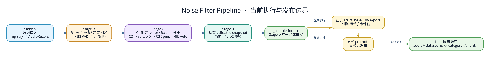

# Noise Filter Pipeline — 噪声/音乐筛选与源库构建平台

目录职责与入口迁移边界见 [`ARCHITECTURE.md`](ARCHITECTURE.md)。

<p align="center">
  <strong>统一音频源库构建平台：数据接入 → 噪声筛选 → 事件检测 → 质量增强</strong>
</p>

---

## 目录

- [这是做什么的](#这是做什么的)
- [术语表](#术语表)
- [文档地图](#文档地图)
- [概览](#概览)
- [执行链路](#执行链路)
- [准入契约](#准入契约)
- [Stage D 输出与布局](#stage-d-输出与布局)
- [发布与 promote](#发布与-promote)
- [训练集导出与训练端语义](#训练集导出与训练端语义)
- [快速开始](#快速开始)
- [测试](#测试)
- [模型准备](#模型准备)
- [环境安装](#环境安装)
- [路径名清理](#路径名清理)
- [致谢](#致谢)

---

## 这是做什么的

这条管线的任务有两类，用的是同一套 Stage A–D 链路：

1. **建噪声/音乐素材库**：从公开数据集里筛出“不含人声、适合当加性噪声”的音频，做统一的响度与格式处理，产出可以直接训练的清单。
2. **建说话人素材库**：筛选带说话人身份的干净语音，供 TSE（目标说话人提取）训练使用。

- 适合读者：要跑筛选、要判断某条记录为什么被接受/拒绝、要接新数据集或换模型的人。
- 不在本文范围：SE/AEC/TSE 模型的训练与推理（见仓库根 README），以及数据集来源的获取（`config/noise.yaml` 只登记路径）。

## 术语表

- **Stage A–D**：四个阶段。A 接入原始数据，B 做切片与 VAD（语音活动检测）过滤，C 做“是不是人声/可懂度”的三分类准入，D 做响度归一化与质检。
- **VAD**：Voice Activity Detection，判断一段音频里有没有人声。
- **admission**：准入判定，即一条记录能否进入最终库。
- **top-5 / MID**：AudioSet 标签体系的缩写，MID 是标签 ID；C2 只保留分数最高的 5 个标签，C3 用其中是否出现 speech 类标签做最终否决。
- **manifest**：清单文件。本管线按数据集拆分，形如 `stage_b/b_manifest_<dataset_id>.jsonl`（JSONL = 每行一个 JSON 对象）。
- **checkpoint / marker**：断点续跑与完成标记文件；配置或输入指纹变化后对应 checkpoint 自动失效。
- **daemon**：常驻子进程（`subprocess_daemon` 模式），模型只加载一次，主进程只负责调度与清单管理。
- **resume / promote**：resume 指从 checkpoint 继续；promote 指把最终子阶段通过的音频正式发布到 `final/`。
- **fail-closed**：发现问题就报错停止，不会“跳过坏数据继续跑”；内容级拒绝是终态，基础设施失败标为可重试。

## 文档地图

- 想跑通：看[快速开始](#快速开始)。
- 想知道每一步在做什么：看[执行链路](#执行链路)。
- 想知道一条记录为什么被拒：看[准入契约](#准入契约)。
- 想知道产物在哪、怎么发布：看 [Stage D 输出与布局](#stage-d-输出与布局) 与[发布与 promote](#发布与-promote)。
- 要接训练：看[训练集导出与训练端语义](#训练集导出与训练端语义)。
- 部署前准备模型与环境：看[模型准备](#模型准备) 与[环境安装](#环境安装)。

---

## 概览

专门用于**噪声与音乐数据筛选及源库构建**的数据处理管道，采用 Stage A-D 统一链路：

- **Stage A**：数据读取整理，将原始音频统一接入为 `AudioRecord`。
- **Stage B**：噪声筛选（B1 分片 → B2 静音/DC 过滤 → B3 多模型 VAD → B4 策略过滤）。
- **Stage C**：噪声事件检测（C1 Qwen 三分类 → C2 AudioTag 固定 top-5 → C3 speech-only veto）。
- **Stage D**：质量统一与质检。当前 `skip_d1: true`，C3 accepted 记录直接进入独立 D2 响度归一化与时长质检；D1 Apollo 是显式启用的可选增强。

关键配置与路径：

- 默认数据集注册表：`tools/noise_filter_pipeline/config/noise.yaml`（便携模板，含 `data/` 相对占位；部署时复制或改写为真实数据根目录）。
- 阶段运行配置：`tools/noise_filter_pipeline/config/pipeline.yaml`。
- 正式输出根目录：`/data_nvme0n1/data/noise_filter/`；显式传入 `--output` 时覆盖此值。
- `tools/noise_filter_pipeline/config/noise.yaml` 仅为便携部署模板，不参与正式运行。
- 核心抽象：`core/`（manifest schema 与 per-dataset 读写、Processor 基类、Stage 调度器、LLM cache）；各阶段 orchestrator：`stages/`。

部署前置：

- Stage A 会读取 registry 中所有 `enabled: true` 条目；运行前必须确认对应数据目录可访问，否则 Stage A 启动即失败。
- `stage_b.b3.funasr_model_dir: null` 表示由 FunASR 按自身规则解析/下载模型；需要固定本地缓存时可在部署侧覆盖为实际目录。FireRedVAD 同样保留 `null` 自动查找/下载语义。
- 当前完整链路在 C1 前必须先准备 `third_party_scripts/Qwen2.5-Omni-7B`；C1 不是可选后置模型。C1/C2/D1 模型路径默认指向仓库内 `third_party_scripts/` 相对资产。C2/D1 的 `python_path` 分别使用 `${NOISE_FILTER_AUDIOTAG_PYTHON}` / `${NOISE_FILTER_APOLLO_PYTHON}` 环境变量占位；部署前必须设置为对应环境的解释器，或在本地覆盖配置。
- 当前 `stage_d.skip_d1: true` 时不消费 D1 的解释器和 Apollo 模型；启用 D1 前需准备 Apollo 的 config、checkpoint、daemon 脚本及其运行环境。C2 默认启用：dry-run 测试只需 label CSV；`subprocess_daemon` 运行及任何可发布链路必须准备 AudioTag checkpoint、label CSV 和 daemon Python 环境。

---

## 执行链路



> 当前准入与发布拓扑以 [仓内 overview 图](assets/noise_filter_pipeline_overview.png) 及其 [Graphviz 图源](assets/noise_filter_pipeline_overview.dot) 为入口。当前主链为 `A → B1 → B2 → B3 → B4 → C1 → C2 → C3 → D2`；strict JSONL v6 export 与 promote `final/` 都是 `d_completion.json` 之后并列、显式触发的后处理，不属于 `python -m noise_filter_pipeline.cli --stage A,B,C,D` 自动主链，也不互相依赖。训练侧 metadata routing / sampling 是消费已发布清单的另一层，不属于 admission、Stage D 或 promotion 发布链。
>
> 仓内 assets 另提供当前 [Stage A-D 与显式后处理详细图](assets/noise_filter_pipeline_flow_v3.png)（[同名 DOT](assets/noise_filter_pipeline_flow_v3.dot)）及 [执行与发布边界概览图](assets/noise_filter_pipeline_overview.png)（[同名 DOT](assets/noise_filter_pipeline_overview.dot)）。两图均明确 `Stage D → d_completion.json`，再并列进入显式 strict JSONL v6 export 与显式 promote 分支，只有 `promote → final`；文件名中的 `v3` / `overview` 是历史命名，不代表当前契约版本。

| Stage | 子步骤 | 具体操作 | 输入 → 输出 | 关键契约 |
|:---|:---|:---|:---|:---|
| **B** | **B1→B4** | 分片、静音过滤、多模型 VAD、策略过滤 | A 输出 → `stage_b/b_manifest_<dataset_id>.jsonl` | VAD `fail_count` 三档 + B4 保留策略 |
| **C** | **C1 Qwen** | 人声/可懂度三分类 | B4 passed → `stage_c/C1/c1_manifest_<dataset_id>.jsonl` | Speech 终态拒绝；Noise/Babble 决定接受类别 |
| | **C2 AudioTag** | 完整 527 仅内部排序；保存固定 top-5 | C1 Noise/Babble → `stage_c/C2/c2_manifest_<dataset_id>.jsonl` | evidence v5；不读取 policy |
| | **C3 最终 admission** | top-5 Speech MID veto | C2 passed → `stage_c/C3/c3_manifest_<dataset_id>.jsonl` | policy v4 / evidence v5；无阈值、无 calibration |
| **D** | **D2 质检（当前）** | 响度归一化、峰值限制、时长过滤 | C3 accepted → `stage_d/D2/d2_manifest_<dataset_id>.jsonl` | `skip_d1: true` |
| | **D1 Apollo（可选）** | 对低采样率音频做频带扩展 | C3 accepted → `stage_d/D1/d1_manifest_<dataset_id>.jsonl` | 仅 `skip_d1: false` |

Stage B 要点：

- 默认启用 `stage_b.unified: true` 单文件 in-memory 流水线，仅对最终保留的 chunk 落盘；VAD 直接接收内存中的音频数组，FunASR/FireRedVAD 不再为每个 chunk 写临时 WAV。设为 `false` 时使用分阶段 Processor 链路。
- 支持断点续跑：中途 kill 后自动从 `checkpoint.json` + per-dataset 输出文件恢复已处理记录。
- 输出为 per-dataset manifest：每个数据集独立文件 `stage_b/b_manifest_<dataset_id>.jsonl`；增量跑只更新涉及的数据集。
- `vad_batch_chunks`（默认 1000）是外层内存/flush 窗口而非 GPU batch，且进入 checkpoint 指纹，调优需谨慎；Silero 真实 batch 由 `b3.silero_group_size` 控制（代码默认 16，当前 `pipeline.yaml` 设为 64；仅调度参数，不进 checkpoint 指纹），FunASR/FireRedVAD 受第三方 API 限制逐条推理。运行时还会按可用物理内存（预算 25%，按 48k/float32 最坏情况估算）自动下调实际批大小并告警，该钳制只改批边界、不改处理结果，也不进 checkpoint 指纹。

VAD 与 B4 策略（当前配置）：

- `stage_b.b3.reject_on_any_speech: false`。B3 正常完成时按 `fail_count` 分类：`0 → noise`、`1 → suspected`、`>=2 → rejected`。
- B4 为 `keep_noise=true`、`keep_suspected=true`、`keep_rejected=false`，因此 noise 与 suspected 都进入 Stage C，单路 VAD 命中不会在 B 阶段直接拒绝。
- `strict_vad_models: true` 时指定模型缺失、fallback 或技术失败直接拒绝。
- Silero VAD 模型文件：优先读取 `third_party_scripts/SileroVAD/silero_vad.jit`（该目录被 `.gitignore` 忽略，需各机器自备已校验副本）；本地缺失时仅当同时配置 `SILERO_VAD_URL` 与 `SILERO_VAD_SHA256`（64 位 hex）才允许下载，否则直接报错——不再静默回退 energy VAD，也不再执行远端 torch.hub 代码。
- 输出档位为 **Noise / Suspected / Rejected** 三档，持久字段为 `final_category` 与 `stages.B4.status`，`kept` 仅为内部 bool。

并发与性能（当前 `pipeline.yaml` 实测值）：

- `stage_a.num_workers: 16`；`stage_b.num_workers: 8`（文件级处理与最终 FLAC 编码/写出）；`stage_b.b3.num_workers: 16`（VAD spawn 进程池，实测 16 已饱和，再上调反而变慢）。
- Stage D 的 snapshot 与 D2 使用独立 worker 配置：`stage_d.snapshot_num_workers` 只控制 validated snapshot 构建和发布前源文件复验，正式配置为 `4`，省略时 runtime 取 `min(4, cpu_count)`；`stage_d.d2.num_workers` 直接控制 D2，未设置时才回退到 `stage_d.num_workers`，两者都省略时 D2 runtime 取 `min(8, cpu_count)`。这些机器相关默认值只在运行时解析，不会无条件写回 resolved config。当前正式 D2 显式配置为 `32`，并配套 `checkpoint_save_interval: 5000`、`manifest_write_batch_size: 2000`（小规模 smoke 13.2s→10.3s，百万级收益更大）。
- Stage D 性能基准只能在隔离、可丢弃的 scratch 输入/输出根目录中执行；禁止把正式 output root 用作 benchmark 目标，以免基准产物、锁、checkpoint 或 completion 状态污染生产 run。
- C1 Qwen 的 `max_new_tokens` 默认 8（限制异常长尾，实测吞吐 +33%）；C1 `batch_size` 保持 32，上调至 64 会因 OOM 折半重试反而变慢，且 32 时已观测到约 78GiB 显存尖峰。

---

## 准入契约

### C1：Qwen 可懂度/人声三分类

C1 将音频判为 `Speech`、`Babble` 或 `Noise`，是 C2/C3 的必需上游：

| 模型输出 | 含义 | C1 stage 状态与下游语义 |
|:---|:---|:---|
| `Speech` | 任何可识别的人声或人类发声 | 终态 `rejected`，不调用 C2 |
| `Babble` | 不可懂的背景群体人声 | `passed` 候选；top-5 无 speech MID 时为 `accept_babble` |
| `Noise` | 不包含人声活动的声音 | `passed` 候选；top-5 无 speech MID 时为 `accept_noise` |
| 其他不可解析输出 | 不符合约定的模型响应 | 终态 `rejected` |
| 无原始输出或基础设施失败 | 模型调用未得到有效响应 | `failed` 且可重试，不写 checkpoint |

生产配置不设置 `stage_c.c1.prompt`，默认使用 `processors/qwen_single_event.py` 中的 `DEFAULT_PROMPT`，避免 YAML 副本与代码漂移；`prompt` 仅用于隔离实验中的临时覆盖，覆盖后会改变 C1 prompt 指纹，相关结果不得与默认生产结果混用。

C1 的持久化结果 cache namespace 和进程内模型 cache key 都绑定已验证的 `qwen_model_sha256`；即使模型路径和名称不变，只要模型内容变化，既有结果和模型实例也不会被复用。未提供 identity 时使用确定性的 `unset:qwen_model_sha256` 隔离命名空间。调用时音频和生效的提示词共同组成 user message，不额外设置自定义 system prompt。

`max_new_tokens`（默认 8）进入 C1 processor/checkpoint fingerprint、Qwen model cache key 与 LLM cache key，修改后既有结果失效。

### C2：AudioTag 固定 top-5 事实层

C2 是纯事实层，不加载 policy：模型完整 527 维 independent sigmoid 分数只用于内部稳定排序，不持久化；固定输出 `labels.audioset_top5`，恰好保存 5 项，每项字段精确为 `index`、`mid`、`label`、`prob`，按 `prob desc, index asc` 排序。`topk_output_key` / `topk_keep_k` 不属于可配置项，出现时直接拒绝。

### C3：policy v4 speech-only 最终准入

C3 无任何分数阈值或 calibration，只检查 top-5：任一 MID 由 policy v4 映射为 `speech` 就 `reject`；否则沿用 C1 类别输出 `accept_noise` / `accept_babble`。映射为 `babble` 的 MID 不参与 veto、支持或类别改写。

accepted 记录的 `balance_category` 取 top-5 中最高排名的 `noise` MID；没有 `noise` MID 时回退 `/m/096m7z` / `Noise`。结果携带 `balance_category_mid`、`balance_category`、`balance_category_source`，不生成固定 Babbling bucket。

### 发布身份与发布边界

当前准入与发布身份：strict manifest schema v6、policy v4、evidence v5、parser v10、Stage D JSONL generator v6.1、promotion marker v4。calibration、approved、attestation 与 approval bundle 均不属于当前决策或发布门禁。

artifact fingerprint 精确包含五项 SHA-256：`voice_policy_sha256`、`audiotag_label_dict_sha256`、`audiotag_checkpoint_sha256`、`qwen_model_sha256`、`c1_prompt_sha256`。C2 fingerprint 绑定 AudioTag checkpoint、label CSV、score/evidence contract 与固定 top-5 规则；修改 C3 policy 只失效 C3 及下游，不触发 AudioTag 重推理。

发布边界：进入 Stage D validated snapshot、strict JSONL 导出或 promote 的记录，必须满足 C1 `production`、C2 `subprocess_daemon`、`publishable=true`，并通过 policy/evidence/fingerprint 一致性复验；dry-run、disabled execution contract 只能用于测试，不可发布。C2 dry-run 只需 `label_dict`、不需要 checkpoint；`subprocess_daemon` 必须具备 `label_dict`、checkpoint 与 daemon Python。

---

## Stage D 输出与布局

Stage D 的最终产物是统一格式的噪声源库，通过 `pipeline.yaml` 中的 `stage_d` 控制：

```yaml
stage_d:
  snapshot_num_workers: 4  # 只控制 snapshot build/source revalidation
  writer_lock_timeout: 30.0  # D1/D2 writer lock 最长等待秒数
  d1:
    mode: "subprocess_daemon"  # dry_run | subprocess_daemon（长驻 daemon，模型只加载一次，生产推荐）
    target_sr: 44100       # Apollo 模型目标采样率
    output_sr: 32000       # D1 最终输出采样率；未配置时与 target_sr 一致；null 表示跳过样本保留原 sr
    output_format: flac    # 输出格式：flac / wav 等 soundfile 支持的扩展名
    post_normalize:        # D1+D2 合并执行
      target_rms: 0.1
      max_peak: 0.95
      min_duration: 2.0
      max_duration: 30.0
  d2:
    num_workers: 32        # D2 音频处理；优先于 stage_d.num_workers fallback
    output_sr: null        # D2 最终输出采样率；null 保持输入采样率（当前配置）
    output_format: flac
    output_layout: dataset_label  # 当前配置：audio/<dataset_id>/<C3 balance_category>/shard_<5位>/<4位>.flac；不含采样率目录
```

行为摘要：

- **三分支**：`skip_d1=true` 时 `C3 → 独立 D2`（当前配置）；启用 D1 且无 `d1.post_normalize` 时 `C3 → D1 → 独立 D2`；启用 `post_normalize` 时 D1 内合并 D2，跳过独立 D2，最终子阶段为 D1。
- **validated snapshot**：Stage D 从预检开始到最终统计全程持有 `stage_d` run 排它锁；先 strict 流式扫描上游 manifest，只接受满足发布边界的 C3 passed 记录，再事务性写入 run 锁内的短生命周期私有 validated snapshot。D1/D2 只读取该快照，避免预检后的输入替换；snapshot 不是发布事实源，promote 的唯一完成事实是 `d_completion.json`。
- **私有音频快照**：每个 eligible unique source file 优先通过 reflink 克隆；只有 `EOPNOTSUPP`、`ENOTTY`、`EXDEV`、`EINVAL`、`ENOSYS` 明确表示不支持 reflink 时，才 fallback 为实体 copy，其他错误 fail-closed。reflink 与实体 copy 两条路径都对源和目标执行完整 SHA-256，且目标必须复验为私有普通文件、大小一致、与源不是同一 inode；不能以 metadata 或共享 hardlink 代替内容与私有身份校验。
- **同步边界**：validated snapshot 音频不做逐文件 `fsync`，避免 unique-file 规模下的同步风暴；仅 snapshot manifest 文件与 owned sentinel 文件保留阶段边界 `flush`/`fsync`，不承诺额外的阶段级目录同步。
- **并发与确定性**：snapshot build 和 source revalidation 各自显示独立进度，均以 eligible 的 unique source file 为计数对象，两个进度条的单位统一为 `unique-file`；多条记录共享同一路径时只计一次。worker 可以乱序完成，但 manifest 写出与私有路径分配仍按输入顺序提交，因而相同输入的 snapshot manifest 保持确定性。
- **worker 优先级与身份**：`stage_d.snapshot_num_workers` 仅服务 snapshot build/source revalidation，省略时 runtime 默认 `min(4, cpu_count)`；D2 优先使用 `stage_d.d2.num_workers`，其次使用兼容 fallback `stage_d.num_workers`，两者都省略时 runtime 默认 `min(8, cpu_count)`。机器相关默认值不得无条件写入 resolved config；但显式增加或修改 `snapshot_num_workers` 会进入 Stage D completion 的 `stage_d_config_hash`，因此显式 `--config` promote 可能与基于旧配置生成的 completion 不兼容。
- **空产出门禁**：输入为空、没有 C3 passed eligible，或最终子阶段没有任何 D2 passed 时直接失败；零 D2 passed 会失效最终子阶段 `.complete`，且不发布 `d_stats.json`。
- **输出布局**：`dataset_label` 布局输出为 `audio/<dataset_id>/<C3 balance_category>/shard_<5位>/<4位>.flac`，不含采样率目录；ordinal 每个 dataset 内按 Stage D 输入 manifest 顺序从 0 开始、跨 category 不重置，每个 shard 最多 10000 条；`rejected`/`failed` 记录不写音频但占用 ordinal，形成编号空洞，因此同一输入顺序重跑时路径稳定。改变输入顺序会重新编号，checkpoint 不恢复。
- **输出规格**：独立 D2 的 `output_sr: null` 保留输入采样率；合并模式以 D2 配置作为归一化、格式和布局基线，再由 `d1.post_normalize` 显式字段覆盖。D1/D2 默认输出 FLAC。
- **重采样**：统一使用 `tools.shared.audio_io.resample_audio`，优先 SoX 命令行（`rate -v -I`），缺失时 fallback 到 soxr / librosa / scipy。
- **D1 daemon**：`subprocess_daemon` 模式按 GPU 常驻进程；daemon 全部不可用时 Stage D 中止，不发布部分结果。

---

## 发布与 promote

run 完成并校验后，可将当前 Stage D 最终子阶段中携带 **D2 passed** 结论的音频发布到 `final/`：独立路径读取 D2，`post_normalize` 合并路径读取 D1。发布不是简单的移动，而是先复制到目标侧 owned staging、校验后以 no-replace/原子语义发布，避免覆盖并发目标。发布不会自动让中间音频收敛为单份：正式输出根目录下保留原始 manifest/stats/checkpoint 等运行记录，须在发布成功后通过 marker 校验并满足 cleanup 默认 `--min-age-hours 24` 年龄保护，才可清理中间音频；完整发布边界见本文“发布与 promote”章节：

```bash
# 1. dry-run 校验（不移动/不写盘）
python tools/noise_filter_pipeline/scripts/promote_run_to_final.py \
    --stage-d-dir /path/to/output/stage_d \
    --final-root /path/to/noise/final --dry-run

# 2. 正式 promote：d2 passed 音频先复制到目标侧 owned staging，完成内容校验后
#    原子发布到 final/audio/**；audio.path 改写后按 record_id 合并进
#    final/manifests/<dataset_id>.jsonl，library_stats.json 全量重聚合。跨盘与同盘
#    均遵循 staging + 校验 + 原子发布语义，不依赖直接 os.rename。
python tools/noise_filter_pipeline/scripts/promote_run_to_final.py \
    --stage-d-dir /path/to/output/stage_d \
    --final-root /path/to/noise/final

# 3. 清理中间音频（stage_b/audio + marker 指定的 D1/D2 audio；先 dry-run）
python tools/noise_filter_pipeline/scripts/cleanup_pipeline_temp.py \
    --config tools/noise_filter_pipeline/config/pipeline.yaml \
    --purge-intermediate --dry-run
```

- 完成门槛：必须存在有效的 `<stage_d>/d_completion.json` schema v1，并精确绑定最终子阶段、exact manifest 集合和当前 `d_stats.json`；`--force` 不能绕过 completion 或零候选门禁；显式 `--config` 只做一致性复验。
- 全局预检：任何发布前 exact 解析全部 run/final manifest、strict 流式验证、compact 全局 record ID，并逐条复验源/目标路径与内容指纹；源、final、manifest、marker 路径任一级 symlink 或非目录 ancestor 都直接拒绝。
- 清理授权：promote 成功后写 `<stage_d>/.promote_complete.json`，绑定当前 strict schema v6、policy/evidence `4/5`、run、目标 final、`d_stats.json`、显式 `final_stage`（D1 或 D2）、对应 manifest/audio 树及 `final/library_stats.json` 指纹；同时严格绑定 `published_audio`、本次触及的 final manifest 内容指纹（`final_manifest_fingerprints`）和 published record identity（`published_records`），final manifest 集合、内容或已发布记录任一变化均使 marker 失效。`--purge-intermediate` 只删除 marker 指定且复验一致的当前 run D1/D2 audio。
- 锁边界：Stage C 是 canonical output namespace lock → physical inode lock；Stage D、promote、cleanup purge 使用 stage_d run lock，其中 promote/cleanup purge 还按固定顺序获取 final-root lock；普通 cleanup 使用独立的 output-root cleanup lock。不能笼统视为所有操作互相排斥或共用同一锁域。Stage C 在进入与退出临界区复验 requested/canonical ancestor 与目录 identity，路径换 inode 或 symlink alias 不能形成并发旁路。锁文件默认位于当前用户私有的 `~/.cache/use_train/pipeline-locks`（目录 `0700`、文件 `0600`），可用 `USE_TRAIN_LOCK_REGISTRY` 覆盖；冲突直接失败，dry-run 同样持锁，D1/D2 writer lock 默认有限等待 30 秒。
- 临时文件：LLM cache 原子写残留严格命名为 `<key>.json.<pid>.tmp`，在已打开 bucket dirfd 下以 `O_EXCL | O_NOFOLLOW` 创建并通过同一 dirfd rename；cleanup 的 `*.json.*.tmp` 规则据此回收中断残留。
- cleanup 边界：Python 3.10 与更新版本统一使用自有 dirfd 递归删除。普通 residual 的最终 identity/年龄复验、quarantine rename、删除与失败恢复均锚定稳定 parent dirfd，候选以 `O_NOFOLLOW` 打开并在同一 fd 上于 rename 后再次复验；symlink、特殊节点、parent/inode 替换或年龄变新一律拒绝。
- 恢复：promote 以持久 journal 记录预提交 source fingerprint。中断后 source 仍存在时必须与该 fingerprint 精确一致；source 缺失时恢复优先使用 quarantine，其次才使用内容匹配的 destination/staged 副本。quarantine 的内容读取、source 发布与清理全程复用已打开的 `parent_fd`/`quarantine_fd`，并复验 `(st_dev, st_ino)`；未知或被替换的 bytes、no-replace hard link 竞争及 unlink/rmdir 失败都不会覆盖 run source，quarantine 与 journal 保留并阻断后续操作。
- 原子发布：跨盘复制与恢复复制均写入目标同目录临时文件，完整校验后 `fsync`、`os.replace` 并同步父目录；quarantine 恢复使用 no-replace hard link，`final/audio` 内容冲突也不产生“先删旧 dst”的缺失窗口。

---

## 训练集导出与训练端语义

Stage D 完成后，可用 `tools/prepare_data_tools/generators/noise/build_stage_d_noise_manifests.py`
从 Stage D 根目录的 per-dataset manifest（`stage_d/d_manifest_<dataset_id>.jsonl`，由最终子阶段链接而来）提取 **D2 passed**
记录；合并模式虽然最终子阶段为 D1，记录仍携带 D2 passed 结论。脚本按全局 Unicode
字典序类别词表生成可供训练配置引用的 strict JSONL：

```bash
# 推荐调用：生成 train/val 划分 + 全局类别词表
python -m tools.prepare_data_tools.generators.noise.build_stage_d_noise_manifests \
    --stage-d-root /data_nvme0n1/data/noise_filter/stage_d \
    --output-dir /data_nvme0n1/data/noise_filter/hq_dataset/noise/filter \
    --val-ratio 0.05 --seed 42

# 备选：生成单个全量 JSONL + 类别词表
python -m tools.prepare_data_tools.generators.noise.build_stage_d_noise_manifests \
    --stage-d-root /data_nvme0n1/data/noise_filter/stage_d \
    --output /data_nvme0n1/data/noise_filter/stage_d/noise_sources.jsonl \
    --category-vocab /data_nvme0n1/data/noise_filter/stage_d/noise_categories.json
```

- 输入只接受当前 run 的 Stage D 聚合产物；`C1`、`C2`、`C3`、`D2` 均须为 `passed`，且 execution contract 必须满足发布边界。
- strict JSONL 使用 `manifest_schema_version: 6`；policy/evidence 版本固定为 4/5。这是推荐的发布/审计合同，不是训练 runtime 唯一支持的 source 格式。
- strict builder 按 v6 精确校验 `verification`，包括 evidence version、score contract、固定 5 项 `top5_hits`、527 类 label space/class count 与五项 artifact fingerprints；缺字段或未知字段直接拒绝。
- `artifact_fingerprints` 精确包含五项：`voice_policy_sha256`、`audiotag_label_dict_sha256`、`audiotag_checkpoint_sha256`、`qwen_model_sha256`、`c1_prompt_sha256`。
- category MID、label 和 source 来自 C3：选择 top-5 中最高排名的 Noise MID；无 Noise MID 时显式回退到 `/m/096m7z` / `Noise`，不会形成固定 Babbling 训练类别。
- `length` 固定由 `ROUND_HALF_UP(Decimal(str(duration)) × sr)` 生成；训练 reader 原样读取该正整数，不重新按浮点时长计算。
- generator 与 materialize 生成 strict JSONL 训练清单；promote 复用同一 strict builder 预检，但写入的是改写 `audio.path` 后的 final `AudioRecord` manifest。三者的复验都属于**生成/发布边界**；训练 Dataset 不复验 admission、policy、verification 或 fingerprints，也不按内容标签二次过滤。

### 训练端 source、路由与采样语义

> 训练侧 source routing 与 sampling 属于训练消费边界；本 README 只说明其文字合同，不再链接已移除的独立图表。该边界从合法 source 开始，只覆盖 metadata 投影、role routing 与 sampler；它不重放 C1/C2/C3 admission，不参与 Stage D 或 promote。strict v6 是发布/审计边界，不是唯一训练输入格式。

训练端 `core.data.simulation_utils.read_source_scp` 只接受严格四列 SCP
（`uid fs length path`）或逐行 JSON object JSONL；JSON array 与遗留三列 SCP 会 fail-closed。metadata
仅由 JSONL 逐条传递，分类能力取决于逐条 JSONL metadata 是否完整。进入 Dataset 状态前，
`core.data.dynamic_dataset_base` 只投影
`uid/fs/length/path/category_id/balance_category/category_name/roles` 八个字段；完整
admission/policy/verification/fingerprints 不进入 Dataset 状态。
训练完全信任配置提供的合法数据，不按 `Human` / `Speech` / `vocal` /
`foreground_speech` 标签做二次过滤。

| 任务 | ordinary additive noise | Wind 路由 | Music 路由 | 准入语义 |
|------|-------------------------|-----------|------------|----------|
| **SE / AEC** | 清单中除 Wind role 外的全部记录，包含 Music | 内嵌 `wind` role 从 ordinary pool 移到风噪 side-chain，并与显式 `windnoise_scp` 合并 | 不拆池，仍是 ordinary additive noise | 完全信任清单，不做内容标签二次过滤 |
| **TSE** | 清单中除 Wind / Music role 外的记录 | 与 SE/AEC 相同 | 内嵌 `music` role 移到 music pool，并与显式 `music_scp` 合并 | 完全信任清单，不做内容标签二次过滤 |

- `roles` 只负责训练路由，不是准入标签。它仅在值为 list 时权威；缺失或非 list 才按 `balance_category`、再按 `category_name` 推导。空 list 或不完整 list 不补判。
- `balance_category` 只是 C3 单条记录的类别身份，不是类别均衡算法；Noise Filter 不设置采样 alpha。roles、Wind/Music 路由、Temperature alpha/difficulty、SR tier/LRU 都属于训练 Dataset/sampler，不属于 Stage C admission、Stage D 或 promote 门禁。
- Wind/Music 类别集合的单一来源是 `core/data/noise_roles.py` 中的 `WIND_CATEGORY_NAMES` / `MUSIC_CATEGORY_NAMES`。显式 `windnoise_scp` / `music_scp` 与内嵌 role 合并扩池。
- 分类 metadata 完整时，双噪声第二段必须异类；无异类候选退化为单噪声。Natural 仅在 metadata 缺失或部分缺失时回退普通 UID 二次读取；`sampling.noise.balance_categories: true` 时 metadata 不完整 fail-fast。
- Natural 第一段 SR tier 为 `exact → 首个可用 higher SR → all`。classified Natural 第二段先排除首类，再按 `exact → 所有 higher SR 聚合 → all`；Category 与 Temperature 同样按 `exact → 所有 higher SR 聚合 → all`。
- Temperature 在首个可用 tier 内按 `P(c) ∝ n_c^alpha × difficulty` 选 category，再在类内均匀、有放回地选 UID；没有 epoch UID 重复硬上限。代码默认 `alpha=0.5`，仅在启用 Temperature 时生效。当前 DeepVQE 会议配置使用四列 SCP 的 Natural UID pool，未配置 `sampling.noise`，因此不启用 Category/Temperature，也不消费 `alpha`。
- selector 派生缓存是双预算 LRU（16 entries / 65,536 UID references）；超大 natural entry 使用零复制 view。缓存不是 UID hard cap，也不改变 RNG 调用或固定种子序列。
- 具体配置样例如 `configs/se/urgent2026/**`、`configs/aec/microsoft_challenge/**`、`configs/tse/dynamic/tse_bsrnn_spk.yaml`。

---

## 快速开始

命令行实现位于 `cli/` 子包，HTML 生成器位于 `scripts/generate_pipeline_html.py`；
均从仓库根目录以模块方式运行。

新数据从 A 开始运行完整链路：

```bash
PYTHONPATH=tools python -m noise_filter_pipeline.cli \
  --stage A,B,C,D \
  --config tools/noise_filter_pipeline/config/pipeline.yaml
```

预期产物（都在 `pipeline.yaml` 的 `output_root` 下，当前为 `/data_nvme0n1/data/noise_filter/`）：

| 产物 | 说明 |
|---|---|
| `stage_b/b_manifest_<dataset_id>.jsonl` | Stage B 每个数据集一份清单，增量跑只更新涉及的数据集 |
| `stage_c/C1/c1_manifest_<dataset_id>.jsonl`、`C2/c2_manifest_<dataset_id>.jsonl`、`C3/c3_manifest_<dataset_id>.jsonl` | 三分类、AudioTag top-5、最终准入三段结果 |
| `stage_d/D2/d2_manifest_<dataset_id>.jsonl` | 当前 `skip_d1: true` 时 D2 子阶段的 per-dataset 清单（响度归一化 + 质检后）；Stage D 结束时会在根目录链接出 `stage_d/d_manifest_<dataset_id>.jsonl` 供导出脚本读取 |
| `<output_dir>/checkpoint.json` | 断点续跑状态；中途 kill 后重跑同一命令会从断点继续，配置或输入指纹变化则自动失效 |
| `<stage_d>/d_completion.json` | Stage D 完成标记（schema v1）；promote 与 strict JSONL 导出的前置条件 |

也可按需运行连续子区间（如 `--stage C,D`），阶段必须严格连续且不重复；单阶段运行会自动读取上一 Stage 输出目录的 per-dataset manifest 作为输入。

### 增量处理（新增数据集）

新增数据集可通过 `--dataset` 限定范围；当前配置的每个新 run 执行 `C1 → C2 → C3 → 独立 D2`。启用 D1 后则按是否配置 `post_normalize` 选择 `C3 → D1 → 独立 D2` 或 D1 内合并 D2：

```bash
PYTHONPATH=tools python -m noise_filter_pipeline.cli --stage A,B,C,D \
  --config tools/noise_filter_pipeline/config/pipeline.yaml \
  --dataset dataset_id_1,dataset_id_2
```

- `--dataset` 对 A/B/C/D 都是显式处理范围；指定 ID 缺少上游 per-dataset manifest 时立即报错。配置加载只预检本次 `--stage` 真正参与的 subprocess daemon；D-only、promote、cleanup 与只读配置检查不会被未参与的 C2 环境阻断。daemon Python 会先解析并冻结为绝对 executable，启动和重启前复验设备/inode/stat/SHA-256 内容身份。
- 同一 run 内可使用 checkpoint 与 marker 恢复；配置或输入指纹变化后，相应 checkpoint 自动失效。
- Stage C 子阶段输出为 C1/C2/C3 per-dataset 文件集合；当前 Stage D 输出 D2 per-dataset 文件集合，启用 D1 时才增加 D1 输出或使用 D1+D2 合并路径。
- 子阶段运行全区间持有 output-dir writer lock，默认最多等待 30 秒；run lock 拒绝 hardlink alias。完成 marker v4 记录输入 snapshot、输出相对文件名、SHA-256 和逐文件行数；同 size/mtime 的内容替换或文件集合变化都会使复用失效。
- 基础设施失败标记为可重试并中止当前 stage；内容级拒绝为终态，不发布部分 strict manifest。

依赖见 `requirements.txt`（Stage C1 的 Qwen 依赖 transformers / accelerate / qwen_omni_utils 为可选段，安装命令见下方「环境安装」章节）；FireRedVAD 需在当前运行环境安装：`pip install fireredvad`，GPU 环境推荐 `pip install fireredvad[gpu]`（[官方](https://github.com/FireRedTeam/FireRedVAD)）。

Stage D 重采样默认使用 SoX（系统依赖）：

```bash
# Ubuntu/Debian
sudo apt-get install sox libsox-fmt-all
# macOS
brew install sox
```

SoX 不可用时自动 fallback 到 soxr / librosa / scipy。

---

## 测试

pipeline 测试需要独立 conda 环境（见「环境安装」）单独运行：

```bash
conda activate noise_filter_pipeline
PYTHONPATH=tools python -m pytest tools/noise_filter_pipeline/tests -q
```

注意：仓库根目录 `pyproject.toml` 的 `testpaths = tests` 默认只收集根 `tests/` 下的用例，`tools/noise_filter_pipeline/tests/` 不在默认收集范围内，必须显式指定测试目录（如上）运行；其 `addopts = -m "unit"` 仍然生效，因此上面的命令只运行标记为 `unit` 的 Noise Filter 用例。

`tools/noise_filter_pipeline/tests/` 的模块按资源边界标记为 `unit` 或 `pipeline`，并非全部都是 `pipeline`。真实 Stage C / Apollo daemon 集成模块额外组合 `integration` 与 `external`；Stage D 的常规契约测试是 `unit`，不能笼统归为 external。若要在独立环境中运行全部不依赖外部模型的 Noise Filter 用例，应显式覆盖 marker 表达式：

```bash
PYTHONPATH=tools python -m pytest tools/noise_filter_pipeline/tests -q \
  -m "unit or (pipeline and not external)"
```

---

## 模型准备

当前完整 Stage A-D 链先执行 C1，因此必须先准备 Qwen2.5-Omni；C2（AudioTag，默认打开）也必须准备，D1（Apollo）仅在 `skip_d1: false` 时需要。模型统一放在 `third_party_scripts/` 下：

```bash
# 完整链路：下载必需的 Qwen2.5-Omni，并同时准备 Apollo + AudioTag
python tools/noise_filter_pipeline/scripts/download_hive_models.py --qwen

# 仅在明确不运行 Stage C 时，才可省略 --qwen，只准备 Apollo + AudioTag
python tools/noise_filter_pipeline/scripts/download_hive_models.py

# NeMo VAD ONNX：远端下载必须同时提供可信 SHA-256
export NEMO_VAD_ONNX_URL="https://example.invalid/vad_marblenet.onnx"
export NEMO_VAD_ONNX_SHA256="<64 位十六进制 SHA-256>"
python tools/noise_filter_pipeline/scripts/download_nemo_vad_onnx.py

# 手动放置
third_party_scripts/Qwen2.5-Omni-7B/
third_party_scripts/Apollo/apollo_model_uni.ckpt
third_party_scripts/Apollo/config_apollo_uni.yaml
third_party_scripts/icefall_audiotaq/exp/pretrained.pt
third_party_scripts/icefall_audiotaq/data/class_labels_indices.csv
third_party_scripts/NeMo-VAD-onnx/vad_marblenet.onnx
```

NeMo 下载器只接受 HTTPS（包括每一跳重定向），限制下载大小为 512 MiB，并在 SHA-256 与 ONNX/ONNX Runtime 校验通过后原子发布；未提供可信 SHA-256 时远端下载直接拒绝。若本机安装了 `nemo_toolkit`，脚本也可先导出到临时文件，校验后再发布。

模型来源：
- Qwen2.5-Omni：[Qwen/Qwen2.5-Omni-7B](https://huggingface.co/Qwen/Qwen2.5-Omni-7B)
- Apollo Universal：[Lew-s-vocal-enhancer-for-Apollo-by-JusperLee/releases/tag/uni](https://github.com/deton24/Lew-s-vocal-enhancer-for-Apollo-by-JusperLee/releases/tag/uni)
- AudioTag：[marcoyang/icefall-audio-tagging-audioset-zipformer-2024-03-12](https://huggingface.co/marcoyang/icefall-audio-tagging-audioset-zipformer-2024-03-12/tree/main)
- NeMo MarbleNet VAD：[NVIDIA NeMo](https://huggingface.co/nvidia/Frame_VAD_Multilingual_MarbleNet_v2.0)

下载完成后，`config/pipeline.yaml` 中 Stage C1 / C2 / D1 的模型路径已默认指向上述位置；运行完整 Stage C 前必须确认 Qwen 与 AudioTag 资产均存在。

---

## 环境安装

Stage C1 的 Qwen-Omni 与 `noise_filter_pipeline.cli` **必须使用同一个 Python 环境**；当前管道使用 `conda noise_filter_pipeline`，不使用 `setrain`。Stage C2 的 AudioTag 与 Stage D1 的 Apollo 可使用各自独立环境。

```bash
# Qwen-Omni（用于 C1；与 noise_filter_pipeline.cli 同环境）
conda activate noise_filter_pipeline
python -m pip install --upgrade "transformers==4.52.3" accelerate
python -m pip install --upgrade "qwen-omni-utils[decord]"
```

`requirements.txt` 同样固定 `transformers==4.52.3`，用于避免版本漂移。当前本机已验证的组合为 `torch==2.10.0+cu128`、`transformers==4.52.3`、`accelerate==1.14.0`、`qwen-omni-utils==0.0.8`；A800 支持 BF16，且本地 Qwen checkpoint 的 `torch_dtype` 为 BF16。`pipeline.yaml` 的 `torch_dtype: "auto"` 因此会加载 BF16：它相对 FP32 显著节省显存，但不会增加物理显存；相对 FP16 的显存占用基本相同、动态范围更大。

C1 仅生成文本，loader 会固定 `return_audio=False`、调用 `disable_talker()` 释放 TTS 的 talker/token2wav，并以 `use_fast=False` 固定 image processor 行为。后续若需要 TTS，必须移除该优化并重新验证音频输出。FlashAttention-2 当前**未安装且未启用**；安装 `flash-attn` 本身不足以生效，仍需在模型加载时显式传入 `attn_implementation="flash_attention_2"`。应在独立 smoke test 通过后再单独接入，避免影响现有 worker 协议。

依赖变更只对新启动的 Python 进程生效。已运行的 Stage C 主进程/worker 保留其启动时导入的版本；请等待任务自然结束后再重启，不要为升级而强制终止运行中的任务。

```bash
# icefall AudioTag（用于 C2 subprocess_daemon）
conda create -n icefall_audiotaq python=3.10
conda activate icefall_audiotaq
pip install torch==2.4.0+cu121 torchaudio==2.4.0+cu121 --extra-index-url https://download.pytorch.org/whl/cu121
pip install 'kaldifeat==1.25.5.dev20250203+cuda12.1.torch2.4.0' -f https://csukuangfj.github.io/kaldifeat/cuda.html
pip install 'k2==1.24.4.dev20250714+cuda12.1.torch2.4.0' -f https://k2-fsa.github.io/k2/cuda.html
pip install lhotse
pip install -e third_party_scripts/icefall
# 长驻 daemon 脚本已内置：third_party_scripts/icefall_audiotaq/audiotag_daemon.py
# （04_audioset_label_audiotag.py 为一次性 one-shot 包装，仅供手工调试）

# Apollo（用于 D1 subprocess_daemon）
# 参考 https://github.com/JusperLee/Apollo 安装 look2hear；仓库内 daemon 入口已固定为：
# third_party_scripts/Apollo/inference_apollo.py --daemon
```

生产环境推荐用 `subprocess_daemon` 模式（长驻 daemon，模型只加载一次），让主环境只负责调度和 manifest 管理。

---

## 路径名清理

分类后目录名若含空格、逗号、句号等，会导致 4 列 SCP 拆列错位。`rename_spaces` 先用 `pypinyin` 将中文转为无声调拼音，再仅保留 Unicode 字母数字、下划线和连字符，其余字符统一变为 `_`；文件名只改主名，扩展名保留。名称含中文时会懒加载 `pypinyin`，环境缺失该包会明确报错；本任务不自动安装依赖。

```bash
PYTHONPATH=tools python -m noise_filter_pipeline.cli rename_spaces --root /path/to/noise_filter/noise_classification/noise
PYTHONPATH=tools python -m noise_filter_pipeline.cli rename_spaces --root /path --dry-run
PYTHONPATH=tools python -m noise_filter_pipeline.cli rename_spaces --root ./runs/noise_a --root ./runs/noise_b
```

```bash
python tools/noise_filter_pipeline/scripts/rename_paths_replace_spaces.py ./runs/noise_root --dry-run
```

重命名顺序：深路径优先；目标已存在则跳过。

---

## 致谢

本管道使用的语音活动检测（VAD）与声音事件分类（AudioTag）模型来自以下开源项目，在此致谢：

- **[FireRedVAD](https://github.com/FireRedTeam/FireRedVAD)** — 主 VAD 检测器（推荐 `pip install fireredvad` / `fireredvad[gpu]`）。
- **Silero VAD** — [snakers4/silero-vad](https://github.com/snakers4/silero-vad)。
- **WebRTC VAD** — [py-webrtcvad](https://github.com/wiseman/py-webrtcvad)。
- **FunASR (FSMN-VAD)** — [Alibaba FunASR](https://github.com/alibaba-damo-academy/FunASR)。
- **NeMo (Marblenet VAD)** — [NVIDIA NeMo](https://huggingface.co/nvidia/Frame_VAD_Multilingual_MarbleNet_v2.0)。
- **icefall AudioTag** — [k2-fsa/icefall](https://github.com/k2-fsa/icefall) / [marcoyang/icefall-audio-tagging-audioset-zipformer](https://huggingface.co/marcoyang/icefall-audio-tagging-audioset-zipformer-2024-03-12/tree/main)。

**流程设计致谢**：本管道整体流程参考 [**Sigurd757/AudioPipeline**](https://github.com/Sigurd757/AudioPipeline)，特此致谢。
