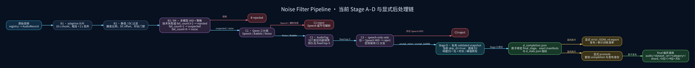
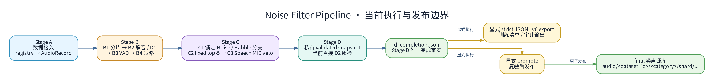

# 噪声筛选总流程



详细图由同名 Graphviz [`noise_filter_pipeline_flow_v3.dot`](noise_filter_pipeline_flow_v3.dot) 重现；文件名中的 `v3` 仅为历史命名。图中 Stage D 只写入 `d_completion.json`，随后由 completion 并列触发显式 strict JSONL v6 export 或显式 promote，只有 promote 分支进入 final，Stage D 不直接连接 final。



概览图由同名 Graphviz [`noise_filter_pipeline_overview.dot`](noise_filter_pipeline_overview.dot) 重现。跨目录的图表索引见 [`../../../docs/diagrams/README.md`](../../../docs/diagrams/README.md)；已删除的历史准入图不再作为当前入口，现行契约以这些 `.dot`、当前代码与配置为准。

## 核心准入边界

- **C1 先锁分支**：`Speech` 直接 `reject` 且不调用 C2；只有 `Noise` / `Babble` 候选进入 C2，C3 不会改变该分支身份。
- **C2 只保存固定 top-5**：模型内部计算完整 527 项 independent sigmoid 分数，但只持久化恰好 5 项 `audioset_top5`；每项精确包含 `index`、`mid`、`label`、`prob`，按 `prob desc, index asc` 稳定排序。
- **C3 只做 Speech MID veto**：无阈值、无 calibration；top-5 中任一 MID 映射为 `speech` 即拒绝，否则按 C1 分支接受。映射为 `babble` 的 MID 不参与 veto、支持或类别改写。
- **类别选择**：accepted 样本采用 top-5 中最高排名的 Noise MID；没有 Noise MID 时统一回退 `/m/096m7z` / `Noise`。
- **hard-negative**：Music（`/m/04rlf`）、Background music（`/m/025td0t`）、Inside public space（`/t/dd00127`）均按 policy class=`noise` 参与类别选择。

## 一句话总览

当前实际执行链是：

```text
Stage A 数据接入
  → Stage B unified：B1 分片 → B2 静音/DC 过滤 → B3 多模型 VAD → B4 策略过滤
  → Stage C：C1 分支锁定 → C2 fixed top-5 → C3 Speech MID veto
  → Stage D：跳过 D1 Apollo，直接执行 D2 响度归一化与质检
  → d_completion.json
      ├─ 显式 strict JSONL v6 export
      └─ 显式 promote → final/audio/<dataset_id>/<category>/shard_<5位>/<4位>.flac
```

主程序到 Stage D 为止。strict JSONL v6 导出与 promote 到 `final/` 是从同一 completion 并列启动的显式后处理，二者不互为前置；发布身份固定为 policy v4、evidence v5、parser v10、generator v6.1 与 promotion marker v4，且只绑定五项 artifact fingerprint。

Markdown 代码块中的路径占位符使用原始 `<...>`；只有写入 HTML 源码时才转义为 `final/audio/&lt;dataset_id&gt;/&lt;category&gt;/shard_&lt;5位&gt;/&lt;4位&gt;.flac`，避免浏览器把占位符解析为标签。

## 图中四个颜色区域

### 1. 蓝色：Stage A 数据接入

- 默认从便携 registry `tools/noise_filter_pipeline/config/noise.yaml` 读取 `enabled: true` 的数据集（模板路径为 `data/` 相对占位，部署时复制并改写为真实数据根）。
- 扫描音频、读取采样率/时长/声道等元信息，生成统一 `AudioRecord`。
- Stage A 将 manifest 写入正式输出根目录 `/data_nvme0n1/data/noise_filter/stage_a/a_manifest_<dataset_id>.jsonl`（per-dataset 分文件），显式 `--output` 可覆盖输出根目录；音频路径仍指向源文件。
- `--dataset` 可限定本次处理的数据集范围。

### 2. 橙色：Stage B 源音频纯化

当前 `stage_b.unified: true`，四步在统一的 in-memory 流水线中完成：

1. **B1 adaptive 分片**：按 10 秒切分，尾段短于 2 秒丢弃。
2. **B2 静音/DC 过滤**：拒绝整体静音、静音比例 `>= 0.9`、DC offset 异常或过短片段；过长静音可缩短。
3. **B3 多模型 VAD**：并行使用 Silero、FunASR、FireRed；语音比例阈值为 `0.005`。
4. **B3/B4 决策**：当前 `reject_on_any_speech: false`。正常完成时 `fail_count=0` 为 `noise`、`fail_count=1` 为 `suspected`、`fail_count>=2` 为 `rejected`；当前 B4 的 `keep_noise=true`、`keep_suspected=true`、`keep_rejected=false` 使 `noise` 与 `suspected` 进入 C1。指定 strict VAD 模型缺失、fallback 或技术失败仍直接拒绝。

Stage B manifest 会保留阶段状态用于审计；B4 保留的 `noise` 与 `suspected` chunk 进入 C1。

### 3. 紫色：Stage C 语义判定与最终准入

- **C1 Qwen**：三分类为 `Speech / Babble / Noise`。`Speech` 和不可解析输出直接 `reject`，并且不调用 C2；`Babble`、`Noise` 锁定各自候选分支。
- **C2 AudioTag**：完整 527 项分数仅在内部排序，唯一持久化事实是固定 5 项 `audioset_top5`。
- **C3 admission**：policy v4 指定 MID class；无阈值、无 calibration。任一 top-5 MID 映射为 `speech` 即拒绝，否则按 C1 分支输出 `accept_noise` 或 `accept_babble`。`babble` MID 不参与决策。

accepted category 采用 top-5 中最高排名的 Noise MID；没有 Noise MID 时统一回退 `/m/096m7z` / `Noise`。

### 4. 绿色：Stage D 质量统一与输出

当前配置 `stage_d.skip_d1: true`，因此不执行 Apollo 超分，C3 accepted 样本直接进入 D2：

- Stage D 从预检到统计全程持有 run 排它锁，strict 流式重算 C3 admission contract，并把通过验证的完整输入事务性写入短生命周期私有 validated snapshot；D1/D2 只读该 snapshot，不再重读可变的原 manifest。snapshot 不是发布清单、训练 source 或 promote 完成标记。
- 输入为空、零 C3 eligible 或零 D2 passed 时直接失败；零 D2 passed 不写 `d_stats.json`，并失效最终子阶段 `.complete`。进入 validated snapshot、strict JSONL 发布或 promote 的记录必须满足 C1 production、C2 subprocess_daemon、`publishable=true`，并通过 policy/evidence/fingerprint 复验。
- D2 检查 NaN/Inf、解码异常、零 RMS 和时长范围。
- 当前保留 `2–30` 秒音频，目标 RMS 为 `0.1`，峰值上限为 `0.95`。
- `output_sr: null`，保持原采样率；输出为 FLAC。
- Stage D/final 正式音频布局为 `audio/<dataset_id>/<C3 category>/shard_<5位>/<4位>.flac`，每 10000 条记录生成一个分片，并生成 `d_manifest_<dataset_id>.jsonl`、`d_stats.json`、`d_completion.json` 与 `.complete`。Stage D 根目录的 `d_manifest_*` 是 generator/统计聚合视图；`d_completion.json` 原子绑定 `final_stage`、exact manifest 集合及 `d_stats.json` 指纹，是 promote 的唯一完成事实。

如果未来把 `skip_d1` 改为 `false`，C3 accepted 会先进入可选 D1 Apollo，再进入独立 D2，或走 D1 内置的合并归一化路径。D1/D2 writer lock 默认最多等待 30 秒，可由 `stage_d.writer_lock_timeout` 调整。

### 发布与清理边界

- `promote_run_to_final.py` 只从 `d_completion.json` 解析绑定的 `final_stage`（D1 或 D2）与 exact manifest 集合，并复验 `d_stats.json`；Stage D 根目录 `d_manifest_*` 只是 generator/统计聚合视图，不能替代 completion。可选配置仅做一致性复验，`--force` 不能绕过完成事实。
- promote 在移动前 strict 流式预检所有 run/final manifest、compact 全局 record ID、逐条路径和内容指纹；任何路径 ancestor symlink、零候选或校验变化都拒绝发布。
- promote 同时持 run 锁与 final-root 锁，并用持久 recovery journal 记录预提交文件指纹；中断恢复时只接受仍匹配的 source，跨盘或恢复复制使用目标同目录临时文件、`fsync` 与 `os.replace` 原子发布。
- promote 成功后写 promotion marker v4；发布门禁绑定 strict schema v6、policy/evidence 4/5、五项 artifact fingerprint、最终子阶段 D1/D2、`d_stats.json`、manifest 集合、剩余 audio 树和 `final/library_stats.json`。parser v10 与 generator v6.1 在各自发布边界执行同等校验。
- 普通 residual cleanup 使用 output-root cleanup lock，并以稳定 parent dirfd 同 fd 完成 identity/年龄复验、quarantine rename 与删除；`--purge-intermediate` 使用 run/final 双锁和双树 identity/quarantine 事务校验。两者均需 marker 复验、目标阶段一致与年龄门禁。

## 关键门禁

```text
源文件
  ├─ 无法读取 / 无有效分片 ─────────────→ B rejected
  └─ 有效分片
       ├─ 静音、DC 异常、过短 ─────────→ B rejected
       └─ B2 passed
            └─ B3/B4 决策
                 ├─ 技术失败或 fail_count≥2 → B rejected
                 ├─ fail_count=1 → suspected → C1
                 └─ fail_count=0 → noise → C1
                      ├─ Qwen=Speech/解析失败 → reject（不调用 C2）
                      └─ Noise/Babble（锁定分支）
                           └─ C2 fixed top-5 → C3 Speech MID veto
                                ├─ 任一 Speech MID ─────→ reject
                                └─ 无 Speech MID
                                     ├─ Noise 分支 ──────→ accept_noise
                                     └─ Babble 分支 ─────→ accept_babble
                                          ├─ D2 质检失败 → D rejected
                                          └─ D2 passed ──→ Stage D FLAC 源库
```

## 横切保障

- 大阶段成功后才写 `.complete`；独立运行下游阶段时必须看到上游完成标记。
- Stage B/C/D 支持 per-dataset manifest、checkpoint 和断点恢复。
- checkpoint 会绑定配置与输入指纹；配置或上游输入变化后不会盲目复用旧结果。
- VAD process pool、Qwen worker pool、AudioTag daemon 等基础设施失败与内容拒绝分开处理：基础设施失败不写完成 checkpoint，并中止阶段以便重试。
- C2 dry-run 只需 `label_dict`、不需要 checkpoint，仅可用于测试；`subprocess_daemon` 需要 `label_dict`、checkpoint 与 daemon Python。
- Stage C 整次发布持有 canonical namespace lock → physical inode lock；Stage D/promote/cleanup purge 使用 stage_d run lock，promote/cleanup purge 另持 final-root lock，普通 cleanup 使用 output-root cleanup lock。

## 代码证据

- CLI 与阶段顺序：`cli/main.py`（`parse_args` / `_parse_stage_list`）、`core/stage_runner.py`（`run_stage` / `run_pipeline` 与阶段顺序校验）
- 当前配置：`config/pipeline.yaml`（`stage_b`、`stage_c`、`stage_d` 各节）
- Stage B unified：`stages/stage_b_curation.py`（`unified` 分支）与 `processors/stage_b_unified.py`
- Stage C 固定顺序：`stages/stage_c_single_event.py`（模块 docstring 与 C1→C2→C3 编排）
- Stage D validated snapshot、run 锁与零产出门禁：`stages/stage_d_enhancement.py`（`_build_validated_snapshot` / `stage_d_run_lock` / `_run_locked`）
- promote 全局预检与 marker v4：`scripts/promote_run_to_final.py`（`PROMOTE_MARKER_VERSION`）
- cleanup 动态最终子阶段：`scripts/cleanup_pipeline_temp.py`
